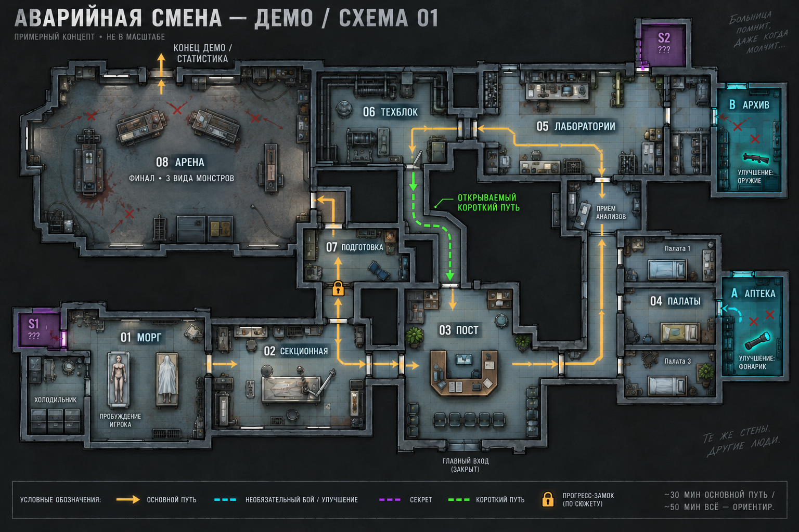

# Морг → больница → арена: схема 01

Исторический иллюстративный эскиз. Текущая рабочая версия — [редактируемая топологическая схема 03](../MorgueDemo03/README.md): подвальный морг, подъём на этаж выше, самостоятельные коридоры и осмысленные связи. Владельцу нужна системная схема без ассетов и декоративных деталей, которую можно перенести в редактор и доработать. Плотное одноэтажное соседство морга и палат на этом изображении не задаёт текущую географию демо. Изображение сохранено как история разработки, в Unity не использовалось.

Статус: исторический иллюстративный эскиз от 2026-10-16, не рабочая схема уровня. Ниже сохранено описание тогдашнего предложения, не актуальные требования. Размеры не заданы; подпись 30/50 минут обозначает цель из [концепта игры](../../../../Docs/GAME_CONCEPT.md), не результат проверки этой планировки. Наполнение комнат иллюстративное, не новый комплект игровых спрайтов.

## Как читать

Основное продвижение: **01 Морг → 02 Секционная → 03 Пост → 04 Палаты → 05 Лаборатории → 06 Техблок → короткий путь к 03 Посту → через знакомый участок 02 к 07 Подготовке → 08 Арене → завершению со статистикой**. На общей линии 02–03 предполагается движение в обе стороны. Пост — ориентир, его безопасность не задана.

- Янтарная линия — основной маршрут. Возврат после техблока позволяет использовать знакомое пространство.
- Зелёный пунктир — открываемый проход из техблока назад к посту. После визуальной проверки первой генерации под пунктир добавлены пол, стены и дверные проёмы.
- Голубые A/B — примеры необязательных боевых комнат с наградой: аптека с улучшением фонаря и архив с улучшением оружия. Количество, функции и награды не утверждены.
- Фиолетовые S1/S2 — примеры скрытых помещений; способы обнаружения и содержимое пока открыты.
- Замок перед подготовкой — предложение показать преграду заранее и получить доступ после обхода. Конкретная карта/питание/сюжетное действие не выбраны.
- Арена — отдельный просторный финал с обходом островов оборудования и тремя видами монстров. Метки подходов, состав, босс и фазы условны.

Морг оставляет место для будущего обучения; конкретных инструкций или обязательной постановки первого боя схема не задаёт. Перед финалом предусмотрен небольшой участок подготовки. Урон, боезапас, враги, проходимость и повтор боя требуют будущего теста.

Из [исследования](../../../../Docs/Research/LEVEL_DESIGN_REFERENCES.md) использованы иерархия магистрали/комнат, функциональные соседства, ответвления с ценностью и полезный возврат. Чужая карта не копировалась. Художественные надписи на изображении — часть чернового оформления, не утверждённые сюжетные факты.

Создано встроенным `image_gen.imagegen`: [исходный промпт](prompt.txt), [адресная правка](edit-prompt.txt), [происхождение и SHA-256](provenance.json). Финальный PNG скопирован из результата инструмента без дополнительной обработки. Игровые сцены, prefab, настройки и каноническая рамка демо не изменены.
