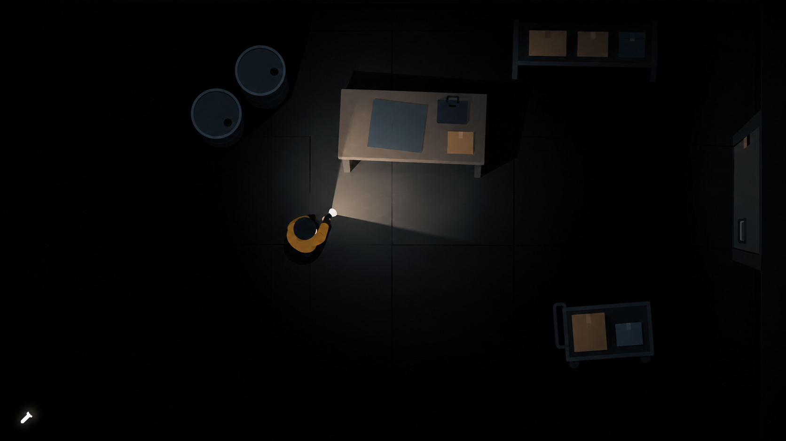
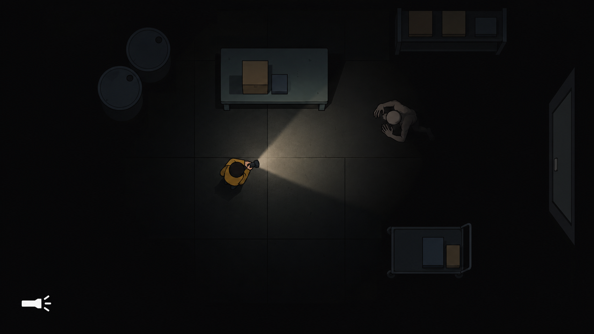
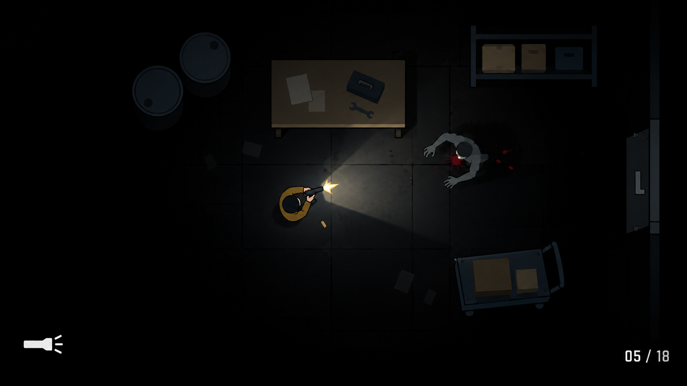
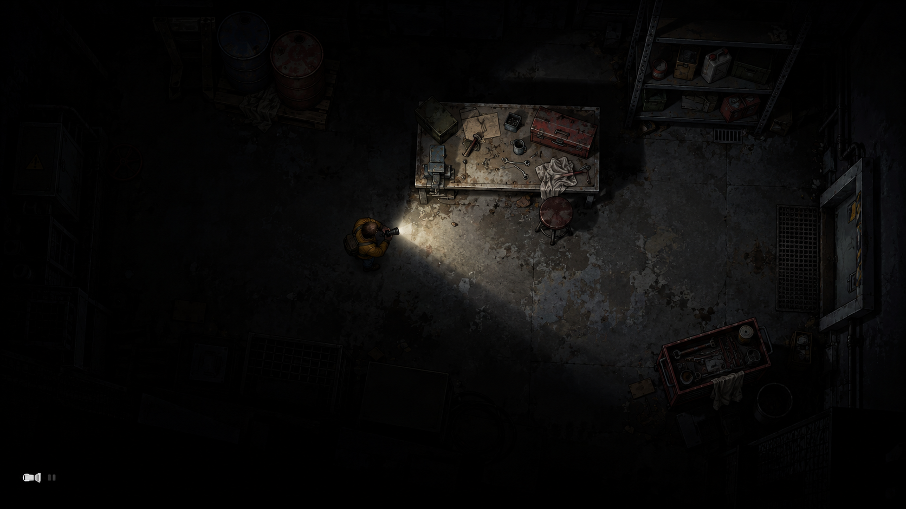
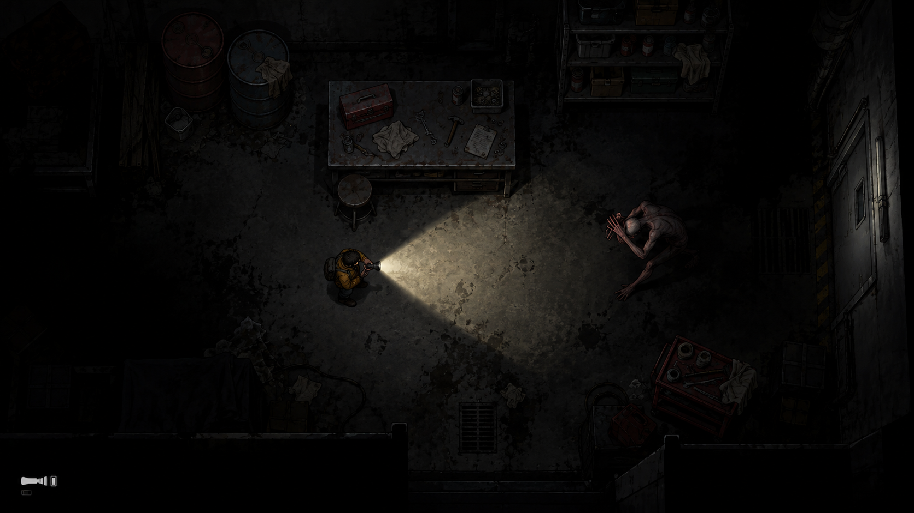
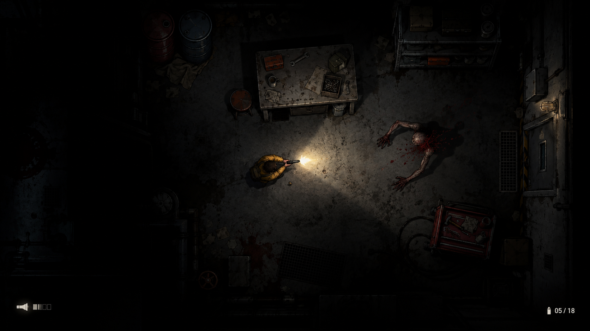
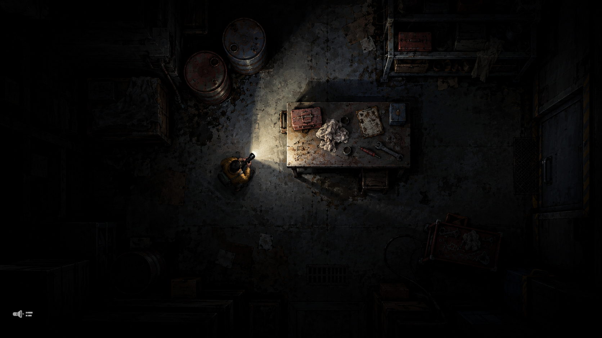
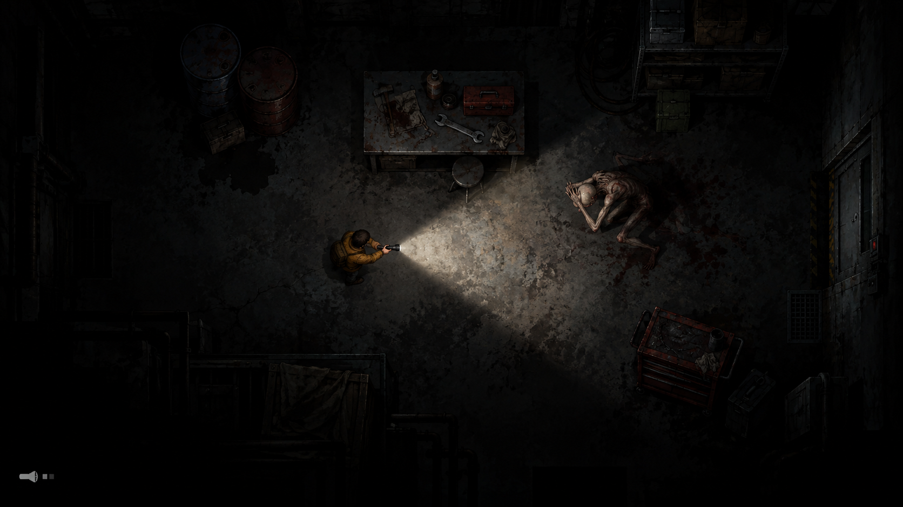
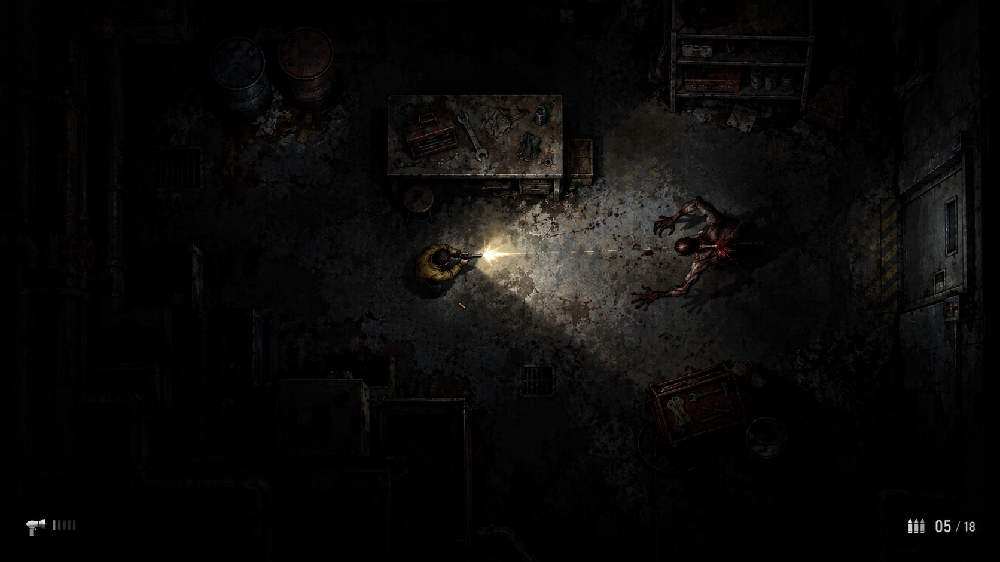

# Emergency Shift — девять визуальных концептов

[Открыть галерею](gallery.html)

Концепты для сравнения художественного направления; не игровые ассеты. Оружие — будущая механика. Второй подход показывает объём в спрайтах; сам по себе он не требует перехода на 3D.

В каждой серии: исследование → отпугивание светом → стрельба. Использован встроенный image_gen, отдельный запрос для каждого изображения. Общая планировка задана одинаково, но детали и ракурс объектов генерации различаются. Изображения не заменяют проверку освещения в Unity. Вторая и третья серии близки по направлению: у третьей сильнее фактура поверхностей, у второй более отчётливы контуры и грани.

## Плоский 2D — Исследование с фонарём



### Промпт

```text
Use case: stylized-concept. A minimalist FLAT 2D GAMEPLAY SCREENSHOT, landscape 16:9. This is the SIMPLE graphical option in a comparison with more detailed game styles.
STYLE HAS PRIORITY: extremely simple flat sprite shapes, graphic cel-like design, only 2 to 3 solid colors per object, smooth crisp outlines, clean fills. ZERO grunge texture, ZERO visible brush strokes, ZERO concrete grain, ZERO detailed tools or debris, ZERO realistic anatomy, ZERO 3D side faces, ZERO painted realistic shading. Floor is a near-black solid charcoal plane with a few broad tile seams. A table is a simple flat rectangular top; barrels are circles from above, shelf is a flat rectangle with three simple box silhouettes, trolley a flat rectangular sprite.
CAMERA HAS PRIORITY: exact 90-degree directly overhead orthographic, like a top-down map. Characters show only crown of head and compact shoulder/arm shapes viewed from ABOVE. NEVER show front-facing faces, standing upright side-view bodies, profile legs or perspective walls.
Layout: abandoned maintenance room, freestanding worktable above center, two circular barrel tops upper-left, shelf upper-right, trolley lower-right, closed flat door at right edge. Walking space around props. Player slightly left of center points toward right/up, ochre jacket, small dark circular head, compact top-down sprite about 5% screen height.
Darkness: 75% of the scene almost pure black. Short broad soft-edged flashlight illuminates only nearby floor and partial prop tops. Beam width about 80 degrees, rounded fade at far end, subtle spill near character. Never illuminate entire room or show bright strips behind occluding objects. Restrained charcoal/blue-gray/ochre colors.
ACTION: alone in center exploring, holding flashlight toward worktable. No enemy, no gun.
Minimal white flashlight icon bottom-left. No other text, watermark, labels, panel borders or collage. ONE image. The final picture must feel like a highly simplified readable 2D videogame made from clean flat sprites, not a painted realistic illustration.
```

## Плоский 2D — Отпугивание монстра светом



### Промпт

```text
Use case: stylized-concept. A minimalist FLAT 2D GAMEPLAY SCREENSHOT, landscape 16:9. This is the SIMPLE graphical option in a comparison with more detailed game styles.
STYLE HAS PRIORITY: extremely simple flat sprite shapes, graphic cel-like design, only 2 to 3 solid colors per object, smooth crisp outlines, clean fills. ZERO grunge texture, ZERO visible brush strokes, ZERO concrete grain, ZERO detailed tools or debris, ZERO realistic anatomy, ZERO 3D side faces, ZERO painted realistic shading. Floor is a near-black solid charcoal plane with a few broad tile seams. A table is a simple flat rectangular top; barrels are circles from above, shelf is a flat rectangle with three simple box silhouettes, trolley a flat rectangular sprite.
CAMERA HAS PRIORITY: exact 90-degree directly overhead orthographic, like a top-down map. Characters show only crown of head and compact shoulder/arm shapes viewed from ABOVE. NEVER show front-facing faces, standing upright side-view bodies, profile legs or perspective walls.
Layout: abandoned maintenance room, freestanding worktable above center, two circular barrel tops upper-left, shelf upper-right, trolley lower-right, closed flat door at right edge. Walking space around props. Player slightly left of center points toward right/up, ochre jacket, small dark circular head, compact top-down sprite about 5% screen height.
Darkness: 75% of the scene almost pure black. Short broad soft-edged flashlight illuminates only nearby floor and partial prop tops. Beam width about 80 degrees, rounded fade at far end, subtle spill near character. Never illuminate entire room or show bright strips behind occluding objects. Restrained charcoal/blue-gray/ochre colors.
ACTION: one gray skinny monster at beam edge on right recoils into darkness. Monster is also a tiny FLAT OVERHEAD sprite: crown of bald head, rounded shoulders, long bent arms shielding crown, hunched top silhouette, NO front-facing portrait or upright humanoid standing on the floor. No gun or shot.
Minimal white flashlight icon bottom-left. No other text, watermark, labels, panel borders or collage. ONE image. The final picture must feel like a highly simplified readable 2D videogame made from clean flat sprites, not a painted realistic illustration.
```

## Плоский 2D — Стрельба и вспышка



### Промпт

```text
Use case: stylized-concept. A minimalist FLAT 2D GAMEPLAY SCREENSHOT, landscape 16:9. This is the SIMPLE graphical option in a comparison with more detailed game styles.
STYLE HAS PRIORITY: extremely simple flat sprite shapes, graphic cel-like design, only 2 to 3 solid colors per object, smooth crisp outlines, clean fills. ZERO grunge texture, ZERO visible brush strokes, ZERO concrete grain, ZERO detailed tools or debris, ZERO realistic anatomy, ZERO 3D side faces, ZERO painted realistic shading. Floor is a near-black solid charcoal plane with a few broad tile seams. A table is a simple flat rectangular top; barrels are circles from above, shelf is a flat rectangle with three simple box silhouettes, trolley a flat rectangular sprite.
CAMERA HAS PRIORITY: exact 90-degree directly overhead orthographic, like a top-down map. Characters show only crown of head and compact shoulder/arm shapes viewed from ABOVE. NEVER show front-facing faces, standing upright side-view bodies, profile legs or perspective walls.
Layout: abandoned maintenance room, freestanding worktable above center, two circular barrel tops upper-left, shelf upper-right, trolley lower-right, closed flat door at right edge. Walking space around props. Player slightly left of center points toward right/up, ochre jacket, small dark circular head, compact top-down sprite about 5% screen height.
Darkness: 75% of the scene almost pure black. Short broad soft-edged flashlight illuminates only nearby floor and partial prop tops. Beam width about 80 degrees, rounded fade at far end, subtle spill near character. Never illuminate entire room or show bright strips behind occluding objects. Restrained charcoal/blue-gray/ochre colors.
ACTION: player fires one small pistol toward a single gray monster overhead sprite on right while flashlight points forward. Compact yellow muzzle flash at pistol barrel briefly widens floor illumination, one casing, tiny red impact. No giant explosion, no front-facing monsters. Ammo HUD bottom-right exactly '05 / 18'.
Minimal white flashlight icon bottom-left. No other text, watermark, labels, panel borders or collage. ONE image. The final picture must feel like a highly simplified readable 2D videogame made from clean flat sprites, not a painted realistic illustration.
```

## 2D с объёмом — Исследование с фонарём



### Промпт

```text
PRIMARY STYLE: stylized illustrated 2D sprites with visible volume, beveled rims, narrow side faces, richer layered props and painted highlights. The camera remains directly overhead. This should look materially deeper and more crafted than minimalist flat sprite art.
Use case: stylized-concept.
Asset type: standalone landscape 16:9 gameplay concept screenshot for the indie survival horror "Emergency Shift".
Camera: exact 90-degree overhead orthographic view, camera directly above the floor as in Hotline Miami. Show the tops of heads, shoulders and objects. NO isometric view, NO tilted camera, NO cinematic side view, NO perspective vanishing points.
Shared setting for comparison: a cramped abandoned industrial maintenance room. Gray concrete floor, a freestanding worktable just above the room center, two barrels upper left, a metal shelf upper right, a tool trolley lower right, a closed industrial doorway near the right edge. Leave believable walking gaps; do not press every prop against walls. Room continues beyond the viewport; do not show a complete brightly exposed map.
Shared hero: one small ochre-jacketed maintenance worker slightly left of image center, seen strictly from above, aiming toward the right with a slight upward angle; character height in screen about 5% of image height. The environment, not the character, dominates.
Lighting: oppressive near-black darkness covering about 70% of the view; no bright ambient room lighting. Short broad flashlight beam about 75-80 degrees, reaches only a third of the room width, with feathered edges, a rounded fading far end and subtle nearby spill so its origin is not a razor-thin triangle. Illuminate real floor and partial prop surfaces, not luminous fog floating in air. Props and closed doors block illumination consistently. No detached bright strips, impossible triangular corner wedges, or glowing surfaces behind occluders. Outside illumination objects disappear into black rather than showing the entire map.
Mood: tense, restrained, readable survival horror. Palette: charcoal, desaturated blue-gray, ochre protagonist, restrained rust red.
Minimal HUD: tiny flashlight icon at bottom left; no big title, no paragraphs, no watermark, no panel borders or collage. One complete image only.
Style/medium: carefully illustrated 2D game sprites with restrained faux volume: beveled object rims, narrow side faces on freestanding props, subtle sprite-painted highlights, layered wall caps. Keep the camera exactly vertical 90 degrees: apparent depth is in sprites, NOT an isometric camera. Crisp, readable shapes, moderate details, no realistic 3D render.
Scene/action: hero standing in the middle of the room with a handheld flashlight, inspecting the tabletop, one barrel and part of the shelving within the short beam. Remaining props are glimpsed only at the edge of the light or lost in darkness. No monster, no gunfire, no weapon. Show distinct scattered furniture shapes with enough free space to move.
Strict overhead rule applies to monsters as well: crown of head and shoulders seen from above, bent elongated arms around the small top silhouette. No standing upright front-view creature, no portrait face, no character at a different camera angle. Render a single gameplay frame.
```

## 2D с объёмом — Отпугивание монстра светом



### Промпт

```text
PRIMARY STYLE: stylized illustrated 2D sprites with visible volume, beveled rims, narrow side faces, richer layered props and painted highlights. The camera remains directly overhead. This should look materially deeper and more crafted than minimalist flat sprite art.
Use case: stylized-concept.
Asset type: standalone landscape 16:9 gameplay concept screenshot for the indie survival horror "Emergency Shift".
Camera: exact 90-degree overhead orthographic view, camera directly above the floor as in Hotline Miami. Show the tops of heads, shoulders and objects. NO isometric view, NO tilted camera, NO cinematic side view, NO perspective vanishing points.
Shared setting for comparison: a cramped abandoned industrial maintenance room. Gray concrete floor, a freestanding worktable just above the room center, two barrels upper left, a metal shelf upper right, a tool trolley lower right, a closed industrial doorway near the right edge. Leave believable walking gaps; do not press every prop against walls. Room continues beyond the viewport; do not show a complete brightly exposed map.
Shared hero: one small ochre-jacketed maintenance worker slightly left of image center, seen strictly from above, aiming toward the right with a slight upward angle; character height in screen about 5% of image height. The environment, not the character, dominates.
Lighting: oppressive near-black darkness covering about 70% of the view; no bright ambient room lighting. Short broad flashlight beam about 75-80 degrees, reaches only a third of the room width, with feathered edges, a rounded fading far end and subtle nearby spill so its origin is not a razor-thin triangle. Illuminate real floor and partial prop surfaces, not luminous fog floating in air. Props and closed doors block illumination consistently. No detached bright strips, impossible triangular corner wedges, or glowing surfaces behind occluders. Outside illumination objects disappear into black rather than showing the entire map.
Mood: tense, restrained, readable survival horror. Palette: charcoal, desaturated blue-gray, ochre protagonist, restrained rust red.
Minimal HUD: tiny flashlight icon at bottom left; no big title, no paragraphs, no watermark, no panel borders or collage. One complete image only.
Style/medium: carefully illustrated 2D game sprites with restrained faux volume: beveled object rims, narrow side faces on freestanding props, subtle sprite-painted highlights, layered wall caps. Keep the camera exactly vertical 90 degrees: apparent depth is in sprites, NOT an isometric camera. Crisp, readable shapes, moderate details, no realistic 3D render.
Scene/action: the same hero aims a handheld flashlight at a single thin, unnaturally long-limbed humanoid monster in the right half of the room, at the far edge of the short beam. Monster clearly recoils from the light: hunched posture, forearms covering its face, body leaning and stepping backward into the darkness. Show this visually without arrows or explanatory labels. Two readable characters only, no gun, no gunfire, no graphic gore. Maintain small gameplay-scale figures.
Strict overhead rule applies to monsters as well: crown of head and shoulders seen from above, bent elongated arms around the small top silhouette. No standing upright front-view creature, no portrait face, no character at a different camera angle. Render a single gameplay frame.
```

## 2D с объёмом — Стрельба и вспышка



### Промпт

```text
PRIMARY STYLE: stylized illustrated 2D sprites with visible volume, beveled rims, narrow side faces, richer layered props and painted highlights. The camera remains directly overhead. This should look materially deeper and more crafted than minimalist flat sprite art.
Use case: stylized-concept.
Asset type: standalone landscape 16:9 gameplay concept screenshot for the indie survival horror "Emergency Shift".
Camera: exact 90-degree overhead orthographic view, camera directly above the floor as in Hotline Miami. Show the tops of heads, shoulders and objects. NO isometric view, NO tilted camera, NO cinematic side view, NO perspective vanishing points.
Shared setting for comparison: a cramped abandoned industrial maintenance room. Gray concrete floor, a freestanding worktable just above the room center, two barrels upper left, a metal shelf upper right, a tool trolley lower right, a closed industrial doorway near the right edge. Leave believable walking gaps; do not press every prop against walls. Room continues beyond the viewport; do not show a complete brightly exposed map.
Shared hero: one small ochre-jacketed maintenance worker slightly left of image center, seen strictly from above, aiming toward the right with a slight upward angle; character height in screen about 5% of image height. The environment, not the character, dominates.
Lighting: oppressive near-black darkness covering about 70% of the view; no bright ambient room lighting. Short broad flashlight beam about 75-80 degrees, reaches only a third of the room width, with feathered edges, a rounded fading far end and subtle nearby spill so its origin is not a razor-thin triangle. Illuminate real floor and partial prop surfaces, not luminous fog floating in air. Props and closed doors block illumination consistently. No detached bright strips, impossible triangular corner wedges, or glowing surfaces behind occluders. Outside illumination objects disappear into black rather than showing the entire map.
Mood: tense, restrained, readable survival horror. Palette: charcoal, desaturated blue-gray, ochre protagonist, restrained rust red.
Minimal HUD: tiny flashlight icon at bottom left; no big title, no paragraphs, no watermark, no panel borders or collage. One complete image only.
Style/medium: carefully illustrated 2D game sprites with restrained faux volume: beveled object rims, narrow side faces on freestanding props, subtle sprite-painted highlights, layered wall caps. Keep the camera exactly vertical 90 degrees: apparent depth is in sprites, NOT an isometric camera. Crisp, readable shapes, moderate details, no realistic 3D render.
Scene/action: the same hero has a small pistol aimed toward one long-limbed monster on the right, flashlight still lighting along the weapon direction. Capture the instant of ONE pistol shot: compact pale-yellow muzzle flash at the actual pistol muzzle, a small nearby light burst briefly exposes parts of the surrounding floor and furniture beyond the usual beam, with much of the room still black. One spent casing nearby and a small restrained red impact spot at the monster communicate a hit. No giant explosion, no wall of fire, no long glowing laser, no gore closeup. Minimal additional ammo HUD at bottom right with exactly '05 / 18'. Keep tiny game-scale characters.
Strict overhead rule applies to monsters as well: crown of head and shoulders seen from above, bent elongated arms around the small top silhouette. No standing upright front-view creature, no portrait face, no character at a different camera angle. Render a single gameplay frame.
```

## Живописный мрачный стиль — Исследование с фонарём



### Промпт

```text
PRIMARY STYLE: expressive hand-painted horror videogame art, bold rough brushwork, scumbled distressed surfaces, imperfect organically painted shapes, subtle color variation. NOT crisp comic outlines or flat cel shading. Strong painterly material character, readable broad silhouettes.
Use case: stylized-concept.
Asset type: standalone landscape 16:9 gameplay concept screenshot for the indie survival horror "Emergency Shift".
Camera: exact 90-degree overhead orthographic view, camera directly above the floor as in Hotline Miami. Show the tops of heads, shoulders and objects. NO isometric view, NO tilted camera, NO cinematic side view, NO perspective vanishing points.
Shared setting for comparison: a cramped abandoned industrial maintenance room. Gray concrete floor, a freestanding worktable just above the room center, two barrels upper left, a metal shelf upper right, a tool trolley lower right, a closed industrial doorway near the right edge. Leave believable walking gaps; do not press every prop against walls. Room continues beyond the viewport; do not show a complete brightly exposed map.
Shared hero: one small ochre-jacketed maintenance worker slightly left of image center, seen strictly from above, aiming toward the right with a slight upward angle; character height in screen about 5% of image height. The environment, not the character, dominates.
Lighting: oppressive near-black darkness covering about 70% of the view; no bright ambient room lighting. Short broad flashlight beam about 75-80 degrees, reaches only a third of the room width, with feathered edges, a rounded fading far end and subtle nearby spill so its origin is not a razor-thin triangle. Illuminate real floor and partial prop surfaces, not luminous fog floating in air. Props and closed doors block illumination consistently. No detached bright strips, impossible triangular corner wedges, or glowing surfaces behind occluders. Outside illumination objects disappear into black rather than showing the entire map.
Mood: tense, restrained, readable survival horror. Palette: charcoal, desaturated blue-gray, ochre protagonist, restrained rust red.
Minimal HUD: tiny flashlight icon at bottom left; no big title, no paragraphs, no watermark, no panel borders or collage. One complete image only.
Style/medium: dark hand-painted 2D game art with broad brush shapes, distressed concrete, corroded metal and rough fabric. Selective expressive texture in lit areas, strong simple silhouettes in darkness, soft integrated light. Evocative indie horror screenshot, not photorealistic and not cinematic concept art with a tilted camera. Keep exact 90-degree top-down gameplay readability.
Scene/action: hero standing in the middle of the room with a handheld flashlight, inspecting the tabletop, one barrel and part of the shelving within the short beam. Remaining props are glimpsed only at the edge of the light or lost in darkness. No monster, no gunfire, no weapon. Show distinct scattered furniture shapes with enough free space to move.
Strict overhead rule applies to monsters as well: crown of head and shoulders seen from above, bent elongated arms around the small top silhouette. No standing upright front-view creature, no portrait face, no character at a different camera angle. Render a single gameplay frame.
```

## Живописный мрачный стиль — Отпугивание монстра светом



### Промпт

```text
PRIMARY STYLE: expressive hand-painted horror videogame art, bold rough brushwork, scumbled distressed surfaces, imperfect organically painted shapes, subtle color variation. NOT crisp comic outlines or flat cel shading. Strong painterly material character, readable broad silhouettes.
Use case: stylized-concept.
Asset type: standalone landscape 16:9 gameplay concept screenshot for the indie survival horror "Emergency Shift".
Camera: exact 90-degree overhead orthographic view, camera directly above the floor as in Hotline Miami. Show the tops of heads, shoulders and objects. NO isometric view, NO tilted camera, NO cinematic side view, NO perspective vanishing points.
Shared setting for comparison: a cramped abandoned industrial maintenance room. Gray concrete floor, a freestanding worktable just above the room center, two barrels upper left, a metal shelf upper right, a tool trolley lower right, a closed industrial doorway near the right edge. Leave believable walking gaps; do not press every prop against walls. Room continues beyond the viewport; do not show a complete brightly exposed map.
Shared hero: one small ochre-jacketed maintenance worker slightly left of image center, seen strictly from above, aiming toward the right with a slight upward angle; character height in screen about 5% of image height. The environment, not the character, dominates.
Lighting: oppressive near-black darkness covering about 70% of the view; no bright ambient room lighting. Short broad flashlight beam about 75-80 degrees, reaches only a third of the room width, with feathered edges, a rounded fading far end and subtle nearby spill so its origin is not a razor-thin triangle. Illuminate real floor and partial prop surfaces, not luminous fog floating in air. Props and closed doors block illumination consistently. No detached bright strips, impossible triangular corner wedges, or glowing surfaces behind occluders. Outside illumination objects disappear into black rather than showing the entire map.
Mood: tense, restrained, readable survival horror. Palette: charcoal, desaturated blue-gray, ochre protagonist, restrained rust red.
Minimal HUD: tiny flashlight icon at bottom left; no big title, no paragraphs, no watermark, no panel borders or collage. One complete image only.
Style/medium: dark hand-painted 2D game art with broad brush shapes, distressed concrete, corroded metal and rough fabric. Selective expressive texture in lit areas, strong simple silhouettes in darkness, soft integrated light. Evocative indie horror screenshot, not photorealistic and not cinematic concept art with a tilted camera. Keep exact 90-degree top-down gameplay readability.
Scene/action: the same hero aims a handheld flashlight at a single thin, unnaturally long-limbed humanoid monster in the right half of the room, at the far edge of the short beam. Monster clearly recoils from the light: hunched posture, forearms covering its face, body leaning and stepping backward into the darkness. Show this visually without arrows or explanatory labels. Two readable characters only, no gun, no gunfire, no graphic gore. Maintain small gameplay-scale figures.
Strict overhead rule applies to monsters as well: crown of head and shoulders seen from above, bent elongated arms around the small top silhouette. No standing upright front-view creature, no portrait face, no character at a different camera angle. Render a single gameplay frame.
```

## Живописный мрачный стиль — Стрельба и вспышка



### Промпт

```text
PRIMARY STYLE: expressive hand-painted horror videogame art, bold rough brushwork, scumbled distressed surfaces, imperfect organically painted shapes, subtle color variation. NOT crisp comic outlines or flat cel shading. Strong painterly material character, readable broad silhouettes.
Use case: stylized-concept.
Asset type: standalone landscape 16:9 gameplay concept screenshot for the indie survival horror "Emergency Shift".
Camera: exact 90-degree overhead orthographic view, camera directly above the floor as in Hotline Miami. Show the tops of heads, shoulders and objects. NO isometric view, NO tilted camera, NO cinematic side view, NO perspective vanishing points.
Shared setting for comparison: a cramped abandoned industrial maintenance room. Gray concrete floor, a freestanding worktable just above the room center, two barrels upper left, a metal shelf upper right, a tool trolley lower right, a closed industrial doorway near the right edge. Leave believable walking gaps; do not press every prop against walls. Room continues beyond the viewport; do not show a complete brightly exposed map.
Shared hero: one small ochre-jacketed maintenance worker slightly left of image center, seen strictly from above, aiming toward the right with a slight upward angle; character height in screen about 5% of image height. The environment, not the character, dominates.
Lighting: oppressive near-black darkness covering about 70% of the view; no bright ambient room lighting. Short broad flashlight beam about 75-80 degrees, reaches only a third of the room width, with feathered edges, a rounded fading far end and subtle nearby spill so its origin is not a razor-thin triangle. Illuminate real floor and partial prop surfaces, not luminous fog floating in air. Props and closed doors block illumination consistently. No detached bright strips, impossible triangular corner wedges, or glowing surfaces behind occluders. Outside illumination objects disappear into black rather than showing the entire map.
Mood: tense, restrained, readable survival horror. Palette: charcoal, desaturated blue-gray, ochre protagonist, restrained rust red.
Minimal HUD: tiny flashlight icon at bottom left; no big title, no paragraphs, no watermark, no panel borders or collage. One complete image only.
Style/medium: dark hand-painted 2D game art with broad brush shapes, distressed concrete, corroded metal and rough fabric. Selective expressive texture in lit areas, strong simple silhouettes in darkness, soft integrated light. Evocative indie horror screenshot, not photorealistic and not cinematic concept art with a tilted camera. Keep exact 90-degree top-down gameplay readability.
Scene/action: the same hero has a small pistol aimed toward one long-limbed monster on the right, flashlight still lighting along the weapon direction. Capture the instant of ONE pistol shot: compact pale-yellow muzzle flash at the actual pistol muzzle, a small nearby light burst briefly exposes parts of the surrounding floor and furniture beyond the usual beam, with much of the room still black. One spent casing nearby and a small restrained red impact spot at the monster communicate a hit. No giant explosion, no wall of fire, no long glowing laser, no gore closeup. Minimal additional ammo HUD at bottom right with exactly '05 / 18'. Keep tiny game-scale characters.
Strict overhead rule applies to monsters as well: crown of head and shoulders seen from above, bent elongated arms around the small top silhouette. No standing upright front-view creature, no portrait face, no character at a different camera angle. Render a single gameplay frame.
```

