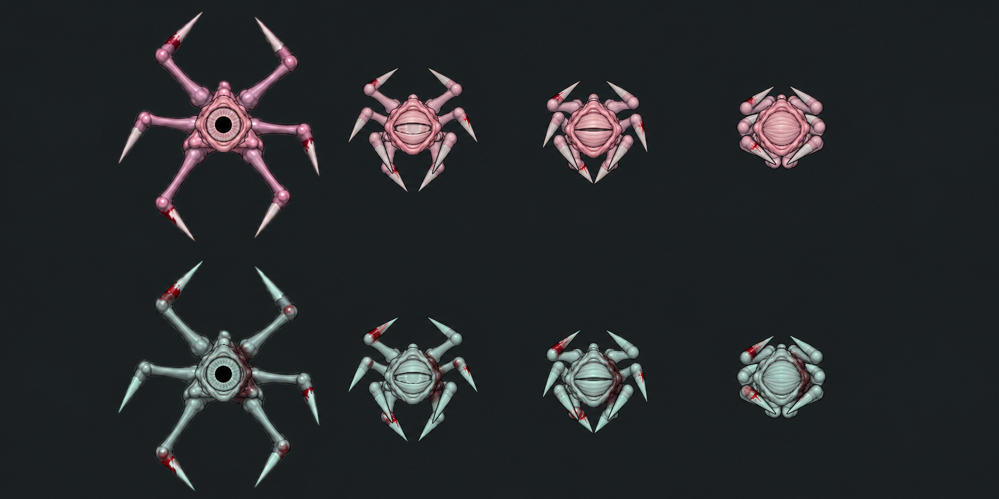

# Спящий · кровавые отметины 01

Историческая первая проба от 2026-10-17. Владелец отклонил широкую бордовую полосу, попросил отдельные подтёки и более белый глаз. Текущая интегрированная версия — [BloodMarks02](../../../Used/Sleeper/BloodMarks02/README.md). Сделана встроенным imagegen как paintover существующего сравнительного листа. В Unity не импортирована; рабочие анимационные листы прежние. Не является текущим производственным комплектом.

[PNG](preview.png) · [Полный промпт](prompt.txt) · [Исходное нативное сравнение](../../../Used/Stalker/EyeSurface05/pose-preview.png)

Верхний розовый ряд служит сравнением со Сталкером; нижний холодный ряд показывает предложение для Спящего: тёмный асимметричный мазок на боку, следы у оснований лап, больше свежей крови на костяных концах. Большая часть кожи и центральный глаз остаются читаемыми. На четырёх позах повторяется общий характер расположения пятен.

Это сгенерированный сравнительный лист, не нативный Unity-рендер и не готовый atlas кадров. Он не подтверждает точное сохранение пикселей/анатомии или непрерывность отметин во всей ходьбе, атаке и смерти. Исходные body PNG, pivots, GUID и игровое поведение не менялись. Для внедрения принятую разметку потребуется переносить по анатомическим частям на рабочий комплект с сохранением альфы и регистрации; развитие отдельного трёхчастного дизайна не возобновлялось.
