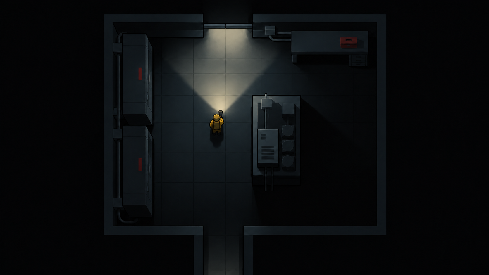
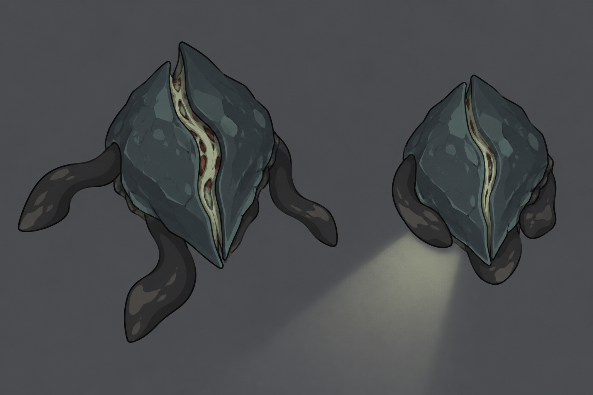

# Визуальные концепты v02

Новые варианты после уточнений: негуманоидный враг, ограниченная палитра, минимум деталей, функциональная планировка, дверь в ракурсе сверху. Сеттинг остаётся открытым.

Изображения созданы встроенным image_gen. Это концепты, не готовые игровые ассеты. Две позы монстра иллюстрируют направление анимации; последовательные кадры нужно подготовить и проверить вручную.

## Техническое помещение



### Промпт

```text
Use case: stylized-concept.
Asset type: a landscape 16:9 visual direction concept for a small achievable top-down 2D survival horror videogame.
PRIMARY VISUAL STYLE: deliberately designed flat 2D sprite graphics, clean bold silhouettes, limited palette, large geometric shapes, only 2-3 tones per object, smooth crisp contours. Quiet graphic design and purposeful composition. No painterly brushwork, no photorealism, no grunge noise, no random scattered debris, no detailed microtextures, no fake cinematic 3D rendering.
CAMERA: exact 90-degree orthographic directly above the floor, like a carefully designed floor plan. Show TOP surfaces of objects. All wall segments and furniture align to a coherent square tile grid. No isometric angle or vanishing points. Doors MUST be represented from the SAME directly overhead angle as the room: a narrow closed horizontal sliding door leaf occupying a clear gap in the top horizontal wall, flush with the wall thickness, NOT a vertical front-view door drawn onto the image.
LOCATION: an orderly utility/service room, setting intentionally neutral between a research facility and an industrial site. A small corridor enters through a gap in the bottom wall. Two large electrical cabinets run parallel along the left wall; cabinet tops are simple dark rectangular shapes. A wall workbench sits along the upper right wall, with only one toolbox. A compact equipment island slightly right of center creates two purposeful walking routes with generous clearance. A floor cable is neatly routed along the wall, no cables strewn across paths. These objects have functional placement, no randomly rotated barrels or furniture. Leave the middle-left walking area clear.
SUBJECT: a tiny top-down ochre worker silhouette in the clear central walking area, head visible as a small circle above shoulder shapes, facing the closed upper doorway, holding a flashlight.
LIGHTING: oppressive near-black room, approximately 70% of frame almost black. Flashlight is the primary light: short broad softly feathered 80-degree beam, modest nearby spill, rounded distance fade, reveals floor seams, the edge of the equipment island and part of the approach to the upper doorway. Beam must stop on opaque objects. Areas behind obstacles stay black, no detached bright strips or strange luminous corner triangles. Door panel is only partially illuminated from the floor, never glowing by itself.
COLOR: charcoal-black, slate blue-gray, muted ochre worker, one restrained desaturated red cabinet marking. Few colors and almost no surface detail. Atmosphere through darkness and geometry.
Constraints: one coherent room, one small worker, no monsters, no text, no HUD, no labels, no watermark, no collage. The final image must plausibly be built from a small reusable 2D tile and sprite set by a beginner team.
```

## Инопланетный панцирник



### Промпт

```text
Use case: stylized-concept.
Asset type: a clean visual design sheet for ONE alien monster for a small top-down 2D survival horror game, landscape composition.
Style has priority: deliberate flat 2D sprite design, bold expressive silhouette, 2-3 solid tones per part, smooth clean outlines, limited palette. No painterly texture, no photorealistic anatomy, no generic highly detailed AI fantasy rendering. Design must remain readable at small game size and be feasible to manually redraw or animate as a few separate 2D parts.
Subject: a NON-HUMANOID alien floor creature. Its main body is a low asymmetrical angular oval shield, slightly pointed toward the front, made of TWO broad overlapping carapace plates. Three short broad flattened tendrils protrude around the edges, unequal lengths; they have single simple bends and blunt tapered ends, no fingers or clawed hands. One subtle pale seam between shell plates hints at an alien soft interior. No recognisable face. NO human head, torso, shoulder anatomy, arms, legs, hands, feet, eyes or teeth. Not a biped, not a person with long limbs, not an ordinary spider, not an octopus with many complex tentacles.
Camera: exact directly overhead 90-degree orthographic for EVERY creature depiction. Show the shell top and appendages on the floor, no side view, no isometric pose.
Composition: present TWO separated drawings of the SAME creature at consistent scale on a simple solid neutral slate background. Left: resting/approaching state, shell slightly open at the seam, three simple appendages spread just outside shell. Right: recoil from flashlight, same shell silhouette compressed slightly, plates closed and the same three appendages drawn inward. A short soft wedge of pale light entering the right drawing from bottom-left communicates the cause of recoil. Do not redesign the creature between states. Plenty of empty space, shapes large enough to inspect.
Color: dark desaturated petrol-gray carapace, pale muted gray-green seam, charcoal appendages. A small restrained dark rust accent inside the seam. Tense strange biology, not cute.
Constraints: one species only, two conceptual poses, no arrows, no labels, no lettering, no watermark, no scenery, no weapons. This is a form exploration sheet, NOT a promised final animation sprite sheet. Keep only a few large shapes so a simple shell motion and bend of three parts could communicate movement.
```


## Исправление двери

Финальный вариант помещения получен редактированием первой генерации: заменена видимая лицевая панель двери на две тонкие створки в ракурсе сверху.

```text
Use case: precise-object-edit. Edit this existing top-down room concept. Change ONLY the doorway at the middle of the upper wall. Preserve the room layout, props, colors, player, flashlight, framing and all other geometry.
The current upper doorway wrongly shows a broad FRONT FACE of a door. REMOVE that front-facing rectangular panel and its handle completely. Replace it with a TRUE TOP VIEW of a closed sliding door: two narrow horizontal dark steel bars inside the existing opening, meeting at a tiny central seam. Each bar must be very THIN in screen vertical dimension, like the top edge of a solid door slab viewed directly from above. The entire door should occupy only the depth of the wall line, flush with the surrounding wall top. There must be NO tall vertical door face, NO raised front-facing facade, NO handle drawn on the surface, NO isometric door. The floor illumination can meet the thin threshold, then stop at the closed bars. Keep everything else unchanged.
```

