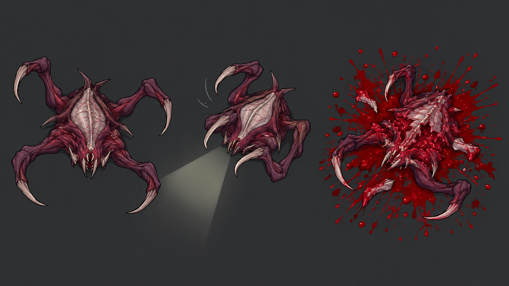

# Враг v03 — мясистый инопланетный хищник

Локации в этой итерации не рассматриваются. Предыдущий панцирник отклонён: нужен более дикий и угрожающий негуманоидный враг, чувствительный к свету. При убийстве — большой выброс крови, с аркадной выразительностью, вдохновлённой Alien Shooter.

Концепт показывает один вид в трёх состояниях: приближение, отступление от света, гибель. Светочувствительная мембрана — предложенное визуальное объяснение реакции, не дополнительная утверждённая механика. Для анимации предлагается корпус и четыре отдельных отростка; кадры и движения ещё нужно изготовить и проверить вручную.



Использован встроенный imagegen. Это поиск дизайна, не готовый игровой спрайт.

## Промпт

```text
Use case: stylized-concept.
Asset type: monster concept sheet for an achievable top-down 2D survival horror videogame. Landscape 16:9 image, three clearly separated poses of the SAME single alien species, no scenery.
Primary request: a truly wild, threatening NON-HUMANOID fleshy alien predator which fears flashlight illumination and bursts into a large amount of blood when killed. Intense visceral arcade horror energy, suitable for small top-down gameplay sprites.
Creature design: low, aggressive, irregular wedge-shaped mass of muscle and thin leathery tissue, distinctly alien proportions. Four broad hooked tendon appendages extend from its perimeter, each has one simple joint and ends in a sharp inward-curving tip; NOT arms, NOT human hands, NOT feet. Small crooked forward projections make an angular predatory silhouette. No hard oval shell, no leaf-shaped carapace, no humanoid head, no upright body, no human anatomy, no biped posture, no cute insect. A short tooth-lined slit at the FRONT EDGE of the body suggests a non-human feeding opening, integrated into the body without a separate head. Along the dorsal body a single pale exposed sensory membrane is surrounded by raw dark-red muscle; visually delicate and light-sensitive. Keep anatomy built from a FEW large readable masses, not hundreds of spikes or tentacles.
Animation feasibility: one central body sprite, four simple appendage parts and a mouth/seam detail; expressive compact silhouette that can be hand-redrawn and animated with simple joint rotations and a few manually controlled frames. No demand for elaborate gait or human skeletal animation.
Camera: directly above the floor, EXACT 90-degree overhead orthographic in ALL THREE depictions. Show back/top surface and outstretched appendages lying in the plane. No side-view standing creature, no isometric perspective, no front-facing monster portrait.
Composition: neutral solid charcoal-gray background, no rooms or setting. Three horizontal sections with substantial empty gaps, no decorative frames:
LEFT: the creature stalking, four hooks spread forward and sideways, feeding slit open, threatening directional silhouette; no external light beam.
CENTER: identical creature recoiling from a short broad pale flashlight wedge entering from lower-left. Sensory membrane partially contracts, front hooks tuck inward, body leans/turns backward away from light. SAME anatomy and appendage count as left, no shields or armor, clearly defensive aversion.
RIGHT: same creature killed and collapsed on the floor, ruptured fleshy central mass and broken pose, surrounded by a LARGE irregular saturated crimson blood splatter with outward streaks and droplets, dark-red pooled blood beneath. Show generous violent arcade-monster blood burst, a few simple alien tissue fragments only, no human body parts. Blood should spread noticeably beyond the living creature's silhouette. Do not turn this into an explosion of fire or smoke.
Style: intentionally clean flat 2D game sprite illustration, chunky sharp silhouettes, bold controlled linework, 3-4 flat tones per body part, tiny selective highlights. Restricted colors: charcoal violet flesh, desaturated pale gray-pink membrane, dark maroon muscle, vivid red blood. NO painterly grunge, NO realistic 3D render, NO glossy concept-art lighting, NO excessive surface texture. Threat through silhouette, pose and blood contrast rather than random detail.
Constraints: one creature species shown three times, not three different designs; no people, no player, no weapon, no labels, no text, no watermark, no location, no UI. This is a concept exploration, not a final animation spritesheet.
```
