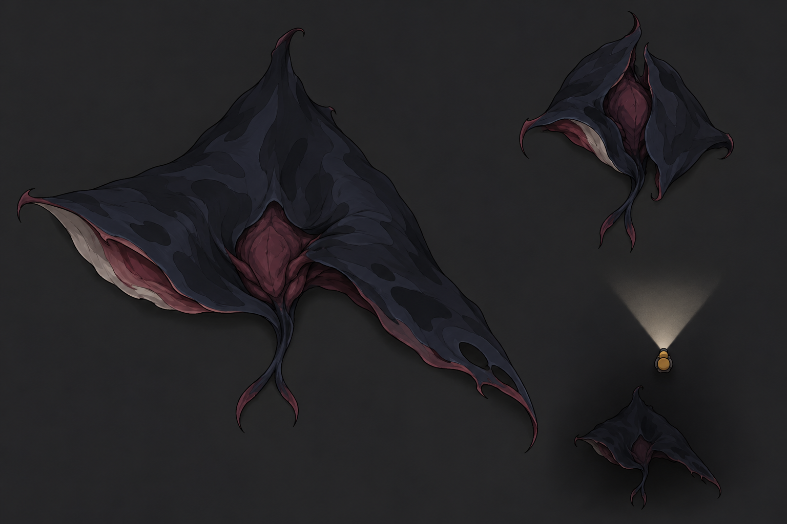
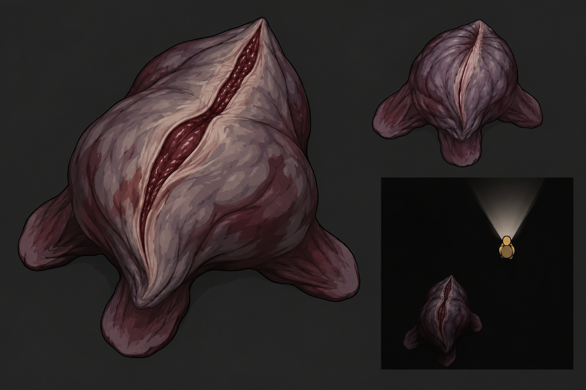
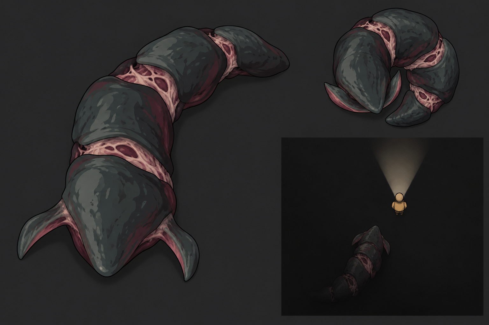

# Варианты существ v04

Поведение для всех вариантов: скрываются в темноте, подбираются сзади вне луча фонаря, при попадании под свет отступают. Негуманоидные. Локации здесь не выбираем. При последующей реализации смерти нужен обильный выброс крови.

На каждом листе: основная форма, реакция на свет и небольшая схема подкрадывания сзади. Это концепты, не готовые спрайты или проверенные анимационные кадры. Способы анимации — предложения, которые нужно проверить на прототипе.

Создано встроенным imagegen, отдельный запрос на каждый вариант.

## Теневой скат

Широкая низкая форма, скользит по полу; движутся края тела и короткий хвост.



### Промпт

```text
PRIMARY DESIGN: an alien SHADOW GLIDER, a low broad asymmetric membrane creature, like a torn triangular cloth made of living flesh. One central compact fleshy knot under a wide dark manta-like mantle; two broad uneven wing edges close to the floor, ONE short forked tail. A pale slit underside visible only at a curled front edge, no face, no eyes, no teeth display, no hard shell, no skeletal legs. Unsettling quiet movement and sudden folding lunge. Few flowing large shapes; animate core motion and the two mantle edges rather than a walking gait. Color: almost-black desaturated indigo mantle, muted wine-red underside, tiny pale gray membrane accent. Recoiling pose folds mantle edges inward over sensitive core, preserving anatomy.
Use case: stylized-concept. Asset type: creature design exploration for a feasible top-down 2D survival horror indie game. Landscape image.
Camera: strict 90-degree directly overhead orthographic for EVERY depiction; show the TOP of a creature lying low against the floor plane. No isometric view, no standing figure, no upright humanoid anatomy.
Behavior premise: the creature hides in shadow and silently approaches a player from BEHIND, outside the forward-facing flashlight. Turning the beam onto it makes it shrink/recoil and withdraw into darkness. Its silhouette and low posture should imply stealth and a sudden short lunge, rather than a giant boss or noisy charging tank.
Visual style: deliberate clean hand-designed 2D game sprite art. Broad shapes and bold silhouettes, restrained contour line, limited palette, 3-4 flat tones per part. No photorealism, no painterly grunge, no excessive microtexture, no glossy CGI, no dozens of tendrils. Preserve readability at small gameplay scale and simple manually controlled animation of a few parts.
Composition: large MAIN top-down resting/stalking pose on the left, a smaller matching top-down recoiling pose at upper right, and a small GAMEPLAY DIAGRAM-like scene at lower right. The small scene uses only a flat nearly-black floor with NO furniture or location details: a tiny ochre player marker at center-right aims a short wide pale flashlight beam UPWARD; the creature sneaks from BELOW the player, entirely outside that beam and emerging from black shadow. Put a clear gap between creature and player; no attack contact yet. The same species in all three depictions. Neutral charcoal background; no labels, arrows, text, HUD, watermark or decorative borders.
No human head, arms, hands, torso, face, feet or biped gait. No human corpses. Not a familiar Earth animal with fantasy eyes attached. Flesh rather than metal, a little muted maroon suggests a blood-filled body; no death scene needed here. This is a concept sheet, not an animation spritesheet.
```

## Угловатый ползун

Маленький корпус и три длинные опоры; замирает, затем резко меняет положение.


### Промпт

```text
PRIMARY DESIGN: an alien ANGULAR STALKER, an unnaturally thin low creature built from a SMALL triangular fleshy core and THREE long angular articulated support limbs arranged asymmetrically around it. Each limb has only one main bend and a blunt needle-like tip, NOT a hand or clawed human arm. The limbs lie splayed in the floor plane, giving a sparse broken geometric silhouette like an impossible mobile trap. No humanoid head, no insect abdomen, no ordinary spider with eight legs, no carapace-covered tank. One delicate gray-pink sensory patch sits on the central core. Quiet stealth, long pauses, then a very sudden small repositioning. Feasible to animate using three articulated limb parts. Color: dark plum limbs, bone-gray tips, dark-red compact core. Recoil folds its same three limbs close to its core.
Use case: stylized-concept. Asset type: creature design exploration for a feasible top-down 2D survival horror indie game. Landscape image.
Camera: strict 90-degree directly overhead orthographic for EVERY depiction; show the TOP of a creature lying low against the floor plane. No isometric view, no standing figure, no upright humanoid anatomy.
Behavior premise: the creature hides in shadow and silently approaches a player from BEHIND, outside the forward-facing flashlight. Turning the beam onto it makes it shrink/recoil and withdraw into darkness. Its silhouette and low posture should imply stealth and a sudden short lunge, rather than a giant boss or noisy charging tank.
Visual style: deliberate clean hand-designed 2D game sprite art. Broad shapes and bold silhouettes, restrained contour line, limited palette, 3-4 flat tones per part. No photorealism, no painterly grunge, no excessive microtexture, no glossy CGI, no dozens of tendrils. Preserve readability at small gameplay scale and simple manually controlled animation of a few parts.
Composition: large MAIN top-down resting/stalking pose on the left, a smaller matching top-down recoiling pose at upper right, and a small GAMEPLAY DIAGRAM-like scene at lower right. The small scene uses only a flat nearly-black floor with NO furniture or location details: a tiny ochre player marker at center-right aims a short wide pale flashlight beam UPWARD; the creature sneaks from BELOW the player, entirely outside that beam and emerging from black shadow. Put a clear gap between creature and player; no attack contact yet. The same species in all three depictions. Neutral charcoal background; no labels, arrows, text, HUD, watermark or decorative borders.
No human head, arms, hands, torso, face, feet or biped gait. No human corpses. Not a familiar Earth animal with fantasy eyes attached. Flesh rather than metal, a little muted maroon suggests a blood-filled body; no death scene needed here. This is a concept sheet, not an animation spritesheet.
```

## Мясной мешок

Мягкая масса с тремя короткими лопастями; ползёт за счёт сжатия тела.



### Промпт

```text
PRIMARY DESIGN: an alien BLOOD SACK, a compact low irregular soft-bodied predator with NO skeleton, NO shell and NO recognisable face. Central asymmetrical inflated muscular sack, THREE short broad muscular lobes under its edges pull it along the floor. One long off-center pale crease on its back makes its anatomy alien; dark-red tissue shows inside the crease. It should look repulsive, tense and predatory, NOT cute slime with eyes, NOT a smooth cartoon blob, NOT a screaming human face. The silhouette has 3-4 abrupt folds rather than many fine wrinkles. Suggest a slow contracting creep followed by a sudden elastic lunge. Animation feasible as a few hand-drawn deformation frames and lobe motions. Color: dirty desaturated violet-gray exterior, dark maroon folds, gray-pink dorsal crease. Recoil contracts the sack tightly and closes its crease.
Use case: stylized-concept. Asset type: creature design exploration for a feasible top-down 2D survival horror indie game. Landscape image.
Camera: strict 90-degree directly overhead orthographic for EVERY depiction; show the TOP of a creature lying low against the floor plane. No isometric view, no standing figure, no upright humanoid anatomy.
Behavior premise: the creature hides in shadow and silently approaches a player from BEHIND, outside the forward-facing flashlight. Turning the beam onto it makes it shrink/recoil and withdraw into darkness. Its silhouette and low posture should imply stealth and a sudden short lunge, rather than a giant boss or noisy charging tank.
Visual style: deliberate clean hand-designed 2D game sprite art. Broad shapes and bold silhouettes, restrained contour line, limited palette, 3-4 flat tones per part. No photorealism, no painterly grunge, no excessive microtexture, no glossy CGI, no dozens of tendrils. Preserve readability at small gameplay scale and simple manually controlled animation of a few parts.
Composition: large MAIN top-down resting/stalking pose on the left, a smaller matching top-down recoiling pose at upper right, and a small GAMEPLAY DIAGRAM-like scene at lower right. The small scene uses only a flat nearly-black floor with NO furniture or location details: a tiny ochre player marker at center-right aims a short wide pale flashlight beam UPWARD; the creature sneaks from BELOW the player, entirely outside that beam and emerging from black shadow. Put a clear gap between creature and player; no attack contact yet. The same species in all three depictions. Neutral charcoal background; no labels, arrows, text, HUD, watermark or decorative borders.
No human head, arms, hands, torso, face, feet or biped gait. No human corpses. Not a familiar Earth animal with fantasy eyes attached. Flesh rather than metal, a little muted maroon suggests a blood-filled body; no death scene needed here. This is a concept sheet, not an animation spritesheet.
```

## Складчатый червь

Четыре сегмента и две передние лопасти; тело движется волной.



### Промпт

```text
PRIMARY DESIGN: an alien JOINTED CRAWLER, a low narrow serpentine organism consisting of only FOUR chunky overlapping fleshy segments, a blunt wedge-shaped front and TWO short lateral steering fins at the front. No individual tiny legs, no dozens of segments, no conventional centipede, no reptile head, no eyes, no snake fangs or forked tongue. Strange asymmetric gaps between segments expose pale sensitive membranes. Rear segments narrower than front, body curled loosely to one side in stalking pose. A quiet creeping wave can be made by rotating four large linked sprites, then sudden forward extension for attack. It feels like an invasive thing slithering out of a gap, not a boss. Color: muted charcoal-teal flesh, pale desaturated pink seams, dark red underside. Recoiling pose curls the SAME four segments into a tight backward C shape with steering fins tucked inward.
Use case: stylized-concept. Asset type: creature design exploration for a feasible top-down 2D survival horror indie game. Landscape image.
Camera: strict 90-degree directly overhead orthographic for EVERY depiction; show the TOP of a creature lying low against the floor plane. No isometric view, no standing figure, no upright humanoid anatomy.
Behavior premise: the creature hides in shadow and silently approaches a player from BEHIND, outside the forward-facing flashlight. Turning the beam onto it makes it shrink/recoil and withdraw into darkness. Its silhouette and low posture should imply stealth and a sudden short lunge, rather than a giant boss or noisy charging tank.
Visual style: deliberate clean hand-designed 2D game sprite art. Broad shapes and bold silhouettes, restrained contour line, limited palette, 3-4 flat tones per part. No photorealism, no painterly grunge, no excessive microtexture, no glossy CGI, no dozens of tendrils. Preserve readability at small gameplay scale and simple manually controlled animation of a few parts.
Composition: large MAIN top-down resting/stalking pose on the left, a smaller matching top-down recoiling pose at upper right, and a small GAMEPLAY DIAGRAM-like scene at lower right. The small scene uses only a flat nearly-black floor with NO furniture or location details: a tiny ochre player marker at center-right aims a short wide pale flashlight beam UPWARD; the creature sneaks from BELOW the player, entirely outside that beam and emerging from black shadow. Put a clear gap between creature and player; no attack contact yet. The same species in all three depictions. Neutral charcoal background; no labels, arrows, text, HUD, watermark or decorative borders.
No human head, arms, hands, torso, face, feet or biped gait. No human corpses. Not a familiar Earth animal with fantasy eyes attached. Flesh rather than metal, a little muted maroon suggests a blood-filled body; no death scene needed here. This is a concept sheet, not an animation spritesheet.
```

