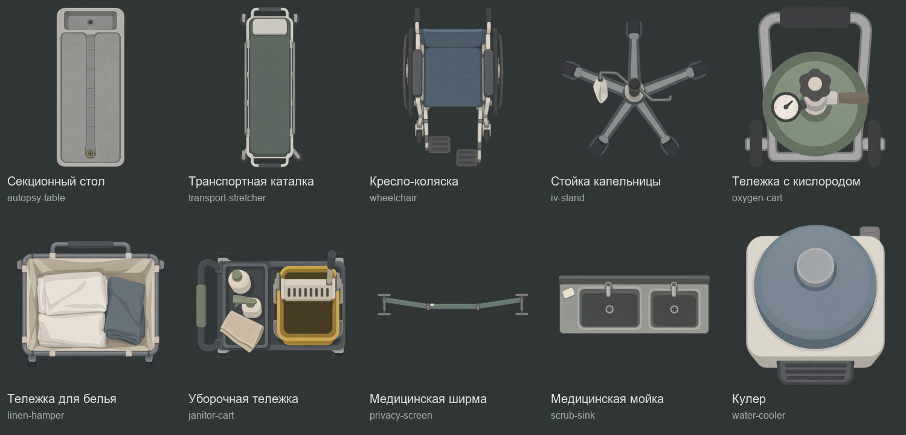

# HospitalService01 — больница, морг и служебные коридоры

Десять новых предметов в упрощённой матовой стилистике. Созданы встроенным image_gen 2026-10-19 по запросу владельца, с карточкой AccessCards01 как ориентиром по степени упрощения. Художественная оценка владельца ещё ожидается.

| ID | Предмет | Видимый размер, Unity units | Высота | Коллайдер |
|---|---|---|---|---|
| autopsy-table | Секционный стол | 0.993 × 2.3 | Furniture | box |
| transport-stretcher | Транспортная каталка | 0.834 × 2.15 | Furniture | box |
| wheelchair | Кресло-коляска | 0.634 × 1.0 | Low | box |
| iv-stand | Стойка капельницы | 0.65 × 0.604 | Tall | circle |
| oxygen-cart | Тележка СЃ кислородом | 0.48 × 0.547 | Furniture | box |
| linen-hamper | Тележка для белья | 0.8 × 0.676 | Furniture | box |
| janitor-cart | Уборочная тележка | 0.902 × 0.65 | Furniture | box |
| privacy-screen | Медицинская ширма | 1.5 × 0.218 | Tall | outline |
| scrub-sink | Медицинская РјРѕР№РєР° | 1.2 × 0.464 | Furniture | box |
| water-cooler | Кулер | 0.433 × 0.5 | Furniture | box |

Размеры относятся к непрозрачному силуэту, а не к холсту PNG. Масштаб prefab — единица; центр pivot рассчитан по видимым границам. Предметы можно поворачивать в плоскости сцены без растяжения рисунка.

## Использование

Готовые prefab находятся в Assets/EmergencyShift/Prefabs/Environment/HospitalService01. Перетащить нужный prefab в свою сцену. Материал FlatLit, физический слой Walls (8), высоты Low/Furniture/Tall, ShadowCaster2D с alpha cutoff .2. Контур ширмы повторяет её неглубокий изгиб, у капельницы круглая компактная коллизия основания, остальные коллизии — корпусные BoxCollider2D. Эти статичные предметы не добавляют использование, лечение, перемещение или иные игровые действия.

Настройки текущего расширения конечных теней подхватываются из общего FloorShadows.asset, если расширение установлено. Authoring не меняет пользовательские карты, существующие prefab и настройки теней.

Источники: Sources. Точные промпты: Prompts. Исходный наклонный кислородный баллон отклонён и сохранён в Historical; production использует исправленный вид сверху. Параметры импорта и индивидуальные особенности — import-recipes.json и provenance.json. Производственные PNG скопированы без изменения пикселей. Служебное композитирование листа не является обработкой игрового арта.

## Проверка

- [Масштаб и альфа на существующей плитке, Unity](Review/unity-scale-tile.png).
- [Освещение, Unity](Review/unity-point-light.png).
- [Нативная проверка prefab](../../../../../../Docs/Validation/HospitalService01.json).
- Отдельный общий лист показывает крупные формы и проверенные практические различия: неодинаковые подножки, повёрнутый ролик, смещённое бельё/мыло/тряпка, сменный слив и клапан, вставка на ширме.
- Интерьеры визуально непрозрачны, исходная альфа обычно 253/255. Тонкие края сглажены; фон и реальные отверстия прозрачны. Проверено настоящее RGBA-композитирование, RGB вне альфы не рассматривается как ореол.
- Полы, кровь, существующие расстановки и поведение игры не менялись. Новая playable-сцена не создавалась.

## Повторный авторинг

Emergency Shift → Art → Build Hospital Service Prefabs в остановленном Editor пересобирает только эту семью из import-recipes.json, сохраняет GUID существующих ресурсов и не открывает/не сохраняет карты. Код: Assets/EmergencyShift/Editor/Authoring/HospitalServicePrefabAuthoring.cs. Ручные изменения самих prefab при повторной сборке заменятся параметрами этого набора.
