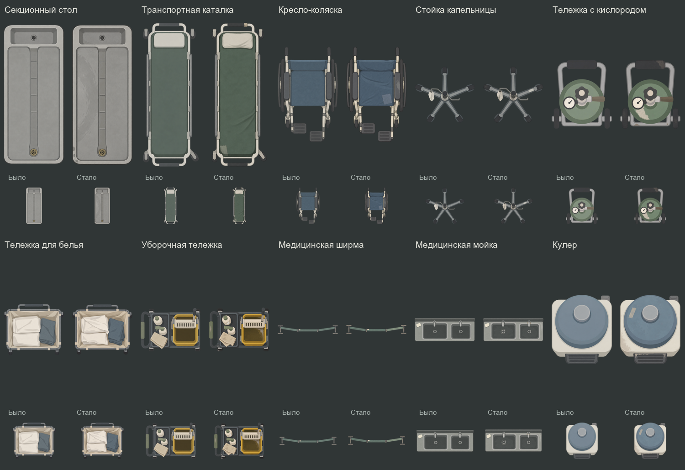

# HospitalService01 — больница, морг и служебные коридоры

Текущая версия: **Imperfections02**, 2026-10-19. Владелец счёл предыдущую версию слишком искусственно ровной. Все десять спрайтов переработаны встроенным image_gen: неровное натяжение ткани, разная укладка белья, локальные потёртости, следы протирки/налёта и ремонтные участки с разными причинами. Широкие спокойные пятна сохраняют упрощённый матовый стиль. Художественная оценка новой версии остаётся за владельцем.

[Общий лист](Review/contact-sheet.png) · [Unity: масштаб на плитке](Review/unity-scale-tile.png) · [Unity: местный свет](Review/unity-point-light.png)

| ID | Предмет | Видимый размер, Unity units | Высота |
|---|---|---|---|
| autopsy-table | Секционный стол | 0.988 × 2.3 | Furniture |
| transport-stretcher | Транспортная каталка | 0.8288 × 2.15 | Furniture |
| wheelchair | Кресло-коляска | 0.6359 × 1.0 | Low |
| iv-stand | Стойка капельницы | 0.65 × 0.6056 | Tall |
| oxygen-cart | Тележка с кислородом | 0.482 × 0.547 | Furniture |
| linen-hamper | Тележка для белья | 0.8 × 0.6642 | Furniture |
| janitor-cart | Уборочная тележка | 0.902 × 0.6532 | Furniture |
| privacy-screen | Медицинская ширма | 1.5 × 0.2233 | Tall |
| scrub-sink | Медицинская мойка | 1.2 × 0.4672 | Furniture |
| water-cooler | Кулер | 0.4348 × 0.5 | Furniture |

## Подключение

Assets/EmergencyShift/Prefabs/Environment/HospitalService01 содержит те же десять prefab; экземпляры автоматически используют новые рисунки. GUID prefab и PNG, Sprite local fileID, масштаб корней, материал FlatLit, слой Walls (8), высоты, sorting и физические коллизии сохранены. Для новой альфы через Unity пересчитаны PPU/pivot, контуры импорта и запечённые контуры освещения. Длинная сторона видимого предмета сохранена, поперечный размер изменился максимум на 2.41% из-за рисунка; физические размеры и смещения коллизий не менялись. Unity обновил только служебный кэш SpriteTilingProperty у коллайдеров.

Предметы статичны, без новых взаимодействий. Пользовательские карты, пол и кровь не менялись. Это правка больничного набора, не новая массовая миграция всей графики.

## Источники и проверенные различия

Текущие PNG — Sources, точные промпты правки — Prompts/Imperfections02. Предыдущие PNG, параметры и превью — Historical/BeforeImperfections02; базовые промпты сохранены в Prompts. Каталог, provenance.json и import-recipes.json соответствуют текущим файлам.

provenance.json перечисляет реально видимые особенности каждого предмета. Например, отдельный разворот ролика капельницы не засчитан как отчётливо различимый — проверяются видимые ремонтная окраска, втулка и пакет. Сравнение содержит уменьшенные изображения; проверялось настоящее RGBA-композитирование на сером и нативный вид на плитке, без ложных выводов из скрытого RGB прозрачного фона.

Производственные PNG — точные копии результата image_gen. Их поверхности визуально непрозрачны (исходная альфа обычно 253/255); фон и реальные отверстия прозрачны. Обработка игрового рисунка Python не применялась.

[Нативная проверка идентичности и ссылок](../../../../Docs/Validation/HospitalImperfections02.json): 10/10 prefab, сохранены коллизии/ссылки/настройки, активная сцена не стала dirty; консоль на финальной проверке пуста. Runtime/C# и поведение игры не менялись; полный повтор игровых тестов и build для этой художественной правки не запускались.

## Повторный авторинг

Emergency Shift → Art → Build Hospital Service Prefabs в остановленном Editor пересобирает только эту семью из import-recipes.json и не сохраняет карты. Код: Assets/EmergencyShift/Editor/Authoring/HospitalServicePrefabAuthoring.cs. Полная пересборка заменяет ручные параметры prefab и заново создаёт коллизии по текущему рецепту; в самой правке Imperfections02 использована замена спрайтов с сохранением прежних физических коллизий.
