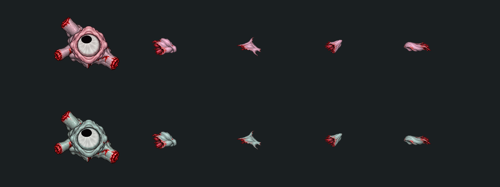

# Куски плоти: общие формы, две палитры

Рисунок этого семейства заменён [упрощённой матовой серией 01](../../Visual/SimplifiedArt01/README.md). Этот документ и прежние изображения сохраняют историю и техническую схему; актуальная детализация задаётся новой серией.

Правка 05: четыре простых обрывка мышц/кожи — короткий кусок мышцы, рваный лоскут, клиновидный обломок и плоская полоска. Формы общие, цвета соответствуют врагу: серо-розовый Сталкер и холодный серо-зелёный Спящий. Без новых органов, глаз и клубков внутренностей.

Созданы через image_gen.imagegen: [текущий промпт](Source/simple-prompt.txt), [исходник](Source/simple-flesh-sheet.png). Прежний [сложный лист](Source/flesh-sheet.png) и [промпт](Source/prompt.txt) — история отклонённой детализации.

Tools/Art/build_flesh_palettes_05.py вырезает формы, вписывает их в прежние размеры холстов и подгоняет цвет по медиане кожи из walk atlas каждого вида. Красные оборванные края сохраняются. [Палитры](palette-report.json).

Рабочие ресурсы: Assets/EmergencyShift/Art/Effects/CreatureFlesh04 — тёплая палитра; подпапка Sleeper — холодная. Старые названия сохранены ради совместимости. Размеры: MuscleWad .28, TornFlap .26, DenseClot .20, TissueStrip .25 units. Оба prefab используют прежние индексы 10–13. Геометрия и GUID тёплых native Sprite сохранены; у Спящего назначены четыре холодных спрайта. Unity: NPOT None, без mipmaps, bilinear, clamp, sRGB, FullRect, pivot .5/.5.

Ниже — нативное сравнение с корпусом: сверху Сталкер, снизу Спящий. Равномерное освещение до общего затемнения останков.

Существующие GoreProfile/GibMotion2D/RemainsRecord2D сохранены. [Композиции](../../Stalker/Remains04/README.md), [происхождение](provenance.json).
