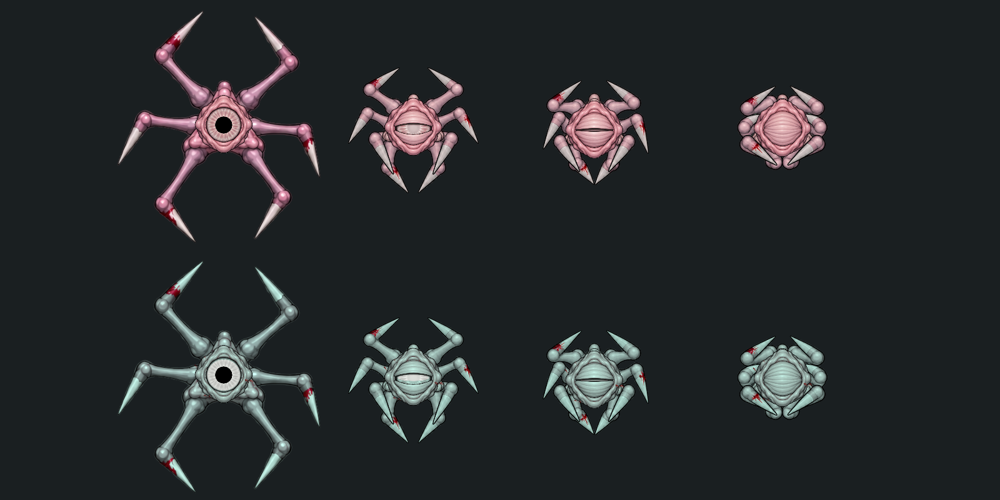
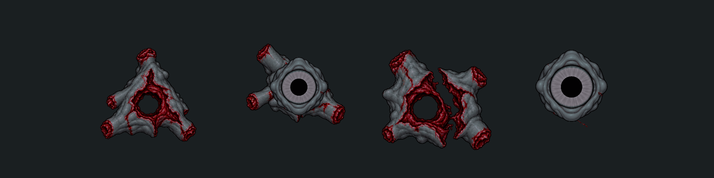

# Спящий · кровь, светлый глаз и варианты останков 02

Внедрено по запросу владельца 2026-10-17. Художественная оценка остаётся за владельцем. Рабочие ресурсы: `Assets/EmergencyShift/Art/Enemies/Sleeper/StalkerPlaceholder01` и `Assets/EmergencyShift/Art/Enemies/Sleeper/BloodMarks02`.

## Живые кадры

- Открытая поверхность глаза осветлена почти до белой; исходные волокна/тонкие вены читаются, веки остаются холодного оттенка кожи. Динамический зрачок и радужка работают как прежде.
- Вместо непрерывной бордовой полосы — несколько небольших раздельных следов у края органа, на корпусе и лапах. Сгенерированы отдельные текстуры мазков; они собраны поверх прежних кадров с привязкой к исходному глазу/позам и имеющимся кровавым концам лап.
- Обновлены пять atlas: ходьба, сжатие, атака, смерть и глаз. Шесть прежних фрагментов используют обновлённый death atlas. Размеры PNG, исходная alpha, native Sprite rect/pivot/PPU/mesh и старые GUID сохранены.

Нативное сравнение четырёх поз: сверху прежний Сталкер, снизу Спящий. Это статичные позы, не запись движения.

## Три состава останков

| Сохранённый ID | Состав |
|---|---|
| radial | Пустой корпус, один отдельно лежащий глаз, три конечности |
| heavy-close | Смятый корпус с одним глазом внутри, четыре конечности |
| scattered | Корпус с разошедшимися секциями, один отдельный глаз, четыре конечности |

Для глаз в туше и на полу использован именно игровой LargeEye01 и тот же круглый зрачок; сгенерированные трёхмерные глазные яблоки из исходной пробы не используются. Отдельный орган около .44 units по ширине и не следит за игроком. В варианте с отдельным глазом у корпуса пустая глазница. Крупная масса падает рядом; конечности получают отдельные импульсы. Выбор варианта случайный, связь с дистанцией/силой смертельного попадания пока не добавлялась.

Ниже — нативный рендер трёх новых остатков корпуса и отдельного глаза, с общим затемнением останков. Это библиотека частей; реальный разлёт зависит от импульсов.

`GoreProfile` получил необязательный состав `GorePiece`: индекс спрайта, начальное смещение, диапазон масштаба и множители импульса/подлёта. `SleeperRupture.asset` задаёт три разных набора рисунков; Сталкер сохраняет прежнюю радиальную схему. После передачи массы новым частям старое тело и его тень скрываются, отдельная туша-дубликат не остаётся. Лужа создаётся один раз прежним процедурным способом; звук CreatureRupture06 не менялся.

Части добавлены в конец prefab-массива (6–9); старые 0–5 и ID вариантов сохранены. Snapshot хранит фактические индексы, позы, цвета и положение. Проверены все три варианта, повторный Kill и тихое восстановление без нового разлёта. Новые тела/глаз не принадлежат живому AI, после оседания используют существующий RemainsRecord2D. Полное снятие исторического долга системы чекпоинтов/пулов в эту задачу не входит.

## Источники и повторная сборка

[Кровь: исходник](Source/blood-decals.png) · [Промпт крови](Source/blood-prompt.txt) · [Исходные разорванные корпуса](Source/generated-cores.png) · [Промпт корпусов](Source/remains-prompt.txt).

Оба исходника получены встроенным imagegen. Рисунок глаз в сгенерированном листе отклонён владельцем; в производстве заменён сборкой игрового органа. Скрипт `Tools/Art/apply_sleeper_blood_02.py` читает исходные PNG из Git revision e267261, переносит кровь, осветляет глаз, собирает части и проверяет неизменность alpha. Нужны Pillow и numpy. Повторный запуск не накапливает мазки. [Отчёт обработки](bake-report.json), [техническая проверка](../../../../Docs/Validation/SleeperBlood02.json).
