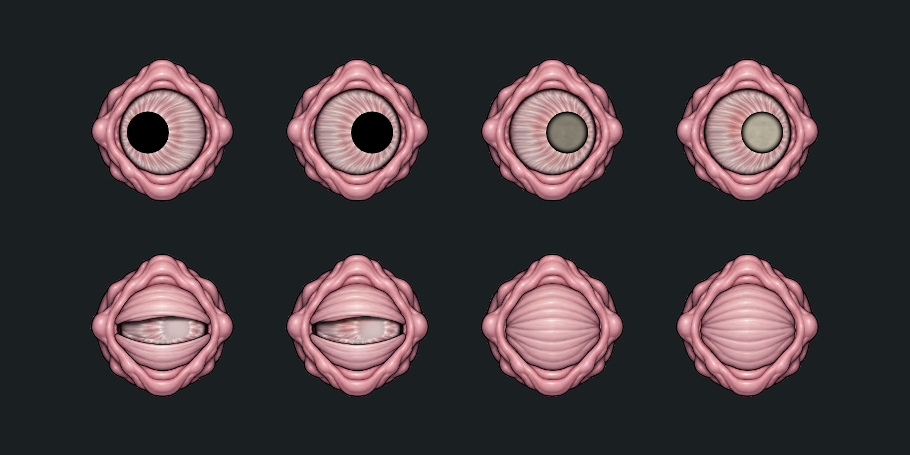
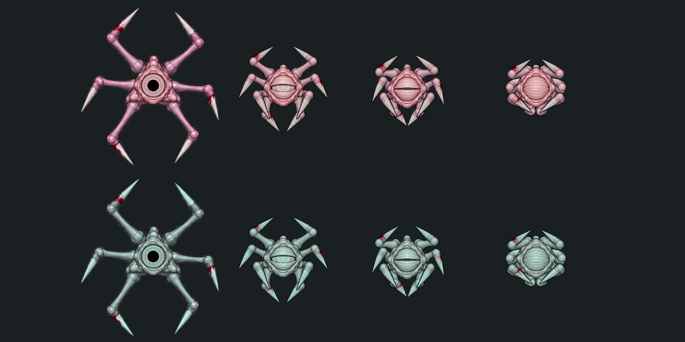

# Глаз 05 · поверхность и слежение

Текущая техническая версия, ожидает художественной оценки владельца. Исходные рисунки LargeEye01/PaleFlesh сохранены; новая генерация bitmap не выполнялась.

- Волокна открытой радужки следуют фактическому смещению зрачка в том же кадре. Край органа и веки неподвижны относительно тела.
- Накопленный ожог постепенно даёт мутный светлый зрачок с тёмным краем и небольшое локальное покраснение открытой поверхности. Он не красит кожу/подложку. Закрытое веко использует исходный цвет и обычный URP 2D свет.
- Контакт ожога: gain 0.42 вместо 0.8; предзвук 0.14 с, накопление 1.25 с, прежняя задержка страха .33/.45 с. Состояние индивидуально и сохраняется прежним snapshot.
- Один материал используется для двух слоёв и обоих видов; отдельные MaterialPropertyBlock задают gaze/дозу/стадию века/режим зрачка. У Спящего доза нулевая, перекраска кожи сохранена.

Верхний ряд: здоровый взгляд влево, здоровый вправо, 50% и 100% ожога. Нижний: полуоткрытый здоровый/повреждённый, закрытый здоровый/повреждённый. Одинаковый нейтральный свет, нативный URP; это сравнение состояний, не запись gameplay.

Параметры поверхности принадлежат `Materials/stalker-eye-burn.mat`: радиусы открытой области (.133,.126) units; aperture полувека .30, щели .025; redness .42; cloudy colour (.76,.73,.65). Геометрия маски рассчитана на четыре текущих кадра LargeEye01, другой рисунок требует настройки материала. GUID прежнего материала/шейдера сохранены.

Дополнительная правка по отзыву владельца: убрано смещение Сталкера по границам atlas; оптический центр открытому глазу задан одинаково у обоих видов. Для сжатых поз prefab содержит `eyeFrameOffsets`: (0,0), (.0410714,−.0205357), (.0164286,−.0410714), (.0472321,−.02875) units. Значения измерены по исходному глазу на теле; они переносят все слои вместе и не меняют body sprite/pivot. Повторное закрытие/открытие не накапливает сдвиг зрачка.

Верхний ряд — Сталкер, нижний — временная перекраска Спящего; четыре позы одного семейства в нейтральном свете.

История: [GradualEyeBurn04 — запись происхождения](../../../retired-sources.json) затемнял весь орган и был отклонён владельцем. Полные требования — [STALKER](../../../../Docs/Enemies/STALKER.md).
