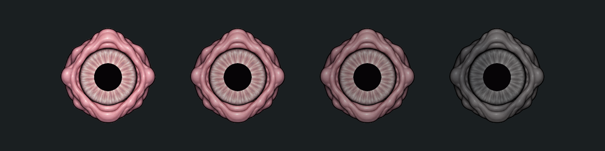

# Постепенный ожог глаза 04

Текущая реализация по запросу 2026-10-17, художественную оценку делает владелец. Без генерации/редактирования bitmap: исходный LargeEye01 и нативный URP 2D материал.

Предзвук 0.14 с → постепенная утрата насыщенности и потемнение, полная степень после 1.25 с дополнительного непрерывного освещения. Остаточное повреждение хранится на экземпляре, после ухода луча не исчезает. Полная обработка: darkening .68, desaturation .92, два неодинаковых угольных участка; исходные детали и alpha сохранены. Разные особи используют один неизменяемый материал с собственным `_BurnAmount`.

Превью: слева направо 0%, 33%, 67%, 100%; одинаковый нейтральный свет, нативный URP. Это сравнение значений, не запись поведения фонаря.

В prefab скорректирован прежний вертикальный сдвиг eye-atlas: локальное смещение −9/1160 units. Размер/ход единственного зрачка сохранены; отслеживание прибавляется к его опорной точке. Тело/его GUID и кадры не менялись.

История: EyeBurn03 — прежнее локальное покраснение, EyePresentation02 — ранняя сплошная заливка. Правила AI/сохранения — Docs/Enemies/STALKER.md.
