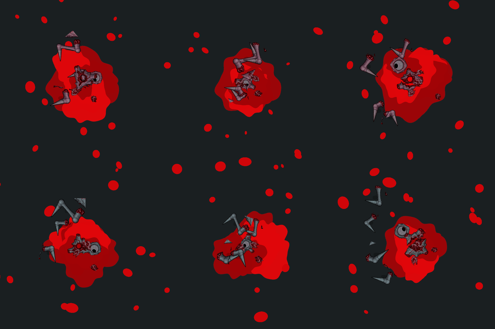

# Сталкер · варианты останков 04

Внедрено 2026-10-17 по запросу владельца. Художественная оценка остаётся за ним. Рабочая папка: `Assets/EmergencyShift/Art/Enemies/Stalker/Remains04`.

- `hollow-core`: пустой разорванный корпус, отдельный глаз, три конечности и три куска плоти — 8 частей.
- `retained-core`: корпус с глазом внутри, четыре конечности и четыре куска плоти — 9 частей.
- `split-core`: разошедшийся корпус, отдельный глаз, четыре конечности и четыре куска плоти — 10 частей.

Использованы формы трёх корпусов из [BloodMarks02](../../Sleeper/BloodMarks02/README.md), с розовой палитрой Сталкера. Красные раны сохранены; отвергнутый сгенерированный глаз заменён игровым LargeEye01. Мёртвый зрачок приплюснут и закатан вверх-влево вместе с внутренним рисунком. Тот же взгляд нанесён на четыре прежних кадра смерти. Живые atlas не меняются.

Три прежних ID Сталкера (`radial`, `heavy-close`, `scattered`) оставлены: их старое тело сохраняется, к прежним восьми фрагментам добавлены три куска плоти. Это позволяет восстановить старые останки с индексами 0–5 и исходным корпусом. Новые три ID передают массу новому корпусу и скрывают старый. Все шесть вариантов выбираются обычным случайным выбором профиля. Направление/сила попадания пока не выбирают вариант.

Общие [четыре формы плоти](../../Shared/FleshChunks04/README.md) используются обоими видами; в правке 05 рисунки упрощены и получили отдельную палитру каждого врага. В prefab новые спрайты добавлены в конец: 6–8 корпуса, 9 глаз, 10–13 плоть. Старые индексы и GUID сохранены. Размеры: корпуса .68/.68/.72 units, глаз .44; плоть .20–.28. Настройка состава, смещений, масштаба и импульсов — `StalkerRupture.asset` и `SleeperRupture.asset`; runtime хранит фактический результат отдельно от этих общих профилей.

Ниже исторические осевшие Play-снимки до упрощения плоти 05: сверху три новых состава Сталкера, снизу три состава Спящего. Это равномерно освещённое нативное Unity-превью для оценки частей. Процедурные лужи пока прежние; исправлен их порядок под тушами и фрагментами.

Сборка: `python Tools/Art/apply_stalker_remains_04.py`. Исходный death atlas читается из Git `7acb25c`; глаз берётся из текущего Stalker LargeEye01; кровь и корпуса — из записанной семьи BloodMarks02. Общая математика глаза — `Tools/Art/creature_eye.py`. Профили и prefab настраиваются в Unity. [Происхождение](provenance.json), [проверки](../../../../Docs/Validation/CreatureRemains04.json).
