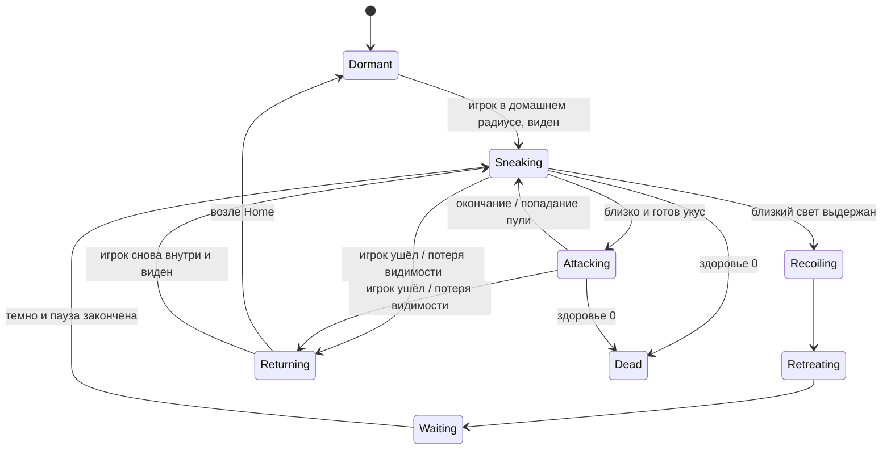

# Архитектура и устройство сцены

## Как устроена первая версия

Unity загружает сохранённую сцену. В сцене уже находятся стены, пол, игрок, дверь, камера, свет и Canvas. Компоненты C# изменяют их состояние в ответ на ввод. Расстановка объектов не зашита в игровом цикле.

```text
BasementPrototype
├─ Level — editable geometry
│  ├─ Floors: Room A, Corridor, Room B
│  ├─ Walls: экземпляры Wall.prefab
│  └─ Door — E to open: экземпляр Door.prefab
│     └─ Leaf: изображение + Collider2D + ShadowCaster2D
├─ Player — capsule: экземпляр Player.prefab
│  ├─ Rigidbody2D + CapsuleCollider2D
│  ├─ PlayerMotor2D + Flashlight2D + PlayerInteraction
│  ├─ Capsule visual
│  └─ Flashlight aim
│     └─ Flashlight beam: Light2D
│  └─ Flashlight spill — close range: слабый круговой Light2D
├─ Main Camera: Camera + CameraFollow2D
├─ Darkness — ambient 0.006: Global Light2D
└─ HUD — minimal: Canvas + PrototypeHud
   ├─ Title
   ├─ Flashlight status
   ├─ Controls
   └─ Door prompt
```

Ссылки на камеру и двери назначены конкретному экземпляру игрока в сцене. Префаб игрока хранит его внутренние компоненты; ссылки на внешние объекты принадлежат уровню. При добавлении другого уровня ссылки нужно назначить заново в Inspector.

## Ответственность компонентов

| Компонент | Делает | Зависимости |
|---|---|---|
| `PlayerMotor2D` | Читает WASD, задаёт скорость физического тела | Rigidbody2D, Input System |
| `Flashlight2D` | Направляет луч на мышь, задаёт оптику, переключает оба источника F | Камера, поворотный узел, луч и слабый ближний Light2D |
| `PlayerInteraction` | Автоподбор лута, выбор двери по E, очередь уведомлений | Массив Door2D, локальный Physics2D-запрос, IAutoPickup/IInteractable, Input System |
| `FlashlightUpgradePickup` | Наземный предмет, бонусы, доступность, отключение после подбора | CircleCollider2D-триггер, PlayerInteraction |
| `FlashlightUpgrades` | Уникальные модули игрока, пересчёт оптики от базы | Flashlight2D, PlayerLife2D |
| `Door2D` | Плавно смещает створку | Transform створки; её коллайдер и тень |
| `CameraFollow2D` | Следует за игроком | Transform игрока |
| `PrototypeHud` | Читает состояние и обновляет текст | Flashlight2D, PlayerInteraction, Text |

Поток данных: клавиатура → поведение игрока/двери → состояние → UI. UI не управляет физикой и дверью. Прямые сериализованные ссылки делают связь видимой в Inspector и не требуют поиска объектов каждый кадр.

## Почему выбрана такая архитектура

**MonoBehaviour вместо одного огромного скрипта.** Чтобы изменение фонаря не затронуло движение. Каждый файл можно изучить отдельно и снять компонент с объекта.

**Прямые ссылки вместо singleton и глобального менеджера.** На одном уровне связи простые и видимые. Когда появится смена сцен и долговременный прогресс, решим, какие данные действительно должны переживать загрузку уровня.

**Небольшие контракты под текущие действия.** IInteractable остаётся у двери/E, наземные предметы реализуют IAutoPickup. PlayerInteraction хранит ссылки на двери и локально ищет коллайдеры лута без ручного списка. Несколько вещей могут собраться за один кадр, дверь не открывается автоматически.

**Редактируемые прямоугольники вместо Tilemap в первой версии.** Сейчас нет тайлового рисунка и текстур, всего несколько крупных сегментов. Их проще двигать в Scene. При появлении повторяющейся графики комнаты можно заменить Tilemap, сохранив поведение игрока и двери.

**Поллинг ввода вместо сложной карты Input Actions.** Только WASD/F/E и мышь. Используем современный Input System, но читаем устройства напрямую. Input Actions добавим при переназначении клавиш или поддержке геймпада.

**UGUI Text вместо дополнительных UI-систем.** Нужны несколько текстовых подписей. Canvas сохранён в сцене. При расширении UI можно заменить его представление, не меняя дверь и движение.

## Редактор и игра — два разных слоя

`PrototypeSceneBuilder` создаёт ассеты и сцену один раз; находится в папке Editor и не попадает в игру. `StarterBootstrap` запускает эту первоначальную подготовку и мост MCP. Они не создают игровой уровень во время Play. Менять существующий уровень следует вручную или через MCP с последующим сохранением.

Настройка прямоугольных ShadowCaster2D использует сериализованные поля URP 17.6 в инструменте редактора. При обновлении URP их имена нужно проверить. Игровые компоненты от этих внутренних полей не зависят.

## Тени существа v0.4.3

**Заменено в v0.4.4:** по правке пользователя мягкий овал больше не используется. `CreatureGroundShadow2D` копирует текущий Sprite/поворот/масштаб Body в два рендера теней после аниматора. `CreatureSilhouetteShadow.shader` рисует только альфа-силуэт, поэтому учитывает все ноги и сохраняет пустоты между ними; RGB кожи/крови не участвует. Контактный силуэт имеет небольшой отступ/масштаб 1.04. Направленный сдвигается и слегка растягивается от фонаря; длина ограничена 1.35. Шейдер отсекает пиксели за лучом и плоскостью найденной стены.

Два кэшируемых MaterialPropertyBlock передают направление, сдвиг, растяжение и границы в общий материал без создания отдельного Material для каждого врага. Их влияние на batching и общую производительность оценить в будущем Profiler-тесте толпы. После смерти контактный рендер следует Death03, проекция скрывается. SoftGroundShadow.asset сохранён как неиспользуемый ранний вариант. Ниже описана история v0.4.3, не текущая форма теней.

У `ShadowStalker.prefab` и экземпляра сцены есть `CreatureGroundShadow2D` и соседний с Visual узел `Ground shadows`: два SpriteRenderer, `Contact shadow` и `Flashlight shadow`. Их общая текстура `SoftGroundShadow.asset` — простая процедурная радиальная форма 128×128 со сглаженным альфа-краем. FlatUnlit с чёрным цветом/прозрачностью затемняет изображение пола; новые рисунки монстра не нужны.

Контактная тень остаётся под корпусом: базовый размер 0.95×0.76, непрозрачность 0.55. Сжатие уменьшает её, бросок чуть уменьшает/ослабляет для ощущения подъёма тела. Направленная проекция проверяет `Flashlight2D.Illuminates` через явную ссылку `ShadowStalker2D.LightSource`, направляется от источника к центру существа, имеет ширину 0.6 и длину не больше 1.35. Длина ограничена концом основного луча и linecast до стены/закрытой двери. Прозрачность до 0.4, уменьшается на дальнем краю. Это условная высота низкого корпуса, не настоящая 3D-геометрия.

`LateUpdate` с порядком 30 выполняется после поворота/кадра аниматора. Тени не содержат физики, не являются источником света и не участвуют в перекрытии Light2D. Поэтому тень первого монстра не выключает освещение второго и не меняет AI. Во время смерти проекция скрывается; контактная уменьшается до 65%, ослабевает, сдвигается за кровь/останки. После 0.8 с её расчёт прекращается. Затенение отдельных оторванных кусков не добавлено.

`CreatureShadowSetup` подготавливает текстуру и сохраняет два объекта в префабе/существующей сцене. При запуске игры они не создаются заново. Инструмент не перестраивает уровень и не меняет пользовательские параметры сталкера. Нативный ShadowCaster2D в пробе затемнял следующего врага, поэтому для существа выбрана короткая декоративная проекция. Нативные тени стен/дверей работают как прежде.

## Пистолет v0.6

WeaponLootPickup реализует IAutoPickup для пистолета/коробки. PlayerInteraction локально собирает близкий доступный лут и хранит ссылку на PlayerWeapon2D. Сам предмет проверяет условия и передаёт Acquire/TryAddAmmo; после полного подбора отключается, частичная коробка сохраняет остаток. Счётчик HUD скрыт, пока HasWeapon=false; найденные раньше патроны допустимы. Никакого общего инвентарного менеджера не добавлено.

PlayerWeapon2D хранит владение/патроны/темп отдельно от Flashlight2D и PlayerLife2D. Порядок Update=20 даёт актуальное направление после Update фонаря. Внутренний Weapon aim/Muzzle сохраняется в Player.prefab. При смерти PlayerLife2D выключает оружие; TryFire тоже проверяет жизнь. R загружает исходную сцену.

BulletProjectile2D — отдельный летящий объект без Rigidbody/собственного коллайдера; CircleCast по каждому следующему отрезку в FixedUpdate выбирает ближайшую стену/живого врага. Игнорирует владельца/триггеры; максимальная жизнь 3 с и дальность 10. Linecast от игрока до дула в TryFire не даёт появиться пуле за стеной при контакте вплотную. Столкновение со сталкером вызывает TakeDamage один раз, затем эффект/удаление пули. GoreBurst не дублируется оружием.

Три ShotVisualProfile — ScriptableObject с общими данными цвета, вспышки, скорости и следа. Они читаются всеми пулями/эффектами; HasWeapon/Ammo не попадают в общий ассет. ShotEffect2D держит одноразовый Point Light/штрихи и удаляется после затухания; существующие тени стен работают. Движущийся свет только у двух профилей, маленький радиус. Пулы/производительность толпы — отдельная будущая задача.

WeaponPrototypeSetup создаёт только отсутствующие профили/префабы, подключает игрока/сохранённый HUD и добавляет именованный пистолет/две коробки. Существующие пользовательские позиции/параметры сохраняются; текущие несохранённые правки вошли в обычное сохранение сцены, не сброшены. WeaponDemoRecorder только UNITY_EDITOR и только временный объект в Play; запись не сохраняет постановку/камеру. Полный гайд — WEAPONS.md.

## Как расширять дальше

Общий концепт описан в FLASHLIGHT_AND_LOOT.md; актуальные модули/оружие — FLASHLIGHT_UPGRADE_GUIDE.md и WEAPONS.md. У лута настройки в компоненте префаба, прогресс на игроке. Общий каталог предметов, инвентарь и контрольные точки отсутствуют; ScriptableObject сейчас используется только для трёх конкретных профилей стрельбы. Состояние находки следует отделять от будущего общего описания и сохранения.

## Наземный модуль v0.5

Актуальная правка v0.8.1: FlashlightUpgradePickup автоматически подбирается и вызывает ReportPickup с названием, без чисел оптики. Бонусы применяются тем же TryInstall/SetOptics. GetPrompt/E у лута больше нет; канал HUD показывает результат очередью.

`FlashlightUpgradePickup` хранит Module Id вида улучшения, название, бонусы дальности/угла и ограничения подбора. CircleCollider2D только триггер для поиска; геометрию не блокирует. Два простых SpriteRenderer используют FlatLit, sortingOrder=0 и Z=-0.045: над полом/кровью, ниже живого SortingGroup=1. Префаб сохраняется инструментом редактора; в Play предметы не расставляются автоматически.

`PlayerInteraction` переиспользует List<Collider2D> в локальном OverlapCircle с радиусом Reach. Из доступных целей выбирает ближайшую; разница до 0.05 считается близкой и разрешается направлением взгляда. Подбор повторно проверяет досягаемость, препятствия, освещение и здоровье игрока. Дверь допускает попадание linecast в собственную створку, но не в другую стену. HUD читает CurrentPrompt и Notification.

`FlashlightUpgrades` запоминает исходную оптику в Awake. В v0.5.2 Dictionary связывает ID вида с накопленной парой бонусов; успешная повторяемая находка добавляет к сумме того же ID. InstalledCount считает все успешные находки, а не только виды. При установке результат вычисляется от базы и суммы, затем ограничивается Maximum Range/Angle. Существующий Flashlight2D применяет параметры через SetOptics, сохраняя питание; Light2D и класс компонента не заменяются. После успеха предмет collected и выключен. При Repeatable=false прежний ID отвергается; при true следующая копия усиливает фонарь. При обоих пределах предмет не тратится. Состояние не сохраняется между загрузками комнаты.

AddTwoRepeatableUpgrades сохраняет прежний GUID/путь префаба, обновляет только исходные бонусы .8/0 до .6/6 (другие ручные значения сохраняет), включает повторяемость и добавляет две именованные копии. Повторный вызов не добавляет ещё две и не перемещает сохранённые. Исходный предмет пользователя не перемещается. В сцене три модуля; база 4.2/80 не меняется.

`FlashlightUpgradeSetup` создаёт новый префаб только при отсутствии, добавляет FlashlightUpgrades в Player.prefab/существующего игрока и одну Text-подпись уведомления в сохранённый HUD. Не расставляет предметы, не пересобирает уровень и не изменяет AI/ручную оптику. Пользовательская инструкция — FLASHLIGHT_UPGRADE_GUIDE.md.

Новый предмет добавлять отдельным префабом. Новое поведение — небольшим компонентом. Для каждого расширения записывать требования в SPEC и объяснение в учебном гайде. Новые комнаты можно строить из Wall.prefab; дверь добавлять из Door.prefab и назначать в массив игрока. Перед правками остановить Play.

## Уточнение v0.2: свет, 2D/2.5D и будущие находки

Текущая симуляция остаётся 2D. 2.5D — возможное оформление поверх этой основы; настоящее освещение по высоте 3D сейчас не реализовано. Дизайн видимости и закрывающих свет препятствий важнее перехода между этими вариантами ради формы конуса.

`Flashlight2D` владеет параметрами дальности и угла и применяет их к Light2D. `SetOptics` позволяет будущей находке изменить оптику, не зная деталей рендера. Это небольшой конкретный контракт, а не готовая система улучшений. Ближний источник смягчает начало конуса и управляется тем же состоянием F.

`FlashlightRevision` — инструмент редактора для обновления существующего Player.prefab и настроек света. Он не пересобирает комнаты, не меняет позицию игрока и не выполняется при Play. Для уже обновлённой сцены запускать его повторно без необходимости не нужно: это вернёт оптику к базовым значениям 4.2/80.

Требования ключа/кода позднее следует держать отдельно от перемещения створки. Детали маршрута, размещения находок и видимости текстовых подсказок описаны в `GAME_DIRECTION.md`. Пока `PlayerInteraction` по-прежнему вызывает свободное открытие тестовой двери.

Для непрозрачных стен/дверей включено самозатенение: оно предотвращает лишние освещённые выступы на пересечении контуров. Смещение источника 0.18 меньше минимальной полуширины коллайдера игрока 0.28; источник не оказывается внутри соседней стены. Проверки временных поз выполняются только в Play и не должны сохранять тестовые позиции в сцену.

## Сталкер и бой v0.4

Уточнение v0.4.2: `StalkerPaletteRevision` копирует данные нового Sprite в существующий ассет через CopySerialized, сохраняя GUID/fileID. Все анимации, префабы останков и GoreBurst продолжают ссылаться на те же ассеты. Рабочие четыре листа и измеренная раскладка лежат в `Art/Stalker/PaleFlesh`; старые PNG сохранены как предыдущая версия. Редакторский инструмент не меняет параметры AI или расстановку.

`RemainsVisualStyle` — небольшой общий статический класс с данными визуального представления: цветовой множитель, порядок отрисовки и смещение поверхности. Его используют аниматор при гибели, GoreBurst для кусков и редактор тестовых трупов. Это правило внешнего вида, не глобальный менеджер врагов. Живой SortingGroup=1, останки=0; Z=-0.03 сохраняет их над полом/лужей при равном порядке 0.

`GoreBurst2D.Play` создаёт лужу сразу в вызове Kill, а затем запускает корутину для кусков с задержкой 0.12 с. Новый seed меняет внутренние пятна/капли, общий размер дополнительно меняется в пределах 0.85–1.18 от poolSize. Флаг emitted предотвращает повторный эффект. Кровь не получает затемняющий множитель тела.

```text
Stalker — six legs (экземпляр ShadowStalker.prefab)
├─ Rigidbody2D + CircleCollider2D
├─ ShadowStalker2D — состояния, движение, свет, атака и окончательная гибель
├─ StalkerSpriteAnimator — кадры и взгляд
├─ GoreBurst2D — одноразовый выпуск эффектов
└─ Visual / SortingGroup
   ├─ Body — SpriteRenderer
   ├─ Eye iris — перекрывает исходный статический зрачок
   └─ Eye pupil — отдельный SpriteRenderer с ограниченным смещением

Player
└─ PlayerLife2D — здоровье, остановка при поражении и перезапуск

Эффекты, возникающие при гибели
├─ BloodPool.prefab / BloodPool2D — независимая лужа и капли
└─ Stalker fragment / GibMotion2D — независимый кусок с затухающим движением
```

`ShadowStalker2D` управляет жизненным циклом одного врага. `StalkerSpriteAnimator` читает его состояние и выбирает спрайт; представление не принимает решения AI. Здоровье игрока и состояние его ввода принадлежат `PlayerLife2D`. HUD только отображает данные. Смерть врага останавливает физику/AI и запускает `GoreBurst2D` один раз.

`Flashlight2D.Illuminates` использует тот же основной луч: включение, дальность, угол и linecast через слой `LightObstacles`. В слой помещены коллайдеры стен и закрытой створки; их визуальные тени продолжают работать. Слабая подсветка у ног не является защитой. Собственная дистанция страха врага и время непрерывного освещения проверяются отдельно: быть видимым ещё не значит немедленно испугаться.

Первый AI не использует навигационный пакет. Он выбирает точку за спиной игрока, проверяет прямую видимость и пробует несколько направлений обхода препятствия. Это подходит для двух простых комнат, но не является полноценным поиском пути по большому этажу. При расширении уровня добавлять маршруты/навигацию по конкретным проблемам.

Кадры хранятся отдельными Sprite-ассетами, ссылающимися на исходные PNG. Нарезка задана индивидуальными Rect и pivot, без перерисовки правильного исходника. Боевая раскладка описана в `CombatFrameLayout.json`; первая/последняя позы атаки используют настоящий готовый кадр ходьбы. Точный контракт качества — `ANIMATION_REFERENCE.md`.

Лужа создаётся независимо от трупа: семь неровных пятен и четырнадцать капель с seed, разным размером и поворотом. Куски используют спрайтовые части погибшего существа; их движение проверяет стены, затухает, затем компонент выключается. Другой враг может использовать тот же эффект с другими фрагментами. Следы остаются до перезагрузки сцены. Оптимизацию для большого числа трупов следует оценить при появлении соответствующей нагрузки.

### Редактор и запись

`StalkerCorpseSetup` создаёт только в редакторе четыре тестовых трупа из `StalkerRemainsTest.prefab`. У них нет AI и физики: последний кадр смерти, восемь неподвижных кусков и вложенный BloodPool. Лужи получают фиксированный seed при подготовке; результат записывается в сцену. В Play не нужна генерация или повторный вызов смерти. Отдельная группа позволяет удалить тестовую расстановку, не затрагивая живого врага. Художественные варианты останков описаны как будущее требование в `ENEMIES.md`.

`StalkerSceneSetup` добавляет/обновляет врага, не перестраивая уровень и не сбрасывая его пользовательскую позицию. `StalkerCombatSetup` импортирует атаку/гибель, добавляет жизнь игрока, ссылки HUD и префаб крови. `StalkerDemoTools` настраивает размер Game View.

`StalkerDemoRecorder` находится среди Scripts, чтобы его можно было добавить в Play; весь файл закрыт `UNITY_EDITOR`, в нём нет ссылок на UnityEditor, в сборку он не попадает. Компонент создаётся только временно для записи. Он задаёт движение капсулы и направление фонаря, а настоящие AI, физика, анимации, здоровье и кровь работают в Unity. Тестовая подсветка, отключение ранних атак и тестовый урон перечислены в отчёте записи. В конце восстанавливаются настройки; после выхода из Play сцена возвращается к сохранённым данным.

## Разрыв тела и вспышка v0.6.1

GoreBurst2D создаёт BloodPool и BloodRuptureBurst2D один раз. Лужа существует сразу при Dead; BeginRupture растит её пятна и откладывает видимость постоянных капель до прибытия летящих штрихов. BloodRuptureBurst читает те же цели: после короткого выброса не оставляет вторую копию декалей. Старые статические тестовые трупы используют только Initialize.

GibMotion2D хранит floorPosition отдельно от height/verticalSpeed. XY проверяет стену CircleCast; условная высота меняет масштаб/контактную тень без наклона камеры. После первого контакта с полом остаётся 16% скорости, один небольшой отскок и сильное трение. Settle обнуляет скорость, возвращает затемнение и отключает Update. Так визуальная энергия выброса не превращается в скольжение по полу.

ShotEffect2D: три слоя пламени, белое ядро, четыре разлетающиеся искры, временный Light2D с удержанием пика 25% длительности. Shapes/MuzzleFlame.asset содержит геометрическую маску с прозрачным сглаженным краем; создаётся редактором, не генератором изображений и не в Play. CombatEffectsRevision обновляет ссылки/ассеты без пересборки сцены и без сброса пользовательских параметров AI.

## Контролируемая угроза и обратная связь v0.6.2



Dead доступен из любого живого состояния, включая Dormant/Returning/страх; стрелки сокращены для читаемости. Значения существующего enum сохранены, новые состояния дописаны в конец. Home — поле экземпляра, не static. Гистерезис .6 предотвращает переключение на границе; потеря видимости имеет выдержку 1.2. Поиск пути остаётся местным, без NavMesh/менеджера толпы.

BulletProjectile вызывает ApplyBulletHit(amount, point, direction), затем удаляется. ShadowStalker применяет здоровье/Dead, ограниченный stagger и прерывание укуса. StalkerHitResponse держит .16-секундную деформацию/цвет корпуса и запускает BloodHitSpray2D. После смерти восстанавливается именно затемнённый цвет, реакция не перезаписывает постоянный стиль останков. Обычное попадание в стену использует ShotEffect; кровь не дублирует большой GoreBurst.

Flashlight Update получает мышь, передаёт цель в AimTowards: SmoothDampAngle с отдельной angularVelocity, ограничением 720°/с и мёртвой зоной .25. Сценарное AimAt явно сбрасывает angularVelocity. PlayerWeapon в Update20 читает уже вычисленный фактический угол. Камера в LateUpdate сглаживает позицию игрока, а не мышь.

TransientGlow — общий аддитивный материал только временной вспышки. Реальное освещение остаётся Light2D, со стеновыми тенями. PlayerShotShadow2D получает ссылку на конкретный light при TryFire, синхронизирует альфа-силуэт капсулы и fade с интенсивностью, ограничивает проекцию длиной/стеной/радиусом. Используется существующий силуэтный шейдер и один кэшированный MaterialPropertyBlock, не поиск всех источников каждый кадр. После удаления света рендер выключен. Это приближение для плоской камеры; не решает общую задачу взаимных теней нескольких источников.

## v0.7 — локальный свет и разделение высоты препятствий

Туман войны/память карты удалены по последнему запросу: нет отдельной маски и копий освещённой геометрии. Light2D освещает реальные SpriteRenderer. Boundary guide — сохранённый ребёнок стены/створки, использует существующий TransientGlow.mat как слабую аддитивную подложку границы; движется вместе с дверью. Пол этим материалом не покрывается.

LocalLamp2D владеет Point Light2D и индикатором лампы: параметры сериализованы, Awake/OnValidate применяют настройки, Update у мигающих ламп меняет интенсивность. OnEnable/OnDisable регистрируют доступные лампы в коротком списке; AnyIlluminates проверяет дистанцию, яркость и прямую видимость. PlayerInteraction.IsCurrentlyLit объединяет фонарь, этот список и краткие активные ShotEffect2D. Оба типа лута используют общий путь; страх врага по-прежнему читает только фонарь. Глобальный менеджер света не нужен для шести объектов.

Layer8 — высокие непрозрачные препятствия с ShadowCaster, layer9 — низкие физические без него. BulletCollisionMask включает9, обход сталкера/разлёт кусков учитывают9. LOS и оптика читают8. Это условность строго верхнего 2D вида, не расчёт высоты в 3D. SortingGroup живых/останков не заменяет физические слои.

LightingPlaygroundSetup работает только в Editor, сохраняет именованные экземпляры/префабы, существующие позиции не перестраивает. Place сохраняет исходный Z префаба. LightingDemoRecorder существует только при UNITY_EDITOR и добавляется временно в Play; заморозка/камера записи не попадают в сцену. Подробная схема стенда — LIGHTING_PLAYGROUND.md.

## v0.7.1 — история; возврат/забывание заменены v0.7.2 ниже

ShadowStalker2D остаётся единственным владельцем BehaviourState. Patrolling дописан в конец enum, сохранив числовые значения прежних состояний. В Awake контроллер передаёт Home компоненту StalkerPatrol2D. Когда игрок вне круга/прямой видимости, включённый Patrol Enabled разрешает Step; выключенный возвращает к Home/Dormant. При обнаружении маршрут сбрасывается, управление получает прежний боевой цикл. Потеря цели ведёт через Returning к выбранному мирному режиму.

StalkerPatrol2D не имеет самостоятельного Update/FixedUpdate: его Step вызывается только в Patrolling. Хранит spawn-якорь, world AABB, следующую точку и таймеры. Выбор до12 кандидатов с CircleCast всего пути; затем проверки следующего шага, прогресса и ограниченная пауза. Паддинг учитывает радиус/масштаб коллайдера, слои8|9. Прямоугольник не следует за transform в Play. Невалидная область не двигает тело, вытолкнутый патрульный возвращается домой. Нет навигационного сервиса, NavMesh или аллокации маршрута каждый кадр.

StalkerSpriteAnimator включает Patrolling в обычную ходьбу/поворот; боевые кадры не меняются. StalkerPatrol2DEditor использует BoxBoundsHandle поXY и SerializedObject/Undo, данные остаются в сцене/префабе. Это локальный обход свободных отрезков, не маршрут по лабиринту.

## v0.7.2 — постоянная агрессия; актуальная схема вместо Returning выше

ShadowStalker2D хранит runtime HasAggro отдельно от текущей позы/страха. Проксимити+LOS или ApplyBulletHit устанавливают его один раз; обычный Enter состояния не сбрасывает. Поля noticeDistance/leaveMargin/loseSightDelay и таймер забывания удалены. Detection Radius использует сохранённое имя habitatRadius, отображаемое иначе через InspectorName, поэтому значения/overrides не потеряны. Home остаётся только якорем необязательной области патруля, не точкой возврата. TargetDead останавливает движения при смерти игрока, Dead имеет высший приоритет. Старый Returning зарезервирован числом7, нигде не выбирается.

Dormant/Patrolling → Sneaking при первом обнаружении. Sneaking/Attacking → Recoiling → Retreating → Waiting → Sneaking при HasAggro. Если свет напугал до обнаружения, Waiting возвращается к Dormant/Patrolling на текущем месте. Мирный Step вызывается только без активной погони; UsePatrolArea задаёт лишь выбор точек, свободный режим выбирает короткий шаг относительно текущего тела. Префабы/области сохраняются, runtime-уровень не строится.

StalkerChasePath2D — обычный C# helper одного врага, не второй MonoBehaviour/владелец движения. Прямой CircleCast сначала обходит поиск; при блокировке bounded A* по4 соседям, cell0.6, окно между целью/телом+4, максимум4096клеток/1536расширений, повтор не чаще .65–.77с. OverlapCircle кэшируется на время одного поиска, переходы проверяются CircleCast, доступные участки пути сглаживаются прямой видимостью. Нет пути — скорость0 с сохранённой агрессией и поздней попыткой. Это ограниченный прототип; большие лабиринты/10–20 одновременных поисков не профилированы.

Страх пока читает Flashlight2D напрямую. Будущий флаер потребует выделить описание опасного светового источника: позиция/радиус/время/LOS/политика отпугивания. Обычная лампа не становится угрозой автоматически. Никакой пустой универсальной системы/броска флаера этим этапом не добавлено.

## v0.8 — архитектура звука

StalkerAudioSet — один ScriptableObject с49 ссылками/13 группами и общими бюджетами. StalkerAudio2D — поведение на каждом враге, явные ссылки на набор/два AudioSource+LowPass. Подписки OnEnable/отписки OnDisable, ограниченные каналы через clip/Play вместо накопления PlayOneShot. Небольшой статический список компонентов нужен только для лимитов; отдельного менеджера/singleton нет.

ShadowStalker2D остаётся владельцем State/здоровья/таймингов. Добавлены уведомления StateChanged, Damaged, AttackLunged(.25), AttackResolved(.42, результат TakeDamage). Урон/переходы не перенесены в звук. Windup/реакции прерываются фактическими событиями; нет корутин с отложенным укусом. Реальный пройденный путь задаёт частоту ног; локальный RNG не меняет случайность AI/крови.

GoreBurst2D публикует выпущенный GibMotion2D, тот публикует FirstLanded только на первом ударе. Аудиокомпонент снимает подписку после события и ограничивает посадки3/.09с. На кусках нет звуковых источников.

Пространство: ручные XY gain/pan до Player, AudioSource SpatialBlend0, listener на камере. Проверка высоких преград.15с, плавные gain/LowPass. Это прямое приближение, не комнатная акустика. Shared set задаёт8 доступов движения/2 quiet/3 death с предпочтением ближних смертей.

StalkerAudioSetup сохраняет реальные ссылки/детей в префабе, существующие ссылки/asset/AI не сбрасывает; один listener добавляется только если отсутствует. Не выполняется при запуске игры. Все7 существующих экземпляров наследуют префаб. Статические трупы не менялись.

В production оставлены генератор membrane_v04, stalker_membrane_dsp и2 исходных quiet-эталона в Tools/Audio/Reference;49 WAV воспроизводятся точно после удаления старых проб. Python/NumPy2.3.5 — инструмент производства, не зависимость Unity. Подробный гайд — STALKER_AUDIO.md.

## Автоподбор и оружейное аудио v0.8.1

PlayerInteraction.Update → CollectNearbyLoot/OverlapCircle → IAutoPickup.TryCollect. WeaponLootPickup меняет PlayerWeapon2D (владение/патроны), FlashlightUpgradePickup меняет FlashlightUpgrades. Успех → ReportPickup → очередь HUD и ItemCollected → PlayerAudio2D. У двери остаётся отдельный IInteractable/E. Коллизия не сама вызывает эффект: локальный поиск ограничивает центры предметов, CanReach проверяет линию/жизнь/дистанцию, а предмет проверяет собственную однократность/лимиты. Частичная коробка хранит остаток в своём runtime-cartridges.

PlayerWeapon2D публикует ShotFired и SurfaceHit. Пуля передаёт collider/точку реального ближайшего попадания до применения урона; заблокированное дуло сообщает то же событие без пули. PlayerAudio2D разрешает ImpactMaterial через компонент цели/родителя; fallback Concrete, для Stalker Flesh. Активный StalkerAudio2D владеет своим hit/death, generic Flesh не накладывается повторно.

PlayerAudioSet — общие массивы клипов, отдельный PlayerAudio2D — подписки/RNG/каналы/громкость и временный флаг combatAudioEnabled. На Player/Audio сохранены Pickup, Shot, Impact1–4; runtime не строит аудиообъекты. Четыре занятых impact-канала пропускают лишний клип. 2D-проигрывание, для импакта ручная XY-панорама/дистанция до16. Сложной акустики комнаты и задержки распространения нет. Источники на игроке ограничены, это не имитация отдельного AudioSource в каждой точке стены.

PlayerAudioSetup — одноразовое редакторское назначение. Уже назначенный set/ссылки/поля сохраняет, уровень/AI не пересобирает. Combat Audio Enabled=false в сохранённой сцене: звук подбора работает, оружейные кандидаты только для оценки. Офлайн NumPy-генератор готовит17 WAV и4 монтажа; мясные клипы переиспользуют утверждённые ссылки. Гайд — AUTO_PICKUP_AND_WEAPON_AUDIO.md.

## Реалистичные пробы оружия/гильз v0.8.2 — без runtime-изменений

По новому требованию реализм звучания важнее соответствия пиксельной графике. Прежний процедурный кандидат пистолета отклонён, Combat Audio Enabled по-прежнему false. Новые4+2 монтажа хранятся в Docs/Audio/WeaponRealism02, источники/CC0/SHA в Sources/sources.json, производственный скрипт Tools/Audio/prepare_weapon_realism_studies.py. Это файлы для выбора, не импортированные игровые ассеты. Никакого нового аудиоменеджера/класса/физики гильз этим этапом не добавлено.

Будущее касание пола гильзой отдельно от ShotFired/SurfaceHit. Акустическая поверхность мишени и поверхность пола под гильзой — разные данные. Фоли-клип с готовыми отскоками запускается один раз при первом касании, иначе получится задвоение. Предложение дальнейшего ограниченного playback и работа с источниками — WEAPON_SOUND_STUDIES.md; реализация ждёт отдельного запроса/выбора.

## v0.8.3 — вариативный выстрел и гильза

PlayerWeapon2D.ShotFired теперь читают два независимых слушателя: PlayerAudio2D выбирает близкий вариант/pitch/gain и свободный shot-канал, PlayerCasingEjector2D выпускает косметический ShellCasing2D из ограниченной коллекции. Пистолет не знает про WAV/звук пола. Кейсинг не знает про патроны/урон. Гильза летит по XY с условной высотой, CircleCast8|9 отражает о преграды; первый пол → GroundAudioSurface2D.At → PlayerAudio2D.PlayCasingAt. Полный записанный bounce-клип звучит один раз, визуальный второй отскок не дублирует его.

Раздельный RNG shot/casing обеспечивает одинаковую оружейную последовательность при отключении гильз и не вмешивается в Unity.Random AI/крови.6 shot WAV — варианты обработки одного выбранного источника,6 casing WAV — разные записанные падения. PlayerAudioSet хранит банки, PlayerAudio2D — каналы/уровни/вариативность; worker/generic SoundManager не добавлен.

Сохранены17 каналов игрока (1+4+4+8), всего31 с7 врагами/1listener; занятые casing-каналы пропускают излишек.48 world-space следов гильз переиспользуются, их Update выключается после посадки. Root эффектов создаётся только при первом выстреле, не является генератором уровня. Опциональный GroundAudioSurface2D использует trigger-регион/приоритет и concrete fallback, отдельно от ImpactSurface2D цели.

PistolAudioSetup создаёт выбранный общий asset/префаб и явные ссылки в сцене; повтор не сбрасывает уже выбранные levels/flags. combat=true/impact=false: выбранные3/6 активны, старые generic impacts ещё не приняты. Мембрана сталкера работает независимо. Полный гайд/кредиты/ограничения/видео — PISTOL_AUDIO_GUIDE.md.

## v0.8.4 — маска огненного выброса

PlayerWeapon2D по-прежнему создаёт ShotEffect2D из сохранённого префаба. Компонент независимо управляет двумя временными огибающими: огонь по Plume Seconds, свет по Flash Seconds. Fire plume использует общий MuzzlePlume.mat и один прямоугольный спрайт; шейдер вычисляет объединённые вытянутые формы/малые искажения края/градиент температуры/ореол. Это экранная 2D-форма, не физическая симуляция газа.

MaterialPropertyBlock передаёт отдельные _Age/_Seed конкретному SpriteRenderer; renderer.material не вызывается, материалы на каждый выстрел не создаются. Размер/цвет/время — общие данные ShotVisualProfile; elapsed/seed — состояние конкретного эффекта. Core/strokes используются в ветке impact; пламенный слой там выключен. Light2D/PlayerShotShadow2D и публикация игровых событий не переписаны.

MuzzlePlumeSetup — редакторская адресная миграция префаба. Сцена не открывается заново и не сохраняется этим инструментом. Подготовка историческими меню делегирует настройку нового слоя тому же методу. Новая схема не требует Animator/атласа ради одного короткого процедурного эффекта.
