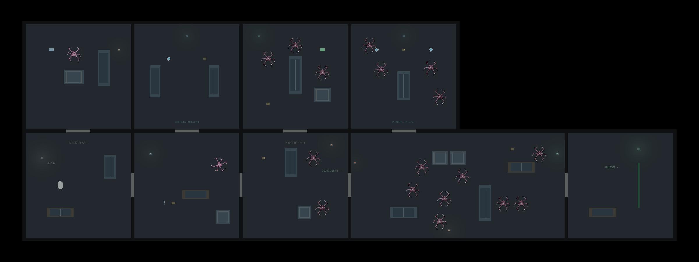

# Первый демонстрационный уровень — First Shift

Редактируемая сцена: `Assets/EmergencyShift/Scenes/FirstShift.unity`. Это первый маршрут с началом, эскалацией, необязательными наградами и выходом. Сеттинг ещё не утверждён: нейтральный служебный сектор без новых художественных ассетов. Исходная BasementPrototype сохранена отдельно с пользовательской расстановкой.

## Как запустить

Открой FirstShift в Project → Scenes и нажми Play. Она также первая в Build Profiles, поэтому самостоятельная сборка начинается здесь. WASD — движение, мышь — прицел/фонарь, F — фонарь, E — двери, ЛКМ — пистолет после подбора. Лут и карты подбираются автоматически. R после смерти или успешного выхода начинает уровень заново.

Цель отображается сверху. Зеленая полоса в восточном тамбуре — настоящий триггер завершения. Побеждать всех необязательно: сталкеров можно отгонять и оставлять за закрытой дверью.

## Маршрут и нарастание

```text
        СЛУЖЕБНАЯ         КЛАДОВАЯ          УПРАВЛЕНИЕ         РЕЗЕРВ
        карта S          замок S          карта E            замок E
        1 ожидающий      1 модуль         3 сталкера          4 сталкера
             │                │                │                │
          ВХОД ────── РАСПРЕДЕЛИТЕЛЬ ─── ТРАНЗИТ ── [замок E] ─ БОЛЬШОЙ ЗАЛ ── ВЫХОД
          старт        пистолет          2 сталкера             8 сталкеров     финиш
                       1 патруль
```

S — служебная карта, E — эвакуационная. Верхние помещения имеют вход только с юга; соседние комнаты отделены сплошной стеной. Резерв необязателен. Внутри две дополнительные находки фонаря и патроны, поэтому исследование даёт ощутимое преимущество.

| Участок | Координаты пола | Назначение |
|---|---|---|
| Вход | x0–12, y0–12 | Старт (4,6), спокойное освоение света/дверей |
| Служебная | x0–12, y12–24 | Карта (3,21), одиночный сталкер за ящиком |
| Распределитель | x12–24, y0–12 | Пистолет (15.5,4), патроны, первый патруль |
| Кладовая | x12–24, y12–24 | Замок S, безопасная награда: модуль и боезапас |
| Транзит | x24–36, y0–12 | Пара за разными укрытиями, обход высокого шкафа |
| Управление | x24–36, y12–24 | Трое вокруг центральной перегородки, эвакуационная карта (33,21) |
| Большой зал | x36–60, y0–12 | Главный шлюз E, восемь врагов, больше места для боя/отхода |
| Резерв | x36–48, y12–24 | Необязательный замок E, четверо, два модуля/патроны |
| Выходной тамбур | x60–72, y0–12 | Зеленые практические лампы, порог (68,6), экран результата |

Габарит72×24; пол существует только внутри помещений. Вне карты чёрная пустота. Оpaque стены имеют постоянно различимую тёмную рамку; фонарь и11 локальных ламп освещают небольшие участки. Возврата тумана войны нет.

## Числа для первого прогона

- 19 сталкеров:11 ожидающих и8 патрулирующих. Из них17 включаются четырьмя EncounterZone по входу; начальные двое сразу существуют на уровне.
- 8 дверей,3 замка: кладовая требует S, главный шлюз и резерв — E. Ключ не расходуется, открытый замок остаётся открытым до перезапуска.
- 3 одинаковых накопительных модуля: каждый +.6 дальности/+6°; действуют существующие ограничения FlashlightUpgrades.
- Пистолет с8 патронами,6 коробок всего64 патрона; не обязательное убийство всех19. Гильзы, попадания, кровь и останки используют существующие системы.
- У игрока здесь3HP вместо2 в старом прототипе. Это локальная настройка экземпляра для демонстрации, глобальный префаб/урон врагов не изменены.
- Detection Radius обычно3.2, первый ожидающий2.9, бойцы зала3.5. Скорости преследования/реакция на свет/урон взяты из текущего префаба. Патруль.65, паузы/случайные цели прежние.
- Служебная комната размечена Tile, кладовая Wood, остальные Concrete — можно сравнить шаги. Попадания по предметам остаются их собственным ImpactSurface.

Это стартовые параметры для проверки, не утверждённый баланс и не измеренная длительность прохождения человеком.

## Как менять в редакторе

В Hierarchy объекты сгруппированы: Geometry, Cover, Loot, Stalkers, Practical lights, Level flow и Level rig. Все стены, двери, предметы, источники и19 врагов сохранены в сцене до Play. Их можно перетаскивать и менять через Inspector.

У ShadowStalker → EnemyPatrol2D: Patrol Enabled выключен для засады, включён для блуждания; Use Patrol Area и Area Size задают мирную область. После агрессии эта область больше не ограничивает погоню. Detection Radius плюс LOS определяют первое обнаружение. Высокое укрытие блокирует свет/обнаружение, LowBench блокирует тело/пули, но пропускает свет.

В EncounterZone список Actors хранит заранее размещённые неактивные объекты. Область включает их один раз; они не телепортируются, не получают автоматическую агрессию и не образуют новую систему волн. Неактивные объекты видны/редактируемы в Hierarchy до Play.

У DoorAccess2D Required Card Id должен совпадать с Card Id нужного AccessCardPickup2D. Display Name/Card Name — русские подписи. Не ставь ключ за единственной дверью, которую он сам должен открыть. Карты S/E в этой карте доступны до соответствующих замков.

FirstLevelBuilder — разовый Editor-инструмент построения исходного каркаса. Повторный запуск отказывается перезаписывать существующую сцену. Дальше редактируй объекты, не запускай генератор заново.

## C#: почему так

PlayerAccessCards2D хранит HashSet<string> — множество уникальных ID, аналог JavaScript Set. Это данные текущего игрока без singleton; адаптер чекпоинта умеет их сохранять. AccessCardPickup2D использует существующий IAutoPickup: приближение, препятствия, сообщение и звук подбора проходят тем же путём, что патроны/модули. Новый PickupKind.AccessCard добавлен в конец enum, прежние числовые значения сохранены. Временно используется принятый звук подбора модуля.

Door2D по-прежнему владеет E, движением, коллайдером, тенью и звуком. Необязательный DoorAccess2D отвечает только на вопрос доступа. Поэтому обычные двери старых уровней работают прежним способом. Даже прямой Toggle не обходит запертый замок. Замки не меняют агрессию врагов.

LevelDefinition описывает приоритетные цели; LevelObjectiveController2D обновляет их по событиям карт/оружия. LevelCompletionView2D управляет существующим Canvas. LevelRunController2D принимает выход от LevelExit2D и через LevelParticipant2D останавливает активность. После выхода R начинает чистую сцену, после смерти — последнюю точку.

В8 помещениях размещены checkpoint volumes: сохраняются фактические HP/боезапас/прогресс/состояние мира и осевшие следы. [Настройка и политика](Guides/CHECKPOINTS.md). Пароли/записки, полноценный инвентарь, новый вид и сюжет остаются будущими этапами.

## Проверка

Фактические отчёты/границы тестов и снимки находятся в `Docs/FirstLevel`. FirstLevelProbe — временный Editor-only пилот: двигает реальное физическое тело по маршруту, подбирает лут обычным способом и стреляет реальными пулями. Это сценарная проверка достижимости/боевого цикла, не оценка темпа/страха человеком. В самостоятельную игру он не входит.



Обзорный снимок специально снят с временно повышенным общим светом и включёнными/замороженными19 акторами для проверки расстановки. Эти настройки не сохранены в сцене. Обычная игровая тьма/интерфейс видны в start.png, reserve.png и exit-approach.png; completed.png показывает экран успешного выхода.
