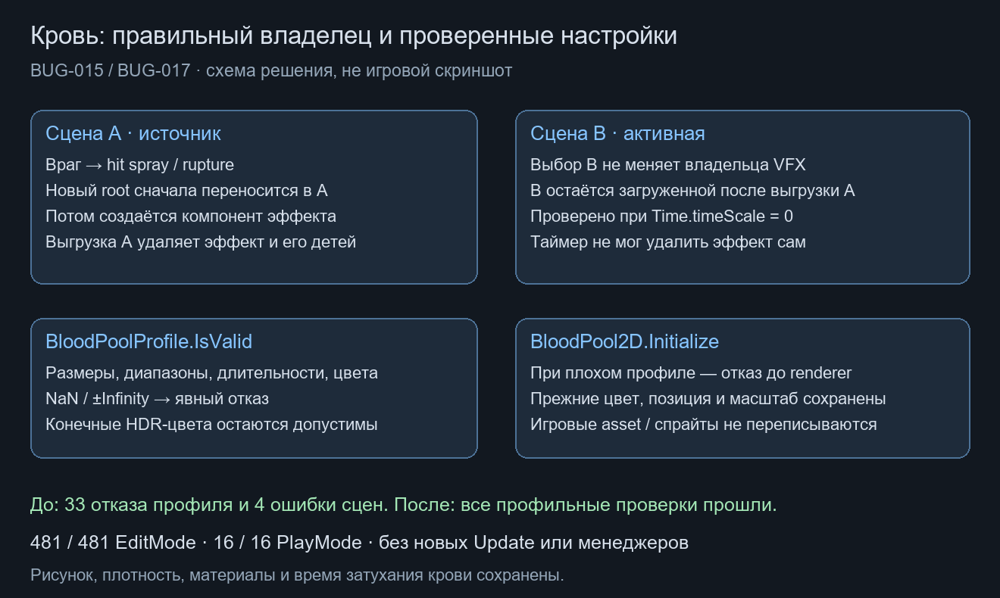

# Владелец кровавых VFX и проверка профиля · BUG-015 / BUG-017

Дата: 2026-10-21. База `e43a141`. Исправления входят в согласованную работу SOD; генератор и рисунок крови не заменялись.

## BUG-015

Корни hit spray и rupture теперь сразу перемещаются в `gameObject.scene` источника, до добавления/инициализации компонента эффекта. Они остаются независимыми от actor, а их время жизни принадлежит сцене уровня. Постоянные останки уже имели такую привязку; их путь не менялся. Нет нового менеджера/пула, подписки на SceneManager или фонового поиска.

До исправления **4/4 настоящих PlayMode** подтвердили ошибку: оба вида эффекта создавались вне сцены источника и переживали её выгрузку. После исправления **4/4** прошли. Проверены две runtime-сцены, активна чужая; `Time.timeScale=0` исключает самостоятельное удаление по таймеру. При выгрузке A удаляются её VFX, B остаётся загруженной; дочерние renderer принадлежат A. Fixture вызывает реальные `EnemyHitResponse2D.Play` / `GoreBurst2D.Play` с существующими sprite/material/pool prefab, без полного AI/урона. Полный анатомический разлёт не заявляется этой проверкой.

## BUG-017

`BloodPoolProfile.IsValid` отвергает NaN и обе бесконечности во всех компонентах пяти числовых диапазонов, двух цветов, длительностях/начальном масштабе и размере каждого варианта. Прежние границы/уникальность/ссылки сохраняются. Валидатор не исправляет и не зажимает настройки: конечный HDR-цвет по-прежнему допустим.

До исправления: **65** EditMode, **33 failed / 32 passed**, включая приём неверного профиля реальным Initialize при бесконечном growSeconds. После: **65/65**. Некорректный профиль отклоняется `BloodPool2D.Initialize` до изменения sprite renderer (цвета, положения/масштаба). Тестовые профили/texture/sprite — временные объекты; игровые asset не сохранялись и не менялись.

## Общая проверка и ограничения

**481/481** собственных EditMode и **16/16** PlayMode; обычный Windows64 Player и состав сборок — [BloodSafety01.json](../Validation/BloodSafety01.json). Исходные отрицательные результаты сохранены там же. Первоначальные сцены/prefab/config/audio проверяются по сохранённым хешам. Рабочее дерево содержит прежнюю принятую незакоммиченную паузу; это не проверка чистого HEAD без неё.

Исправления не завершают общий перенос GoreBurst/крови/останков по MVC: в нём остаются emit/spawn state, shared tuning/RNG и другие границы. Возможное совместное управление visual pose аниматором/реакцией также остаётся отдельной проверкой. Авторская приёмка, полный игровой маршрут и Profiler не выполнялись.

Цена: одна явная операция назначения сцены на создаваемый корень VFX и конечное число float-проверок при существующей validation профиля. Новых Update/таймеров/поисков нет. Число частиц, материалы, физика, время затухания и кровавые накладки не менялись; FPS не измерен.
