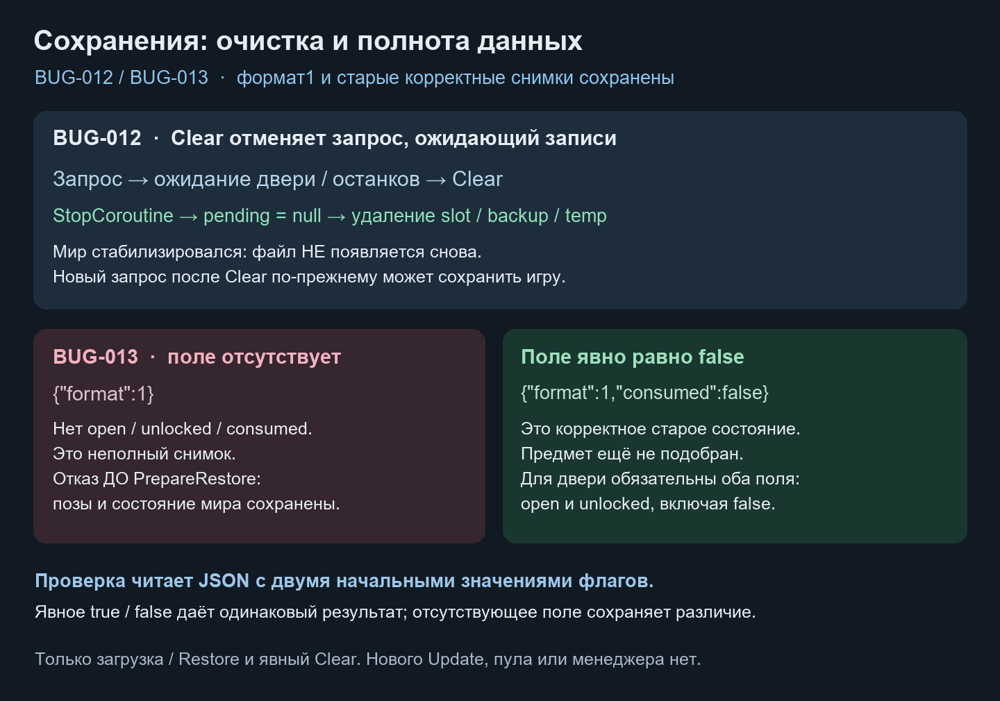

# Очистка и полнота checkpoint · BUG-012 / BUG-013

Дата: 2026-10-21. База `ddffa7b`, исходные незавершённые правки сохранены. Исправлены [BUG-012](https://app.notion.com/p/4008d6dc06b6811d89cbf3a33cba5145) и [BUG-013](https://app.notion.com/p/4008d6dc06b6818d988ffe8e78f77288).

Это схема решения, не игровой скриншот. PNG прикреплён к обеим карточкам Notion.

## Что изменено

**BUG-012.** Отмена единственной pending-корутины перенесена из OnFinished в Clear: StopCoroutine → pending=null → Store.Delete → очистка visited/LastCheckpointId. OnFinished вызывает общий Clear. Запрос после очистки может снова сохранять, включая ранее посещённый ID. Правило ожидания стабилизации мира и атомарная файловая запись не менялись. Новой очереди/менеджера/планировщика нет.

**BUG-013.** Четыре Unity-адаптера используют общий CheckpointBooleanPayload. Он читает прежние format1 DTO и проверяет присутствие обязательных bool-полей через JsonUtility с двумя начальными наборами значений. Явное false/true перезаписывает оба одинаково; отсутствующее поле оставляет значения разными. Это семантика JSON-парсера, а не поиск слова в строке: вложенные посторонние поля и комментарий-строка не обходят проверку. Дверь требует open+unlocked, остальные — consumed. Прямые Restore читают/проверяют весь свой payload перед изменением компонента.

Сохранены version1, SaveKey, внутренний format1, поля и saveRevision. Полные старые снимки с false не отвергаются; remaining по-прежнему пишется как прежнее неиспользуемое поле и не обязателен для чтения. Это проверка полноты конкретных DTO, не новый универсальный JSON-парсер и не полная миграция системы checkpoint по SOD.

## Проверено Unity 6000.6.5f1

- **BUG-013 до исправления:** 51 EditMode, 39 failed / 12 passed; реальные JsonUtility/Capture/Restore/Level.Apply. Отказы связаны с пропущенным обязательным полем, ошибок setup нет.
- **BUG-012 до исправления:** 5 настоящих PlayMode, 3 failed / 2 passed. Отдельно подтверждено, что файл снова появляется спустя несколько кадров после Clear; ещё два отказа — IsSaving при ожидании движущейся двери и unsettled gore. Проверка файла усилена до зафиксированного финального отрицательного прогона.
- **После исправления:** 51/51 профильных и **316/316 всех собственных EditMode**, 0 skipped. Неполный payload не активирует/не перемещает первый объект и не меняет дверь, замок, лут, encounter, elapsed или checkpoint ID. Прямой Restore защищён. Все четыре сочетания флагов двери, оба consumed, старое отсутствие remaining и полный JSON round-trip допустимы.
- **5/5 PlayMode**, 0 skipped: удалены slot/bak/tmp; после Clear файл не возвращается через кадры и после завершения движения двери; контролируемый флаг spawning у GoreBurst проверяет ожидание останков без генерации графики. Новый запрос успешно пишет ранее посещённую точку. Завершение уровня сохраняет отмену/очистку. Fixture использует отдельную runtime-сцену, неактивный контейнер с настоящей моделью здоровья и временный путь; игровые сцены и файлы игрока не участвуют.
- Обычная **StandaloneWindows64** сборка отдельной копии: `outcome=success`, `exitCode=0`, `Build Finished, Result: Success`. Player содержит EmergencyShift.Runtime.dll; Editor/Development/EditModeTests/PlayModeTests отсутствуют. Открытый Editor владельца не переключался в Play. Это не ручная игровая приёмка или полноценная campaign/death/reload-проверка.

PlayMode и сборка выполнены на отдельной копии Assets/Packages/ProjectSettings/PackageCache с собственным Library. Восемь затронутых C# сверены по SHA256 между проверенной копией и рабочим проектом. Полный EditMode-набор выполнен в открытом Editor. Начальные 69 незавершённых файлов сохранены; в ValidationIndex добавлена только наша строка, остальные правки не включены в коммит.

## Владение и стоимость

Сроком жизни pending владеет существующий LevelCheckpointController. JSON-адаптер проверяет значения и структуру, не обращается к сцене, часам или Unity Objects; каждый participant сам восстанавливает свой компонент. Общая MVC/DI-миграция, static sessionPaths и поиск стабилизации мира остаются прежним долгом.

Clear отменяет одну корутину и выполняет существующие файловые операции. Проверка bool делает два разбора маленького JSON при validation и повторяет защиту при прямом Restore; она работает при загрузке, без нового Update. FPS и длительность загрузки не измерялись. [Машиночитаемые результаты и исходники](../Validation/CheckpointConsistency03.json).
