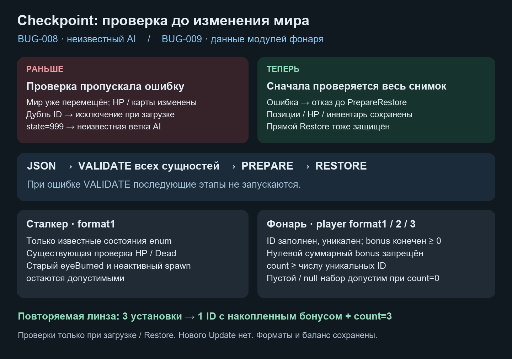

# Проверка AI и модулей перед восстановлением · BUG-008 / BUG-009

Дата: 2026-10-21. База: `4508773` и существующее рабочее дерево владельца. Исправлены [BUG-008](https://app.notion.com/p/4008d6dc06b6814aa9d7c1ecd0afb886) и [BUG-009](https://app.notion.com/p/4008d6dc06b6814287c5e10e2b136c0f).

Схема объясняет порядок загрузки; это не игровой скриншот. Она прикреплена в обе карточки Notion.

## Изменение и границы

StalkerCheckpoint2D проверяет принадлежность state известному BehaviourState, сохраняя прежнюю проверку HP/Dead и глаза. Прямой RestoreCheckpoint сначала вызывает ValidateCheckpoint. Неизвестные -1/999/int.MaxValue отвергаются до PrepareRestore любых сущностей. Корректные десять состояний, старый eyeBurned и неинициализированный spawn продолжают проходить validation. Правила AI, поля DTO и баланс не менялись; это не полная проверка всех оставшихся таймеров/векторов AI.

Чистый FlashlightModuleValidation проверяет структуру и значения DTO без доступа к живому миру. PlayerCheckpoint2D вызывает его до ветвления на format1/2/3, а FlashlightUpgrades.Restore — до installed.Clear и изменения оптики. Проверяются null-элементы, пустые/пробельные и повторные ID, finite/nonnegative bonus и ненулевая пара бонусов. count не меньше числа уникальных записей; пустой/null-набор допустим только при count=0. Регистр ID сохраняется, как в существующем словаре. Произвольный верхний лимит установок не введён: повторяемые линзы накапливаются под одним ID, а оптика по-прежнему ограничена настройками компонента.

Общий файл version1, player.v1/format1–3, stalker.v1/format1 и saveRevision сохранены. Новых полей и миграции формата нет. Проверка намеренно перестаёт принимать повреждённые снимки, которые прежний код мог загрузить частично. Null-массив без модулей продолжает поддерживаться. Карты/направление игрока и остальные открытые дефекты остаются за пределами этих двух исправлений.

## Настоящие проверки Unity 6000.6.5f1

Pipeline открытого Editor ответил; set_autotick включён. Тесты создают собственную preview scene и экземпляр настоящего Player.prefab, инициализируют только нужные адаптеры и модель здоровья. В пользовательские сцены временные компоненты не добавлялись.

- До исправления: **73 случая, 56 failed / 17 passed**. Ошибка первоначальной тестовой fixture (отсутствующий PlayerAccessCards в базовом prefab) устранена перед этим зафиксированным прогоном; её 69 setup failures не считаются воспроизведением багов.
- После исправления: **73/73** новых проверки; затем **265/265** всех собственных EditMode, 0 skipped. Повреждённый payload не активирует/не перемещает первый объект, не меняет HP/карты/оружие/модули/оптику и время уровня. Проверены прямой Restore модулей, прямой Restore игрока всех трёх форматов, null-набор и повторяемые установки.
- Реальные три повторные установки → Capture → JsonUtility/отдельный CheckpointStore на диске → смерть игрока → Apply: восстановлены здоровье, инвентарь, карточки, положение, накопленный bonus и count (четыре установки, два уникальных ID с уже имевшейся линзой). Это EditMode-регрессия восстановления, не ручной игровой death/reload с полной перезагрузкой сцены.
- Обычная **StandaloneWindows64** сборка через Pipeline: `Succeeded`, 0 errors, 1 warning; build ID `build_d928880bd58a`. Предупреждение: RuntimePipelineConfig не задан, служебный Pipeline отключён в Player. В Managed присутствует EmergencyShift.Runtime.dll; Editor/Development/EditModeTests отсутствуют. Текущая console groundTruth: 0 errors, compilationFailed=false; старый Pipeline timeout до этой работы не относится к результату компиляции.

Unity Build автоматически переписал preloadedAssets в ProjectSettings; после сборки файл восстановлен побайтно к начальному SHA256 из существовавшей копии с совпадающим хешем. Остальные 68 начальных незавершённых файлов сохранены. Ручные сцены/prefab/SO не менялись этим исправлением.

Машиночитаемые результаты и хеши: [CheckpointPayload02.json](../Validation/CheckpointPayload02.json). Проверки линейны по числу модулей, с небольшим HashSet только при загрузке; несколько защитных вызовов повторяют этот проход. Нового Update/менеджера/пула нет. FPS/профиль загрузки и авторская приёмка не измерялись.
