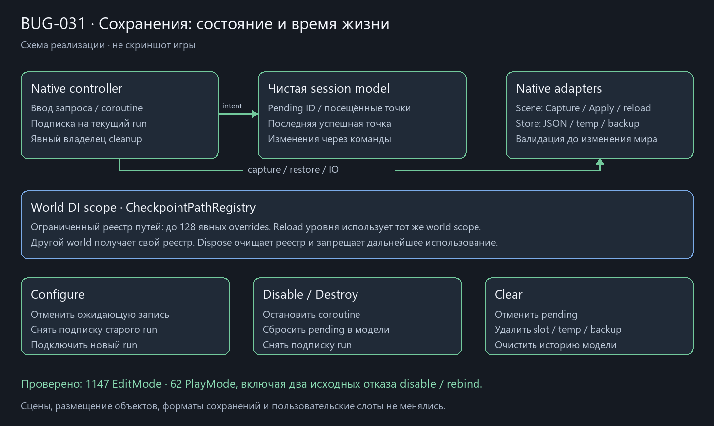

# Состояние и lifetime сохранений · CheckpointSession35

2026-10-22, после ea6213f. BUG-031 воспроизведён **0/2 настоящих PlayMode**: disable оставлял pending save, а Configure на другой run сохранял подписку старого Finished, удалявшую текущий слот.

Личная CheckpointSessionModel хранит pending ID, посещённые точки и последний успешный ID. Request/Reset/Record/Restore commands проверяют изменения, controller и factory не зависят от сцены/IO/ввода. Отмена не стирает историю; успешная запись посещает точку, Clear разрешает повторное посещение. Snapshot и Capture возвращают защищённые копии ID; legacy null visits допустимы. Неверные visit IDs отклоняются до замены файла.

LevelCheckpointController2D остаётся native координатором: coroutine ждёт оседания мира, IDisposable callbacks не нужны чистой session без подписок. Pending coroutine отменяется и session сбрасывается при disable/destroy/rebind; finally закрывает завершённую/прерванную работу. Подписка принадлежит subscribedRun: старый источник снимается до замены ссылки, enable подключает текущий один раз. LastError остаётся сообщением native UI, не состоянием игрового мира.

Обход/Capture/полная предварительная проверка/Prepare/Restore/sync/reload выделены в CheckpointSceneAdapter2D одной сцены. PersistentEntity проверяет собственный ID и layout/позы/payload также при прямом Prepare/Restore до mutation; отсутствующий participant не приводит к частичному переключению active. CheckpointStore остаётся небольшим JSON/файловым инфраструктурным адаптером с прежней temp/flush/replace/backup политикой; отдельные искусственные интерфейсы для одного backend не добавлены.

Mutable static sessionPaths удалён. CheckpointPathRegistry принадлежит world DI scope, наследуется уровнями и сохраняет intended UseStore override при reload того же world. Другой world изолирован. Реестр ограничен 128 явными overrides, очищается и запрещает использование при Dispose; не создаёт файлов. Last-good slot, DTO formats/ключи/ID/saveRevision не менялись. Сохранения/цели в песочницу не добавлялись, FirstShift не восстанавливался.

**1147/1147 EditMode**, включая component-free session/commands, snapshot isolation, посещения/отмена/clear, настоящий WorldInstaller и его Dispose, direct entity/IO guards. **62/62 PlayMode**, включая оба исходных случая disable/rebind и прежние Clear/door/gore/finish/сценовые сценарии. Обычная Windows64 success; собственная Player assembly только EmergencyShift.Runtime. [Baseline/XML/source/meta hashes](../Validation/CheckpointSession35.json). Схема прикреплена в BUG-031.

1805 прежних защищённых ресурсов и 60 исходных dirty файлов неизменны; 13 новых meta импортированы exclusive create. Новые bindings не потребовали изменения assets/scenes. Проверялась dirty копия с исходной паузой, не clean HEAD; эти незавершённые изменения исключены из коммита. Нефатальный LicensingClient warning остаётся.

Обходы сущностей/сериализация остаются редким O(entities + payload + visits) путём с временными массивами/словарями. Проверка оседания, как раньше, опрашивает native объекты по кадрам только во время pending save; фонового Update/пула не добавлено. Путь lookup — ограниченный dictionary. Это оценка алгоритма, не замер FPS. Общая миграция, config/style/tools и авторская приёмка продолжаются.
