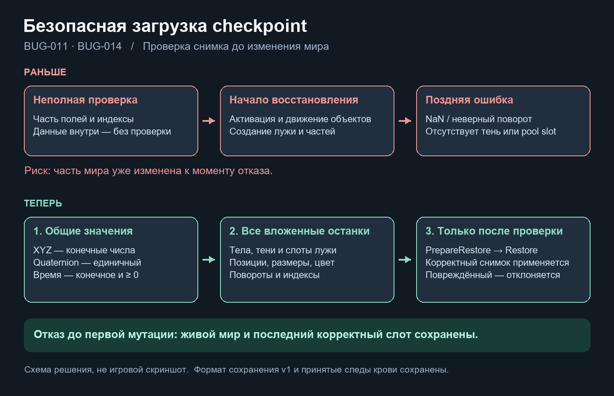

# Защита checkpoint перед изменением мира · BUG-011 / BUG-014

Дата: 2026-10-21. База: `6f3f32d`, текущее рабочее дерево с сохранёнными незавершёнными правками владельца. Исправляются только два бага высокой важности: [BUG-011](https://app.notion.com/p/4008d6dc06b681e9bd1de832bb82310a) и [BUG-014](https://app.notion.com/p/4008d6dc06b681e3bc92d86b33bef084).

Схема объясняет решение, это не игровой скриншот. Та же картинка прикреплена в обе карточки Notion.

## Что исправлено

- **BUG-011:** CheckpointStore проверяет все XYZ, все компоненты quaternion и неотрицательное конечное elapsedSeconds до temp-записи и до Level.Apply. PersistentEntity.Validate также защищён для прямого вызова. Политика поворота — finite unit quaternion с `abs(lengthSquared - 1) <= 0.001`, оба знака допустимы. Нулевой/неединичный поворот отвергается, тихой нормализации нет; double norm исключает overflow при проверке больших float.
- **BUG-014:** RemainsSnapshotValidation обходит все pool slots и части, проверяет body/обязательную shadow, индексы и finite позиции/масштабы/цвета/повороты. GoreBurst.ValidateRemains использует этот preflight в общем Validate → PrepareRestore → Restore. Прямые GoreBurst.RestoreRemains и RemainsRecord.Restore тоже проверяют до остановки, удаления прежних останков, изменения Transform или Instantiate.

Схема/ключи payload version1, saveRevision и художественные данные не менялись. Старый bloodVariantId может отсутствовать; unused shadow/pool fields игнорируются по их presence flags. Масштабы с отражением/нулём и HDR цвета не ограничены новым дизайнерским диапазоном: проверяется конечность, сохраняется точный вид допустимого снимка.

## Границы SOD и стоимость

Два новых небольших класса проверяют только значения и структуру DTO, без Unity Objects, сцены, камеры, времени и mutable static state. Ссылки на prefab/разрешённые варианты проверяют существующие Unity adapters. Полная миграция Capture/Apply DTO, controller orchestration, RNG и всех остальных функций этой задачей не выполнялась.

Проверки линейны по сущностям/renderer slots/частям и работают при записи/загрузке или прямом restore, а не каждый кадр. Два GetComponentsInChildren при проходе gore/record относятся к загрузке; нового Update, пула или общего менеджера нет. FPS/пиковая стоимость не измерялись.

## Проверено настоящим Unity

Редактор владельца удерживал проект и не завершал async Test Runner. Для воспроизводимости использована отдельная копия Assets/Packages/ProjectSettings с собственным Library, Unity 6000.6.5f1 и отдельными временными save slots. Открытая пользовательская сцена не закрывалась/не сохранялась нашими инструментами.

1. Исходный код: 35 конкретных проверок, **28 failed / 7 passed**. После исправления ошибки самой тестовой fixture (preview scene вместо additive untitled) повторно получены именно отказы assertions о пропущенной validation, не ошибки setup.
2. Исправление: **102/102** профильных теста, включая **83 новые регрессии** (37 envelope/pose/store и 46 nested remains) плюс прежние Persistence/BloodPool/GoreComposition.
3. Весь собственный EditMode-набор: **192/192**, 0 skipped. Невалидный второй entity не активирует и не перемещает первый; прошлый slot/backup не затирается; прямой restore не удаляет существующую запись. Проверены реальные JsonUtility/disk round-trip v1 и silent restore на конфигурациях обоих видов без изменения общих профилей/launch events. Это не полный Play death/reload или авторская приёмка картинки.
4. Обычная **StandaloneWindows64** сборка успешна, build provenance `outcome=success`, `exitCode=0`, в журнале `Build Finished, Result: Success`. Player содержит EmergencyShift.Runtime.dll, не содержит Editor/Development/EditModeTests assemblies. В логе были служебная проверка подписи LicensingClient (entitlement затем успешен) и недоступность необязательного Unity analytics endpoint; ошибок C# не было.

Машиночитаемые результаты/имена тестов, build summary, точные хеши восьми C# и ограничения — [CheckpointValidation01.json](../Validation/CheckpointValidation01.json). Реестр [CodeAudit.json](CodeAudit.json) обновлён: **273/273**, 152 reviewed_boundary / 121 partial / 0 queued; полная миграция остаётся открытой.

## Сохранность и оставшийся объём

68 из 69 существовавших незавершённых файлов имеют прежний хеш. Во время работы в открытом MorgueRouteTest изменились transform-параметры накладки влаги; эти параллельные изменения сохранены как есть и не включены в коммит. Никаких наших правок сцен/prefab/SO/арт/звука нет. GUID существующих ресурсов сохранены; новые C# meta получены от Unity и согласованы с тестовой копией.

BUG-008/009/012/013 и остальные ошибки остаются отдельными открытыми карточками, их решение не объявляется выполненным. Закрываются только исходные сценарии BUG-011 и BUG-014. Временный test project не является новой рабочей картой или релизом; ручная игра/FPS не проверены.

## Изменённые исходники

- [CheckpointStore.cs](../../Assets/EmergencyShift/Runtime/Persistence/CheckpointStore.cs) — Файловая запись/чтение checkpoint и envelope preflight.
- [PersistentEntity2D.cs](../../Assets/EmergencyShift/Runtime/Persistence/PersistentEntity2D.cs) — Сценический ID, участники и применение позы.
- [GoreBurst2D.cs](../../Assets/EmergencyShift/Runtime/Presentation/Visuals/GoreBurst2D.cs) — Однократная кровь и scene-owned останки.
- [RemainsRecord2D.cs](../../Assets/EmergencyShift/Runtime/Presentation/Visuals/RemainsRecord2D.cs) — Постоянная запись останков и silent restore.
- [CheckpointValueValidation.cs](../../Assets/EmergencyShift/Runtime/Persistence/CheckpointValueValidation.cs) — Чистые проверки значений checkpoint.
- [RemainsSnapshotValidation.cs](../../Assets/EmergencyShift/Runtime/Persistence/RemainsSnapshotValidation.cs) — Полный обход значений settled snapshot.
- [CheckpointValidationTests.cs](../../Assets/EmergencyShift/Tests/EditMode/CheckpointValidationTests.cs) — 37 регрессий сохранности слота и мира.
- [RemainsValidationTests.cs](../../Assets/EmergencyShift/Tests/EditMode/RemainsValidationTests.cs) — 46 регрессий nested validation и silent remains restore.
