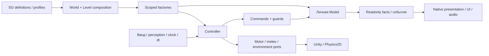

# TASK-008 · Читаемость и расширяемость кода

Дата обновления: 2026-11-04. Статус: **F01/F02 реализованы и проверены в своей границе; вся TASK-008 ещё не завершена**.

Авторитетная задача и критерии: [TASK-008 в Notion](https://app.notion.com/p/40c8d6dc06b68132874cd3d781d119fd). Этот документ — техническое свидетельство, не отдельный план или реестр багов.

В текущем коде есть осмысленные границы SOD и несколько конкретных мест для упрощения. Нет основания массово переписывать модели или объявлять каждый длинный View и конечный `switch` плохой архитектурой. F01/F02 теперь реализованы в игровом C# и проверены, F05 уточнён в Enemies/SPEC; F03/F06–F08 и окончательная квалификация/сборка остаются обязательными. Независимые исправления инструментов F04/BUG-055–057 реализованы и проверены отдельно.

## Основание и границы

Исходный проход начат на HEAD `361c8177fe95de5dbd4e5a2f0051ac050a6a640c` в общей dirty-копии. Прочитаны 781 собственный C# файл исходного снимка под `Assets/EmergencyShift`: Runtime 588, Editor 35, Development 17, Tests 141. Прочитаны также 49 отдельных инструментов и сохранённых рецептов вне Assets. Это журнал чтения, не результат запуска тестов и не обещание отсутствия дефектов.

Пофайловые локаторы чтений сохранены в [read-trace.json](../Validation/CodeReadabilityTask008/read-trace.json). [Снимок метаданных](../Validation/CodeReadabilityTask008/source-inventory.pre-handoff.json) содержит текущие SHA, сборочные области и сохранённые GUID-зависимости; [collector](../Validation/CodeReadabilityTask008/capture_inventory.py) использует существующий `Tools/Maintenance/audit_code.py` только на чтение. Совпадение SHA, число строк, найденный токен или запись команды не заменяют семантическую проверку.

Первый этап чтения выполнялся при game lease TASK-007. Его художественно отклонённый FixedSprites06 остаётся чужим установленным кандидатом. Явный handoff TASK-008 записан 2026-11-04; свежий Editor6000.6.5f1 stopped/ready, одна MechanicsSandbox, dirty=false, startScene=null. Владелец перезапустил Editor: вчерашний unsaved буфер не объявляется сохранившимся. Сверены свежий diff, manifest 114 импортированных файлов TASK-007 и собственный native baseline. Новый `FixedCreatureSpriteSceneTests.cs` прочитан отдельно. Законный commit настройки ролей `45c72a69` относится к инструкции/docs, а не к игровому изменению TASK-008.

Исторический `CodeAudit.json` описывал прежние 663 источника и результаты 2026-10-22. Его старые зелёные флаги и отчёты не доказывают качество сегодняшней копии. TASK-008 выполнил метаданный refresh под отдельным files lease: текущих записей 924, из них 585 унаследованных без изменения SHA, 78 partial и 261 queued. Все технические признаки готовности/hash-current сняты; новая семантическая квалификация пока не присвоена. Датированная история сохранена, прежний coverage-summary явно помечен историческим.

## Находки

| Код | Приоритет и область | Основание | Предлагаемая граница; текущее состояние |
|---|---|---|---|
| F01 | P2 · Скорпион | Прежний Step смешивал постоянные настройки и текущие факты, а actor делил скорость атаки на допустимый ноль PursuitSpeed. | Реализованы неизменяемый ScorpionSettings при композиции и короткий Step с deltaTime. BUG-059 воспроизведён в настоящем Unity EditMode через fake ports: baseline13/14 с одним ожидаемым FAIL, после исправления исходный сценарий проходит. Сохранены числовые SO-поля и melee/event порядок; итоговая общая сборка впереди. |
| F02 | P2 · Связность тревоги | Actor/pack раньше находили конкретный audio View для проигрывания выбранной тревоги. | Реализовано AlarmCueRequested с подпиской/отпиской audio View. Четыре native PlayMode прошли до/после; проверены выбранный caller, один голос стаи, cue-before-counter, mute с положительным audibility control, enable/disable без replay, две независимые стаи, standalone и fatal-hit ordering. Нового Manager/interface нет. |
| F03 | P2 · Композиция подбора | `PickupInstaller` скрыто делает `Resources.Load<PickupGlintProfile>` при создании каждого уровня. | Явная сериализованная ссылка в world composition; локальные factory/controller и личная pulse остаются. Сохранить путь/GUID существующего profile и отсутствие изменений карт. Подключение и native-проверка ещё не выполнены. |
| F04 | P2 · Достоверность аудита | До исправления `audit_code.py --refresh` сбрасывал только `complete`, оставляя три технических флага и вложенное `sourceCoverage.hashesCurrent` true. | BUG-055: воспроизведено в отдельной временной копии CLI и исправлено. Все четыре признака готовности и hashesCurrent сбрасываются; dated review evidence/reviewedSha256 сохраняются, новые файлы queued. Применён метаданный refresh общего CodeAudit; окончательная ручная квалификация после передачи обязательна. |
| F05 | P2 · Текущие контракты | В SPEC сохранялась прежняя visual-only стадия Скорпиона. | Исправлено после освобождения SPEC резерва TASK-006; Enemies описывает действительные settings/factory/event lifetimes. Художественно отклонённый кандидат TASK-007 и неутверждённый баланс не объявлены принятыми. |
| F06 | P3 · Навигация | Внутренний `EnemyChasePath2D` только перенаправляет вызовы в `EnemyChasePathModel`; текущие callers — motor/factory. Сериализованных ссылок GUID в первоначальном поиске не найдено. | После финальной проверки текстовых/динамических/сериализованных uses убрать проходной слой, возвращать model напрямую. Удаления нет; навигационные регрессии и сборка ещё не запускались. |
| F07 | P2 · Диагностические fixtures | `DevelopmentBuildSmoke` создаёт encounter и вызывает Activate без scoped injection. `SleeperRegressionProbe` создаёт активный Flashlight2D до DI, хотя Awake уже требует factory. | Проверить актуальный исходник/воспроизвести после слота; динамические fixtures должны получить существующую level composition до вызовов/Awake. Предшественник предупреждён ранее; fallback-контроллер не нужен. Обычный gameplay не объявлен сломанным. |
| F08 | P2 · Владение доказательствами | Два сценария `ScriptedIntroSceneTests` и один `StalkerBurnSceneTests` пишут свежие отчёты в исторические `Docs/Validation/DoorScatterDelay01` и `MonsterEyes03`. | Перед повторным прогоном перенести новый вывод в Logs, сохранив assertions и прежние свидетельства. Тесты этой задачей ещё не исполнялись. |

F01 зарегистрирован после проверки дубликатов и реального воспроизведения как [BUG-059](https://app.notion.com/p/40e8d6dc06b681f395d2f887dd8b4f69), уникальность кода сверена. F07 ещё требует фактической квалификации. F04 зарегистрирована как [BUG-055](https://app.notion.com/p/40d8d6dc06b681bd82aafcdcb81dfe53); сопутствующие дефекты проверки документации — [BUG-056](https://app.notion.com/p/40d8d6dc06b68108a382e5c6dae49a73) и [BUG-057](https://app.notion.com/p/40d8d6dc06b68194a1c9cb461bda4ccf).

## Реальный этап Скорпиона · 2026-11-04

Старый [контрпример](../Validation/CodeReadabilityTask008/scorpion.before.json) дал 13 прежних PASS / один новый FAIL конечности запрошенной скорости. NaN наблюдал fake motor, native Rigidbody не получал его. После переноса настроек [19/19](../Validation/CodeReadabilityTask008/scorpion.after.json); затем добавлена проверка factory на действительных authored SO и неизменность их JSON. [Вместе с audio-hit fixture — 28/28 EditMode](../Validation/CodeReadabilityTask008/scorpion.all-editmode.after.json). Содержательные проверки включают нулевую скорость погони, отдельную gather cycle, недопустимый dt до side effects, личные gait/aggro/death при общих settings, ускорение, поворот, interruption и finish один раз.

Новые native сценарии тревоги прошли [4/4 до](../Validation/CodeReadabilityTask008/scorpion-alarm.before.json) и [4/4 после](../Validation/CodeReadabilityTask008/scorpion-alarm.after.json) event-границы. Использованы существующие четыре R04 actor и отдельный временный pack через настоящий level factory; все runtime-объекты выгружены без сохранения сцен. Это функциональная проверка, не художественная оценка или стресс-тест.

Нативный baseline и повторная проверка сравнили 2703 объекта открытой MechanicsSandbox, включая неактивные, полные сериализованные данные/ссылки, файл сцены и loaded/active/dirty state: различий0, missing scripts/references0, saves0. Два ранних FAIL диагностического helper объяснены типом JSON null (Null после чтения файла против String с null в свежем JObject), а не изменением карты; различие раскрыто в tokenDifferences. Helper исправлен явным JValue.CreateNull, исходный baseline не заменялся. Итог — [editor.after-scorpion-stage.json.gz](../Validation/CodeReadabilityTask008/editor.after-scorpion-stage.json.gz). Полные snapshots сохранены lossless gzip; их исходные SHA и проверка точного roundtrip находятся в compression-manifest.json.

[Проверка сохранённых входов](../Validation/CodeReadabilityTask008/scorpion.saved-inputs.after.json) сравнила 3826 исходных файлов Assets/Packages/ProjectSettings: отличаются только 11 разрешённых C#/новых meta этого этапа. Все 114 чужих импортированных файлов TASK-007 побайтно совпали с handoff manifest; сцены, prefab, SO, GUID/IDs, pause draft и остальные настройки не изменены. Итоговый контроль авторинга этого этапа неприменим: объекты сцен не добавлялись/не перемещались. Обычная Windows64-сборка и полные регрессии всей TASK-008 ещё не выполнялись.

## Изолированная проверка инструментов · этап 2026-11-03

После решения владельца о параллельных независимых результатах был получен `files` lease на два maintenance CLI, этот отчёт/Validation и `MONSTER_CONCEPT_WORKFLOW.md`. Общий `game` в тот период оставался у TASK-007. Временные проекты тестов размещались только в зарезервированной Validation-папке; путь перед очисткой проверялся. Первый запуск harness в sandbox Temp не смог создать вложенные папки и не проверил продукт; после переноса временного корня выполнены следующие фактические проверки.

До исправлений [пять CLI-регрессий](../Validation/CodeReadabilityTask008/check_maintenance_cli.py) дали **две ожидаемые ошибки**: сохранение sourceCoverageComplete и ложный missing для существующих файлов с query. [Результат до](../Validation/CodeReadabilityTask008/maintenance-cli.before.json). После узких исправлений — **5/5**, [результат после](../Validation/CodeReadabilityTask008/maintenance-cli.after.json). Проверены реальный CLI refresh при added/changed/removed, сохранение старого reviewedSha256/дат/истории и removed entry при повторе, отсутствие автоматического review нового файла, byte-for-byte неизменность read-only реестра и отказ refresh без даты. Исторические поля sourceCoverage и dated evidence не становятся новым доказательством; текущие верхние counts/scopeCounts механические, а готовность после refresh всегда требует отдельной квалификации.

BUG-056 исправлен разбором URL path до percent-decoding: query и fragment не входят в имя файла; `%20`/`%23` внутри имени сохраняют правильное значение. Реально отсутствующая ссылка по-прежнему возвращает exit 1 и исходный target, внешние ссылки/anchors не объявляются проверенными.

Исправленный refresh также применён к фактическому общему реестру. [Дельта](../Validation/CodeReadabilityTask008/registry-refresh.pre-handoff.json), [проверка сохранности review evidence](../Validation/CodeReadabilityTask008/registry-refresh.verification.json) и [прежний summary](../Validation/CodeReadabilityTask008/registry-summary.before-refresh.json) зафиксированы отдельно. Для всех 663 прежних путей сохранены reviewedSha256, reviewDate/history/report/scope/notes; все 261 новые записи queued без reviewedSha256. Датированные reviewPasses/latestReview не изменены. Это проверка реального metadata refresh, не новая семантическая квалификация 924 файлов и не Unity/native PASS.

Дополнительное чтение `audit_content.py` обнаружило второй независимый Markdown parser с той же ошибкой и ложным учётом примеров внутри code fence. Новый реальный CLI-сценарий сначала упал ([content-before](../Validation/CodeReadabilityTask008/maintenance-cli.content-before.json)); после замены дублирования вызовом существующего `audit_documentation.inventory` — **6/6** ([content-after](../Validation/CodeReadabilityTask008/maintenance-cli.content-after.json)). Сохранён прежний формат `broken_links` как пары source/target; оба инструмента теперь используют один набор правил для Docs/Concepts/AGENTS/project skills. Это продолжение BUG-056, не новая gameplay-система.

Фактический [content inventory](../Validation/CodeReadabilityTask008/content-inventory.pre-handoff.json) также завершился без broken links. Он увидел 2047 meta, 103 кандидата без входящих текстовых GUID и 239 внешних либо не найденных в Assets GUID. Это **не** 239 потерянных native references: сканер не читает PackageCache/AssetDatabase/local fileID. Кандидаты тоже не unused: среди них текущий `Resources/PickupGlintProfile.asset`, который прямо загружает PickupInstaller. Никакие ресурсы по этому списку не удалялись; игровая копия предшественника ещё меняется, финальная native-квалификация впереди.

В исходном [общем doc-check](../Validation/CodeReadabilityTask008/documentation-links.pre-handoff.json) было три brokenLocalLinks: два существующих viewer.html с query и один действительно отсутствующий исторический `FastGroupEnemy05Animation/README.md`. Для BUG-057 снята только нерабочая Markdown-ссылка в guide, отсутствие исторического README названо явно; арт/каталоги/требования не пересоздавались. После исправлений [проверка 427 Markdown файлов](../Validation/CodeReadabilityTask008/documentation-links.after-tools.json) дала **exit 0, brokenLocalLinks 0, exactDuplicateGroups 0**. Это проверка существования локальных файлов, не семантики текста, anchors или внешних URL.

## Карта основной игровой границы



Это карта владельцев основной логики, а не требование создавать Model для каждого SpriteRenderer или offline-рецепта. Composition знает конкретные реализации; общие consumers используют contracts. F02 — локальное нарушение этой границы: actor/pack ещё сами находят конкретный audio View. F03 относится к явности входящих данных composition, F01 — к разделению данных разного срока жизни.

## Что уже понятно и сохраняется

| Модуль | Вывод чтения |
|---|---|
| World/level/player composition | Общие immutable настройки и сервисы отделены от scope уровня, ввода и личных моделей. Фабрика может быть scoped, создавая отдельную модель на каждый actor. Installer не является gameplay Manager из-за перечня bindings. |
| Все текущие враги | Общие motor/perception/health/melee/gore используют bounded contracts. Сталкер, Спящий, Скорпион и прототип Claw имеют свои алгоритмы/представление; общие пули, door-crush, UI и audio-threat не требуют разрастающегося dispatch по виду. Роль прототипа Claw не придумывается заново. |
| Команды/модели | Проверки доступности и повторная валидация перед commit осмысленны. Конечные FSM/guard/две альтернативы не заменяются механически набором независимых if. Три явные зависимости EnemyPathSchedule — clock, общий quota, личный RNG — обоснованы; context bag не нужен. |
| Оружие/игрок/фонарь | Состояние боезапаса/владения/RNG личное. Числовые варианты отделены от различающихся cycle-алгоритмов. Направления залпа фиксируются до косметических callbacks. Старый AcquireFlashlightCommand — документированная совместимая API с тестами, не мусор по отсутствию нового caller. |
| Двери/подбор/доступ/цели | Команды проверяют приём и повторный вход; сохранение pickup remainder/consumption и стабильных IDs отделено от уведомлений. Новые стили не должны менять Silent Restore или порядок выдачи/сигналов. |
| Checkpoint/remains | DTO, версии, presence flags и старые ID сохраняются. Вложенные данные проверяются до изменения мира; restore не воспроизводит смерть/урон/аудио. Отсутствие checkpoint-поддержки Скорпиона в sandbox не оправдывает добавление нового payload ради примера. |
| UI/пауза/смерть/диалог | Явные владельцы input/motion leases и cleanup подписок уже имеют содержательные проверки. Отложенный MainMenu не превращается в обязательную точку входа. Чужой pause draft сохраняется. |
| Аудио/свет/VFX | Источники/реестры принадлежат своим сценам; личные memory/pulse/mix отделены от общих profiles. Шесть аргументов AudioLayerMix Step — текущие факты кадра, в отличие от смешанного tuning в F01. Лампа/выстрел не становятся защитным светом. |
| Editor/Development/тесты | Offline bake и native presentation могут быть длинными, оставаясь одной ответственностью. Editor-геометрия не возвращается в Player. Исторические генераторы и save/restore helpers не запускаются как универсальный ремонт текущих карт. |

Старое имя ассета само по себе не означает obsolete: установка TASK-007 намеренно сохраняет `StalkerSprites.asset`, `SleeperSprites05.asset`, их GUID и семантические имена `body-*`. Соответствующие проверки меняются только по действительному новому контракту.

Отдельно прочитаны ещё 87 внешних C# рецептов; [дополнительный след чтения](../Validation/CodeReadabilityTask008/additional-read-trace.json) содержит пофайловые выводы и локаторы реальных команд. Вместе с 49 внешними источниками первоначального прохода это 136 внешних файлов: все 134 текущих AgentScripts и два исторических Concepts. Это authoring/диагностические инструменты вне production assembly. Например, Validate pause draft вызывает Install, старые native verifiers перезаписывают исторические evidence-файлы, а часть сценариев Скорпиона только записывает false без исключения. Они не являются универсальным PASS сегодняшних dirty-карт. Старые рецепты не выполняются и не форматируются массово; активные helpers TASK-007 прочитаны предварительно и требуют повторной квалификации после передачи.

Шесть файлов в `Concepts/Unused/Visual/SleeperSpriteRig01/{AuthoringDrafts,PausedAttempt}` — сохранённый владельцем остановленный черновик вне Unity imports. [Исключения с SHA](../Validation/CodeReadabilityTask008/preserved-draft-exclusions.json) фиксируют их по отдельности и две пары точных копий; это метаданные и причина сохранения, не новое семантическое чтение/компиляция. Исторические create.cs отделки/отклонённых индикаторов прочитаны как история, не как разрешение восстановить результат. Общий аудит остаётся незавершённым: игровые правки, актуальные меняющиеся SHA, новые файлы после baseline, Unity/native регрессии и обычная сборка ещё впереди.

[Третий снимок](../Validation/CodeReadabilityTask008/source-inventory.pre-handoff-03.json) на HEAD `2b38cefa` содержит 924 текущих источника и 917 локаторов чтения. Его семь pending paths — шесть указанных drafts и новый `FixedCreatureSpriteSceneTests.cs`; последний затем прочитан отдельно (`724dca`, `69804a`) и добавлен в журнал. Итого 918 предварительных чтений текущих путей, включая 782 Assets, без автоматического присвоения reviewedSha256 или переноса результатов тестов предшественника.

## Граница F01 до и после

До изменения actor смешивает данные разного срока жизни:

```csharp
controller.Step(position, target, alive, pursuitSpeed,
    attackReferenceSpeed / pursuitSpeed,
    cycleDistance / attackReferenceSpeed,
    turnPerTick, accelerationPerTick, brakingPerTick);
```

Реализованный API после рефакторинга:

```csharp
// Factory один раз получает проверенные неизменяемые ScorpionSettings.
controller.Step(position, target, alive, deltaTime);
```

Это убирает повторное связывание правил на каждом tick и зависимость скорости атаки от деления на скорость погони. Положение, цель и время остаются явными текущими фактами. Новый snapshot не должен менять существующие SO/serialized поля, баланс и рисунки. Числа и порядок событий требуют baseline и последующей проверки.

Для последующей реализации подготовлен [отдельный F01 patch](../Validation/CodeReadabilityTask008/scorpion-settings.proposed.patch) и [manifest исходных SHA](../Validation/CodeReadabilityTask008/scorpion-settings.proposal.json). `git apply --check --whitespace=error` прошёл; patch **не применён, не скомпилирован и не проверен Unity**. Он сохраняет порядок melee/motion и сериализованные поля, вводит immutable Settings и абсолютную скорость атаки, переносит статические параметры из FixedUpdate в factory/model. До применения обязательны явный handoff, свежий native baseline/характеризация, zero-pursuit repro и миграция всех callers/tests; source-SHA/проверка применимости не заменяют эти проверки.

Дополнительная внеимпортная подготовка также остаётся **неприменённой**:

| Граница | Подготовка | Обязательная квалификация после game handoff |
|---|---|---|
| F01 · контрпример до исправления | [Baseline patch](../Validation/CodeReadabilityTask008/scorpion-zero-pursuit.baseline.patch), [manifest](../Validation/CodeReadabilityTask008/scorpion-zero-pursuit.baseline.json) | Реально запустить старые положительные сценарии и expected-red finite-velocity assertion при PursuitSpeed=0. Используется настоящий controller/model с fake ports; NaN не передаётся Rigidbody. Пока не исполнено, воспроизведённый BUG не заявлен. |
| F02 · тревога | [Patch](../Validation/CodeReadabilityTask008/scorpion-alarm.proposed.patch), [manifest](../Validation/CodeReadabilityTask008/scorpion-alarm.proposal.json) | Один выбранный emitter, cue до AlarmCount++, silent Alert(), standalone/pack/mute/disable/re-enable/независимые группы/смерть. Audio подписывается и отписывается, PlayAlarm API сохраняется. |
| F03 · подбор | [Patch](../Validation/CodeReadabilityTask008/pickup-glint-composition.proposed.patch), [manifest](../Validation/CodeReadabilityTask008/pickup-glint-composition.proposal.json) | Source patch отдельно недостаточен: новый MonoInstaller после compile подключается ровно один раз в существующем ProjectContext через Unity, с прежним resource profile/GUID. Проверить DI identity, неизменность profile и реальные glint/lifetime/occlusion/pause/restore/build. |
| F06 · обёртка | [Patch](../Validation/CodeReadabilityTask008/navigation-wrapper.proposed.patch), [manifest](../Validation/CodeReadabilityTask008/navigation-wrapper.proposal.json) | Повторить final dynamic/serialized/full-text проверку GUID/callers, затем navigation/motor/native route и build. Личная Model/schedule/RNG сохраняются, unused не выводится из одного поиска. |
| F07 · diagnostic DI | [Частичный patch](../Validation/CodeReadabilityTask008/diagnostic-composition.proposed.patch), [manifest](../Validation/CodeReadabilityTask008/diagnostic-composition.proposal.json) | Инъекция encounter до Activate, неактивное создание/инъекция flashlight до Awake и один реальный level context. Полные старые probes не сертифицированы: startup input lock, фиксированные audio counts, checkpoint/presentation fixtures и тайминги требуют настоящего прогона; assertions не ослаблять. |
| F08 · результаты тестов | [Patch](../Validation/CodeReadabilityTask008/test-evidence-outputs.proposed.patch), [manifest](../Validation/CodeReadabilityTask008/test-evidence-outputs.proposal.json) | Снять SHA исторических evidence; до прогона перенести только три output в абсолютные project Logs/Tests, сохранив assertions. После настоящих PlayMode проверить новые файлы и неизменность прежних байтов. |

Шесть proposed patches вместе прошли `git apply --check --whitespace=error`; baseline counterexample проверен на применимость отдельно к старому API. Это проверка контекста patch, не C# compilation/tests. Подготовка не записывала Assets/C#/prefab/сцены/настройки и не получала game lease по idle предшественника.

Предварительное повторное чтение границы (`ce48aa`, `e44f13`) и сохранённых Scorpion SO (`ab7468`, `1a6953`) уточнило условия миграции: pursuit 2.4, attack reference 1.8973215, attack duration 0.56, turn 420°/s, acceleration 9, braking 18. Gather cycle выводится отдельно из run distance / attack speed, не подменяется attack duration. Не менять сериализованные имена, animation refs, HP/урон/тайминги. `Alert()` каждого участника остаётся беззвучным; один cue выбранного caller возникает до увеличения AlarmCount, а disable/re-enable audio не должен повторять уже состоявшуюся тревогу. Это проектирование по исходникам, не новый результат Unity-тестов.

## Следующее расширение

| Изменение | Где меняется и почему |
|---|---|
| Числовой вариант существующего врага | Definition/behavior profile и prefab/визуальный вариант. Новый controller-класс ради чисел не нужен. |
| Новый алгоритм врага | Свои settings/model/controller/commands, scoped factory и одна явная binding в EnemyInstaller; native adapter/presentation и prefab. Общие contracts переиспользуются по смыслу. Checkpoint adapter добавляется только при требовании persistence. |
| Вариант оружия | Definition с устойчивыми ContentId/SelectionSlot, visual/audio, каталог и authored loot reference. Новый cycle стрельбы/перезарядки — собственная settings/cycle специализация. |
| Третье одновременно выбираемое оружие | Это отдельное расширение возможностей ввода и active/spare HUD, сейчас рассчитанных на две позиции. Нельзя обещать нулевое изменение потребителей. Это не воспроизведённый текущий баг. |
| Новое взаимодействие | IInteractable/IInteractionActor, локальный владелец состояния/команд и native callbacks. Stable SaveKey/preflight нужны только при сохранении; новый глобальный context/Manager не нужен. |

## Сохранность внеимпортного этапа · 2026-11-03

На том этапе TASK-008 ещё не менял импортируемые ресурсы/C#, сцены, prefab, Packages или ProjectSettings и не вызывал Unity/тесты/build. Его изменения — отдельно зарезервированные maintenance CLI, guide и свидетельства/отчёт. Выполнялись только описанные Python CLI-регрессии и doc-check. Они не подменяют выполненный после handoff native baseline и последующие реальные проверки Скорпиона, описанные выше.

Обязательная реализация, содержательные регрессии, фактические prefab/scene references, смерть/retry/save затронутых границ, обычная Windows64 сборка, итоговый CodeAudit/контракты и scoped commits остаются в критериях задачи. Этот предварительный отчёт не закрывает их как рекомендации. Производительность/FPS, творческая приёмка и публикация не заявлены; OPT-01 остаётся отложенным. Обычный Play должен сохранить открытую карту и `playModeStartScene=null`.

Итоговый контроль авторинга на данном этапе: неприменим — объекты сцен этой задачей не менялись.

На этапе 2026-11-03 обновления Notion с подготовленными предложениями были отклонены автоматической проверкой из-за отсутствия прямой авторизации для payload/карточек; обхода не было. После нового прямого поручения владельца продолжить исправления и завершить карточку TASK-008 доступна синхронизация фактической работы: BUG-059 создан после воспроизведения. Технический этап Скорпиона завершён в своей границе; полная задача, финальный CodeAudit и общая сборка остаются в работе.
