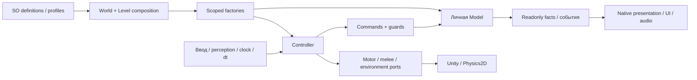

# TASK-008 · Читаемость и расширяемость кода

Дата: 2026-11-03. Статус: **предварительный аудит исходников; реализация и проверка не завершены**.

Авторитетная задача и критерии: [TASK-008 в Notion](https://app.notion.com/p/40c8d6dc06b68132874cd3d781d119fd). Этот документ — техническое свидетельство, не отдельный план или реестр багов.

В текущем коде есть осмысленные границы SOD и несколько конкретных мест для упрощения. Нет основания массово переписывать модели или объявлять каждый длинный View и конечный `switch` плохой архитектурой. Игровые изменения F01–F03/F05–F08 ещё не выполнены. Независимые исправления инструментов F04/BUG-055–057 реализованы и проверены отдельно; они не завершают TASK-008.

## Основание и границы

Исходный проход начат на HEAD `361c8177fe95de5dbd4e5a2f0051ac050a6a640c` в общей dirty-копии. Прочитаны 781 собственный C# файл исходного снимка под `Assets/EmergencyShift`: Runtime 588, Editor 35, Development 17, Tests 141. Прочитаны также 49 отдельных инструментов и сохранённых рецептов вне Assets. Это журнал чтения, не результат запуска тестов и не обещание отсутствия дефектов.

Пофайловые локаторы чтений сохранены в [read-trace.json](../Validation/CodeReadabilityTask008/read-trace.json). [Снимок метаданных](../Validation/CodeReadabilityTask008/source-inventory.pre-handoff.json) содержит текущие SHA, сборочные области и сохранённые GUID-зависимости; [collector](../Validation/CodeReadabilityTask008/capture_inventory.py) использует существующий `Tools/Maintenance/audit_code.py` только на чтение. Совпадение SHA, число строк, найденный токен или запись команды не заменяют семантическую проверку.

На момент подготовки этого отчёта общий `game` принадлежит TASK-007. Его частичная установка и меняющаяся цепочка анимации не считаются окончательным результатом. Новый `FixedCreatureSpriteSceneTests.cs` отсутствовал в исходном снимке и требует отдельного чтения по финалу предшественника. После явной передачи нужны свежий diff, SHA, состояние Editor и квалификация затронутых источников. Законный commit настройки ролей `45c72a69` относится к инструкции/docs, а не к игровому изменению TASK-008.

Исторический `CodeAudit.json` описывает прежние 663 источника и результаты 2026-10-22. Его старые зелёные флаги и отчёты не доказывают качество сегодняшней копии. Пока этот реестр не обновлялся TASK-008.

## Находки

| Код | Приоритет и область | Основание | Предлагаемая граница; текущее состояние |
|---|---|---|---|
| F01 | P2 · Скорпион | `ScorpionController.Step` принимает девять смешанных аргументов: текущие факты, статические настройки и уже умноженные на dt величины; есть optional defaults. `Scorpion2D` каждый tick делит скорость атаки на скорость преследования. `EnemyDefinition` разрешает нулевую PursuitSpeed, что создаёт путь к нечисловой скорости. | Один неизменяемый snapshot при композиции, абсолютная скорость атаки и короткий Step с фактами/временем. Сохранить порядок melee, фаз и движения. Путь при нуле доказан исходниками, runtime-воспроизведение ещё не выполнено; BUG не объявлен воспроизведённым. |
| F02 | P2 · Связность тревоги | `Scorpion2D` и `ScorpionPack2D` находят конкретный `ScorpionAudio2D` и вызывают `PlayAlarm`. Выбор источника тревоги связан с исполнением звука. | Actor сообщает событие, audio View владеет подпиской/проигрыванием. Сохранить один сигнал стаи, standalone, mute/disable, re-enable, независимые группы и порядок смерти. Пока предложение; нового Manager/interface не требуется. |
| F03 | P2 · Композиция подбора | `PickupInstaller` скрыто делает `Resources.Load<PickupGlintProfile>` при создании каждого уровня. | Явная сериализованная ссылка в world composition; локальные factory/controller и личная pulse остаются. Сохранить путь/GUID существующего profile и отсутствие изменений карт. Подключение и native-проверка ещё не выполнены. |
| F04 | P2 · Достоверность аудита | До исправления `audit_code.py --refresh` сбрасывал только `complete`, оставляя три технических флага и вложенное `sourceCoverage.hashesCurrent` true. | BUG-055: воспроизведено в отдельной временной копии CLI и исправлено. Все четыре признака готовности и hashesCurrent сбрасываются; dated review evidence/reviewedSha256 сохраняются, новые файлы queued. Общий CodeAudit пока не refresh-ился; его квалификация после передачи обязательна. |
| F05 | P2 · Текущие контракты | В SPEC/Features остались формулировки прежней visual-only стадии Скорпиона и переноса. | Обновить по окончательной реализации вместе с итогом TASK-007. Часть профильных docs сейчас зарезервирована предшественником; конкурирующие правки не выполнялись. |
| F06 | P3 · Навигация | Внутренний `EnemyChasePath2D` только перенаправляет вызовы в `EnemyChasePathModel`; текущие callers — motor/factory. Сериализованных ссылок GUID в первоначальном поиске не найдено. | После финальной проверки текстовых/динамических/сериализованных uses убрать проходной слой, возвращать model напрямую. Удаления нет; навигационные регрессии и сборка ещё не запускались. |
| F07 | P2 · Диагностические fixtures | `DevelopmentBuildSmoke` создаёт encounter и вызывает Activate без scoped injection. `SleeperRegressionProbe` создаёт активный Flashlight2D до DI, хотя Awake уже требует factory. | Проверить актуальный исходник/воспроизвести после слота; динамические fixtures должны получить существующую level composition до вызовов/Awake. Предшественник предупреждён ранее; fallback-контроллер не нужен. Обычный gameplay не объявлен сломанным. |
| F08 | P2 · Владение доказательствами | Два сценария `ScriptedIntroSceneTests` и один `StalkerBurnSceneTests` пишут свежие отчёты в исторические `Docs/Validation/DoorScatterDelay01` и `MonsterEyes03`. | Перед повторным прогоном перенести новый вывод в Logs, сохранив assertions и прежние свидетельства. Тесты этой задачей ещё не исполнялись. |

F01/F07 требуют точной квалификации и проверки дубликатов перед регистрацией воспроизведённого BUG в Notion. F04 зарегистрирована как [BUG-055](https://app.notion.com/p/40d8d6dc06b681bd82aafcdcb81dfe53); сопутствующие дефекты проверки документации — [BUG-056](https://app.notion.com/p/40d8d6dc06b68108a382e5c6dae49a73) и [BUG-057](https://app.notion.com/p/40d8d6dc06b68194a1c9cb461bda4ccf). Уникальность этих кодов сверена в Notion после создания.

## Изолированная проверка инструментов

После решения владельца о параллельных независимых результатах получен `files` lease на два maintenance CLI, этот отчёт/Validation и `MONSTER_CONCEPT_WORKFLOW.md`. Общий `game` остаётся у TASK-007. Временные проекты тестов размещаются только в зарезервированной Validation-папке; путь перед очисткой проверяется. Первый запуск harness в sandbox Temp не смог создать вложенные папки и не проверил продукт; после переноса временного корня выполнены следующие фактические проверки.

До исправлений [пять CLI-регрессий](../Validation/CodeReadabilityTask008/check_maintenance_cli.py) дали **две ожидаемые ошибки**: сохранение sourceCoverageComplete и ложный missing для существующих файлов с query. [Результат до](../Validation/CodeReadabilityTask008/maintenance-cli.before.json). После узких исправлений — **5/5**, [результат после](../Validation/CodeReadabilityTask008/maintenance-cli.after.json). Проверены реальный CLI refresh при added/changed/removed, сохранение старого reviewedSha256/дат/истории и removed entry при повторе, отсутствие автоматического review нового файла, byte-for-byte неизменность read-only реестра и отказ refresh без даты. Исторические поля sourceCoverage и dated evidence не становятся новым доказательством; текущие верхние counts/scopeCounts механические, а готовность после refresh всегда требует отдельной квалификации.

BUG-056 исправлен разбором URL path до percent-decoding: query и fragment не входят в имя файла; `%20`/`%23` внутри имени сохраняют правильное значение. Реально отсутствующая ссылка по-прежнему возвращает exit 1 и исходный target, внешние ссылки/anchors не объявляются проверенными.

В исходном [общем doc-check](../Validation/CodeReadabilityTask008/documentation-links.pre-handoff.json) было три brokenLocalLinks: два существующих viewer.html с query и один действительно отсутствующий исторический `FastGroupEnemy05Animation/README.md`. Для BUG-057 снята только нерабочая Markdown-ссылка в guide, отсутствие исторического README названо явно; арт/каталоги/требования не пересоздавались. После исправлений [проверка 427 Markdown файлов](../Validation/CodeReadabilityTask008/documentation-links.after-tools.json) дала **exit 0, brokenLocalLinks 0, exactDuplicateGroups 0**. Это проверка существования локальных файлов, не семантики текста, anchors или внешних URL.

## Карта основной игровой границы



Это карта владельцев основной логики, а не требование создавать Model для каждого SpriteRenderer или offline-рецепта. Composition знает конкретные реализации; общие consumers используют contracts. F02 — локальное нарушение этой границы: actor/pack ещё сами находят конкретный audio View. F03 относится к явности входящих данных composition, F01 — к разделению данных разного срока жизни.

## Что уже понятно и сохраняется

| Модуль | Вывод чтения |
|---|---|
| World/level/player composition | Общие immutable настройки и сервисы отделены от scope уровня, ввода и личных моделей. Фабрика может быть scoped, создавая отдельную модель на каждый actor. Installer не является gameplay Manager из-за перечня bindings. |
| Все текущие враги | Общие motor/perception/health/melee/gore используют bounded contracts. Сталкер, Спящий, Скорпион и прототип Claw имеют свои алгоритмы/представление; общие пули, door-crush, UI и audio-threat не требуют разрастающегося dispatch по виду. Роль прототипа Claw не придумывается заново. |
| Команды/модели | Проверки доступности и повторная валидация перед commit осмысленны. Конечные FSM/guard/две альтернативы не заменяются механически набором независимых if. Три явные зависимости EnemyPathSchedule — clock, общий quota, личный RNG — обоснованы; context bag не нужен. |
| Оружие/игрок/фонарь | Состояние боезапаса/владения/RNG личное. Числовые варианты отделены от различающихся cycle-алгоритмов. Направления залпа фиксируются до косметических callbacks. Старый AcquireFlashlightCommand — документированная совместимая API с тестами, не мусор по отсутствию нового caller. |
| Двери/подбор/доступ/цели | Команды проверяют приём и повторный вход; сохранение pickup remainder/consumption и стабильных IDs отделено от уведомлений. Новые стили не должны менять Silent Restore или порядок выдачи/сигналов. |
| Checkpoint/remains | DTO, версии, presence flags и старые ID сохраняются. Вложенные данные проверяются до изменения мира; restore не воспроизводит смерть/урон/аудио. Отсутствие checkpoint-поддержки Скорпиона в sandbox не оправдывает добавление нового payload ради примера. |
| UI/пауза/смерть/диалог | Явные владельцы input/motion leases и cleanup подписок уже имеют содержательные проверки. Отложенный MainMenu не превращается в обязательную точку входа. Чужой pause draft сохраняется. |
| Аудио/свет/VFX | Источники/реестры принадлежат своим сценам; личные memory/pulse/mix отделены от общих profiles. Шесть аргументов AudioLayerMix Step — текущие факты кадра, в отличие от смешанного tuning в F01. Лампа/выстрел не становятся защитным светом. |
| Editor/Development/тесты | Offline bake и native presentation могут быть длинными, оставаясь одной ответственностью. Editor-геометрия не возвращается в Player. Исторические генераторы и save/restore helpers не запускаются как универсальный ремонт текущих карт. |

Старое имя ассета само по себе не означает obsolete: установка TASK-007 намеренно сохраняет `StalkerSprites.asset`, `SleeperSprites05.asset`, их GUID и семантические имена `body-*`. Соответствующие проверки меняются только по действительному новому контракту.

Внешние источники пока квалифицированы частично. Шесть файлов в `Concepts/Unused/Visual/SleeperSpriteRig01/{AuthoringDrafts,PausedAttempt}` — сохранённый владельцем остановленный черновик вне Unity imports; их содержимое не объявлено заново прочитанным или рабочим. Исторические create.cs отделки/отклонённых индикаторов прочитаны как история, не как разрешение восстановить результат. Остальные непрочитанные AgentScripts явно видны в снимке, не отмечаются reviewed автоматически.

## Схема предполагаемого упрощения F01

До изменения actor смешивает данные разного срока жизни:

```csharp
controller.Step(position, target, alive, pursuitSpeed,
    attackReferenceSpeed / pursuitSpeed,
    cycleDistance / attackReferenceSpeed,
    turnPerTick, accelerationPerTick, brakingPerTick);
```

Целевой API после ещё не выполненного рефакторинга:

```csharp
// Factory один раз получает проверенные неизменяемые ScorpionSettings.
controller.Step(position, target, alive, deltaTime);
```

Это убирает повторное связывание правил на каждом tick и зависимость скорости атаки от деления на скорость погони. Положение, цель и время остаются явными текущими фактами. Новый snapshot не должен менять существующие SO/serialized поля, баланс и рисунки. Числа и порядок событий требуют baseline и последующей проверки.

## Следующее расширение

| Изменение | Где меняется и почему |
|---|---|
| Числовой вариант существующего врага | Definition/behavior profile и prefab/визуальный вариант. Новый controller-класс ради чисел не нужен. |
| Новый алгоритм врага | Свои settings/model/controller/commands, scoped factory и одна явная binding в EnemyInstaller; native adapter/presentation и prefab. Общие contracts переиспользуются по смыслу. Checkpoint adapter добавляется только при требовании persistence. |
| Вариант оружия | Definition с устойчивыми ContentId/SelectionSlot, visual/audio, каталог и authored loot reference. Новый cycle стрельбы/перезарядки — собственная settings/cycle специализация. |
| Третье одновременно выбираемое оружие | Это отдельное расширение возможностей ввода и active/spare HUD, сейчас рассчитанных на две позиции. Нельзя обещать нулевое изменение потребителей. Это не воспроизведённый текущий баг. |
| Новое взаимодействие | IInteractable/IInteractionActor, локальный владелец состояния/команд и native callbacks. Stable SaveKey/preflight нужны только при сохранении; новый глобальный context/Manager не нужен. |

## Проверка и сохранность на этом этапе

TASK-008 не менял импортируемые ресурсы/C#, сцены, prefab, Packages или ProjectSettings; не вызывал Unity, compile, EditMode/PlayMode или build. Изменения этого этапа — отдельно зарезервированные внеимпортные maintenance CLI, guide и свидетельства/отчёт. Выполнены только описанные изолированные Python CLI-регрессии и doc-check. Нативный baseline до чужой работы не подменяет будущий baseline после передачи. Старые зелёные Unity-тесты не переиспользованы как сегодняшние.

Обязательная реализация, содержательные регрессии, фактические prefab/scene references, смерть/retry/save затронутых границ, обычная Windows64 сборка, итоговый CodeAudit/контракты и scoped commits остаются в критериях задачи. Этот предварительный отчёт не закрывает их как рекомендации. Производительность/FPS, творческая приёмка и публикация не заявлены; OPT-01 остаётся отложенным. Обычный Play должен сохранить открытую карту и `playModeStartScene=null`.

Итоговый контроль авторинга на данном этапе: неприменим — объекты сцен этой задачей не менялись.
