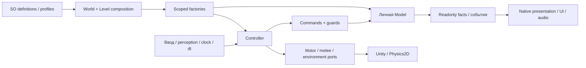

# TASK-008 · Читаемость и расширяемость кода

Дата обновления: 2026-11-04. Статус: **технический аудит, обязательные исправления и итоговые проверки завершены**.

Авторитетная задача и критерии: [TASK-008 в Notion](https://app.notion.com/p/40c8d6dc06b68132874cd3d781d119fd). Этот документ — техническое свидетельство, не отдельный план или реестр багов.

## Итоговая квалификация · 2026-11-04

[Текущий source snapshot](../Validation/CodeReadabilityTask008/source-review.final.json): **950 C# путей**, из них 944 прочитаны и имеют SHA-qualified ручные выводы; шесть остановленных внешних drafts явно исключены. Состав: 790 Assets/EmergencyShift, 150 AgentScripts и 10 Concepts (четыре прочитанных рецепта и шесть исключений). Текущие повторные чтения — [recent-read-trace](../Validation/CodeReadabilityTask008/recent-read-trace.json), решения по ответственности/исключениям — [semantic-modules](../Validation/CodeReadabilityTask008/semantic-modules.json). SHA подтверждает соответствие прочитанным байтам, не качество по счётчику/regex/компиляции.

CodeAudit содержит 944 reviewed_boundary, шесть preserved_unread_draft_exclusion, queued/partial0. Прежние dated passes, reviewed SHA и выводы сохранены в reviewHistory и backup. Шесть сохранённых `SleeperSpriteRig01/{AuthoringDrafts,PausedAttempt}` не прочитаны заново, не компилировались и не исполнялись. Исторические внешние генераторы квалифицированы как source/provenance, а не универсальные валидаторы сегодняшних карт. Подготовленный capture-only helper D/E/F TASK009 прочитан; его последующее исполнение относится к следующему окну владельца.

Небольшие осмысленные границы SOD сохранены. Конечные FSM, guard-проверки, три явные зависимости clock/quota/личный RNG, scoped factory и длинные связные native/View-рецепты не объявлены spaghetti по форме. Общие потребители урона, оружия, UI и угрозы не получили выбора по названию вида.

| Находка | Итог |
|---|---|
| F01/F02, BUG-059 | Immutable ScorpionSettings, короткий Step с текущими фактами/dt и абсолютная скорость атаки; AlarmCueRequested отделяет actor/pack от audio View. Прежние SO/баланс и порядок melee/cue сохранены. Red13/14 → green28/28, native4/4 до/после и итоговые общие проверки. |
| F03 | Явная serialized world-ссылка PickupGlintInstaller на прежний profile; PickupInstaller связывает только level factories. Native ProjectContext4→5 installers, шесть прежних компонентов неизменны, GUID/profile сохранены. Реальный glint baseline1/1; итоговый тест проверяет identity обеих factory-attached View и личную pulse. |
| F04/F05, BUG-055–057 | Maintenance CLI и parser исправлены/проверены; CodeAudit сохраняет историю; SPEC/Enemies описывают реальный Скорпион. Два дополнительных CLI red подтвердили ложный reviewedSha непрочитанного исключения; refresh теперь сохраняет unread без reviewedSha, изменившийся draft ставит queued. Итоговые8/8 CLI PASS. Ручная квалификация отделена от metadata refresh. |
| F06 | Удалены внутренняя несериализуемая EnemyChasePath2D и meta; factory/motor используют личную model напрямую. До удаления8053 native dependency checks/0 users плюс текущий caller/GUID/dynamic review. Geometry/cache/schedule/quota/RNG сохранены; navigation/motor и release проверены. |
| F07, BUG-062 | Реально воспроизведены устаревший audio fixture, отсутствующие encounter/flashlight DI. Scoped injection до Awake/Activate, один свой scene context, bounded штатная input readiness,30 уникальных voices и actual-shot positive control. Полные smoke15/15 и Sleeper25/25. |
| F08, BUG-060 | Три активных output перенесены в абсолютные Logs/Tests; payload/assertions сохранены. Реальные новые отчёты получены, три исторических SHA неизменны. Разрушительного воспроизведения не было. |
| F09, BUG-061 | TASK007 исправил UTF-8/control character своего отчёта, сохранив смысл и FAIL; настоящий doc-check проходит. Его отдельный commit713505a9; чужой файл не stage-ился TASK008. |
| F10, BUG-063 | Deferred hurt Start переносил root в выгружаемую сцену. Исходный AccessControl red повторён; новая immediate-unload regression red→green. Parenting к Player теперь задаёт сцену и lifetime голосов. Profile/клипы/микс не менялись. |
| F11, BUG-064 | StalkerRig fixture больше не требует отменённые body-0/4/8. Проверяет actual SpriteSet.Frame identity и оригинальные Walk/Recoil refs; оба authored уровня, движение, gradual fold, eye/body separation, whole-body/death сохранены. |
| F12, BUG-065 | Native audio положительный контроль ждёт DSP ограниченное1s unscaled время; timeSamples>0/isPlaying/clip/once-per-pack/order/mute/isolation остаются обязательными. Игровое audio не менялось. |

| Итоговая проверка | Фактическое свидетельство |
|---|---|
| Полный EditMode после всех C# изменений | [1478/1478](../Validation/CodeReadabilityTask008/all-editmode.final.json) |
| Полный PlayMode после исправления трёх выявленных сбоев | [117/117](../Validation/CodeReadabilityTask008/all-playmode.final.json); исходный113/116 сохранён отдельно |
| Настоящие диагностические routines | [Smoke15/15](../Validation/CodeReadabilityTask008/diagnostic-smoke.after.json), [Sleeper25/25](../Validation/CodeReadabilityTask008/diagnostic-sleeper.after.json) |
| Реальная физика Скорпиона | [Погоня2.4, атака1.89732146, committed heading, disable/death и immutable assets PASS](../Validation/CodeReadabilityTask008/scorpion-native-motion.after.json) |
| Native prefab/profile references | [266 assets/2954 objects/0 failures](../Validation/CodeReadabilityTask008/native.asset-references.final.json), включая неактивные дочерние объекты |
| Обычный Windows64 Player | [Succeeded,0 errors,1 warning](../Validation/CodeReadabilityTask008/release-build.json),93.22s; только собственная Runtime assembly; прежний glint и установленный hurt profile/4клипа включены |
| Открытая MechanicsSandbox | 2703 native object/component records, full normalized JSON/scene SHA/setup/dirty/global state совпали с phase2 baseline; missing scripts/refs0 |
| Сохранённые входы | [3856 baseline files, только17 явных собственных изменений](../Validation/CodeReadabilityTask008/saved-inputs.phase2.after.json);114 TASK007 inputs побайтно сохранены |
| Исторические test reports | [Три прежних SHA неизменны, три новых отчёта в Logs](../Validation/CodeReadabilityTask008/historical-test-outputs.after.json) |
| Maintenance и preservation CLI | [8/8 maintenance](../Validation/CodeReadabilityTask008/maintenance-cli.final.json), [8/8 preservation](../Validation/CodeReadabilityTask008/preservation-cli.after-resume.json); реальные отдельные временные проекты |

Сборка включает MechanicsSandbox, MorgueRouteTest, BasementPrototype и DoorCrushTest. Единственное предупреждение — отсутствие RuntimePipelineConfig: Pipeline выключен в обычном Player. [Console status](../Validation/CodeReadabilityTask008/console.final.json): compilationFailed=false,0 текущих errors,1 ожидаемое warning. Буфер хранит исходные red cases/прежние CS0618 и инфраструктурный30s Pipeline timeout при prebuild snapshot. Сам snapshot полностью сформирован и preserved=true; эти записи сохранены отдельно и не выданы за новый gameplay дефект или нулевую историю Console.

Проверена фактическая общая dirty-копия на base HEAD8e10b3fe с source snapshot; чистая опубликованная ревизия не заявлена. Чужие pause/art/scene изменения сохранены и не входят в commit TASK008. Baseline снят заново после согласованного возврата оригиналов TASK007 и короткой записи TASK009. Native snapshots сжаты gzip без потери байтов, исходные/сжатые SHA записаны отдельно. Сцены не сохранялись, объекты авторинга не добавлялись/перемещались; итоговый контроль авторинга: **неприменим**. Единственная постоянная prefab-миграция этой фазы — world installer в ProjectContext.

Не заявлены FPS/performance, художественная приёмка, публикация, завершение нового арта TASK007 или замены отклонённого B TASK009. OPT-01 и MainMenu сохраняют последнее решение владельца. Scoped commit и завершение карточек записываются после этой квалификации.

## История промежуточного аудита

Ниже сохранены состояния предыдущих этапов и их ограничения. Формулировки «ещё не выполнено» относятся к тому этапу; актуальный итог приведён выше. Предложения `.proposed.patch` повторно применять к текущему коду нельзя.

В текущем коде есть осмысленные границы SOD и несколько конкретных мест для упрощения. Нет основания массово переписывать модели или объявлять каждый длинный View и конечный `switch` плохой архитектурой. F01/F02 теперь реализованы в игровом C# и проверены, F05 уточнён в Enemies/SPEC; F03/F06–F08 и окончательная квалификация/сборка остаются обязательными. Независимые исправления инструментов F04/BUG-055–057 реализованы и проверены отдельно.

## Основание и границы

Исходный проход начат на HEAD `361c8177fe95de5dbd4e5a2f0051ac050a6a640c` в общей dirty-копии. Прочитаны 781 собственный C# файл исходного снимка под `Assets/EmergencyShift`: Runtime 588, Editor 35, Development 17, Tests 141. Прочитаны также 49 отдельных инструментов и сохранённых рецептов вне Assets. Это журнал чтения, не результат запуска тестов и не обещание отсутствия дефектов.

Пофайловые локаторы чтений сохранены в [read-trace.json](../Validation/CodeReadabilityTask008/read-trace.json). [Снимок метаданных](../Validation/CodeReadabilityTask008/source-inventory.pre-handoff.json) содержит текущие SHA, сборочные области и сохранённые GUID-зависимости; [collector](../Validation/CodeReadabilityTask008/capture_inventory.py) использует существующий `Tools/Maintenance/audit_code.py` только на чтение. Совпадение SHA, число строк, найденный токен или запись команды не заменяют семантическую проверку.

Первый этап чтения выполнялся при game lease TASK-007. Его художественно отклонённый FixedSprites06 остаётся чужим установленным кандидатом. Явный handoff TASK-008 записан 2026-11-04; свежий Editor6000.6.5f1 stopped/ready, одна MechanicsSandbox, dirty=false, startScene=null. Владелец перезапустил Editor: вчерашний unsaved буфер не объявляется сохранившимся. Сверены свежий diff, manifest 114 импортированных файлов TASK-007 и собственный native baseline. Новый `FixedCreatureSpriteSceneTests.cs` прочитан отдельно. Законный commit настройки ролей `45c72a69` относится к инструкции/docs, а не к игровому изменению TASK-008.

Исторический `CodeAudit.json` описывал прежние 663 источника и результаты 2026-10-22. Его старые зелёные флаги и отчёты не доказывают качество сегодняшней копии. Первоначальный метаданный refresh под отдельным files lease содержал 924 записи: 585 унаследованных без изменения SHA, 78 partial и 261 queued. После этапа Скорпиона выполнен новый refresh и [явная квалификация десяти изменённых источников](../Validation/CodeReadabilityTask008/scorpion.semantic-review.json), привязанная к фактическому SHA и commit `a05f2ab7`. Прежние выводы сохранены в reviewHistory и отдельном before-снимке. Все технические признаки общей готовности/hash-current остаются false; остальные исторические статусы не объявлены новым покрытием TASK-008.

## Находки

| Код | Приоритет и область | Основание | Предлагаемая граница; текущее состояние |
|---|---|---|---|
| F01 | P2 · Скорпион | Прежний Step смешивал постоянные настройки и текущие факты, а actor делил скорость атаки на допустимый ноль PursuitSpeed. | Реализованы неизменяемый ScorpionSettings при композиции и короткий Step с deltaTime. BUG-059 воспроизведён в настоящем Unity EditMode через fake ports: baseline13/14 с одним ожидаемым FAIL, после исправления исходный сценарий проходит. Сохранены числовые SO-поля и melee/event порядок; итоговая общая сборка впереди. |
| F02 | P2 · Связность тревоги | Actor/pack раньше находили конкретный audio View для проигрывания выбранной тревоги. | Реализовано AlarmCueRequested с подпиской/отпиской audio View. Четыре native PlayMode прошли до/после; проверены выбранный caller, один голос стаи, cue-before-counter, mute с положительным audibility control, enable/disable без replay, две независимые стаи, standalone и fatal-hit ordering. Нового Manager/interface нет. |
| F03 | P2 · Композиция подбора | `PickupInstaller` скрыто делает `Resources.Load<PickupGlintProfile>` при создании каждого уровня. | Явная сериализованная ссылка в world composition; локальные factory/controller и личная pulse остаются. Сохранить путь/GUID существующего profile и отсутствие изменений карт. Подключение и native-проверка ещё не выполнены. |
| F04 | P2 · Достоверность аудита | До исправления `audit_code.py --refresh` сбрасывал только `complete`, оставляя три технических флага и вложенное `sourceCoverage.hashesCurrent` true. | BUG-055: воспроизведено в отдельной временной копии CLI и исправлено. Все четыре признака готовности и hashesCurrent сбрасываются; dated review evidence/reviewedSha256 сохраняются, новые файлы queued. Применён метаданный refresh общего CodeAudit; окончательная ручная квалификация после передачи обязательна. |
| F05 | P2 · Текущие контракты | В SPEC сохранялась прежняя visual-only стадия Скорпиона. | Исправлено после освобождения SPEC резерва TASK-006; Enemies описывает действительные settings/factory/event lifetimes. Художественно отклонённый кандидат TASK-007 и неутверждённый баланс не объявлены принятыми. |
| F06 | P3 · Навигация | Внутренний `EnemyChasePath2D` только перенаправляет вызовы в `EnemyChasePathModel`; текущие callers — motor/factory. Сериализованных ссылок GUID в первоначальном поиске не найдено. | После финальной проверки текстовых/динамических/сериализованных uses убрать проходной слой, возвращать model напрямую. Удаления нет; навигационные регрессии и сборка ещё не запускались. |
| F07 | P2 · Диагностические fixtures | `DevelopmentBuildSmoke` создаёт encounter и вызывает Activate без scoped injection. `SleeperRegressionProbe` создаёт активный Flashlight2D до DI, хотя Awake уже требует factory. | Проверить актуальный исходник/воспроизвести после слота; динамические fixtures должны получить существующую level composition до вызовов/Awake. Предшественник предупреждён ранее; fallback-контроллер не нужен. Обычный gameplay не объявлен сломанным. |
| F08 / [BUG-060](https://app.notion.com/p/40e8d6dc06b6819bbee9e45a88ee41df) | P2 · Владение доказательствами | Два сценария `ScriptedIntroSceneTests` и один `StalkerBurnSceneTests` пишут свежие отчёты в исторические `Docs/Validation/DoorScatterDelay01` и `MonsterEyes03`. | Перед повторным прогоном перенести новый вывод в Logs, сохранив assertions и прежние свидетельства. Тесты этой задачей ещё не исполнялись. |
| F09 / [BUG-061](https://app.notion.com/p/40e8d6dc06b681fca6cfcdc46ec86609) | P3 · Кодировка свидетельств | Реальный doc-check прервался на ANSI-байте0x97 в actual-r2-review.md отчёта TASK007. | Владелец TASK007 исправил UTF-8 и управляющий символ перед именем JSON; смысл и FAIL сохранены. TASK008 проверил декодирование/FAIL и настоящий общий doc-check: exit0, 453 документа, 241 Docs, brokenLocalLinks=[], exactDuplicateGroups=[]. Before/after evidence сохранены; исправленный документ включён владельцем в отдельный commit `713505a9`, BUG-061 закрыт. Игровой runtime не затронут. |

F01 зарегистрирован после проверки дубликатов и реального воспроизведения как [BUG-059](https://app.notion.com/p/40e8d6dc06b681f395d2f887dd8b4f69), уникальность кода сверена. F07 ещё требует фактической квалификации. F04 зарегистрирована как [BUG-055](https://app.notion.com/p/40d8d6dc06b681bd82aafcdcb81dfe53); сопутствующие дефекты проверки документации — [BUG-056](https://app.notion.com/p/40d8d6dc06b68108a382e5c6dae49a73) и [BUG-057](https://app.notion.com/p/40d8d6dc06b68194a1c9cb461bda4ccf).

## Реальный этап Скорпиона · 2026-11-04

Старый [контрпример](../Validation/CodeReadabilityTask008/scorpion.before.json) дал 13 прежних PASS / один новый FAIL конечности запрошенной скорости. NaN наблюдал fake motor, native Rigidbody не получал его. После переноса настроек [19/19](../Validation/CodeReadabilityTask008/scorpion.after.json); затем добавлена проверка factory на действительных authored SO и неизменность их JSON. [Вместе с audio-hit fixture — 28/28 EditMode](../Validation/CodeReadabilityTask008/scorpion.all-editmode.after.json). Содержательные проверки включают нулевую скорость погони, отдельную gather cycle, недопустимый dt до side effects, личные gait/aggro/death при общих settings, ускорение, поворот, interruption и finish один раз.

Новые native сценарии тревоги прошли [4/4 до](../Validation/CodeReadabilityTask008/scorpion-alarm.before.json) и [4/4 после](../Validation/CodeReadabilityTask008/scorpion-alarm.after.json) event-границы. Использованы существующие четыре R04 actor и отдельный временный pack через настоящий level factory; все runtime-объекты выгружены без сохранения сцен. Это функциональная проверка, не художественная оценка или стресс-тест.

Нативный baseline и повторная проверка сравнили 2703 объекта открытой MechanicsSandbox, включая неактивные, полные сериализованные данные/ссылки, файл сцены и loaded/active/dirty state: различий0, missing scripts/references0, saves0. Два ранних FAIL диагностического helper объяснены типом JSON null (Null после чтения файла против String с null в свежем JObject), а не изменением карты; различие раскрыто в tokenDifferences. Helper исправлен явным JValue.CreateNull, исходный baseline не заменялся. Итог — [editor.after-scorpion-stage.json.gz](../Validation/CodeReadabilityTask008/editor.after-scorpion-stage.json.gz). Полные snapshots сохранены lossless gzip; их исходные SHA и проверка точного roundtrip находятся в compression-manifest.json.

[Проверка сохранённых входов](../Validation/CodeReadabilityTask008/scorpion.saved-inputs.after.json) сравнила 3826 исходных файлов Assets/Packages/ProjectSettings: отличаются только 11 разрешённых C#/новых meta этого этапа. Все 114 чужих импортированных файлов TASK-007 побайтно совпали с handoff manifest; сцены, prefab, SO, GUID/IDs, pause draft и остальные настройки не изменены. Итоговый контроль авторинга этого этапа неприменим: объекты сцен не добавлялись/не перемещались. Обычная Windows64-сборка и полные регрессии всей TASK-008 ещё не выполнялись.

## Изолированная проверка инструментов · этап 2026-11-03

После решения владельца о параллельных независимых результатах был получен `files` lease на два maintenance CLI, этот отчёт/Validation и `MONSTER_CONCEPT_WORKFLOW.md`. Общий `game` в тот период оставался у TASK-007. Временные проекты тестов размещались только в зарезервированной Validation-папке; путь перед очисткой проверялся. Первый запуск harness в sandbox Temp не смог создать вложенные папки и не проверил продукт; после переноса временного корня выполнены следующие фактические проверки.

До исправлений [пять CLI-регрессий](../Validation/CodeReadabilityTask008/check_maintenance_cli.py) дали **две ожидаемые ошибки**: сохранение sourceCoverageComplete и ложный missing для существующих файлов с query. [Результат до](../Validation/CodeReadabilityTask008/maintenance-cli.before.json). После узких исправлений — **5/5**, [результат после](../Validation/CodeReadabilityTask008/maintenance-cli.after.json). Проверены реальный CLI refresh при added/changed/removed, сохранение старого reviewedSha256/дат/истории и removed entry при повторе, отсутствие автоматического review нового файла, byte-for-byte неизменность read-only реестра и отказ refresh без даты. Исторические поля sourceCoverage и dated evidence не становятся новым доказательством; текущие верхние counts/scopeCounts механические, а готовность после refresh всегда требует отдельной квалификации.

BUG-056 исправлен разбором URL path до percent-decoding: query и fragment не входят в имя файла; `%20`/`%23` внутри имени сохраняют правильное значение. Реально отсутствующая ссылка по-прежнему возвращает exit 1 и исходный target, внешние ссылки/anchors не объявляются проверенными.

После возобновления отдельно проверен инструмент сохранности saved inputs: [8/8 реальных CLI-сценариев](../Validation/CodeReadabilityTask008/preservation-cli.after-resume.json) в изолированном временном проекте. Проверены разрешённое собственное изменение, обнаружение чужого изменения даже в allow-list, новый явно указанный handoff, автоматический выбор записанного манифеста при verify, сохранность прежнего baseline, отказ изменённому манифесту и пути вне проекта. `--baseline` позволяет сохранить отдельный снимок после согласованных окон других задач; `--handoff` и его SHA закрепляют конкретное основание проверки. Общие Assets/Packages/ProjectSettings и Unity этим прогоном не затрагивались; это проверка инструмента, а не текущей сохранности игрового проекта.

Исправленный refresh также применён к фактическому общему реестру. [Дельта](../Validation/CodeReadabilityTask008/registry-refresh.pre-handoff.json), [проверка сохранности review evidence](../Validation/CodeReadabilityTask008/registry-refresh.verification.json) и [прежний summary](../Validation/CodeReadabilityTask008/registry-summary.before-refresh.json) зафиксированы отдельно. Для всех 663 прежних путей сохранены reviewedSha256, reviewDate/history/report/scope/notes; все 261 новые записи queued без reviewedSha256. Датированные reviewPasses/latestReview не изменены. Это проверка реального metadata refresh, не новая семантическая квалификация 924 файлов и не Unity/native PASS.

Дополнительное чтение `audit_content.py` обнаружило второй независимый Markdown parser с той же ошибкой и ложным учётом примеров внутри code fence. Новый реальный CLI-сценарий сначала упал ([content-before](../Validation/CodeReadabilityTask008/maintenance-cli.content-before.json)); после замены дублирования вызовом существующего `audit_documentation.inventory` — **6/6** ([content-after](../Validation/CodeReadabilityTask008/maintenance-cli.content-after.json)). Сохранён прежний формат `broken_links` как пары source/target; оба инструмента теперь используют один набор правил для Docs/Concepts/AGENTS/project skills. Это продолжение BUG-056, не новая gameplay-система.

Фактический [content inventory](../Validation/CodeReadabilityTask008/content-inventory.pre-handoff.json) также завершился без broken links. Он увидел 2047 meta, 103 кандидата без входящих текстовых GUID и 239 внешних либо не найденных в Assets GUID. Это **не** 239 потерянных native references: сканер не читает PackageCache/AssetDatabase/local fileID. Кандидаты тоже не unused: среди них текущий `Resources/PickupGlintProfile.asset`, который прямо загружает PickupInstaller. Никакие ресурсы по этому списку не удалялись; игровая копия предшественника ещё меняется, финальная native-квалификация впереди.

В исходном [общем doc-check](../Validation/CodeReadabilityTask008/documentation-links.pre-handoff.json) было три brokenLocalLinks: два существующих viewer.html с query и один действительно отсутствующий исторический `FastGroupEnemy05Animation/README.md`. Для BUG-057 снята только нерабочая Markdown-ссылка в guide, отсутствие исторического README названо явно; арт/каталоги/требования не пересоздавались. После исправлений [проверка 427 Markdown файлов](../Validation/CodeReadabilityTask008/documentation-links.after-tools.json) дала **exit 0, brokenLocalLinks 0, exactDuplicateGroups 0**. Это проверка существования локальных файлов, не семантики текста, anchors или внешних URL.

## Карта основной игровой границы



Это карта владельцев основной логики, а не требование создавать Model для каждого SpriteRenderer или offline-рецепта. Composition знает конкретные реализации; общие consumers используют contracts. F02 устранил локальную зависимость actor/pack от конкретного audio View. F03 относится к явности входящих данных composition, F01 — к разделению данных разного срока жизни.

## Что уже понятно и сохраняется

После этапа Скорпиона составлены [ручные выводы по каждому модулю](../Validation/CodeReadabilityTask008/semantic-modules.json), [новые пофайловые чтения с SHA](../Validation/CodeReadabilityTask008/recent-read-trace.json) и [поисходниковая сводка](../Validation/CodeReadabilityTask008/source-review.progress-01.json). На момент снимка 933 пути: 917 выводов по исходникам, десять отдельно проверенных файлов этапа Скорпиона и шесть явно сохранённых непрочитанных drafts. Это квалификация содержания прочитанных исходников, а не полный native/build PASS: оставшиеся F03/F06–F08 требуют реализации, активные изменения других чатов — проверки новых SHA после передачи. Сборщик только соединяет явные ручные решения и локаторы; он не присваивает качество по именам, токенам или счётчикам и не меняет CodeAudit.

| Модуль | Вывод чтения |
|---|---|
| World/level/player composition | Общие immutable настройки и сервисы отделены от scope уровня, ввода и личных моделей. Фабрика может быть scoped, создавая отдельную модель на каждый actor. Installer не является gameplay Manager из-за перечня bindings. |
| Все текущие враги | Общие motor/perception/health/melee/gore используют bounded contracts. Сталкер, Спящий, Скорпион и прототип Claw имеют свои алгоритмы/представление; общие пули, door-crush, UI и audio-threat не требуют разрастающегося dispatch по виду. Роль прототипа Claw не придумывается заново. |
| Команды/модели | Проверки доступности и повторная валидация перед commit осмысленны. Конечные FSM/guard/две альтернативы не заменяются механически набором независимых if. Три явные зависимости EnemyPathSchedule — clock, общий quota, личный RNG — обоснованы; context bag не нужен. |
| Оружие/игрок/фонарь | Состояние боезапаса/владения/RNG личное. Числовые варианты отделены от различающихся cycle-алгоритмов. Направления залпа фиксируются до косметических callbacks. Старый AcquireFlashlightCommand — документированная совместимая API с тестами, не мусор по отсутствию нового caller. |
| Двери/подбор/доступ/цели | Команды проверяют приём и повторный вход; сохранение pickup remainder/consumption и стабильных IDs отделено от уведомлений. Новые стили не должны менять Silent Restore или порядок выдачи/сигналов. |
| Checkpoint/remains | DTO, версии, presence flags и старые ID сохраняются. Вложенные данные проверяются до изменения мира; restore не воспроизводит смерть/урон/аудио. Отсутствие checkpoint-поддержки Скорпиона в sandbox не оправдывает добавление нового payload ради примера. |
| UI/пауза/смерть/диалог | Явные владельцы input/motion leases и cleanup подписок уже имеют содержательные проверки. Отложенный MainMenu не превращается в обязательную точку входа. Чужой pause draft сохраняется. |
| Аудио/свет/VFX | Источники/реестры принадлежат своим сценам; личные memory/pulse/mix отделены от общих profiles. Шесть аргументов AudioLayerMix Step — текущие факты кадра, в отличие от смешанного tuning в F01. Лампа/выстрел не становятся защитным светом. |
| Editor/Development/тесты | Offline bake и native presentation могут быть длинными, оставаясь одной ответственностью. Editor-геометрия не возвращается в Player. Исторические генераторы и save/restore helpers не запускаются как универсальный ремонт текущих карт. |

Старое имя ассета само по себе не означает obsolete: установка TASK-007 намеренно сохраняет `StalkerSprites.asset`, `SleeperSprites05.asset`, их GUID и семантические имена `body-*`. Соответствующие проверки меняются только по действительному новому контракту.

Отдельно прочитаны ещё 87 внешних C# рецептов; [дополнительный след чтения](../Validation/CodeReadabilityTask008/additional-read-trace.json) содержит пофайловые выводы и локаторы реальных команд. Вместе с 49 внешними источниками первоначального прохода это 136 внешних файлов: все 134 текущих AgentScripts и два исторических Concepts. Это authoring/диагностические инструменты вне production assembly. Например, Validate pause draft вызывает Install, старые native verifiers перезаписывают исторические evidence-файлы, а часть сценариев Скорпиона только записывает false без исключения. Они не являются универсальным PASS сегодняшних dirty-карт. Старые рецепты не выполняются и не форматируются массово; активные helpers TASK-007 прочитаны предварительно и требуют повторной квалификации после передачи.

Шесть файлов в `Concepts/Unused/Visual/SleeperSpriteRig01/{AuthoringDrafts,PausedAttempt}` — сохранённый владельцем остановленный черновик вне Unity imports. [Исключения с SHA](../Validation/CodeReadabilityTask008/preserved-draft-exclusions.json) фиксируют их по отдельности и две пары точных копий; это метаданные и причина сохранения, не новое семантическое чтение/компиляция. Исторические create.cs отделки/отклонённых индикаторов прочитаны как история, не как разрешение восстановить результат. Общий аудит остаётся незавершённым: игровые правки, актуальные меняющиеся SHA, новые файлы после baseline, Unity/native регрессии и обычная сборка ещё впереди.

[Третий снимок](../Validation/CodeReadabilityTask008/source-inventory.pre-handoff-03.json) на HEAD `2b38cefa` содержит 924 текущих источника и 917 локаторов чтения. Его семь pending paths — шесть указанных drafts и новый `FixedCreatureSpriteSceneTests.cs`; последний затем прочитан отдельно (`724dca`, `69804a`) и добавлен в журнал. Итого 918 предварительных чтений текущих путей, включая 782 Assets, без автоматического присвоения reviewedSha256 или переноса результатов тестов предшественника.

## Граница F01 до и после

До изменения actor смешивает данные разного срока жизни:

```csharp
controller.Step(position, target, alive, pursuitSpeed,
    attackReferenceSpeed / pursuitSpeed,
    cycleDistance / attackReferenceSpeed,
    turnPerTick, accelerationPerTick, brakingPerTick);
```

Реализованный API после рефакторинга:

```csharp
// Factory один раз получает проверенные неизменяемые ScorpionSettings.
controller.Step(position, target, alive, deltaTime);
```

Это убирает повторное связывание правил на каждом tick и зависимость скорости атаки от деления на скорость погони. Положение, цель и время остаются явными текущими фактами. Новый snapshot не должен менять существующие SO/serialized поля, баланс и рисунки. Числа и порядок событий требуют baseline и последующей проверки.

Сохранённые [F01 patch](../Validation/CodeReadabilityTask008/scorpion-settings.proposed.patch) и [manifest исходных SHA](../Validation/CodeReadabilityTask008/scorpion-settings.proposal.json) описывают подготовку 2026-11-03. Реализация 2026-11-04 уже применена, скомпилирована и проверена после handoff; фактические результаты и commit приведены выше. Сохраняются melee/motion порядок и сериализованные поля, immutable Settings и абсолютная скорость атаки. Исторический patch не следует повторно применять к новому API.

Состояние отдельных предложений после этапа Скорпиона:

| Граница | Подготовка | Обязательная квалификация после game handoff |
|---|---|---|
| F01 · контрпример до исправления | [Baseline patch](../Validation/CodeReadabilityTask008/scorpion-zero-pursuit.baseline.patch), [manifest](../Validation/CodeReadabilityTask008/scorpion-zero-pursuit.baseline.json) | Исполнено: 13/14 до исправления, ожидаемый FAIL finite-velocity при PursuitSpeed=0; после исправления 28/28 с исходными контролями и новыми сценариями. Настоящий controller/model и fake ports, NaN не передавался Rigidbody. BUG-059 зарегистрирован после воспроизведения. |
| F02 · тревога | [Patch](../Validation/CodeReadabilityTask008/scorpion-alarm.proposed.patch), [manifest](../Validation/CodeReadabilityTask008/scorpion-alarm.proposal.json) | Применено и проверено: 4/4 native до/после, выбранный emitter, cue до AlarmCount++, silent Alert(), standalone/pack/mute/disable/re-enable/независимые группы/смерть. PlayAlarm API сохранён. |
| F03 · подбор | [Patch](../Validation/CodeReadabilityTask008/pickup-glint-composition.proposed.patch), [manifest](../Validation/CodeReadabilityTask008/pickup-glint-composition.proposal.json) | Source patch отдельно недостаточен: новый MonoInstaller после compile подключается ровно один раз в существующем ProjectContext через Unity, с прежним resource profile/GUID. Проверить DI identity, неизменность profile и реальные glint/lifetime/occlusion/pause/restore/build. |
| F06 · обёртка | [Patch](../Validation/CodeReadabilityTask008/navigation-wrapper.proposed.patch), [manifest](../Validation/CodeReadabilityTask008/navigation-wrapper.proposal.json) | Повторить final dynamic/serialized/full-text проверку GUID/callers, затем navigation/motor/native route и build. Личная Model/schedule/RNG сохраняются, unused не выводится из одного поиска. |
| F07 · diagnostic DI | [Частичный patch](../Validation/CodeReadabilityTask008/diagnostic-composition.proposed.patch), [manifest](../Validation/CodeReadabilityTask008/diagnostic-composition.proposal.json) | Инъекция encounter до Activate, неактивное создание/инъекция flashlight до Awake и один реальный level context. Полные старые probes не сертифицированы: startup input lock, фиксированные audio counts, checkpoint/presentation fixtures и тайминги требуют настоящего прогона; assertions не ослаблять. |
| F08 · результаты тестов | [Patch](../Validation/CodeReadabilityTask008/test-evidence-outputs.proposed.patch), [manifest](../Validation/CodeReadabilityTask008/test-evidence-outputs.proposal.json) | Снять SHA исторических evidence; до прогона перенести только три output в абсолютные project Logs/Tests, сохранив assertions. После настоящих PlayMode проверить новые файлы и неизменность прежних байтов. |

До handoff шесть proposed patches вместе прошли `git apply --check --whitespace=error`; baseline counterexample был проверен отдельно к старому API. Та проверка относилась только к контексту patch. Игровые F01/F02 затем выполнены под явным game lease; F03/F06–F08 ещё не применены.

Предварительное повторное чтение границы (`ce48aa`, `e44f13`) и сохранённых Scorpion SO (`ab7468`, `1a6953`) уточнило условия миграции: pursuit 2.4, attack reference 1.8973215, attack duration 0.56, turn 420°/s, acceleration 9, braking 18. Gather cycle выводится отдельно из run distance / attack speed, не подменяется attack duration. Не менять сериализованные имена, animation refs, HP/урон/тайминги. `Alert()` каждого участника остаётся беззвучным; один cue выбранного caller возникает до увеличения AlarmCount, а disable/re-enable audio не должен повторять уже состоявшуюся тревогу. Это проектирование по исходникам, не новый результат Unity-тестов.

## Следующее расширение

| Изменение | Где меняется и почему |
|---|---|
| Числовой вариант существующего врага | Definition/behavior profile и prefab/визуальный вариант. Новый controller-класс ради чисел не нужен. |
| Новый алгоритм врага | Свои settings/model/controller/commands, scoped factory и одна явная binding в EnemyInstaller; native adapter/presentation и prefab. Общие contracts переиспользуются по смыслу. Checkpoint adapter добавляется только при требовании persistence. |
| Вариант оружия | Definition с устойчивыми ContentId/SelectionSlot, visual/audio, каталог и authored loot reference. Новый cycle стрельбы/перезарядки — собственная settings/cycle специализация. |
| Третье одновременно выбираемое оружие | Это отдельное расширение возможностей ввода и active/spare HUD, сейчас рассчитанных на две позиции. Нельзя обещать нулевое изменение потребителей. Это не воспроизведённый текущий баг. |
| Новое взаимодействие | IInteractable/IInteractionActor, локальный владелец состояния/команд и native callbacks. Stable SaveKey/preflight нужны только при сохранении; новый глобальный context/Manager не нужен. |

Проверенный по действующим исходникам пример следующего вида: личная factory получает level clock и создаёт новую model с immutable settings для каждого actor; регистрация factory добавляется в `EnemyInstaller.Install`. Native actor использует `IEnemyBrainMotor`/`IEnemyBrainMelee` для движения и контакта, а `Damageable2D` связывает его с пулями и раздавливанием. Для атмосферы собственный наследник `AudioThreatEmitter2D` сообщает общие факты alive/engaged/attacking и услышанные cues; `AudioThreatQuery2D` уже обрабатывает эти факты через scene registry. При динамическом появлении `LevelContext2D.CreateInstance` выполняет scoped composition до Awake. Нужные компоненты и данные собираются в prefab, а размещение/цель/патруль принадлежат уровню. Save adapter появляется при требовании сохранять этот вид, со своим явным payload/preflight.

Для числового варианта пистолета используется существующий `MagazineWeaponDefinition.ToSettings`: ёмкость и время перезарядки создают личный cycle через settings. Другой алгоритм, как у `PumpShotgunDefinition`, специализирует settings/cycle; `WeaponControllerFactory` продолжает создавать личную `WeaponOwnerModel` и RNG. `WeaponSettingsCatalog` проверяет уникальность ContentId и SelectionSlot. Так следующий вариант имеет явные места изменения и сохраняет текущие ограничения двух выбираемых позиций ввода/HUD.

## Сохранность внеимпортного этапа · 2026-11-03

На том этапе TASK-008 ещё не менял импортируемые ресурсы/C#, сцены, prefab, Packages или ProjectSettings и не вызывал Unity/тесты/build. Его изменения — отдельно зарезервированные maintenance CLI, guide и свидетельства/отчёт. Выполнялись только описанные Python CLI-регрессии и doc-check. Они не подменяют выполненный после handoff native baseline и последующие реальные проверки Скорпиона, описанные выше.

Обязательная реализация, содержательные регрессии, фактические prefab/scene references, смерть/retry/save затронутых границ, обычная Windows64 сборка, итоговый CodeAudit/контракты и scoped commits остаются в критериях задачи. Этот предварительный отчёт не закрывает их как рекомендации. Производительность/FPS, творческая приёмка и публикация не заявлены; OPT-01 остаётся отложенным. Обычный Play должен сохранить открытую карту и `playModeStartScene=null`.

Итоговый контроль авторинга на данном этапе: неприменим — объекты сцен этой задачей не менялись.

На этапе 2026-11-03 обновления Notion с подготовленными предложениями были отклонены автоматической проверкой из-за отсутствия прямой авторизации для payload/карточек; обхода не было. После нового прямого поручения владельца продолжить исправления и завершить карточку TASK-008 доступна синхронизация фактической работы: BUG-059 создан после воспроизведения. Технический этап Скорпиона завершён в своей границе; полная задача, финальный CodeAudit и общая сборка остаются в работе.
