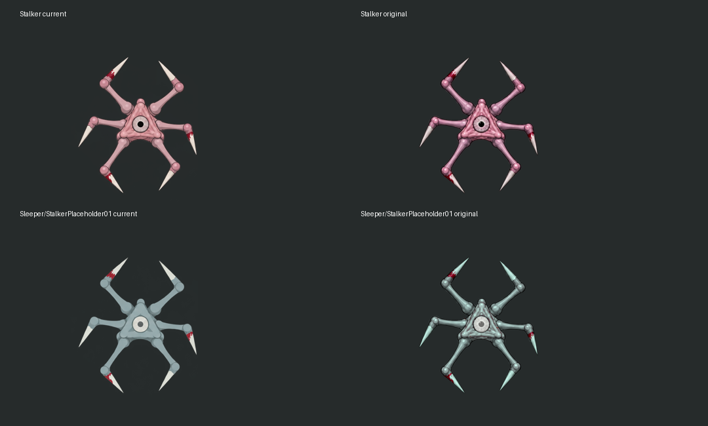
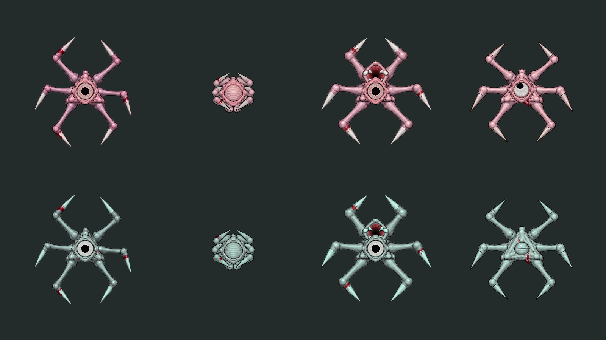
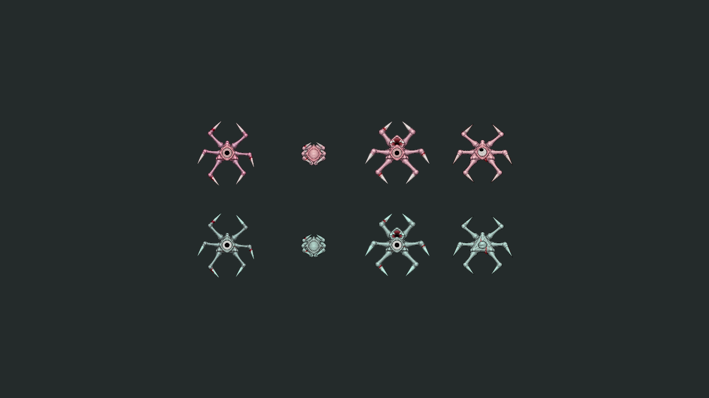
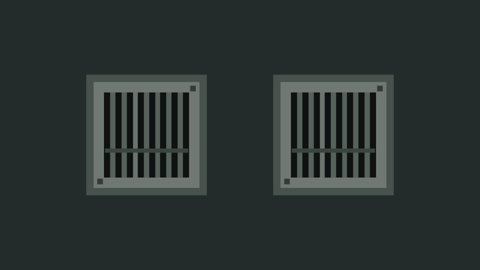
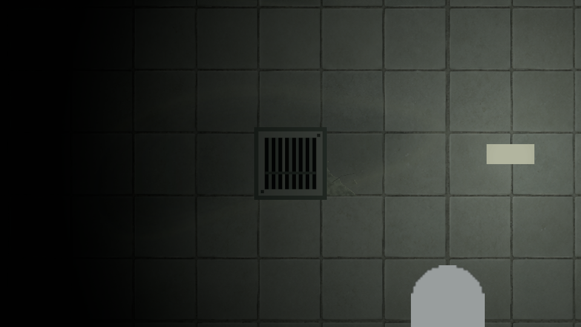
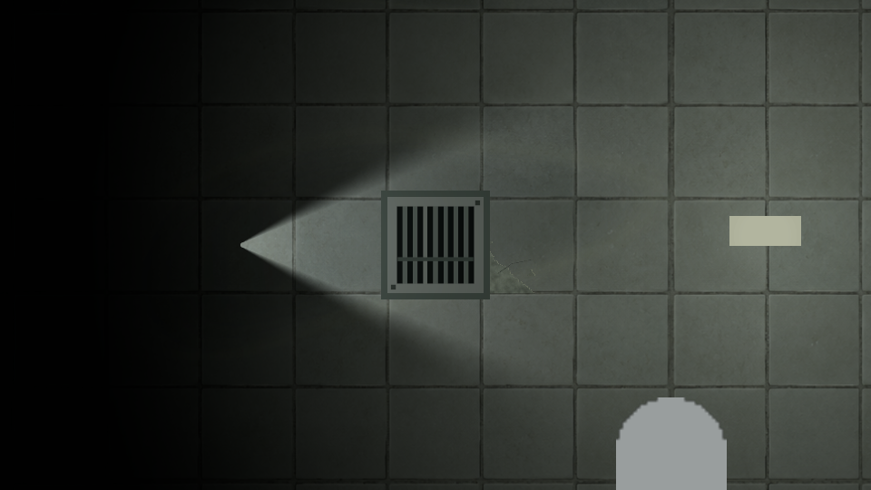

# BUG-006/007 · исходные враги и единый слив

2026-10-22. Техническая проверка завершена; внешний вид обоих врагов передан на художественную оценку владельцу в Notion. [Машинный итог](../Validation/CreatureRestoration45.json), [источники и импорт](../../Concepts/Used/Visual/CreatureRestoration01/README.md).

## Результат

Восстановлены ровно 38 PNG из архива до `aa1a9dc`: 10 атласов тела/глаза, 28 изображений корпусов/плоти/конечностей. SHA совпадают с оригиналами. Сталкер снова детализированный серо-розовый; Спящий — с холодной палитрой, светлым глазом и кровавыми отметинами. Это возвращение принятой временной графики второго вида, без внедрения отклонённого отдельного концепта. Геометрия 76 native Sprite восстановлена по исходному снимку через Unity API; GUID и fileID 21300000 сохранены. Общие материалы, prefab врагов, порядок кадров/фрагментов, GoreProfile, AI/звук/коллизии/снимки не менялись. Новый уровень наследует рисунок из общей библиотеки.

`MorgueFloorDrain.prefab` сохранил GUID и корень. 13 дочерних SpriteRenderer заменены одним на корне. Цельный прозрачный PNG 256×256 запечён в Unity из прежней геометрии и цветов, без освещения. Холст 0.64 unit, видимая рамка 0.58, PPU 400; общий FlatLit, sortingOrder −5. Повторное добавление prefab создаёт один рисунок; transform/tint доступны в Inspector, влажность и кровь остаются отдельными. Новых runtime-скриптов/источников света/коллизий/теневиков нет.

## Проверка

| Область | Факт |
|---|---|
| Исторический рисунок | 38/38 SHA совпали, окружение и кровь не откатывались |
| Sprite geometry/identity | 76/76 crops/pivots/PPU, GUID и local fileID корректны |
| Нативная композиция | 8 экземпляров двух видов/четырёх поз; 2 новых экземпляра люка, по одному SpriteRenderer |
| Открытый MorgueRouteTest | 2523 компонентов / 18779 object references: 0 missing scripts, 0 unresolved nonzero handles |
| Ручной авторинг | Сохранены world transforms существующих объектов и JSON всех компонентов обоих prefab врагов; удалены только 13 детей люка |
| Исходная незавершённая работа | Все 60 исходных dirty-файлов побитово сохранены, включая обе сцены и меню |
| EditMode | 1224/1224, изолированная копия опубликованного кода и новых ассетов |
| PlayMode | 71/71, включая реальные сцены обоих врагов |

В copy перенесены 110 изменённых asset-файлов, исходный незавершённый pause draft исключён. Сохранённые сцены главного проекта не перезаписывались; открытая сцена осталась чистой. Runtime/сборочные границы не менялись, новая Windows-сборка этим отчётом не заявляется. Превью проверены визуально: формы/конечности, глаз, компактная реакция, пасть, исходный кадр смерти, освещаемый слив и повторное создание prefab.

## Картинки

Слева упрощённые исходники, справа восстановленные; это сравнение рисунков, без игровых слоёв глаза:

Нативные prefab: Сталкер сверху, Спящий снизу; ходьба, сжатая поза/сон, атака, исходный кадр смерти. Поза назначена вручную в несохраняемой preview scene с ровным светом; дополнительные ground-shadow слои скрыты только для таблицы. Это не запись естественного AI и не все procedural death variants:

Люк в настоящем окружении морга: местный свет и дополнительная временная проверка направленным лучом. Проверочная камера/лампа удалены, сцена не сохранена:

## Нагрузка и границы

Дополнительного игрового C# нет; частота анимации/AI, шейдеры и число частей смерти прежние. У люка минус 12 renderers и 13 Transform/GameObject; добавлена одна общая RGBA32-текстура 256² без mipmaps — около 256 KiB несжатых texels, общая для экземпляров. Это не замер draw calls или FPS: batching/освещение зависят от сцены. У существ восстановлены прежние разрешения и пределы импорта; новая степень детализации не означает дополнительный CPU-аниматор. Художественную приёмку агент за владельца не отмечает.
