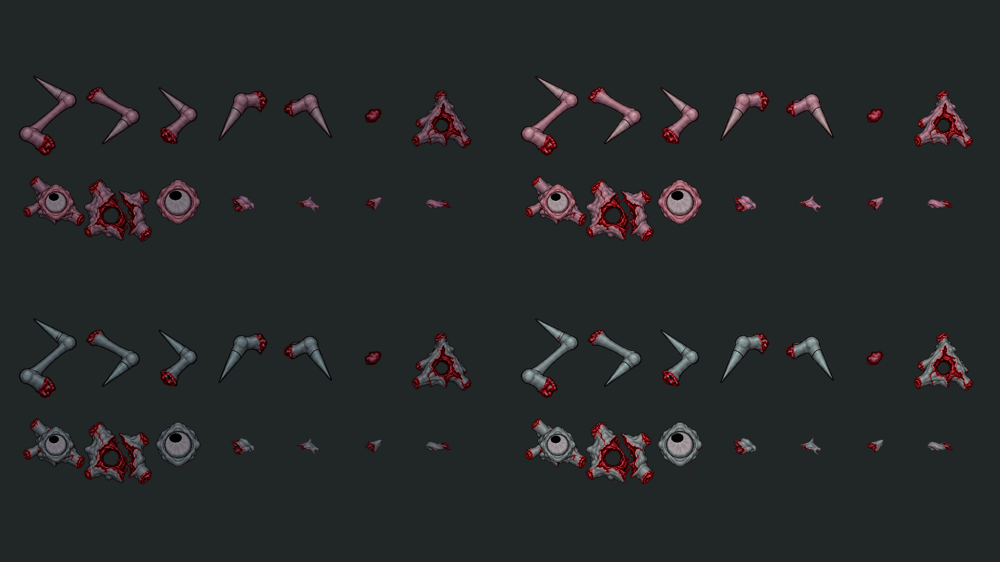
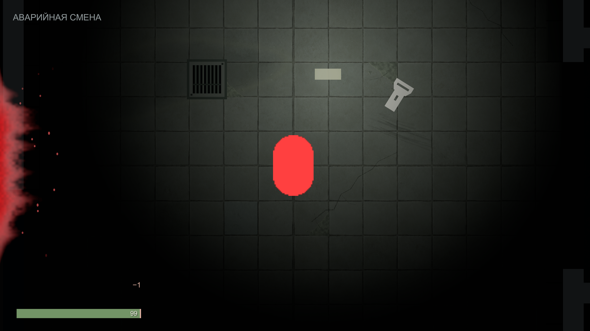
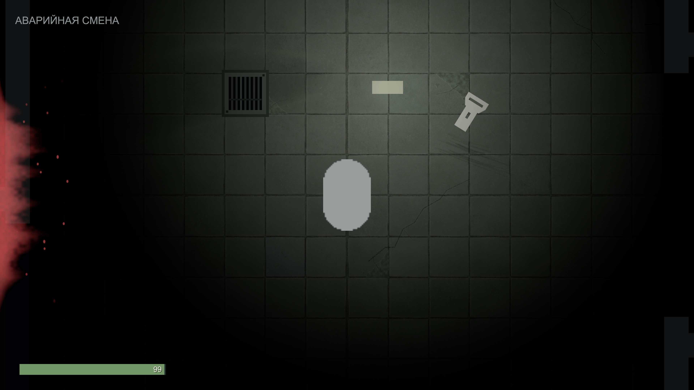

# Отклик урона и читаемость останков

2026-10-22. Отзыв владельца по TASK-HUD-REVIEW и повторная проверка BUG-006. [Настройка HUD](../UI/HUD_DESIGN_SYSTEM.md), [оттенки останков](../Enemies/RUPTURE_CONCEPT.md), [машинные результаты](../Validation/DamageFeedback47.json).

## Что изменено

Кровь от принятого направленного удара стала ярче/шире: RGB (.8,.025,.04), opacity .9, depth .19, spread .62. Вместо .09 с удержания + .95 с спада — .28 + 1.8 с. Центр экрана свободен, мировая кровь и раскладка HUD прежние.

В общий DirectionalDamage01 добавлены Camera Distance (.08 world unit, 0 выключает) и Camera Seconds (.22 с). Один быстрый толчок от источника плавно возвращается без вращения/zoom; повторный удар заменяет импульс. Модель владеет косметическим временем и вектором, Controller выводит их через отдельный ICameraImpactView; здоровье и защита не менялись. CameraFollow исключает предыдущий offset из SmoothDamp, очищает его при snap/rebind/disable и не применяет при остановленном игровом времени. Лечение и отключение HUD очищают оба эффекта. Нет покадрового поиска камеры, RNG или нового менеджера.

## Что оказалось с останками

Нативный инвентарь снят ещё в остановленном кадре владельца: живые части процедурной смерти уже ссылались на оригинальные AnatomicalGibs01, Remains04 и CreatureFlesh04. Все 38 действующих PNG побитово совпадают с восстановленными историческими источниками. GPU-readback HollowCore также показал оригинальный рисунок. Повторно заменять PNG не было оснований. Маски Capsule в инвентаре — контактные тени, не анатомические детали.

Внешний вид сильно приглушал общий tint (.58,.55,.60). Для новых фрагментов он заменён на настраиваемые Settled Tint (.78,.73,.76) / Airborne Tint (.88,.82,.86) в GoreProfile обоих видов. Рисунки, UV/PPU, prefab/GUID, профили составов, число частей, кровь, AI, коллизии и звук не менялись. Новые останки темнее живых и лежат ниже них. Сохранённый checkpoint воспроизводит свой фактический цвет, без перекрашивания и смены схемы. Старый RemainsVisualStyle остаётся совместимым оттенком исходного кадра смерти/legacy helpers.

Контрольная таблица Unity: сверху Сталкер, снизу Спящий; слева прежнее затемнение, справа новое. В каждом блоке все 14 исходных фрагментов prefab, без выбора удобного рисунка. Ровный свет, один материал и масштаб; это просмотр отрисовки, не естественная раскладка боя.

## Проверка

Нативный Play в MorgueRouteTest: реальный принятый урон, измеренный максимум смещения .07692809 unit, ошибка возврата 0, rotation/zoom прежние; кровь видна через 1.1 с. Временные изменения игрока/врагов были только в Play, сцена не сохранялась. Консоль не содержит новых ошибок этого прогона; старые записи предыдущего authoring не выдаются за новые.

EditMode проверяет направленный ограниченный импульс, независимые сроки крови/камеры, отказ, reset и отключение настройкой. PlayMode проверяет отсутствие дрейфа, pause/disable/snap, настоящее принятие/отказ урона и восстановление HUD, а также реальную смерть и round-trip цвета/индексов останков обоих видов. Окончательный состав: 1235/1235 EditMode, 74/74 PlayMode, обычная Windows64 успешна; из собственных Player assembly только Runtime. SHA свидетельств и проверенных файлов — в машинном результате. Художественная оценка остаётся владельцу.

## Нагрузка и сохранность

Пара дополнительных векторов и таймер на модель HUD, несколько скалярных операций во время короткого импульса. Прежние восемь пятен и тот же шейдер/материал: число UI-проходов не увеличено. Более долгий эффект дольше держит RawImage включённым; пиксельная нагрузка во время него прежняя. У частей добавлены два скопированных цвета, их число, текстуры, материалы и частота обновления не увеличены; после оседания GibMotion выключается как прежде. Это оценка изменённой работы, не замер FPS.

Исходные 60 dirty-файлов, включая обе карты и незавершённое меню, побитово сохранены. Сцены не перезаписывались. Проверка опубликованного состава выполняется в изолированной копии без этого draft. Авторскую приёмку и завершение родительской проверки агент не отмечает за владельца.
