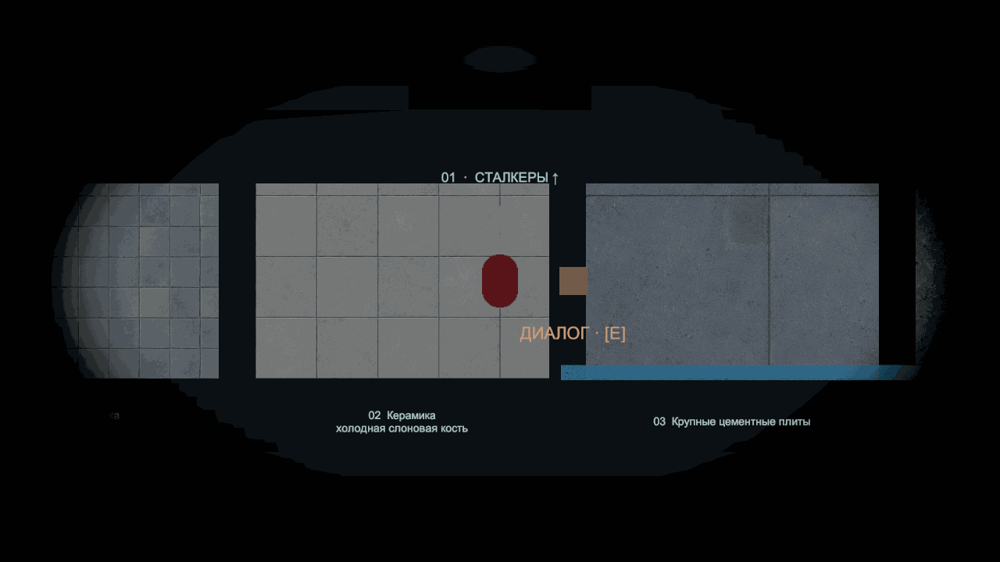

# TASK-006 · BUG-058 · быстрое чёрное закрытие D02

2026-11-04, Unity6000.6.5f1. По отзыву владельца мягкое проявление D01 заменено немедленной тьмой от краёв к центру: закрытие0.32 s, затем сообщение/кнопки без fade-in на полном чёрном. Музыки нет. [Контракт](../Features/DeathScreen.md), [TASK-006](https://app.notion.com/p/40a8d6dc06b68181a6b1f162b37c9ab2), [BUG-058](https://app.notion.com/p/40e8d6dc06b681a5a6e3f131cf7fea58).

GIF собран из12 записанных native кадров с их временными интервалами и удержанием последнего кадра. Движение не замедлено. Это обычная смерть в MechanicsSandbox, фонарь ради показа не включался. [Финальный кадр](../Validation/DeathScreenD02/ready.png).

## Изменение

DeathScreenIris — собственная uGUI-геометрия с CanvasRenderer, стандартным UI-материалом и чёрными вершинами. Видимая овальная область сжимается линейно; финал — сплошной непрозрачный quad, без остаточного серо-зелёного Image. Новых shader/material/растров/аудио нет. Иерархия22 объектов prefab, их трансформы, GUID727f5fddd937da44ca32e7345ed689dd, меню/шрифт/действия сохранены; заменён графический компонент World Veil и назначена явная ссылка View.

Model гарантирует Content Start=max(World Fade,Content Delay), полный вход=Content Start+Content Fade. Поэтому ранняя настройка задержки не покажет действия поверх мира. Профиль: World Fade.32, Content Delay.32, Content Fade0, Exit Fade.35, Iris Feather.18. Прежние1.4 s до WorldMotionPause отделены от визуала: scoped таймер продолжается через Ready/ConfirmQuit и отменяется вместе со scope/возвратом. Это сохраняет время реакции TargetDead и закрытия тела Спящего за чёрным экраном. BUG-053 сохраняет собственный unscaled audio fade1.4 s.

## Проверки текущей ревизии

| Граница | Результат |
|---|---|
| Компиляция | Unity completed,failed=false,errors0 |
| EditMode | 30/30,failed/skipped0; [JSON](../Validation/DeathScreenD02/editmode.json). Дополнительно тот же модельный набор выполнялся в частном .NET harness до получения game lease; это отдельная проверка, не native интеграция |
| Настоящий переход | 12 GameView кадров1280×720, действия скрыты при progress<1. Ready в записи через≈.29 s wall time при configured.32 s; различие — включение текущего шага движка в unscaled elapsed. На Ready817/817 world samples справа имеютRGB0/0/0; [timeline](../Validation/DeathScreenD02/native-transition.json) |
| Настоящий GPU mask probe | Белая независимая подложка: чёрная площадь100470→695960→921600 пикселей при progress0/.5/1; углы чёрные сразу, центр сначала белый и закрывается последним. На финале921600/921600 пикселей точно чёрные |
| Раздельные часы | Меню доступно после визуала, мир останавливается позже, в записи≈1.37 s wall time при configured1.4 s. Смена фаз меню не перезапускает motion delay; ранний живой restore не оставляет отложенную паузу |
| Single retry | Старый scope уничтожен, новый живой игрок, phaseHidden/timeScale1, дубликат отвергнут; [JSON](../Validation/DeathScreenD02/native-retry.json) |
| Native UI/input | 8/8: открытая/закрывающаяся пауза и её музыка, pending quit, диалог, внешние аренды, pointer/Enter/Esc, Editor quit rejection, удержанный реальный R через загрузку и повторная смерть; [JSON](../Validation/DeathScreenD02/native-interactions.json). Ожидание world pause в рецепте отделено от ранней готовности UI |
| Авторинг | Пять реальных saved-сцен включая inactive: один D, правильные prefab/context/View/iris ссылки, missing scripts0, ID уникальны, root0/identity/1, камеры/слушатели/contexts по одному, death AudioSource0; [review](../Validation/DeathScreenD02/authoring-review.json) |
| Обычная Win64 | build_7827617bd2f5 Succeeded,0errors,1 ожидаемое предупреждение Pipeline disabled,76.236 s; [summary](../Validation/DeathScreenD02/build.json) |
| Player startup | 10 s headless запуск, процесс работал до остановки собственного экземпляра,exceptions/errors0; из проектных assemblies только Runtime; [JSON](../Validation/DeathScreenD02/player-startup.json) |

В ходе pixel-probe закреплена явная зависимость Graphic от CanvasRenderer; после исправления повтор прошёл полностью. Первое чтение нескольких сцен additively вызывало временные сообщения URP о нескольких global lights. Review исправлен на последовательное Single-чтение только clean-сцен с восстановлением исходной карты; повторный проход не добавил ошибок. В игре и обычной сборке этих сообщений нет. Сцены для этого исправления не сохранялись.

Новый framework PlayMode-прогон не заявляется: в переданной сессии его дополнительный запуск ранее открывал save-modal. Текущая интеграция проверена обычным Play и native-пробами. Прежние Sleeper/layout/DSP/checkpoint результаты относятся к [D01](DeathScreenD01.md); новой проверкой их не объявляем. Путь сохранений, scene IDs, формат checkpoint и поведение врагов не менялись.

## Сохранность и координация

Подготовка и независимые проверки выполнялись под files-резервом вне Assets. Shared game lease получен явно после двери5805beaf через coordinator. До передачи Assets и Unity не менялись. Снимок перед интеграцией защищает текущий чужой dirty state; изменены только ресурсы D и связанные тесты/документы. [Сохранность](../Validation/DeathScreenD02/source-preservation.json). В частности, все сохранённые карты и их meta побайтно совпадают со входом, включая11DoorCrush2D и чужой residue MorgueRouteTest. Карты не регенерировались и не пересохранялись.

Проверены фактические MechanicsSandbox/MorgueRouteTest/BasementPrototype/LevelTemplate/DoorCrushTest. В prefab изменён компонент, группировка/позиции/привязки сохранены. Новых сценовых объектов не добавлялось и не переносилось; обязательный контроль для перемещения объектов неприменим, проверка реальных экземпляров и сохранности всё равно выполнена.

Final Editor: одна clean MechanicsSandbox, Play stopped, entry=null, timeScale1,listener1/pausefalse,mixer0dB, временных probes0; [state](../Validation/DeathScreenD02/final-state.json). GameView размер/выбор восстановлен. Нормальный Play остаётся из открытой карты, MainMenu не возвращался. Художественная оценка скорости/края, графический quit, полное прохождение и производительность не заявлены. Runtime в игре готов к оценке владельцем; коммит локальный, без push.
