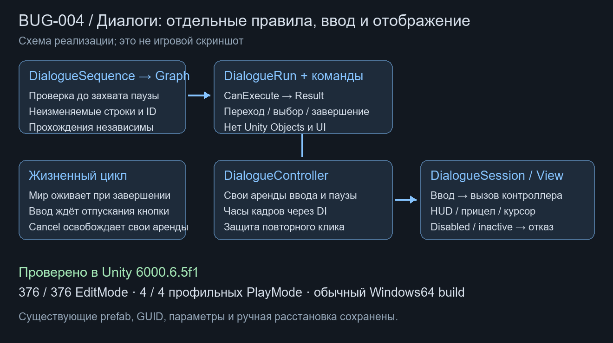

# Диалоги: MVC/DI и защита отключённого сеанса

Дата: 2026-10-21. База `5a0b3ce`. Исправление [BUG-004](https://app.notion.com/p/3ff8d6dc06b681b5beeaf9c860dd4138) входит в согласованный полный перенос SOD.

## Границы

`DialogueSequence` остаётся сериализованным Unity-контентом. `ToGraph` проверяет и копирует строки, цели и варианты в неизменяемый `DialogueGraph`. `DialogueRun` получает только снимок; наружу не выдаются mutable-массивы и ScriptableObject. Изменение общего asset после начала разговора не меняет переходы. Картинки/имена говорящих остаются данными представления.

Переходы оформлены командами с `CanExecute/CommandResult`. `DialogueController` владеет прохождением, арендой ввода и паузы, кадровым барьером подтверждения. Три явные зависимости: блокировка ввода игрока, пауза мира, часы кадров. Фабрика подключена через `DialogueInstaller` в scope уровня и создаёт отдельный контроллер на сеанс. Контроллер не читает Unity Time, Canvas, устройства ввода или сцену.

`DialogueSession` передаёт намерения ввода и отображает уведомления, сохраняет прежние HUD/прицел/курсор, завершает контроллер и подписки при уничтожении. Имена компонентов, сериализованные поля и GUID сохранены; prefab, диалоговый asset и ручные сцены не перестраивались. Уведомление `DialogueSession.Transitioned` сохраняет прежний смысл и ссылку на asset; чистая модель выдаёт только `DialogueStep` с ID.

## BUG-004

`CanBegin/TryBegin` отвергают disabled/inactive сеанс, отсутствие внедрения или контекста. Интерактор использует ту же доступность. После окончания последней реплики пауза мира освобождается сразу, а игровой ввод — после отдельного кадра и отпускания подтверждения. Cancel/OnDisable освобождают только свои аренды; исключение представления также не оставляет аренду. Другой владелец паузы/ввода сохраняет свой захват.

## Проверки

Unity 6000.6.5f1. Результаты сохранены в [DialogueMvc01.json](../Validation/DialogueMvc01.json).

- 29/29 профильных EditMode: граф, команды, изоляция, кадры/аренды, исключения и существующий prefab.
- В чистой копии проекта: 376/376 собственных EditMode, включая пространства имён Features. Более узкий старый фильтр EmergencyShift.Tests покрывает 328/328, а не всю сборку.
- 9/9 всех собственных PlayMode: 5 прежних checkpoint и четыре диалоговых. Четыре настоящих PlayMode на сохранённом prefab/диалоговом asset: disabled-компонент, inactive-корень, повторное включение и обе ветви, отключение открытого разговора при чужих арендах. Это вызовы интерактора/кнопок/сеанса; физическое нажатие E не эмулировалось.
- Обычный Windows64 Player собран; собственная runtime-сборка включена, Editor/Development/тестовые сборки исключены.

В открытом Editor общий прогон имел 2 ошибки InputSystem при установке нового EventSystem, хотя отдельный набор прошёл. В чистом Editor те же 328, затем все 376 проверок прошли. Сбой исходного состояния редактора не исправлялся подменой игровых ассетов; он сохранён в JSON как ограничение, а не скрыт успешным прогоном. Отдельный отрицательный Play-прогон до изменения кода для BUG-004 не выполнялся.

Проверяется рабочее дерево с ранее принятым, но ещё не закоммиченным меню паузы; чужие незавершённые исходники/сцены не включаются в этот коммит. Полная визуальная/авторская приёмка и Profiler не выполнялись. Общая миграция остальных систем остаётся открытой.

## Нагрузка

Снимок графа и словарь ID создаются один раз при запуске разговора. Команды создаются при действии пользователя; обработка кадров не создаёт новые коллекции и использует внедрённый счётчик кадров. Нового глобального менеджера или фонового поиска нет. Визуальный reflow и кнопки работают по прежнему правилу. Время кадра и память профилировщиком не измерялись.
