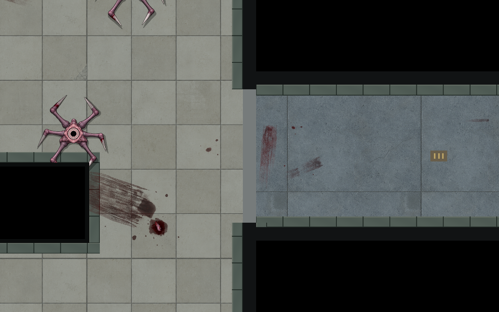
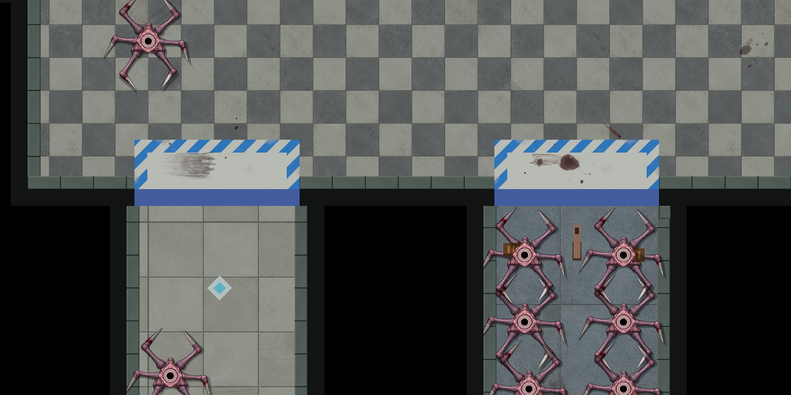
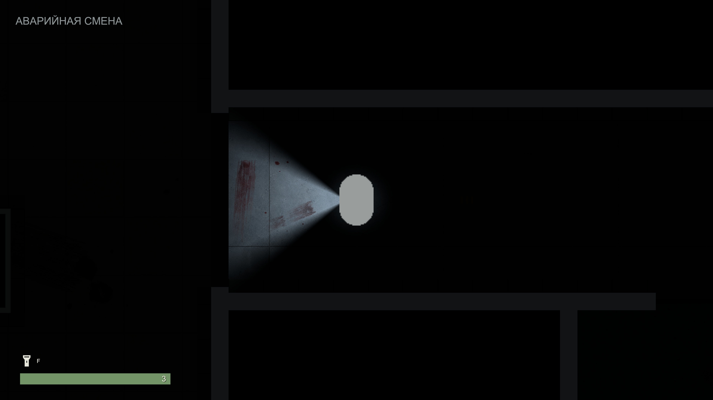
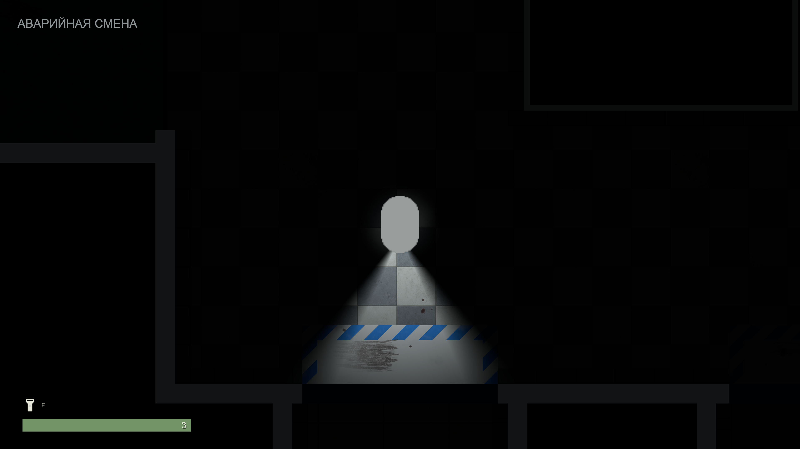
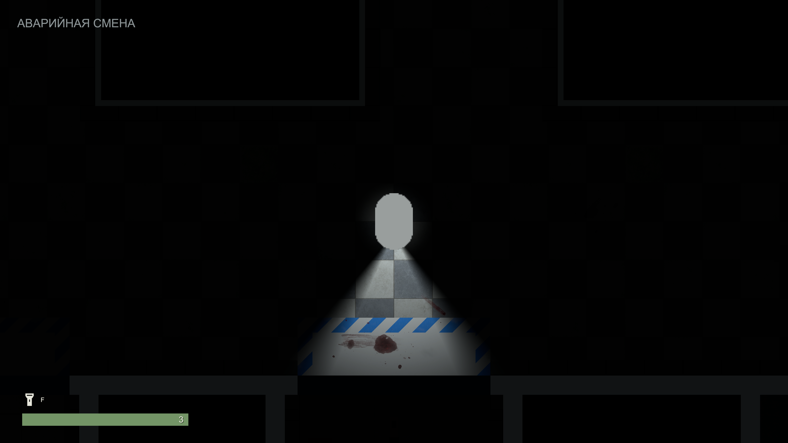

# Небольшие кровавые следы у опасных входов

2026-10-22 · [TASK-LEVEL-DANGER](https://app.notion.com/p/4018d6dc06b6812ab69ae1a471244da2). Исходная ревизия `340dd78`. Ориентир — скрин владельца в комментарии: локальный след непосредственно у порога. После восстановления Unity выполнен native Editor-авторинг текущей MorgueRouteTest без пересборки карты.

Добавлены 15 отдельных экземпляров **семи прежних prefab BloodTraces05** у девяти входов: A–B, открытый западный вход арены, H–O1, H–O2, ER–ED, G–R, западный вход зала, H–ER, R–H. Учтены фактические 27 активных врагов: 8 арена, 3 зал, 2 комната фонаря, 10 дробовик, 2 восточный подход, 2 зелёная карта. Пустой H–O3 и стартовая комната не получили ложного предупреждения.

Вдоль раздвижных створок короткие смазы; капли отделены чистым полом. У H–O1 след старее/темнее, H–O2 свежее; ориентация, размер и плотность не повторяются. Прежние 44 кровавых SpriteRenderer и их настройки сохранены. Новые объекты находятся в Dressing соответствующих зон с префиксом `Entrance`; все сохраняют prefab-связь. [Раскладка](../../Concepts/Used/Environment/BloodTraces05/entrance-placements-48.json), [помощь владельцу](../Guides/MORGUE_ROUTE_TEST.md#кровавые-следы-в-зонах-монстров).

## Вид в редакторе

Ниже native-отрисовка сохранённой сцены с временным ярким светом для оценки раскладки. Этот свет не сохранён в уровне и не означает игровую экспозицию.

## Проверка в игре

Все девять подходов просмотрены в контролируемой Play-сессии: реальный GameView, базовый фонарь 3.2 unit/80°, camera orthographic size 3.45. Для осмотра 27 врагов временно выключены, игрок перемещён в точки осмотра; это не боевое прохождение. Двери остаются закрытыми, предупреждение видно на подходе. Временные runtime-позиции/отключения не сохранялись; Play остановлен.

Native guard подтвердил неизменность 867 прежних world transforms и 1602 компонентов. После Play проверены prefab-связи всех 15 накладок, Sprite/материалы/order, отсутствие у них скриптов/коллайдеров/caster; полные bounds не пересекают solid geometry, исключая допустимое расположение под дверью. 2558 компонентов рабочей сцены — без missing scripts и unresolved references. Публикационная копия без исходного незавершённого Pause Menu: 2514 компонентов/18781 ссылок без ошибок. При её экспорте Unity пометил исходную сцену dirty; сравнение 169943 сохранённых полей дало 0 различий, только после этого исходник пересохранён. Проверенные данные — [native evidence](../Validation/EntranceBlood48/result.json).

Новых текстур, материалов, Runtime C#, физики/AI/света нет. 15 небольших прозрачных SpriteRenderer добавляют только работу отрисовки/перекрытия; стоимость зависит от видимости и batching, FPS не измерялся. Неприменимые полный набор тестов и новая сборка не запускались для статичного декора. Художественную приёмку агент за владельца не отмечает.
