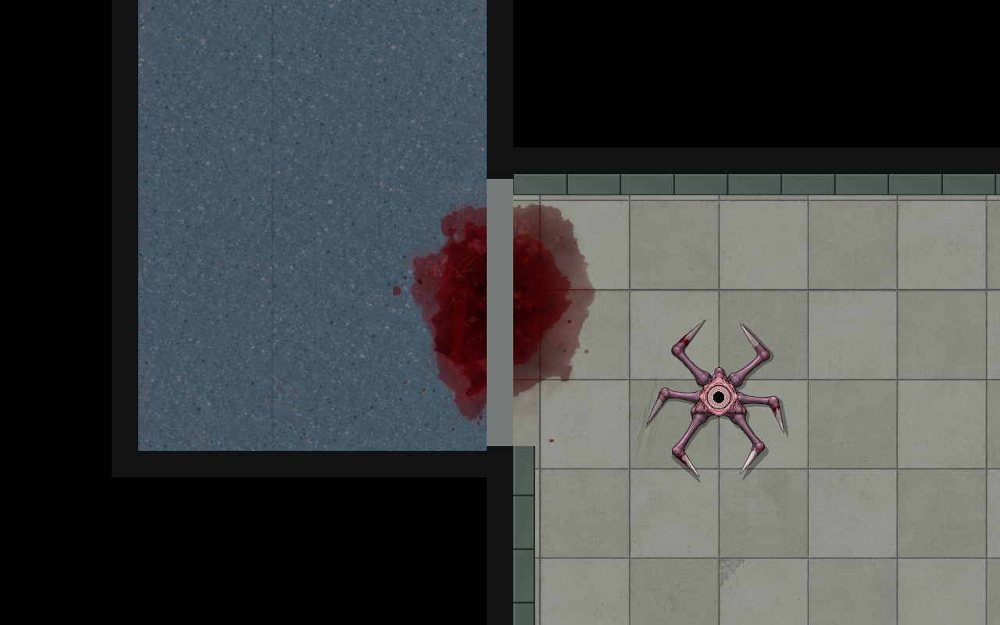
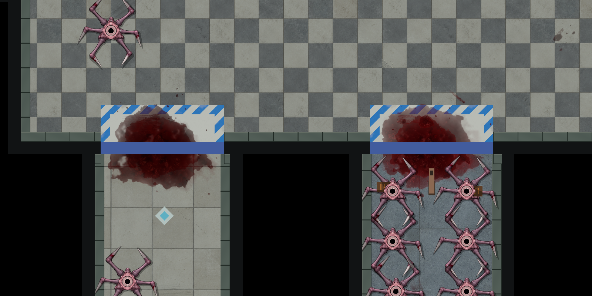
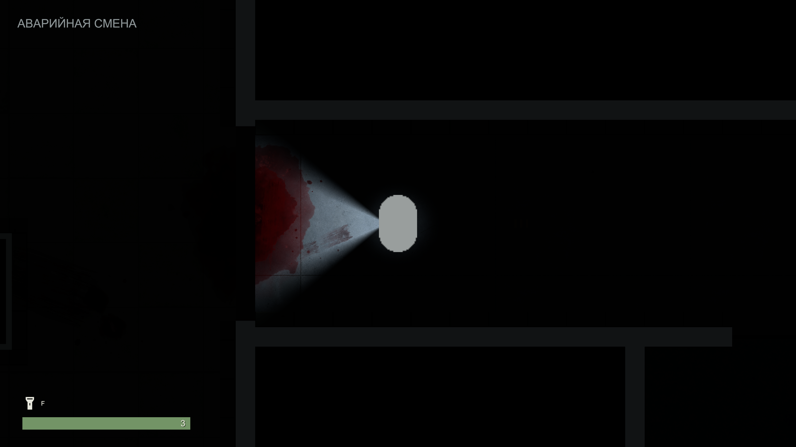
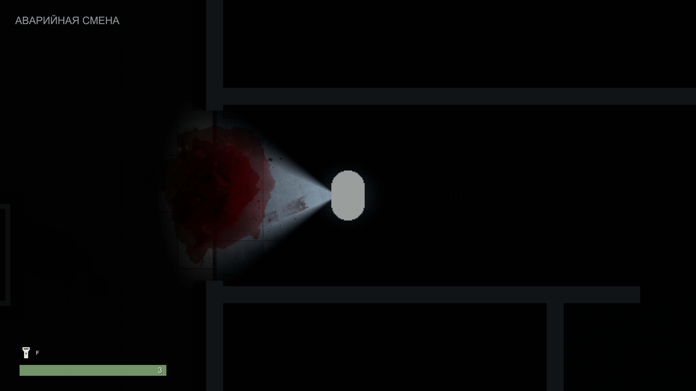

# Крупные лужи ровно под створками

2026-10-22 · продолжение [TASK-LEVEL-DANGER](https://app.notion.com/p/4018d6dc06b6812ab69ae1a471244da2), исходная ревизия d1e4b5a. Малые следы EntranceBlood48 не удовлетворили владельца. Уточнение по размеченному скрину: **крупная лужа по центру порога, вытянута вдоль всей открывающейся створки**, остающаяся на полу после открытия.

У прежних девяти входов добавлены девять двухслойных луж: 18 отдельных prefab-накладок. Семь дверных луж имеют координаты центра закрытой створки; две у открытых входов арены/зала — центр порога. Вращение следует ориентации дверного проёма. Густая середина и широкая неровная граница; оттенки старой и свежей крови сохраняют местную вариацию. Прежние 15 смазов/капель остаются дополнительными деталями. Объекты `Entrance … pool/centre` находятся в Dressing соответствующих зон, не являются дочерними движущейся створки.

## Повторное использование

Два новых **варианта прежних prefab**: `Prefabs/Environment/LevelSurfaces/BloodDecal-Fresh-Dense.prefab` и `BloodDecal-Clotted-Dense.prefab`. Те же PNG/FlatLit/order −3, никаких новых bitmap или материалов. Два самостоятельных Sprite assets `FreshStaticCore` и `ClottedStaticCore` используют область центральной массы прежних PNG. Большие прозрачные поля/удалённые капли исключены из rect, поэтому масштаб в редакторе соответствует видимой луже.

Read-only анализ связной alpha>5 дал Fresh [203,195,424,467] и Clotted [209,181,459,502] в координатах PNG сверху. Native rect с прозрачным запасом: Fresh (191,160,246,297), PPU 246; Clotted (197,125,274,346), PPU 274. Старые Sprite/TextureImporter/PNG не менялись. Варианты можно ставить отдельно на другие уровни. Размер/позиция/поворот и SpriteRenderer Color остаются местной настройкой; [точная раскладка](../../Concepts/Used/Environment/BloodTraces05/entrance-pools-49.json).

## Проверка и границы

Native authoring сохранил 882 прежних world transforms и параметры 1617 компонентов. При замене только 18 новых pool instances на Dense variants Unity сменил их prefab source IDs; проверка учла только эти алиасы, подтвердив 169961 неизменное поле вне луж. Общая сцена: 2594 компонента, без missing scripts/unresolved references; новые накладки не пересекают solid geometry, кроме допустимого наложения на дверной проём.

Два контролируемых Play-прогона по девяти подходам: все 11 дверей установлены штатным RestoreState в закрытое/открытое положение. Это проверка визуального состояния, не прохождение карточных условий. Игрок перемещён в точки осмотра, враги временно выключены; базовый фонарь 3.2 unit/80°, камера 3.45. Лужи остаются на полу при открытии. Runtime-сцена не сохранялась, Play остановлен.

Для публикации создана отдельная AssetDatabase.CopyAsset-копия с исключением прежнего незавершённого Pause Menu. Исходник при экспорте не пересохранялся; побайтовая проверка и 172475 полей подтвердили его неизменность, dirty=false. Копия: 2550 компонентов без ошибок ссылок. [Машинные свидетельства](../Validation/EntrancePools49/result.json).

Нагрузка — 18 дополнительных прозрачных SpriteRenderer с двумя существующими текстурами, без Update, света, теней и физики. Более крупные пятна увеличивают закрашиваемую площадь/overdraw; FPS не измерялся. Нового Runtime C# нет, полный набор tests/build для статичного декора не запускался. Художественная приёмка остаётся владельцу.
