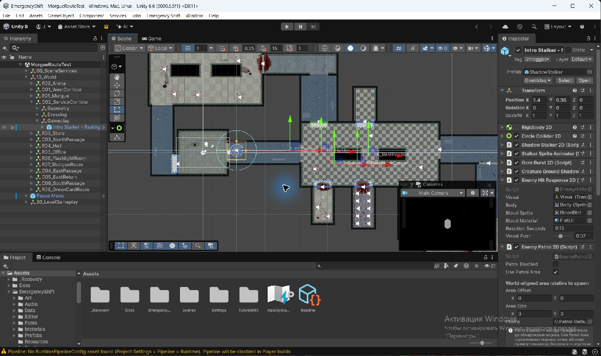

# Первый сценарный отход Сталкера

TASK-ENCOUNTER-INTRO · 2026-10-24. Реализован одноразовый отход по скриншоту владельца в MorgueRouteTest: от выхода из морга через коридор, снизу вокруг левого блока, к месту между блоками. Прибытие сразу возвращает обычный AI с выключенным патрулём.

## Изменение

Новая feature ScriptedEncounters хранит чистую личную модель маршрута, проверяемые команды, controller, readonly SO-настройки и scoped-фабрику. Видовой мост вызывается из единственного физического цикла Сталкера. До прибытия блокируются автоматическое/внешнее обнаружение, укус и агрессия от stagger. После прибытия стандартные обнаружение, постоянная агрессия, страх и бой восстановлены. Смерть немедленно отменяет сценарий; препятствие даёт Blocked с повторным поиском без боевого fallback.

Первый экземпляр использует прежний ShadowStalker prefab. Добавлены пять пустых маркеров уровня и один общий профиль; новые изображения/аудио/пакеты не добавлялись. Inspector и Scene View показывают состояние, номера, стрелки и handles точек. [Контракт/владельцы](../Features/ScriptedEncounters.md), [настройка и координаты](../Guides/MORGUE_ROUTE_TEST.md#первый-сценарный-сталкер).

## Проверка

- 11/11 новых EditMode: фактическое условие света, одноразовость/порядок, копирование входных данных, Blocked/recovery, stagger, завершение/отмена, изоляция экземпляров, отказ некорректных данных, запреты агрессии/атаки и приоритет смерти.
- 3/3 новых PlayMode в реальной сохранённой сцене: закрытая дверь блокирует луч; близость и пуля не включают агрессию; отведение луча не отменяет путь; монстр проходит снизу блока, останавливается и затем обнаруживает игрока по обычным правилам. Отдельно проверены смерть с единственным Died и повторный поиск после снятия полного препятствия в коридоре.
- Общая регрессия текущей рабочей копии: **1296/1296 EditMode, 87/87 PlayMode**. [Сводка](../Validation/IntroEncounter01/tests.json). Эти числа включают сохранённые незавершённые пользовательские изменения подбора/меню; они не являются утверждением, что эти отдельные задачи приняты или опубликованы.
- Обычная Windows64-сборка всех пяти включённых сцен: **Succeeded**, без Development; из собственных Managed assembly только `EmergencyShift.Runtime.dll`. Editor/Development/tests в Player отсутствуют. [Краткий BuildReport](../Validation/IntroEncounter01/build.json). Единственное предупреждение — Pipeline отключён в Player без RuntimePipelineConfig; runtime-сервер по этой задаче не включался.
- Native readback: ровно один сценарий, пять назначенных точек той же сцены, прежняя prefab-ссылка, профиль назначен, патруль выключен, MissingScript=0, сцена сохранена. [Проверка ссылок](../Validation/IntroEncounter01/native-references.json).
- От исходного dirty-снимка до результата сохранены все **879 исходных serialized blocks**: удалений/неожиданных изменений нет. Добавлены 20 blocks; два прежних блока получили только ссылки на новых детей/корень. Все прежние 27 врагов и геометрия сохранены, врагов стало 28. [Проверка сохранности](../Validation/IntroEncounter01/scene-preservation.json), [размещение](../Validation/IntroEncounter01/placement.json).

Фактическая конечная позиция теста около `(26.508, -0.669)` при маркере `(26.6, -0.55)` и допуске 0.16; `HasAggro=false` на всём сценарном пути, обычная агрессия проверена после прибытия. [Запись пути](../Validation/IntroEncounter01/live-route.json).

## Границы

Обычный Сталкер может начать бой уже на следующем шаге после прибытия, если игрок близок и видим: это согласованное поведение. Условие открытия двери после подбора фонаря остаётся отдельной TASK-DOOR-CONDITIONS. Сценарный checkpoint payload не добавлен; capture/restore такого экземпляра явно отклоняются, в MorgueRouteTest checkpoint-controller отсутствует.

Сборка/тесты относятся к текущей рабочей копии с сохранённым pause draft. В коммит этого эпизода включаются только его код, профиль, сценовая дельта и документация; чужие незавершённые правки остаются отдельно. Художественную оценку темпа и первого знакомства выполняет владелец. FPS, полное прохождение и поддержка кампании этим результатом не подтверждаются.
