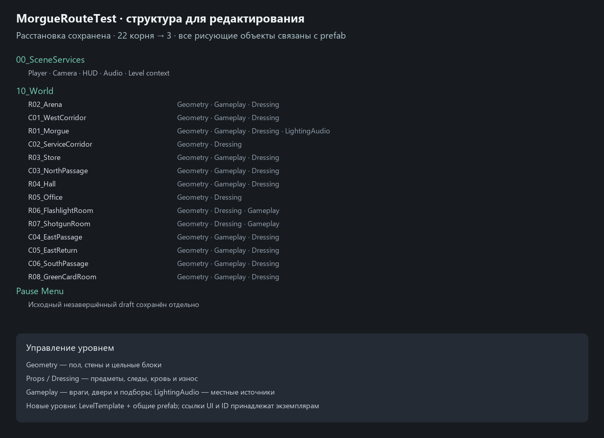

# TASK-LEVEL-01 · сцены и общие prefab

2026-10-22. Все 11 сохранённых сцен приведены к читаемым корням и проверены. [Как управлять уровнем](../Guides/SCENE_ORGANIZATION.md), [реестр источников](../../Concepts/Used/Environment/LevelOrganization01/README.md), [машинные результаты](../Validation/LevelOrganization46.json).

| Сцена | Корней до → после в рабочем проекте | Свободных SpriteRenderer до → после |
|---|---:|---:|
| MorgueRouteTest | 22 → 3 | 81 → 0 |
| MechanicsSandbox | 14 → 4 | 15 → 0 |
| BasementPrototype | 17 → 3 | 16 → 0 |
| FloorMarkingsReview | 26 → 3 | 1 → 0 |
| Остальные 7 сцен | 2–4 → 2 | 13 → 0 |

109 свободных поверхностей связаны с библиотекой. Добавлены 18 статичных prefab/вариантов, включая три размера полного блока с отделкой, и два функциональных тестовых примера. Существующие подходящие prefab переиспользованы. Стены/коллизии не отделялись от картинки; одинаковые блоки используют один вариант. Маркер диалога сохраняет местную session как override; общий prefab её не захватывает. Карты целиком не превращались в prefab; службы уровня и локальные bindings остаются сценовыми.

Перед сохранением каждой сцены нативно проверены world matrices (допуск 0.00005), active state, существование исходных компонентов и доступные serialized scalar/reference поля. Рисующие компоненты, коллизии, сортировка, настройки акторов, ссылки/имеющиеся ID сохранены. После записи — 0 свободных SpriteRenderer, 0 пустых/повторяющихся имеющихся persistent IDs. Все 58 исходных dirty-файлов вне двух изменяемых сцен побитово сохранены; исходные версии сцен и текущая копия песочницы оставлены в ignored work. Цельные prefab-дети не разносились; ошибочная попытка смены границы тестовой сборки была остановлена guard до записи и заменена сохраняющим объекты SaveAsPrefabAssetAndConnect.

## Регрессия BUG-035 и проверки

При работе с библиотекой обнаружено изменение native-view двух общих ламп вне валидной сцены: Light2D/маркер выключались, intensity становилась 0. Исходные четыре случая на временных prefab-копиях: 0/4. `LocalLamp2D` теперь пропускает запись native view при OnDisable и ApplyPower, если объект не принадлежит валидной сцене. Scene-registry cleanup остаётся; настоящие сцены, включая disable/mask cleanup, работают как прежде. Два production prefab возвращены к исходным значениям и не имеют diff. Баланс, цвет, радиус, звук и циклы мерцания не менялись.

Итог: 1228/1228 EditMode, 71/71 PlayMode, обычная Windows64-сборка успешна; из собственных Player assembly только Runtime. Тесты выполнены на изолированном публикуемом составе. Сначала независимый проход реорганизации дал 1224 EditMode/71 PlayMode; четыре новых asset-lifecycle проверки затем подтвердили исправление. Новая runtime-логика ограничена двумя scene-validity guards, без систем/менеджеров и покадровых обходов.

## Публикация и границы

В рабочем проекте сохранён незавершённый Pause Menu. Для двух содержащих его сцен Unity создал отдельные публикационные копии; только из этих копий исключён draft-корень. Изменения записаны в Git через их native содержимое, исходные рабочие файлы не подменялись. Остальные 9 сцен публикуются как сохранены редактором. Публикационный состав проверен отдельно от оригинального menu draft.

Save-as-copy/preview вызывает производные изменения UI и lamp-view. Перед финальным сохранением исходных сцен выполнена отдельная сверка persistent field identity: 98428 полей MechanicsSandbox и 167838 MorgueRouteTest, 0 необъяснённых различий. Сравнение исключает временные EntityId reference children, производную RectTransform/Canvas-геометрию экрана и Light2D/bulb view, которым управляет проверенный LocalLamp config; исходная проверка до authoring-save включает их значения в том же Editor-контексте. Настройки config/профилей, anchors/размеры обычных UI-элементов, ссылки и прочие доступные поля сравниваются.

FPS, полное боевое прохождение, художественная приёмка и campaign persistence этим отчётом не заявляются. Размещение карт и внешний рисунок не менялись. После завершения свежая доска повторно сверяется; BUG-006 остаётся на художественной оценке владельца.
