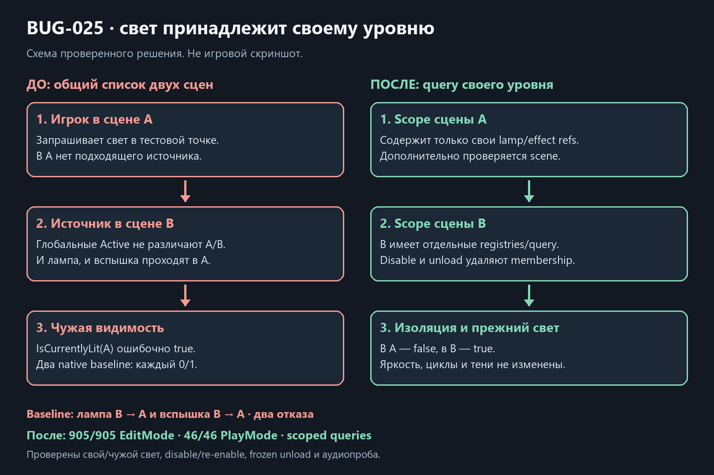

# Свет своего уровня / BUG-025

Дата: 2026-10-21. База `5510d7b`. Два отдельных native baseline подтвердили одинаковую ошибку: лампа B и настроенная вспышка B делали IsCurrentlyLit игрока A истинным. Каждый baseline **0/1 PlayMode**; источники создавались в правильной сцене, это не прежний BUG-023 о Instantiate ownership.

Глобальные mutable lists LocalLamp2D.Active/AnyIlluminates и ShotEffect2D.IlluminatesPoint удалены. LevelRegistriesInstaller создаёт два SceneRegistry и LocalIlluminationQuery2D на уровень. Регистрация/удаление парные; повторная инъекция не дублирует членство. Query дополнительно сравнивает owner Scene, читает прежние current intensity/radius/LOS правила и не превращает лампы/вспышки в defensive IThreatLight. PlayerInteraction получает query явно, LevelAudioDirector использует только lamp-ветку как прежде.

Вспышка дула, blocked impact и попадание пули создаются через имеющийся scoped ScenePrefabFactory: сценовая принадлежность сохраняется, registry внедряется до использования. Native standalone preview может показывать свет без регистрации; для участия в запросах уровня нужна явная composition, глобального fallback нет. Brightness, phase/cycles, радиусы, цвета, звуки, cookie и геометрия/тени не менялись. Прежний откат height/shadow работ не затрагивался.

**905/905 EditMode**, включая composition/cleanup и обновлённые искусственные component fixtures. **46/46 PlayMode**, четыре новых native-сценария: чужая лампа и чужая вспышка исключены, свой источник доступен, disable/re-enable и повторный bind не дублируют запись, frozen effect unload удаляет членство и сохраняет sibling lamp. Первый полный прогон 45/46 выявил временную лампу AdaptiveAudioProbe без scoped-инъекции; она добавлена явно, полный повтор прошёл вместе со всеми его проверками. Прежние source-scene shot/impact и shotgun направления сохранены.

Обычная Windows64 success; собственная Player-сборка только EmergencyShift.Runtime. [Исходные отказы, хеши, source parity и 1794 неизменённых ресурса](../Validation/LightScopes22.json). Копия включает исходную незавершённую паузу и не является clean HEAD. Нефатальное сообщение LicensingClient сохранено; FPS/художественная/слуховая приёмка не заявляются.

На уровень добавлены две membership collections и query; их IDisposable lifetime принадлежит существующему scope. У источника есть Register/Remove на lifecycle, у transient effects добавилась стоимость DI-инъекции при существующем Instantiate. Indexed query не создаёт foreach enumerator, перебирает собственные источники и не делает LOS-запрос чужому уровню. Новых Update/корутин/голосов/геометрических расчётов нет. Lamp power/clock/config Model, VFX tuning/RNG, audio model/static threat emitters, concrete actor/style и общий SOD-перенос остаются открыты; прежние partial-статусы сохранены.

