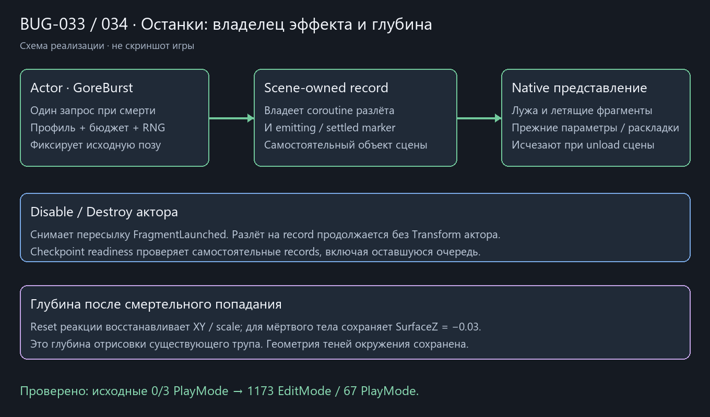

# Native VFX и останки · NativeRemains37

2026-10-22, после 1cd7555. **0/3 настоящих PlayMode** подтвердили два дефекта: BUG-033 — disable/destroy актора до releaseDelay оставляли 0 фрагментов вместо 8; BUG-034 — hit reset возвращал умершему телу исходный localZ=.1 вместо принятого −.03.

Coroutine разлёта и emitting/settled marker перенесены с GoreBurst2D на самостоятельный RemainsRecord2D в сцене. От актора захватывается матрица позы при смерти; после его удаления emitter не обращается к Transform источника. Профиль, порядок random draws, раскладки, импульсы/гравитация и прежний лимит 32 фрагмента/кадр сохранены. GoreBurst запрашивает эффект один раз и пересылает FragmentLaunched только в свой enable lifetime; disable/destroy снимают relay, не отменяя разлёт. Root disable/unload закрывает coroutine/finally. Restore facade отключает старый root перед отложенным Destroy и создаёт свежий view; повторный direct Restore занятого record отклоняется до нового представления.

CheckpointSceneAdapter проверяет самостоятельные records наряду с акторными фасадами/дверями, поэтому оставшаяся очередь не становится готовой только из-за удаления источника. Формат останков/checkpoint, variant IDs и распределение renderer state не менялись. Сохранение динамически удалённых/порождённых игровых сущностей этим не добавлено.

Hit reset восстанавливает XY/scale и сохраняет SurfaceZ умершего тела, включая disable. Это глубина отрисовки существующего трупа; алгоритм высоты/геометрии теней окружения не возвращался. PlayerShotShadow получил только разделение двух объявлений на строки. BloodPool больше не выдаёт исходный renderer array: native потребитель использует Count/At, визуальные параметры прежние.

Прочитаны десять native view файлов: hit/rupture/pool, gib/casing, gore/record, hit response и обе проекции силуэта. По принятому [state/authority](../../.agents/skills/sod-unity-architecture/references/state-and-authority.md) animation/FX — presentation: кадры, частицы, визуальная физика, renderer pose и финальный DTO не требуют пустых domain models. Они не решают урон, AI, инвентарь или gameplay RNG; query/physics остаются native environment. Состояние смерти принадлежит прежним чистым моделям, не длительности анимации. Shared config/read-only и scoped source boundaries проверены предыдущими этапами; данный проход закрывает роль/владельца этих views.

После исправления **1173/1173 EditMode**, **67/67 PlayMode**, включая исходные disable/destroy/depth, прежние additive frozen unload и Clear/door/gore readiness. Обычная Windows64 success; собственная Player assembly только EmergencyShift.Runtime. [Исходные случаи и hashes](../Validation/NativeRemains37.json). Схема прикреплена к BUG-033/034.

2002 защищённых ресурса и 60 исходных dirty файлов неизменны. Новых C#/meta нет; сцены, prefab, art и configs не менялись. Проверялась dirty копия с исходной паузой, не clean HEAD; эти правки исключены из коммита. Нефатальный LicensingClient warning остаётся.

Spawn/physics стоимость прежняя; coroutine сменила владельца. Pending checkpoint добавляет ещё один native обход records и их ограниченных списков частей; постоянного общего Update/пула/кеша не добавлено. Это описание алгоритма, не замер FPS; OPT-01 остаётся отложен. ShotEffect/native lighting/audio, actor tuning, tools/style и авторская приёмка ещё открыты.
