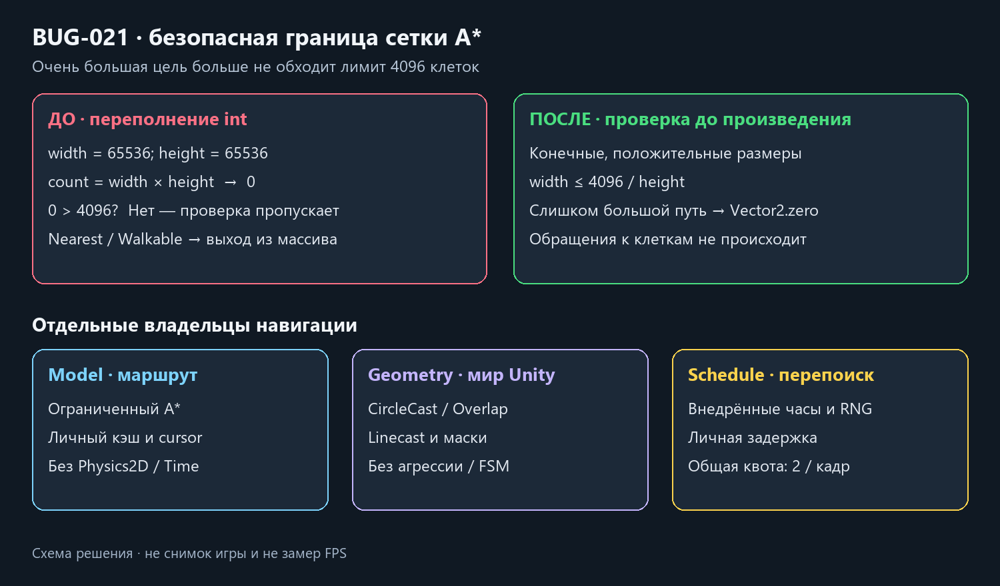

# Навигация: чистый расчёт и BUG-021

Дата: 2026-10-21. База `40fd2e9`. Авторские сцены, маршруты и значения prefab не менялись.

`EnemyChasePathModel` владеет личными массивами A*, waypoint-кэшем и cursor. Две зависимости — интерфейсы геометрии и расписания перепоиска. В модели нет Physics2D, Time, RNG, SO, MonoBehaviour или View. `EnemyPathGeometry2D` исполняет прежние CircleCast/OverlapCircle/Linecast. `EnemyPathSchedule` хранит личный nextRepath и получает часы, общую квоту и отдельный RNG — три явные зависимости. Прежний EnemyChasePath2D сохраняет API мотора как небольшой адаптер; factory собирает роли.

Сохранены клетка .6, ограничение 4096 клеток / 1536 раскрытий, четыре соседних направления, сглаживание доступных участков, радиусы/отступы и общая квота двух построений за кадр. Перепоиск имеет прежние .65 + random×.12 с; таймер теперь double, как внедрённые часы. Эти параметры расписания ещё отмечены для общего config-pass. Profiler marker `EmergencyShift.Navigation.Build` сохранён отдельным декоратором: охватывает построение и короткое завершение расписания, не обычный шаг движения.

**BUG-021 подтверждён до исправления:** за преградой цель (39312.5;39312.5) даёт width/height 65536. Старое int-произведение превращается в 0, обходит лимит и приводит к IndexOutOfRangeException в Walkable. Размеры теперь проверяются до преобразования/произведения: finite/positive, затем width ≤ MaxCells / height. Большая недоступная сетка возвращает нулевое направление без индексирования/выделения массивов. Также отклоняются невалидные входы и переполненное смещение между конечными точками до geometry query.

Исходный красный тест повторён на двух точных файлах Git `40fd2e9` в отдельной копии; хеши и raw — в [Navigation05.json](../Validation/Navigation05.json). Повтор потребовался после закрытия основного Unity: его Temp вместе с исходными временными свидетельствами был очищен. Новые raw сохраняются в игнорируемой `work/sod-evidence-20261021`, вне Unity Temp. Прежние опубликованные отчёты не переписаны.

**638/638 EditMode**: регрессия переполнения с настоящей стеной, чистые маршруты/кэш/обход/смена цели, malformed inputs, изоляция экземпляров и личные таймеры/RNG при общей квоте. В новой fixture сначала были неверны запрет повторного планирования и квадратный отступ вместо кругового контакта у угла. Она исправлена на управляемые часы и swept-circle clearance; рабочий алгоритм ради этого теста не менялся. Диагностический отказ новой fixture отделён от исходного BUG-021.

**25/25 PlayMode** включают новый сценарий: настоящий Сталкер получает агрессию попаданием, действительно движется вокруг стены к игроку и не пересекает collider. Тело не заморожено; ограничен только поворот. Сохранены также прежние проверки обоих FSM, checkpoint/оружия/фонаря и lifetimes. Это локальный физический маршрут и регрессии, не вся карта или художественная приёмка. Обычная Windows64-сборка — в JSON-свидетельстве.

Цена: прежние пять массивов на первое допустимое построение — 56 KiB данных плюс List/объектные накладные расходы. Добавлены небольшие личные solver/schedule/geometry/decorator; новых Update, пулов или глобальных списков нет. Обычное движение использует кэш; недопустимый размер не запускает перебор клеток. Это описание структуры, не замер CPU/FPS; OPT-01 не менялся. Проверяется dirty working tree с исходной принятой паузой.

