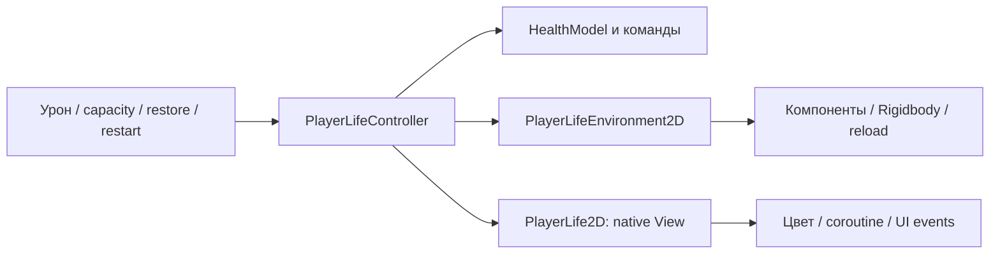

# Жизнь игрока: controller, environment и View · PlayerLife41

2026-10-22, после90a7015. BUG-037 воспроизведён в authored sandbox: hit → PlayerLife.enabled=false оставлял RGBA(1,.25,.25,1) вместо нормального (.6,.62,.62,1). Baseline **0/1 PlayMode**; coroutine продолжал принадлежать отключённому фасаду.

PlayerLifeController теперь применяет damage/capacity/restore/restart через команды. HealthModel владеет HP/защитой; IPlayerLifeEnvironment исполняет физическое defeat/reload; IPlayerLifeView отображает flash/цвет и старые events. Три зависимости указаны прямо, service bag не добавлен. PlayerLifeEnvironment2D — отдельный native adapter с кешированными компонентами явного root; C#-модель не знает Rigidbody, SceneManager или renderer.

Disable отменяет native hit-flash и восстанавливает normalColor живого спрайта. Model death/physical stop не ждут анимацию; no-op View в чистом тесте не мешает поражению. Native damage facade отказывает после уничтожения root, но visibility/enable renderer не становятся правилом здоровья. Restore сохраняет прежний clamp1..Maximum, снимает защиту и не выдаёт damage/death повторно; порядок Damaged → HealthChanged, native component states и checkpoint policy сохранены.

Прежние .16с/hit/defeat цвета вынесены в тот же player entity profile. В PlayerRules.asset добавлены **только три строки**, прежние8 полей/refs/GUID побайтово сохранены. Профиль проверяется до bindings; длительность0 выключает косметический flash. Сохранения, роли источников света, shader/геометрия и высота теней не менялись.

После: **1218/1218 EditMode =1215 production+3 scratch guards**, **69/69 PlayMode**, обычная **Windows64 success**. Проверены command rejection/защита, конечность direction до damage, независимая capacity, silent restore/clamp, dead-only restart и поражение без визуального ожидания. Настоящий disable case и прежние health/UI/save/room/weapon/AI/light/FX регрессии прошли. Собственная Player assembly только EmergencyShift.Runtime. [Источники/сценарии/дельта](../Validation/PlayerLife41.json).

2020 ресурсов до этапа: изменён только указанный player asset; остальные и60 исходных dirty файлов неизменны. Добавлены7 C#/8 meta. Тестировалась dirty disposable-копия с прежней паузой, не clean HEAD; она сохраняет3 guard cases вне production source. Нефатальный LicensingClient warning остаётся.

Добавлены controller и cached environment по одному на actor; новые команды — value structs. Контакты компонентов разрешаются при инициализации, общего Update/поиска сцены каждый кадр нет. Flash coroutine остался косметическим, теперь его lifetime ограничен. Это описание реализации, не измерение FPS. Audio/door/lamp/navigation/UI/tools/style и итоговая приёмка продолжаются.
