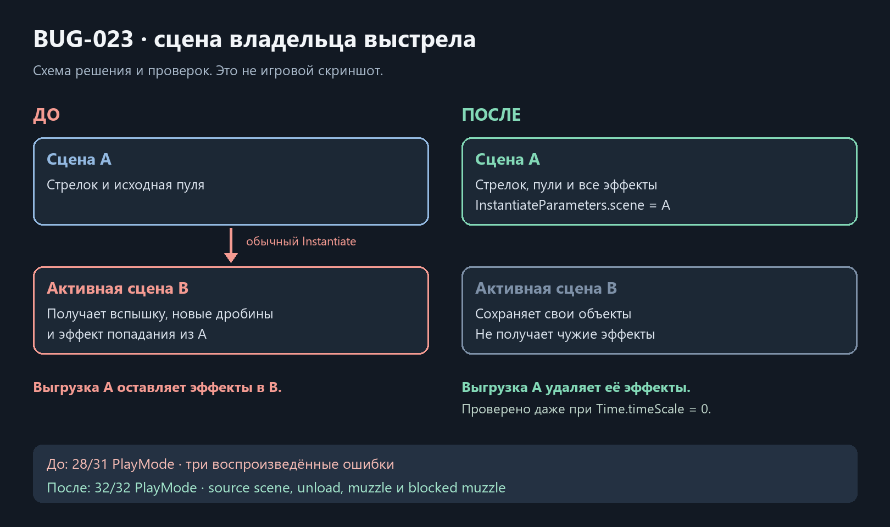

# Выстрел · владелец сцены, BUG-023

Дата: 2026-10-21. База `5feac67`. Обычный Instantiate в PlayerWeapon2D создавал вспышку, пули и blocked-muzzle impact в активной сцене; BulletProjectile2D так же создавал попадание. Теперь все четыре точки задают `InstantiateParameters.scene = gameObject.scene`, worldSpace=true, без parent. API и overload проверены по XML установленной Unity 6000.6.5f1, затем компиляцией/сборкой. Объект сразу создаётся в указанной сцене, без временного parenting/изменения масштаба или последующего поиска контекста.

До исправления **28/31 PlayMode**: native CircleCast создал impact в чужой B; при Time.timeScale=0 выгрузка A его не удалила; настоящий выстрел оставил в B 8/8 дробин и 1/1 вспышку. Первое узкое воспроизведение отдельно дало 0/1. Три исходных дефекта подтверждены до изменения runtime; baseline source hashes сохранены.

После **671/671 EditMode**, **32/32 PlayMode**. Четыре новые проверки: сцена настоящего попадания, удаление замороженного impact вместе с источником, выстрел в пустое пространство и выстрел с перекрытым дулом. Последний не создаёт летящих дробин и создаёт обе вспышки в A. Все прежние случаи spread/lifetime, checkpoint, AI, movement и doors также прошли. Добавленная fixture первоначально использовала недоступный в установленном NUnit Assert.Multiple; её исправление не относится к игровому багу.

Обычная Windows64 success; собственная Player-сборка только EmergencyShift.Runtime. 1794 защищённых ресурса без изменений; source hashes совпадают с тестовой копией. [Данные и raw hashes](../Validation/ProjectileOwnership10.json). Копия включает исходную незавершённую паузу; build log содержит прежнее нефатальное сообщение LicensingClient. Художественная/авторская приёмка и FPS не заявляются.

Это техническая схема, не игровой скриншот. В single-scene сценарии активная сцена обычно совпадала с владельцем; исправление проявляется при additive-загрузке/выгрузке. Новых Update, реестров, физических запросов или менеджеров нет. InstantiateParameters — значение, существующее число Instantiate сохранено. Баланс, направление/spread, полёт, damage, профили и визуальные ресурсы не менялись. Полный перенос полёта пули в Model/controller и разделение ballistic/visual config остаются открыты.
