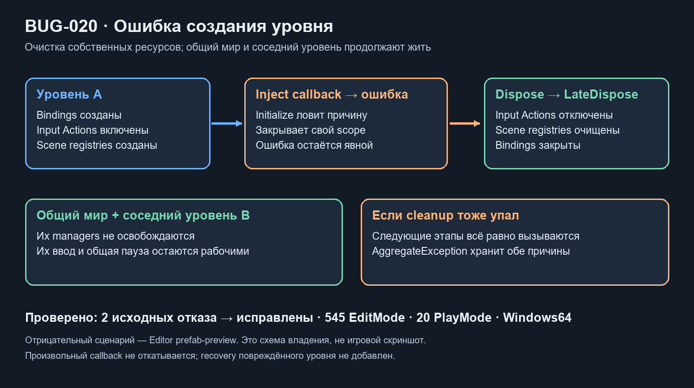

# Очистка неуспешного scope · BUG-020

Дата: 2026-10-21. База `67e0eb9`. Меняется аварийный lifecycle композиции, без пересоздания сцен/ресурсов.

До исправления настоящий LevelRig в одноразовом prefab-preview получил исключение из Inject callback: **2 failed / 1 passed**. Native InputActionAsset оставался живым, частичный реестр содержал дверь. Соседний уровень/общая пауза не ломались; прежний код освобождал часть ввода только при последующем Destroy.

LevelContext теперь захватывает DisposableManager после завершения bindings, до пользовательских Inject callbacks/ResolveRoots. Для input subcontainer manager тоже захватывается до roots. Ошибка немедленно вызывает Dispose собственного scope. Dispose пытается закрыть оба manager, их LateDispose и bindings, очищает собственные ссылки и остаётся одноразовым. Если cleanup тоже бросил исключение, AggregateException сохраняет обе причины. Configure разрешён до инициализации: он больше не может менять ссылки поверх уже связанных зависимостей. Общий manager мира и соседние уровни не освобождаются.

**545/545 EditMode**, включая 5 новых lifecycle-проверок: исходные input/registry утечки, живой sibling/world, две причины ошибки вместе с late-cleanup, запрет reconfigure и повторный Dispose. **20/20 PlayMode** штатных сцен и обычный Windows64 Player прошли. [Результаты/хеши](../Validation/ScopeFailure03.json).

Отрицательный сценарий проверен в Editor preview реальной сценовой композиции с явно подключённой opt-in Development fixture, без запуска пользовательской сцены и без записи prefab. В Editor input clone удаляется через DestroyImmediate; в Play его прежний Dispose немедленно отключает actions и ставит Destroy на конец кадра. Отдельный аварийный Play-тест не выполнялся. Исправление не делает повреждённый уровень пригодным для продолжения игры и не восстанавливает произвольные побочные эффекты упавшего callback.

Первая новая fixture была ошибочно помещена в Editor-only тестовую сборку; Unity не разрешила прикрепить такой MonoBehaviour. Она перенесена в Development с UNITY_EDITOR; тест вызывает её через reflection, обычный Player не содержит Development/tests. Тестовый ILateDisposable требует явной ссылки на Zenject-usage; NUnit тоже указан явно. Исходный отрицательный результат выше снят уже после этих исправлений fixture.

SDK DisposableManager сам прекращает свой внутренний цикл на первом исключении. Наш код гарантирует попытку следующих этапов/другого manager и сохранение ошибок; он не заменяет SDK новым контейнером. Текущие собственные dispose не используют исключения как штатный результат. Это граница защиты, не обещание произвольного recovery.

Рабочая копия содержит прежнюю принятую незакоммиченную паузу. Ручные сцены/параметры/GUID сохранены, пользовательские слоты не используются. Время захвата прежнего manager изменилось, новые Update/менеджеры не добавлены. Один небольшой список ошибок создаётся при Dispose; кадровая нагрузка не меняется, FPS не измерен.
