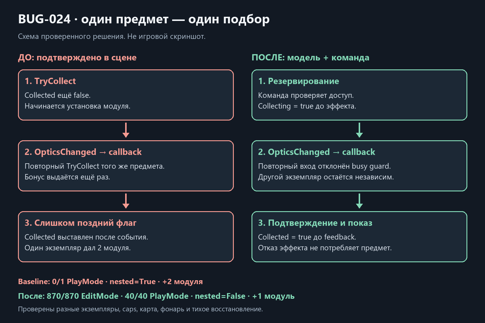

# Однократный подбор / BUG-024

Дата: 2026-10-21. База `90909d9`. Native baseline в MorgueRouteTest подтвердил дефект: callback OpticsChanged повторно вызывает TryCollect того же FlashlightUpgradePickup до выставления Collected. Результат — nested=True и два модуля за один экземпляр, **0/1 PlayMode**. Это отдельный runtime-баг, не прежние BUG-009/019 сохранений.

Features/Pickups содержит личную SingleUsePickupModel, collect/restore commands, controller и scoped factory. Команда резервирует Collecting до inventory effect и отклоняет повторный вход. Успех фиксирует Collected до feedback, отказ сохраняет предмет доступным. Карта, фонарь и модуль используют ту же модель с отдельными native value operations; правила выдачи по-прежнему принадлежат моделям соответствующего инвентаря. Два разных экземпляра одного repeatable module сохраняют два бонуса. WeaponLoot с частичным боезапасом пока остаётся отдельным открытым переносом.

Restore меняет только consumed flag, не вызывает эффект/уведомление и не допускается посреди inventory callback. Все прежние поля, GUID, диапазоны, bonuses, ID и DTO-форматы сохранены; Activate/Deactivate при checkpoint остаётся у существующего адаптера. Карточный/модульный fixtures теперь явно получают composition. Исходные незавершённые PauseMenu-строки LevelContext сохранены отдельно и исключены из коммита.

**870/870 EditMode**, 10 новых случаев: повторный вход, stale gate, отказ/повторная попытка, quiet restore/busy guard, независимость экземпляров, cleanup при исключении до выдачи и запрет повторной выдачи после ошибки presentation. 1000 попыток consumed pickup — 0 managed bytes в чистом сценарии. **40/40 PlayMode**, четыре native-сценария: исходный BUG-024 (теперь nested=False и один модуль), отдельная repeatable копия, карта/disabled actor/quiet restore, фонарь/одно ownership событие и capped upgrade, который остаётся на полу.

Обычная Windows64 success; собственная Player-сборка только EmergencyShift.Runtime. [Хеши источников, исходный отказ, source parity и 1794 неизменённых ресурса](../Validation/SingleUsePickups18.json). Копия включает исходную незавершённую паузу и не является clean HEAD; LicensingClient остаётся нефатальным сообщением окружения. FPS/авторская приёмка не заявляются.

На экземпляр добавляются model и controller, на попытку используется value operation/command без boxing. Новых Update, overlap/LOS запросов, очередей, корутин или runtime-реестров нет. Presentation запускается после commit; native объект отключается в finally даже при ошибке feedback. Это не общая транзакция отката чужого inventory callback, бросившего исключение после собственного изменения: такая атомарность здесь не заявляется. Concrete actor contracts, item definition/config bridge и общий SOD-перенос остаются открыты.

