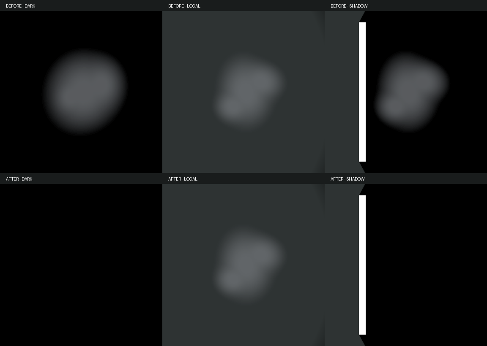

# BUG-045 · дым подчиняется свету и тени

2026-10-24. По отзыву владельца «Дым всегда виден, даже сквозь тьму». Исправление предоставлено на проверку; прежняя приёмка аудиобанка B сохранена.

## Причина и изменение

MuzzleSmoke.shader возвращал input.color.rgb независимо от освещения и для основного облака, и для бокового газа. Тег Universal2D не выполняет освещение автоматически. На нулевом свете получалось светлое облако.

Добавлены URP 2D lighting UV и штатные ShapeLightShared/CombinedShapeLightShared из установленного URP пакета. Оба режима используют освещение и тени существующих Light2D, белую surface mask и плоскую нормаль. Если ни один shape-light тип не активен, результат прозрачен: стандартный sprite fallback в этом случае возвращает unlit цвет, что снова делало бы дым ярким. Нулевые light textures дают нулевой цвет; слабая базовая освещённость остаётся слабой, полного выключения дыма при любом выключенном фонаре не вводилось.

Функции плотности/формы/seed не изменены. Размеры, opacity, сроки жизни, предел четыре облака/два quad, muzzle flash, сцены, native GUID и принятые шесть B сохранены. Production C# не менялся. Дополнительные свет/материалы/текстуры/источники звука не создаются в игре.

## Проверка

- Контролируемый native URP fixture: основной/боковой слой × темнота/базовый .05/белый 1/локальный Point/ShadowCaster/no lights, по 12 кадров до/после. В темноте максимальная сумма RGB-разниц между кадром с дымом и без него была 274/213, после 0/0. В полной тени и без lights после также 0/0. При единичном белом и локальном свете PNG обоих режимов побитово совпали с прежним shader. [Before](../Validation/SmokeLighting56/Before/capture.json), [After](../Validation/SmokeLighting56/After/capture.json), [checks](../Validation/SmokeLighting56/checks.json).
- Fixture использует отдельную PreviewScene, штатный Sprite-Lit reference floor и реальный ShadowCaster2D. Для локального света вручную обновляются его native mesh/bounds через version-local reflection: PreviewScene не исполняет обычный LateUpdate Light2D. Baseline shader компилируется как временный Hidden shader, игровой shader обратно не переключается. Материалы/scene/RT удаляются в finally, исходная карта/dirty flag сохранены. У ReviewSmokeContinuity добавлен единичный белый preview-свет для будущих проверок формы.
- [MorgueRouteTest](../Validation/SmokeLighting56/MorgueRouteTest/capture.json): тот же production smoke prefab/View и readonly профиль, возраст .12 с после времени короткой вспышки, камера 3.102903, исходный фон/свет карты. Временная проба отдельно включает фонарь, оставляет ambient и затем обнуляет интенсивности. Фонарь реально IsOn=true; максимальная RGB-разница дыма 106, ambient 54, blackout 0 и 0 изменённых пикселей. Это контролируемые кадры самого View, не запись боя; [фонарь](../Validation/SmokeLighting56/MorgueRouteTest/flashlight.png), [ambient](../Validation/SmokeLighting56/MorgueRouteTest/ambient.png), [blackout](../Validation/SmokeLighting56/MorgueRouteTest/blackout.png). Начальная проба без владения фонарём не использована; финальная временно получает/восстанавливает владение.
- [3/3 PlayMode](../Validation/SmokeLighting56/smoke-tests.json): лимит, отдельное короткое освещение, пауза/возврат, disable/unload и раннее завершение бокового дыма обоих оружий. [Native prefab/config/shader check](../Validation/SmokeLighting56/native-final.json) passed; console errors=0/compilationFailed=false.
- Карты не сохранялись/не генерировались. Play завершён; исходные MorgueRouteTest, playModeStartScene=null, mute=false, captureFramerate=0 и preload=1 сохранены. Чужой pause/input/scene draft остаётся отдельно.

Новые полные test/build/GPU результаты не заявляются: shader-only production изменение. Освещение добавляет чтение light textures, поэтому прежние числа стоимости unlit shader не доказывают текущую GPU стоимость. Художественная оценка нового поведения остаётся владельцу.
