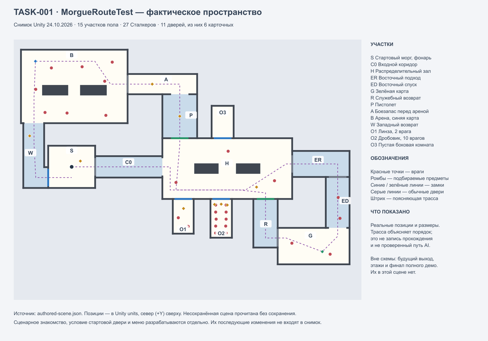
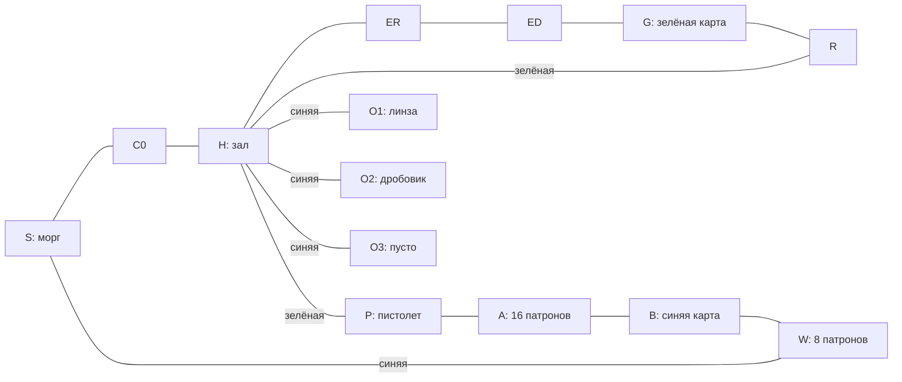

# TASK-001 · Левел-дизайн и использование механик

Дата: 24.10.2026. [Карточка задачи](https://app.notion.com/p/4038d6dc06b681409c1fc807b2fd8ab5). Объект: MorgueRouteTest; MechanicsSandbox — вспомогательная среда проверки. Это экспертная оценка конкретного состояния прототипа и предложения, а не новый утверждённый дизайн уровня.

## Заключение

**У маршрута есть работоспособный пространственный каркас:** сначала беспомощность, затем доступ через зелёную карту и оружие, затем арена с синей картой и раскрытие знакомого пространства. Ключи меняют связность, возвраты полезны, необязательные комнаты действительно можно пропустить. Сохранять эту основу разумнее, чем начинать карту заново.

**Главное ограничение — последовательность решений пока слабее последовательности находок.** Уровень выдаёт фонарь, карты и оружие, но ещё не обеспечивает ясную цепочку «понял правило → безопасно попробовал → применил под давлением → сочетал с другим правилом». До пистолета расположены семь обычных Сталкеров; далее масштаб растёт преимущественно числом одинаковых противников. Основные риски — ранняя перегрузка, однообразная безопасная стратегия с постоянно включённым фонарём и неясная цена необязательного боя.

Ближайшее улучшение — закончить уже отдельно разрабатываемое знакомство со светом, сделать первый обычный контакт понятным, проверить экономику прямого пути с 24 патронами и придать боковым комнатам разные игровые роли. Для этого сначала достаточно расстановки, предупреждений и наград. Новые виды врагов, батарейки, кампания и раздавливание дверью не являются необходимым первым шагом.

**Полноценное боевое прохождение, баланс и удобство для новичка этим отчётом не подтверждены.** По прямому ответу владельца оценка выполнена по сцене и коду; живой прогон отложен. Выводы о типичных ошибках и доминирующей стратегии остаются проверяемыми дизайнерскими гипотезами.

## 1. Метод, состояние проекта и пределы

### Что исследовано

- Прочитаны проектные правила, SPEC, GAME_CONCEPT, FIRST_LEVEL, руководства маршрута/песочницы, контракты дверей, взаимодействий, Сталкера и оружия.
- Прочитаны главная Notion, PLAN-00, PLAN-01, TASK-001, отдельная авторская оценка, задачи сценарного знакомства, условия стартовой двери, контекстных сообщений и раздавливания.
- Через Unity Pipeline снята **фактическая открытая MorgueRouteTest с несохранёнными изменениями**. Снимок: 24.10.2026, **13:28:32 МСК**. Сцена не сохранялась. Измерены позиции, размеры коллайдеров, состояния авторинга, ссылки на профили и содержимое подбираемых предметов.
- Сохранённая MechanicsSandbox отдельно прочитана в краткоживущей Preview Scene; исходная открытая сцена не заменялась и не сохранялась. Это осмотр ресурса, без запуска игры.
- Проверены реальные правила обнаружения, фонаря, подбора боезапаса и замков по C#. Построены схема и граф доступа по текущим дверям и стыкам полов; выполнен расчёт достижимости с разными картами.

Базовый HEAD при начале оценки — `8b426ea8f18521f675a6b773c41678422ff5826d`. Рабочая копия уже содержала незавершённые изменения подбора/блика, меню паузы, обеих сцен и документации. Параллельно началась реализация сценарного Сталкера. Поэтому результат описывает **зафиксированный снимок**, а не чистую ревизию Git и не автоматически все последующие изменения. Реестр входных файлов и хеши — [sources.json](../Validation/Task001LevelDesign/sources.json).

### Что не сделано

Вначале была попытка войти в Play, но параллельная работа переключала режим редактора. Устойчивого игрового сеанса и прохождения не получилось; эта попытка **не считается игровым прогоном**. После ответа владельца «Сделать анализ по сцене и коду, живой прогон позже» игровые действия не продолжались.

В этой оценке нет замеров длительности, смертей, попаданий, расхода патронов, удобства мыши или субъективного восприятия аудио. Не пройдены в игре ни основной маршрут, ни необязательные ветки. Исторические результаты из MorgueRouteTest.json не переобъявляются результатами текущей сцены. Не проверялась производительность. Нет тестов с новыми игроками.

Используются три уровня утверждений:

| Обозначение | Значение |
|---|---|
| **Факт** | Видно в native-снимке, данных ресурса или непосредственно следует из прочитанного кода |
| **Вывод** | Дизайнерское следствие фактов; объяснение приведено рядом |
| **Гипотеза** | Предположение о восприятии, успешности или выборе игрока; нужен игровой тест |

Схема графа проверяет **условия доступа**, а не движение тела, работу AI или возможность выжить. Полилиния на карте поясняет порядок эпизодов; это не записанная траектория игрока.

## 2. Фактическое пространство

[Векторная схема](../Validation/Task001LevelDesign/route-map.svg) · [снимок открытой сцены](../Validation/Task001LevelDesign/authored-scene.json) · [расчёт и предметы](../Validation/Task001LevelDesign/analysis.json).

В снимке 15 прямоугольников пола: восемь комнат и коридорные фрагменты; западный коридор состоит из двух. Есть 11 дверей: пять обычных, две зелёные и четыре синие. Четыре других соединения открытые, без створок. Все 27 врагов — Сталкеры одного типа, у всех выключен случайный патруль.

| Участок | Фактическая роль и содержимое | Решение игрока |
|---|---|---|
| **S, морг** | Старт (0; 0), фонарь (1.5; 1), небольшой локальный свет; синяя дверь на запад и обычная на восток | Осмотреться, найти источник света, выбрать доступный выход |
| **C0, входной коридор** | Связь S–H, примерно 11.6 × 3.7 units | Продолжить в темноту; освоить направление луча и взаимодействие |
| **H, зал** | Примерно 22.4 × 10.5, два блока, три Сталкера; зелёные двери к P и R, три синие ветки, обычная дверь на восток; 8 патронов в (31.9; −3.5) | Выбрать обход блока и направление, запомнить закрытые двери, избегать лишней агрессии |
| **ER–ED, восток** | Протяжённый обход; два Сталкера в ED | Вести свет вперёд или проверять тыл, проходить мимо или отступать |
| **G, зелёная карта** | Карта (43.25; −14.662), два Сталкера; выход в R | Забрать доступ и воспользоваться новым возвратом, не обязательно убивать охрану |
| **R, возврат** | Коридор к зелёной двери в H | Превратить находку в сокращение пути; решить, закрыть ли дверь за собой |
| **P, оружейный проход** | Пистолет с 8 патронами, далее открытый проход в A | Получить первое средство окончательного устранения угрозы |
| **A, запас перед ареной** | 16 патронов и обычная дверь в B | Пополнить резерв, подготовиться к бою, решить, когда войти |
| **B, арена** | Примерно 18.4 × 12.7, два блока, восемь Сталкеров, синяя карта (−6.25; 18.25) | Обойти, вытянуть противников, стрелять, держать направление светом или взять карту и уйти |
| **W, западный возврат** | Открытая связь с B, 8 патронов, синяя дверь в S | Открыть второй локальный цикл и вернуться к старту |
| **O1, линза** | Комната 3.6 × 6, два Сталкера; линза у входной части, (19.3; −7.2) | Рискнуть ради более широкого и дальнего луча |
| **O2, дробовик** | Комната 3.7 × 6.7, десять Сталкеров; дробовик с 4 и две коробки по 12 у входа | Получить мощное оружие, выбрать отступление или зачистку тесной группы |
| **O3, кабинет** | Синяя дверь, отдельная комната без игровой награды в снимке | Проверить неизвестную ветку; пока без дальнейшего системного результата |

Размеры — по границам пола, а не чистое пространство между внутренними гранями стен. Единицы Unity не объявляются метрами.

### Граф доступа

**Факт:** зелёная карта достижима по графу с пустым инвентарём. С ней доступны P, A, B и W; синяя открывает возврат W–S и три ветки из H. Собственный замок не блокирует получение карты. Удаление O1/O2/O3 из графа не закрывает путь к синей карте. Карты не расходуются.

Пистолет расположен на основном пути, но владение оружием и убийства не являются условиями доступа к B или синей карте. Поэтому «арена с восемью врагами» сейчас означает опасную задачу проникновения/боя, а не гарантированный обязательный бой. Это полезная свобода, которую стоит сохранить, если владелец отдельно не выберет другую постановку.

До получения синей карты W доступен из B, но его дверь в S закрыта. Поэтому при первом входе в B западный коридор нельзя считать уже открытым вторым сквозным выходом; он может стать тупиком для отступающего игрока.

Выхода в следующую локацию нет. Получение синей карты или возвращение в S не объявляются завершением уровня либо всего демо. Ориентиры 30/50 минут относятся к будущему полному демо; к этому фрагменту они неприменимы.

## 3. Освоение и сочетание механик

| Механика | Где вводится | Где практикуется | Где проверяется/сочетается | Пробел |
|---|---|---|---|---|
| Движение и мышь | S, затем C0 | Проходы и обходы блоков H | Уход от нескольких угроз в B, тесная O2 | S безопасен, но после C0 нет выделенной обычной встречи только на одно новое правило |
| E и дверь | S–C0; рядом видна недоступная синяя S–W | Обычные двери восточного обхода | Карточный возврат, дверь арены, изоляция преследователей | Одновременно появляются обычные/карточные двери и направления; не проверено, заметит ли новичок подсказку |
| Находка фонаря и F | Фонарь в S, камера расширяется после подбора | C0 и H | Сдерживание врага при движении, разворот между угрозами | В снимке выход S–C0 обычный: наличие фонаря не является условием открытия; соответствующая задача ещё отдельная |
| Обнаружение и агрессия | Первый обычный Сталкер H: (18; −2.7) | Восточный обход и G | Перенос преследования через возврат, работа с хвостом на арене | Постоянство агрессии и отсутствие скрытности от выключения F не объясняются одним видом монстра |
| Задержанный страх света | Контакт в H/ED | Четыре восточных противника, разнесённые угрозы H | Удержание одного направления при обходе другого в B | Нет отдельной безопасной проверки обычного правила до угрозы; сценарное знакомство разрабатывается параллельно |
| Автоподбор | Фонарь S | Зелёная карта G | Карта под давлением, коробки и модули | Стартовый фонарь не может получать блик от ещё не принадлежащего игроку фонаря; нужно читать сам предмет и стартовое освещение |
| Зелёная карта | Запертые H–P/R–H до находки | Открытие возврата R–H | Доступ к оружию и изменение маршрута | Нужна проверка, понимает ли игрок, что карта открыла два разных места, а не только ближайшую дверь |
| Пистолет | P: 8/0 после подбора | A даёт резерв; отдельной спокойной мишени здесь нет | Восемь врагов B, возможный хвост от ранней части | Полезно дать безопасную возможность понять выстрел/магазин перед основной группой |
| Перезарядка X и авто | После появления оружия | Теоретически перед A–B | Движение + фонарь во время перезарядки B | Доступны сразу магазин, резерв и автоперезарядка; игрок может пережить эпизод, не поняв X и раздельный учёт |
| Синяя карта | Найдена за угрозами B | W–S | Возврат в H и выбор O1/O2/O3 | Должна ощущаться сменой возможностей; O3 пока обещает больше, чем отдаёт |
| Линза | O1 после синей карты | Оставшиеся необязательные угрозы | Луч 4.2/88° и расширенный обзор | Основная проверка света уже позади; улучшение слабо меняет остаток обязательного маршрута |
| Дробовик и 1/2 | O2, одновременно с плотной группой | Та же тесная комната | Распределение оружия, помпа, поштучная зарядка и свет | Много новых правил в момент наибольшей локальной плотности; награда лежит перед основной глубиной комнаты |
| Спящий | В MechanicsSandbox | Отдельная комната/тир | В MorgueRouteTest отсутствует | Нельзя обосновывать им уже существующий выбор «свет помогает/свет опасен» в этом маршруте |

**Вывод:** материал для обучения есть, но выдача предмета ещё не гарантирует усвоение правила. В первую очередь нужны разные функции эпизодов: показать, дать попробовать, затем попросить совместить. Самостоятельное чтение инструкции перед запуском этого не заменяет.

## 4. Выбор игрока и вероятные стратегии

### Свет — сильный инструмент, внимание — его текущая цена

**Факты:** обычное обнаружение Сталкера проверяет дистанцию и прямую видимость. Освещённость игрока и шум выстрела не входят в эту проверку. Фонарь отпугивает после задержки .45 с, в пределах 3.2 units; начальная дальность самого луча тоже 3.2. У всех врагов снимка радиус обнаружения 3.2. Фонарь не расходует батарею. Обычная лампа и вспышка выстрела не заменяют защитный луч. Накопление повреждения глаза не уменьшает HP врага; это нельзя считать бесплатным убийством светом.

**Вывод:** в этой сцене выключение фонаря само по себе не даёт бонуса к скрытности против Сталкера. Игра уже поддерживает обход вне радиуса/за препятствием, но это пространственный обход, а не механика «в темноте он меня не видит». Приписывать игроку такой выбор было бы неверно.

**Гипотеза:** опытный игрок будет преимущественно держать F включённым, пятиться и направлять луч на ближайшую угрозу. Это не обязательно проблема: управление направлением может быть основой боя. Однообразие возникает, если все ситуации решаются одинаковым пятящимся движением и у игрока нет причины менять угол, позицию или темп.

Первая рекомендация — проверить расстановкой цену внимания: видимая угроза впереди и заранее предупреждённый альтернативный подход, необходимость перенести луч при обходе блока, возможность остановить преследователя дверью. Не нужно автоматически вводить батарейки или увеличивать скорость общего профиля. Будущий светочувствительный в другую сторону враг может изменить выбор, но текущую сцену он ещё не спасает.

### Бой, бегство и обход

Скорость игрока — 3.5 units/s, обычное преследование местного Сталкера — 1.2, выпад — 2.7, отход от света — 3.8. Это **параметры**, не замер реального зазора при движении. Свободный прямой участок даёт игроку преимущество; углы, столкновения и несколько направлений могут его отменить.

Патрон окончательно убирает одну конкретную угрозу, свет временно управляет её направлением, обход сохраняет ресурсы, закрытая дверь физически разделяет пространство. Агрессия за препятствием не стирается. Это уже четыре полезных роли; им не требуется четыре новых вида монстров.

**Гипотезы для проверки:** B может быть выгодно проходить без стрельбы; врагов можно вытягивать через A–B и уничтожать по одному; W может оказаться удобнее для бегства, чем для «передышки»; дверь позволяет временно разорвать контакт. Существование этих стратегий не объявляется багом. Нужно проверить их цену и разнообразие, прежде чем вводить зачистку как обязательное условие.

### Необязательные комнаты

В O1 линза находится примерно на 1.65 unit южнее центра двери, в O2 дробовик — на .9 unit, коробки — рядом с ним. Два первых врага O2 стоят примерно в 1.05 unit за дверью. Предметы собираются при близости и прямом доступе; убийства не являются условием выдачи.

**Вывод:** риск возникает сразу у входа, а большая часть награды находится до глубокой части комнаты. **Гипотеза:** взять дробовик/линзу и отойти выгоднее, чем зачищать всё помещение. Для survival horror это может быть хорошей кражей под угрозой. Если обещанная роль — «награда за зачистку», текущая постановка этой роли не обеспечивает.

Следует сначала выбрать смысл: разрешённая рискованная кража либо глубокая вылазка с понятным путём назад. Скрыто вводить проверку убийства всех противников не нужно. Возможный вариант без нового кода: оружие оставить у входа как средство решения, часть запаса или отдельную ценную награду поставить глубже, а путь отступления сделать обозримым.

## 5. Экономика и возможность ошибки

### Боезапас

| Источник | Пистолет | Дробовик | Условие/оговорка |
|---|---:|---:|---|
| P, первая находка | 8 | — | Сразу доступен после зелёной карты |
| A, перед B | 16 | — | По прямой цепочке P → A → B |
| H, (31.9; −3.5) | 8 при активном пистолете | Может достаться ему при активном дробовике | Тип не закреплён; до оружия не принимается, после P нужен возврат. См. BUG-046 ниже |
| W, после входа в B | 8 | — | Лежит за опасным участком; не считать запасом для первого входа в B |
| O2 | — | 4 + 12 + 12 | Требуется синяя карта; на обязательный первый вход в B не влияет |

**Прямой путь после получения пистолета даёт 24 патрона перед ареной.** 32 — доступный максимум с дополнительным посещением коробки H и активным пистолетом; не гарантированный запас у каждого игрока. В сцене 32 патрона с явным пистолетным типом, 28 с дробовым и ещё 8 нетипизированных в H. При сборе H пистолетом пистолетный итог равен 40.

**Отдельное несоответствие конфигурации — [BUG-046](https://app.notion.com/p/4038d6dc06b681108068c49a654410eb).** У `Route pistol reserve - 8 cartridges` не задана `weaponDefinition`, хотя имя и руководство описывают пистолетный запас. В коде пустой target означает активное оружие. При позднем возврате с выбранным дробовиком коробка по этому правилу адресована ему. Native-конфигурация и цепочка кода подтверждены; фактическая выдача в игре не воспроизводилась. Карточка оставлена «Запланировано», исправления нет. Это конкретное расхождение назначения/данных, в отличие от субъективного предложения изменить число патронов.

У всех Сталкеров снимка 2 HP, пистолет наносит 1 урон. Без промахов и при обычных попаданиях восемь врагов B требуют 16 пуль. Магазин вмещает 8, то есть четыре таких убийства на магазин; для восьми потребуется хотя бы одна полная перезарядка при боевом решении. Её длительность 1.4 с; движение и фонарь остаются доступны.

На основном фрагменте 15 врагов: семь до оружия и восемь в B. Их полная пистолетная зачистка требует 30 попаданий. Если все ранние угрозы остаются в зоне дальнейших действий, запас 24 не покрывает такую зачистку даже без промахов. Запас 32 оставляет только две пули сверх этого расчёта. Это **расчёт предельного сценария**, не средний расход и не доказательство непроходимости: часть врагов можно не активировать, отгородить или обойти.

Все 27 врагов имеют суммарно 54 HP против максимальных 40 пистолетных патронов при таком сборе H; поэтому полную зачистку одним пистолетом закладывать в ожидания нельзя. Дробовик меняет экономику, но его восемь дробин нельзя считать восемью гарантированными попаданиями или фиксированным числом убийств: влияют веер, стены, дистанция и остановка дроби на первой цели.

**Вывод:** боезапас достаточно осмысленно ограничен, чтобы поддержать обход, однако баланс нельзя строить на предположении, что новичок обязательно подберёт возвратную коробку H. Сначала проверять B с 24 и частично израсходованным магазином, затем вариант с 32.

### Здоровье и повтор попытки

В MorgueRouteTest стартовые 3 HP, в снимке нет подбираемого лечения и подключённого checkpoint. Смерть означает повтор сцены. Это допустимо для короткого тестового фрагмента, но по сцене нельзя установить, сколько времени и освоенных действий теряет новичок.

**Гипотеза:** ошибка в конце B/O2 будет наказывать повторением уже понятного восточного обхода сильнее, чем самой потерей здоровья. Сначала измерить этот повтор; не подключать систему checkpoint в рамках аналитической задачи. Для следующего авторинга возможна локальная передышка перед B либо сохранение в конкретной точке, если владелец выберет такую политику.

## 6. Пространство, предупреждения и темп

### Что стоит сохранить

1. **Два замкнутых возврата вместо простой цепочки комнат.** Зелёная карта сразу сокращает путь, синяя открывает ранее видимую связь со стартом и боковые ветки. Находки меняют знакомое пространство, а не только добавляют значок инвентаря.
2. **Отдельный старт и протяжённые коридоры.** Есть место осмотреться и подготовиться к новой зоне; это соответствует выбранному подвальному сегменту.
3. **Блоки в H и B.** Они создают разные стороны обхода и разрыв прямой видимости. Их можно использовать для задач на направление света без усложнения базового AI.
4. **Свобода взять карту и уйти.** Она оставляет выход при плохой стрельбе, поддерживает риск/ресурсы и не превращает все помещения в обязательные арены.
5. **Цветовые замки, повторяемая ширина дверей и обратная связь отказа.** Владелец уже выбрал единый язык B и убрал лишние огоньки. Его стоит проверять на читаемость, а не заменять новой системой указателей.
6. **Следы опасных зон.** Кровь у входов и локальные места жизнедеятельности дают возможность предупредить угрозу до прямого контакта. Наличие следа подтверждено, достаточность предупреждения для человека ещё нет.

### Основные ограничения

| Приоритет | Наблюдение и конкретное место | Влияние на опыт / статус вывода |
|---|---|---|
| **P1** | На входе в H уже обычный Сталкер (18; −2.7); всего H содержит 3, ED/G ещё 4 до пистолета | До выделенной проверки света игрок уже решает навигацию, направление луча, дверь и риск постоянной агрессии. Перегрузка новичка — гипотеза; состав и порядок — факт |
| **P1** | Из H отходят пять карточных направлений; шестая карточная дверь находится в S. Локальный обзор после фонаря около 6.9 units по высоте широкого кадра | Схему 22.4-unit зала нельзя считать одновременно видимой. Успешная навигация зависит от памяти и ориентиров; нужна проверка без предварительного просмотра карты |
| **P1** | Начальная дальность света и радиус обычного обнаружения одинаковы — 3.2, реакция на свет задержана | Первое уверенное попадание луча не является гарантированным безопасным наблюдением до агрессии. Сценарный эпизод должен быть понятным исключением; обычное правило нужно показать отдельно |
| **P1** | B разрешает захват карты, отход через A и проход к W; ни зачистки, ни нового правила противников нет | Возможен сильный эпизод проникновения, но обещанная «продолжительная схватка» не гарантируется геометрией и числом 8. Требуется выбор роли, затем тест |
| **P1** | O2: 10 врагов в 3.7 × 6.7, две колонки; первые две особи у наград | Плотность резко меняет задачу. Между кругами первой пары в стартовой расстановке около .64 unit, ширина капсулы игрока .56: статический запас всего .08. Это не доказательство проходимости в толпе; для новичка может остаться только стрельба с порога |
| **P2** | Линза доступна после арены и находится близко к входу O1 | Улучшение приходит после основной проверки света и может не получить выразительного применения. Его ценность на остатке фрагмента не доказана |
| **P2** | O3 имеет такой же синий замок, но нет награды, информации или продолжения в игровом содержимом снимка | Гипотеза ложного обещания: игрок платит исследованием и получает пустую проверку. Для блокинга это незавершённость содержания, а не зарегистрированный баг |
| **P2** | Постоянная агрессия переносится через R/H/W, двери не требуют зачистки | Получение карты/коробки не означает передышку. Темп может слиться в одно длинное преследование, если ранние группы тянутся дальше |
| **P2** | Все 27 Сталкеров неподвижны до реакции; предупреждения в основном одного кровавого семейства | Система проста и честно предсказуема, но повтор одного сигнала может снизить различимость опасности и смысл отдельных комнат. Это вопрос композиции, а не требование добавить патруль всем |

### Проходы и манёвр

Створки имеют проход шириной 3 units. Габарит капсулы игрока .56 × .88, диаметр круга Сталкера около 1.16. Сам по себе единичный дверной проём не является очевидной геометрической щелью для одного актёра. Ограничение создают расположение нескольких тел и доступная сторона обхода.

H и B содержат два разнесённых блока; боковые комнаты O1/O2 значительно теснее и имеют один вход. Различие хорошо подходит для контраста «маневрировать» / «решать риск у порога». Однако переход от восьми разнесённых целей B к десяти в двух плотных колонках O2 — одновременно скачок численности, плотности и числа новых правил оружия. Изменять все три фактора сразу для обучения невыгодно: сложно понять причину ошибки.

Кровь должна предупреждать **тип риска**, не изображать обязательную стрелку основного пути. Порог O3 без опасной группы может контрастировать с O1/O2. Массовое добавление одинаковой крови на все двери превратит предупреждение в фон. Достаточность контраста и освещения следует оценивать в Game View на штатном фонаре; нынешняя техническая схема этого не показывает.

### Свет, звук и UI

Код даёт подсказку E, название требуемой карты, уведомление отказа, находки, магазин/резерв и состояния оружия. Звуки дверей/считывателя и характерные состояния монстра уже способны поддержать причинность. Их наличие ещё не доказывает, что игрок успевает их прочитать или правильно интерпретирует.

Новый блик подбираемых предметов требует луча принадлежащего игроку фонаря и доступности находки. Он помогает поиску после начала игры, но не объясняет функцию предмета и не показывает стартовый фонарь через собственный ещё отсутствующий луч. Общий свет и вспышка не заменяют это условие. Пауза/блик находились в параллельной разработке; эстетика и финальное поведение UI здесь не приняты за владельца.

## 7. Приоритетные предложения

Это рекомендации для согласования, **не открытые здесь задачи реализации**. Оценка сложности относительная: малая — локальная расстановка/содержание; средняя — настройка эпизода с проверкой альтернатив; высокая — новый контракт механики или перепланировка маршрута. Это не оценка в часах.

| № | Изменение и место | Ожидаемый эффект | Сложность / зависимости | Риск | Как проверить |
|---|---|---|---|---|---|
| **R01 · P1** | Сначала закончить уже существующий сценарный контакт у S–C0; затем отделить первый обычный контакт H от остальных | Игрок понимает направление света до многозадачного боя | Средняя; [TASK-ENCOUNTER-INTRO](https://app.notion.com/p/4018d6dc06b6811688c9d405a0250620), без дублирования реализации | Сценарный враг может научить ложному правилу «любой монстр всегда убегает по маршруту» | После эпизода дать обычного одиночного Сталкера с видимым путём отхода; спросить, что изменилось и почему |
| **R02 · P1** | У S–C0 завершить условие владения фонарём и согласованную причину отказа | Исключить случайный выход без основного инструмента и объяснить ближайшую цель | Средняя; [TASK-DOOR-CONDITIONS](https://app.notion.com/p/4018d6dc06b6812bb97ccad3df143a40), общий текстовый блок и согласованный текст | Жёсткий замок может ощущаться произволом | Игрок без инструкции находит предмет по смыслу/подаче; выключение найденного фонаря не возвращает запрет |
| **R03 · P1** | В H дать один выраженный ориентир к доступному восточному проходу и два различимых якоря у зелёного возврата/оружейного входа | Меньше случайного обхода закрытых дверей; лучше память карты | Малая–средняя; существующее оформление и выбранная разметка B | Указатель может излишне направлять и уничтожить исследование | На первом посещении игрок объясняет доступное направление; после карты сам находит P, без показа схемы |
| **R04 · P1** | Проверять и настраивать B под прямой запас 24; отдельно предложить понятный возврат к 8 патронам H после оружия | Ошибка в чтении маршрута не превращается в неявный ресурсный налог | Малая; число/место коробки — только после теста | Дополнительные патроны могут убрать напряжение | Сравнить ветки с 24/32, фиксировать попадания, остаток и добровольный обход; не оценивать по одной идеальной зачистке |
| **R05 · P1** | Перед A–B дать место для короткой самостоятельной пробы пистолета и перезарядки, без большой группы | Игрок связывает магазин, резерв, X и движение со светом | Малая–средняя; возможна одна локальная встреча вместо новой системы обучения | Отдельная демонстрационная мишень может разрушить атмосферу | В B человек знает, почему выстрела нет и что делать; объяснение не требует внешней памятки |
| **R06 · P1** | Выбрать роль B: проникновение за картой с возможностью боя; подготовить видимые обходы обоих блоков и отход к A | Сохранить осмысленные альтернативы вместо негласного требования убить всех | Средняя; локальный авторинг и набор сценариев проверки | Полностью безопасный обход обесценит оружие | Сравнить бой, свет+отход и захват карты; у каждого решения должна быть наблюдаемая цена внимания/ресурса/позиции |
| **R07 · P1** | В O2 отделить выдачу нового оружия от основной толпы: оставить понятную переднюю зону, часть награды перенести глубже либо уменьшить стартовый контакт | Дробовик сначала расширяет возможности, затем проверяет их | Средняя; локальная расстановка, существующие pickups | Излишне лёгкое получение может обесценить риск ветки | Проверить «взять и уйти» и «зачистить»; обе ветки намеренно допустимы либо цена глубокой награды очевидна |
| **R08 · P2** | В O1 дать отличающийся от O2 эпизод на направление луча; предусмотреть после линзы ещё одно осмысленное применение света | Линза меняет опыт, а комнаты не отличаются только количеством врагов | Средняя; не переносить обязательный путь в необязательную комнату | Улучшение может стать скрытой обязанностью | Основной маршрут проходит без линзы; её владелец может назвать конкретное облегчение следующего эпизода |
| **R09 · P2** | Выбрать завершённую роль O3: короткая информация, малая находка либо явно оформленная атмосферная тупиковая комната | Исследование получает понятный смысл, карта не обещает одинаковую награду везде | Малая–средняя; для текста отдельное согласование | Ненужный лут превращает все комнаты в одинаковые сундуки | После посещения игрок понимает, зачем проверял комнату; пустота читается намеренной, а не потерянным содержимым |
| **R10 · P2** | В A или W проверить возможность управляемого сброса темпа через закрываемую дверь и место для ориентации | Возникает передышка действием игрока, без удаления агрессии | Малая–средняя; сохранение постоянного HasAggro | Дверь может стать универсальным безопасным эксплойтом | Проверить преследователей с обеих сторон, повторное открытие и цену возвращения; изоляцию не выдавать за забывание цели |
| **R11 · P2** | Выделить хотя бы две разные задачи на внимание в H/B вместо повсеместного увеличения количества | Развить сочетание движения, света, позиции и оружия | Средняя; расстановка и предупреждения, без новых общих профилей | Нечитаемый фланг воспринимается как нечестный урон | До входа различимы сигналы; после ошибки игрок может объяснить, какой риск проигнорировал |
| **R12 · P3** | После замеров повторной попытки решить, нужна ли локальная точка восстановления перед B | Сократить повтор уже освоенного пути при сохранении цены ошибки | Средняя; отдельное решение о checkpoint и проверка восстановления | Сохранение может зафиксировать невыигрышное состояние или обнулить напряжение | Замерять повтор после смерти, проверять низкий запас/HP и возможность отступления; не выводить решение из длины схемы |

### Быстрые улучшения и более крупные изменения

**Без перепланировки маршрута:** различимые ориентиры H; явная подготовка у A; уточнение роли коробки H; более ясное предупреждение O2; назначение O3; локальное разделение первой обычной угрозы и следующей группы. Конкретные позиции и числа выбираются после согласования; в этой задаче ничего не переставлено.

**С локальной переработкой эпизодов:** глубина наград O1/O2, распределение направлений угроз в B, место безопасной пробы оружия, реальное применение линзы после находки. Здесь нужно проверить все способы игры, а не только задуманную автором траекторию.

**Новые механики/продолжение:** раздавливание дверью, переход этажей, новый состав угроз, итоговая статистика и финал демо. Раздавливание уже имеет [отдельную карточку](https://app.notion.com/p/4018d6dc06b681988121ca6de195b509); в снимке дверь не убивает врага. Оно может добавить ресурсосберегающую ловушку, но также усилить стратегию выманивания всех в один проём. Потребуются отдельные предупреждения, зона контакта, правило игрока под створкой и проверка повторной смерти/останков. Для решения нынешних вопросов обучения эта механика не обязательна.

## 8. Что даёт MechanicsSandbox

Песочница действительно содержит раздельные комнаты обычных Сталкеров, карточного доступа и тира; есть живой Спящий за карточной дверью и неподвижный Спящий в тире. Снимок ресурса — [sandbox-saved.json](../Validation/Task001LevelDesign/sandbox-saved.json). Тир содержит неподвижные цели 2/6/20 HP, дополнительную группу для перекрытия крови, оружие/патроны и временную зону 100 HP. R/T поддерживают повторяемую механику теста.

**Сильная сторона:** здесь удобно отдельно проверить реакцию света, магазин/помпу, попадания, двери и обратную связь, не тратя попытку на весь маршрут.

**Ограничение:** заранее подписанные станции, возможность пополнения и неподвижные мишени не создают обучение внутри MorgueRouteTest. Успех в тире не доказывает, что новый игрок правильно распознал предмет, выбрал путь, пережил первый контакт или понял риск O2. Нельзя критиковать отсутствие кампании в песочнице — у неё другая работа.

Для будущих проверок полезно использовать обе сцены последовательно: сначала изолировать непонятную механику в Sandbox, затем проверить её считывание и сочетание в маршруте. Новичку при оценке обучения MorgueRouteTest заранее тир не показывать: иначе он уже знает ответы.

## 9. Отложенная игровая проверка

Ниже программа проверки рекомендаций, а не уже полученные результаты. Живой прогон отложен владельцем; новые люди ещё не тестировали этот отчёт.

| Проход/ситуация | Что фиксировать | Какой вопрос решает |
|---|---|---|
| Первый запуск без схемы и подсказок наблюдателя | Первая найденная цель, пропущенный фонарь, проверки закрытых дверей, добровольные возвраты; отдельно активное исследование и явная потеря ориентации | Читается ли маршрут и функция замков |
| Первый обычный Сталкер после сценарного знакомства | Куда смотрит луч, замечена ли задержка, куда игрок отступает, объяснение агрессии своими словами | Не создаёт ли вступление ложное правило |
| Основной маршрут, умеренный бой, 24 перед B | HP/магазин/резерв на G, P, A, синей карте и W; выстрелы, попадания, убийства, активные преследователи | Есть ли ресурсный запас на обычную ошибку |
| То же с возвратом за 8 в H | Цена возврата, изменился ли бой и состав хвоста | Является ли коробка приятным преимуществом или скрытой обязанностью |
| Обход без выстрелов и быстрое взятие синей карты | Урон, преследователи, закрытые двери, фактический путь и возможность уйти | Работает ли осмысленная альтернатива бою |
| Удержание луча/пятящийся отход, стрельба через A–B | Какие решения повторяются, приходится ли менять позицию/направление | Не сводятся ли все встречи к одной процедуре |
| O1 и O2: взять награду и уйти / зайти глубже | Что получено до первого риска, полученный урон, остаток ресурсов, причина продолжать бой | Совпадает ли цена ветки с выбранной ролью |
| Смерть поздно в B/O2 и повтор | Реальное время возврата к месту ошибки, повторяемые действия, желание продолжать | Нужна ли другая политика повторной попытки |
| Штатное окно, свет и звук | Какие предупреждения замечены до угрозы, прочитаны ли уведомления и магазин/резерв | Работает ли фактическая подача в масштабе игры |

Для первичной качественной проверки достаточно небольшой группы новых игроков; число участников и пороги успеха выбираются до теста. В этом отчёте нет выдуманных процентов или нормативного времени. Наблюдение «прошёл» само по себе слабее ответа, **какое решение человек понял и почему выбрал его**.

## 10. Передача результата и сохранённые границы

Подготовлены подробное заключение, карта реальной расстановки, матрица освоения, разбор альтернатив, ресурсный расчёт и приоритетные рекомендации. Различены факты, выводы и гипотезы. Текущий фрагмент не оценивается как готовое демо.

Сцены, prefab, настройки баланса, позиции, патрули, GUID и runtime-код этой задачей не менялись и не сохранялись. Новых механик не реализовано. Дизайнерские предложения и сознательно незавершённые ветки не оформлялись как BUG. Отдельно зарегистрировано подтверждённое по данным/коду несоответствие типа коробки H — BUG-046; исходный игровой сценарий и исправление ещё впереди. Связанная авторская приёмка и художественное согласование остаются за владельцем.

В Notion передаётся результат на проверку. Живое прохождение и принятие рекомендаций остаются открытыми следующими действиями; готовность статического разбора не означает их выполнения.

### Основные источники и воспроизводимость

- [SPEC](../SPEC.md), [концепт](../GAME_CONCEPT.md), [разбор первого уровня](../Levels/FIRST_LEVEL.md), [руководство маршрута](../Guides/MORGUE_ROUTE_TEST.md), [SANDBOX](../SANDBOX.md).
- [Сталкер](../Enemies/STALKER.md), [пистолет](../Weapons/PISTOL.md), [дробовик](../Weapons/SHOTGUN.md), [взаимодействия](../Features/World.md).
- [EnemyPerception2D](../../Assets/EmergencyShift/Runtime/Enemies/Common/EnemyPerception2D.cs), [StalkerModel](../../Assets/EmergencyShift/Runtime/Features/Enemies/Logic/StalkerModel.cs): отдельные условия обнаружения/освещения и постоянная агрессия.
- [PlayerInteraction](../../Assets/EmergencyShift/Runtime/Player/PlayerInteraction.cs), [WeaponLootPickup](../../Assets/EmergencyShift/Runtime/World/Loot/WeaponLootPickup.cs), [WeaponInventory](../../Assets/EmergencyShift/Runtime/Combat/Weapons/WeaponInventory.cs): близость, LOS, отсутствие приёма боезапаса без оружия.
- [Door2D](../../Assets/EmergencyShift/Runtime/World/Doors/Door2D.cs), [DoorAccess2D](../../Assets/EmergencyShift/Runtime/World/Doors/DoorAccess2D.cs): доступ/створка, отсутствие условия зачистки в этом контракте.
- [InspectTask001.cs](../../AgentScripts/InspectTask001.cs) — read-only выгрузка через Pipeline `run_script`; не сохраняет сцену. [AnalyzeTask001.py](../../AgentScripts/AnalyzeTask001.py) — расчёт графа и SVG из снимка; не зависит от текущего Editor. PNG — рендер того же SVG через Sharp.

Для повторения карты запускать `AnalyzeTask001.py` из проекта. Новый native-снимок означает новую базу оценки; не заменять им сохранённое свидетельство, сохранив прежние выводы без пересмотра.
