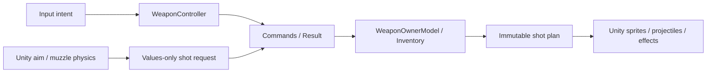

# Управление оружием: чистый контроллер и физический адаптер

Дата: 2026-10-21. База `8be148b`. Продолжение [WeaponModels01](WeaponModels01.md) в рамках согласованного полного MVC/DI-переноса.

## Границы

`WeaponOwnerModel` владеет инвентарём, отдельным gameplay RNG, transient-счётчиком залпов и последним выстрелом. `FireOwnedWeaponCommand` проверяет время/готовность и конечные значения результата прицеливания до изменения патронов. Полный неизменяемый `WeaponShotPlan` содержит направления, урон, дальность и ID до запуска косметики. Ссылки на коллайдеры/камеру/SO в модель не попадают.

`WeaponController` переводит `WeaponInputIntent` в команды, обслуживает cycle Tick, автоперезарядку, фазовые ограничения смены, частоту пустого спуска и подписки. Он получает модель, часы, узкий gate доступности и интерфейс отображения. Четыре явные зависимости соответствуют исключению SOD для делегирующего координатора (до пяти); они не упакованы в context bag. Модель не вычисляет доступность по локальной камере и не читает устройства ввода.

`WeaponAimEnvironment2D` отдельно выполняет поворот и Physics2D-проверку дула. `WeaponAimRig2D` описывает геометрию одного авторского rig (владелец/поворот/дуло), `WeaponAimSource2D` адаптирует PlayerAim и прежний fallback направления фонаря. Это Unity-данные/адаптеры, не конфиг модели. Условие близкого курсора, боковое смещение дула и поправка перед препятствием сохранены.

`PlayerWeapon2D` передаёт намерения ввода, связывает авторские ссылки с адаптером и отображает план. В нём больше нет прямого Time, Physics2D и расчёта разброса. `WeaponInstaller` подключён в level scope; фабрика создаёт индивидуальные модель/контроллер/RNG для компонента. OnDisable отменяет зарядку, OnDestroy завершает контроллер и подписки. Чужие незавершённые настройки паузы в LevelContext сохранены отдельно.

## Совместимость и проверки

Сохранены сериализованные поля, GUID, ручные сцены, баланс/звуки, JSON-форматы и SaveKey. Сначала отображается выстрел, затем начинается автоматическая зарядка; два одновременных выбора слотов обрабатываются в прежнем порядке. Input block приостанавливает Tick; умерший владелец всё ещё завершает уже начатую помпу, но не получает новый выстрел/автозарядку. Пустой спуск ограничен прежними .25 секунды. Препятствие у дула тратит один патрон и даёт impact без выпуска пуль.

Unity 6000.6.5f1: **416/416** собственных EditMode (22 новых сценария: контроллер/геометрия, включая пассивные аллокации); **12/12** настоящих PlayMode. Новые Play-проверки: препятствие между владельцем и дулом; отмена частичной зарядки при отключении компонента и дозарядка после включения без создания патронов. Прежние checkpoint, диалоги и реальное сравнение косметики/разброса прошли. Обычный Windows64 Player и состав собственных сборок — в [машиночитаемом отчёте](../Validation/WeaponController02.json).

Рабочее дерево включает ранее принятую незакоммиченную паузу; это не сертификация чистого HEAD без неё. Полный игровой маршрут, авторская приёмка и Profiler не выполнялись. Полёт/урон/жизненный цикл BulletProjectile2D, остальные игровые системы и legacy-публичный API SO остаются отдельным долгом. Родительская SOD-задача не закрывается.

## Нагрузка

Пассивный Update передаёт struct намерений. Перед автоматической зарядкой контроллер проверяет CanReload без создания команды; во время Loading/Pumping команда не выделяется каждый кадр. Три чистых сценария (ready/loading/pumping) после прогрева по 1000 вызовов Update показали 0 managed bytes по GC.GetAllocatedBytesForCurrentThread. Это измерение только чистого координатора, не Unity-рендеринга/FPS. При выстреле добавляются небольшой план, его коллекция до 32 направлений и команды. Они нужны для фиксации игрового результата до косметических callback; новый пул/менеджер не добавлен. Геометрический адаптер сохраняет один linecast при попытке выстрела; настройка ссылок создаётся при Awake/Configure. Новых фоновых поисков сцены нет. Фактические аллокации/FPS не измерены.
