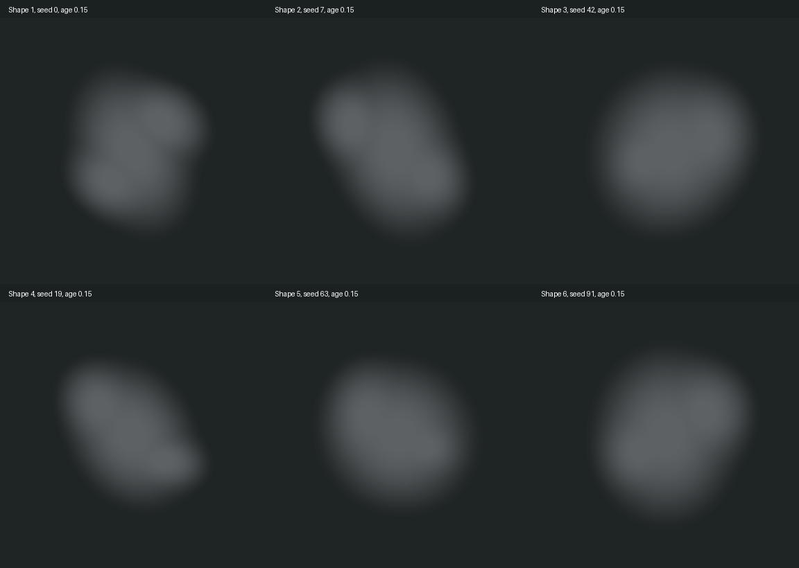

# Вариативный дым и игровая проба контакта B

2026-10-23, продолжение FX/BUG-044 по выбору владельца «Давай попробуем B» и просьбе разнообразить облако. Итоговая художественная приёмка остаётся владельцу.

## Результат

В `MuzzleSmoke.shader` личный seed каждого выстрела теперь задаёт ширину, вытянутость, наклон, сторону и размер мягких выступов. Три перекрывающиеся области плавно соединяются; плотность остаётся непрерывным градиентом без периодических волн. Это непрерывная процедурная вариативность, а не шесть заготовленных картинок. Seed выбирается прежним Begin один раз; при рассеивании форма не переключается. Два renderer на облако, предел четыре облака, основной поток, боковые выбросы и различия профилей пистолета/дробовика сохранены. Runtime C#, сцены, профили дыма и gameplay RNG не менялись.

В fleshImpact подключён выбранный B из FleshImpactStudies04. Основная атака и влажная фактура сохранены: из секундной пробы оставлены .34 с с плавным .04 с fade; сохранено 99.80% энергии PCM. Почти тихий длинный хвост иначе занимал бы четыре старых канала при пистолете с интервалом .1 с. При минимальном pitch .97 клип заканчивается за .351 с. Новых каналов/пулов и изменения правил воспроизведения нет. Для этой пробы подключён один клип, прежний pitch .97–1.03 сохранён; дополнительный банк дублей не заявляется.

Первый trial при gain .4 дал шесть отсчётов на полном масштабе в записи морга; он отклонён технической проверкой. Финальный gain .28, PCM24/48 kHz/stereo, native импорт PCM/DecompressOnLoad/preload. FirearmMix02, механика, гильзы, голоса, бетон и дерево сохранены. [Исходник/обработка/хеши и статус выбора B](../../Concepts/Used/Audio/FleshContacts04/README.md). Старые FleshContacts03 сохранены как история.

## Настоящие игровые записи

[MorgueRouteTest, 8.67 с](../Validation/WeaponFeedback54/MorgueRouteTest.mp4) · [MechanicsSandbox, 8.67 с](../Validation/WeaponFeedback54/MechanicsSandbox.mp4). Штатные камеры 2.4/4.6, настоящие пол/свет, игрок в исходных позициях (0,0)/(10,-3). Временный probe фиксирует прицел/цель и запрещает атаки врага только на время Play, карты не сохраняет. В каждом ролике пистолет по Сталкеру и дробовик по Спящему, обычный и смертельный удар. Это автоматическая запись для оценки, не ручная приёмка владельца.

Main mix AudioRenderer, 48 kHz/stereo: peak .885952/.893695, clipped samples 0/0. Данные — [mix-checks.json](../Validation/WeaponFeedback54/mix-checks.json), события — [морг](../Validation/WeaponFeedback54/MorgueRouteTest.json)/[песочница](../Validation/WeaponFeedback54/MechanicsSandbox.json). Несмертельный залп: восемь контактов и один полный flesh sound. При смерти оставшиеся независимые дробины могут попасть в стену и добавить второй материал; это прежняя группировка по материалу, не восемь громких flesh sounds и не доказательство пробития BUG-042.

## Проверки и границы

- Native URP: 6 seed × 3 возраста, 18 forward/6 side кадров, shader errors=0. [Кадры](../Validation/WeaponFeedback54/Shapes/capture.json). В трёх сопоставимых seed боковые PNG побитово совпали с прежним shader; форма центра меняется по ширине/асимметрии, края quad в образцах без обрезания. [Численные проверки](../Validation/WeaponFeedback54/shape-checks.json).
- [3/3 PlayMode smoke](../Validation/WeaponFeedback54/smoke-tests.json): ограничение, свет отдельно, пауза/возврат, disable/unload, короткий боковой слой обоих оружий. [1/1 flesh test](../Validation/WeaponFeedback54/contact-tests.json), внутри все 8 сочетаний оружия/вида врага/lethal. Отдельно [8 выстрелов → 8 контактов → 8 звуков](../Validation/WeaponFeedback54/burst.json) в быстрой серии. Первая настройка burst-harness оставила шесть патронов от предыдущей пробы; повтор сделан с полным магазином через штатную перезарядку.
- [Native prefab/config/reference/shader check](../Validation/WeaponFeedback54/native-final.json) passed; VerifyAudio подтвердил один B .34 с, gain .28, PCM/preload/48 kHz и чистый общий SO. Исходные сцена MorgueRouteTest, MainMenu playModeStartScene, mute=false/captureFramerate=0/preload сохранены/восстановлены. Изменения карт/незавершённого меню в коммит не включаются.
- Проверки выполнены в открытом проекте с сохранённым чужим pause draft. Новые полные EditMode/PlayMode, Windows build и GPU/overdraw замеры не заявляются: production C#/assemblies/lifetime/integration остались прежними, менялись shader и аудиоконтент. Предыдущие полные результаты относятся к WeaponFeedback51 и своей ревизии. Число quad не выросло, но это не измерение стоимости нового shader.

Повторение: `AuthorWeaponFx.InstallFleshTrial`, `ReviewSmokeContinuity.Variants`, `InspectWeaponFeedback.Begin`, `ReviewFleshTrial.Burst` через unity-pipeline; аудио — `Tools/Audio/prepare_flesh_contacts04.py`. BUG-044/FX возвращаются на проверку владельцу, BUG-042 и полная GPU приёмка этим изменением не закрываются.
