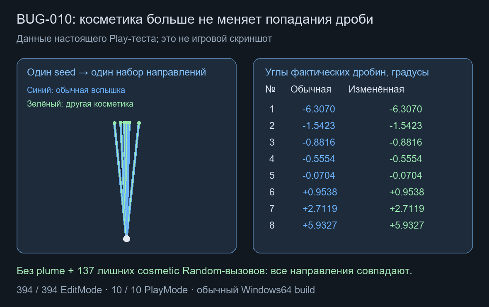

# Оружейные модели и изоляция разброса · BUG-010 / BUG-018

Дата: 2026-10-21. База `9c949eb`. Часть согласованного MVC/DI-переноса: циклы, инвентарь, снимки конфигов и граница gameplay RNG.

## Что изменено

`WeaponSettings`, `MagazineWeaponSettings`, `PumpShotgunSettings` — проверенные неизменяемые C#-настройки. Общие SO остаются авторскими источниками и адаптерами `ToSettings/CreateCycle`; модель больше не хранит Unity-объекты. Последующее изменение asset не меняет магазин, запас, длительности или ID уже созданного экземпляра. Каталог копируется в чистый `WeaponSettingsCatalog` с проверкой пропущенных/повторных ID и конфликтующих слотов.

Выстрел, перезарядка, её отмена, пополнение, подбор, переключение, замена и восстановление проходят через команды с `CanExecute/CommandResult`. Прежние bool/int-фасады сохранены; прежний Restore по-прежнему сообщает некорректный payload исключением после отказа команды. Tick меняет собственное состояние модели. Нечисловое/отрицательное внешнее время отвергается до изменения патронов. Инвентарь строит полный набор восстановленных экземпляров до замены живого состояния.

Unity-адаптер сопоставляет стабильные ID чистой модели с визуальными asset. Урон/дальность/темп/автоматический режим активного оружия берутся из снимка. Сериализованные поля/GUID, настройка баланса, звуки, projectile/effects и ручные сцены сохранены. Форматы остались прежними: inventory 1, обычный cycle 1, магазин 2 с миграцией старого 1, помпа 1; PlayerCheckpoint сохраняет прежний format3/player.v1.

## BUG-010

Алгоритм направления вынесен из `PumpShotgunDefinition` в чистые настройки. PlayerWeapon получает отдельный `IRandomSource` через DI-фабрику; он не разделяет UnityEngine.Random с эффектами и трассерами. Сохраняются два независимых uniform draw, треугольная плотность и прежняя ширина веера. Состояние этого RNG не добавлено в checkpoint: полная replay/save-детерминированность не заявляется.

Play-тест создаёт два настоящих PlayerWeapon2D с сохранёнными projectile/effect prefab и общим исходным игровым seed. Во втором эффекте отключён plume и дополнительно выполнены 137 косметических Random-вызовов. Все фактические направления созданных дробин совпали. В JSON сохранены сами векторы; сравнение идёт по отсортированному набору направлений залпа, порядок GameObject/instanceID не используется.

## BUG-018

При переносе проверен прежний долг связи pump cue с операцией. Четыре контрпримера подтвердили исходный пропуск: cue позже конца операции, положительное время неактивного cue, полный магазин в фазе помпы, Loading с лимитом Pumping вместо длительности вставки. До исправления 4 failed / 14 passed в профильном наборе. Guard теперь проверяет соответствующие фазе ограничения и согласованность; формат не менялся. Допустимое истекшее время до первого Tick с pending cue=0 сохраняется и не повторяет звук после первого применения.

## Проверки и границы

Unity 6000.6.5f1: 394/394 собственных EditMode, включая Features; 10/10 настоящих PlayMode (прежние 9 + реальный залп). Нет skipped. Обычный Windows64 Player и состав сборок проверены в [машиночитаемом отчёте](../Validation/WeaponModels01.json).

Проверялось рабочее дерево с ранее принятым, но ещё не закоммиченным меню паузы. Посторонние незавершённые файлы не включаются в этот коммит. Нет отдельного отрицательного Play-прогона BUG-010 до изменения RNG; его исходная связь подтверждена прежним аудитом исходников. Для BUG-018 исходные четыре ошибки сохранены.

Перенос PlayerWeapon2D как целого контроллера ещё не завершён: там остаются ввод/Time, прицеливание, физическая проверка дула, запуск представления и часть сроков жизни. BulletProjectile2D и остальные игровые системы тоже требуют следующего шага. Публичный legacy API авторских SO пока сохранён; граница runtime-моделей уже получает неизменяемые данные. Родительская SOD-задача остаётся открытой.

Снимки настроек/словаря создаются при создании/загрузке оружия; проверки каталога при подготовке сохранения могут повторно создавать небольшие снимки. Команды выделяются при действиях, а не в пассивном Tick. Новый глобальный менеджер/пул не добавлен. Физика и косметика работают по прежним правилам. FPS, аллокации и длительность загрузки Profiler не измерялись.
