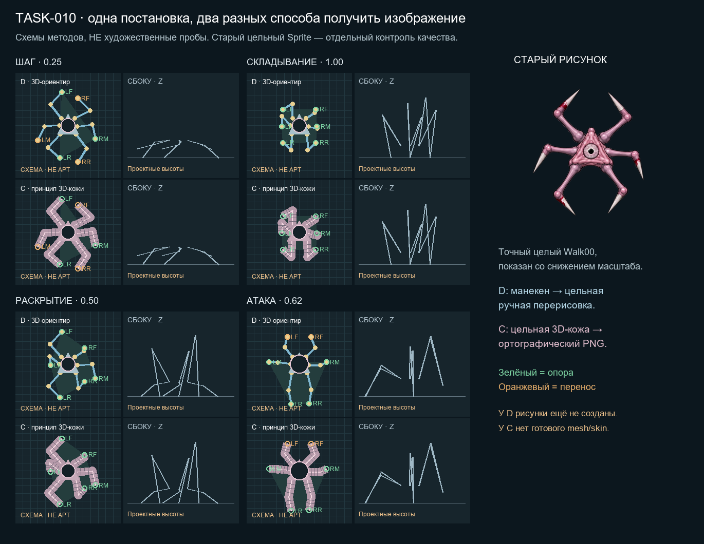

# TASK-010 · альтернативы анимации Сталкера и Спящего

Дата исследования: 2026-11-04, Europe/Moscow. [Карточка TASK-010](https://app.notion.com/p/40e8d6dc06b681b4ac6addcf3836a438). Связанные [TASK-007](https://app.notion.com/p/40c8d6dc06b6819ca4bbd253f97a680a) и [BUG-054](https://app.notion.com/p/40c8d6dc06b681259204eeed7f39e3d0) продолжают свою работу; здесь нет внедрения или художественной приёмки.

## Рекомендация и что можно посмотреть

**Основной следующий эксперимент — D: физически осмысленная offline-постановка на простом 3D-манекене, затем цельная ручная перерисовка небольшого набора кадров в стиле старого Sprite.** Манекен владеет пространственной задачей, художник — изображением. Не переносить старую кожу по UV и не собирать силуэт из вырезанных лап. Это сохраняет полезную идею прежнего шага, но меняет способ получения картинки.

**Запасной путь — C: один специально созданный объёмный персонаж, исправленные деформации кожи и ортографический рендер в 2D.** Он лучше переиспользует движение и устраняет проблему отсутствующих поверхностей, но дороже на старте и может потерять индивидуальность нарисованного Сталкера. Выбирать его после маленькой пробы сходства с исходником, а не обещания «3D решит всё».

Причина выбора D перед C: главный известный провал — качество изображения при сгибе, а старый цельный рисунок предпочтительнее. D оставляет право исправить контур/окклюзию художнику. Если ручная работа недоступна, это ограничение D, а не основание незаметно заменить её автоматическим растягиванием старых пикселей. В таком случае C становится практичнее, но только с авторским выбором нового изображения.

- [Автономное сравнение](../../Concepts/Unused/Visual/EnemyAnimationAlternativesTask010/comparison.html): шаг, складывание, раскрытие, подготовка/выпад/возврат; пауза, соседние кадры, таймлайн, вид сверху/сбоку/спереди, общий темп и масштаб двух схем. Старые native Sprite Сталкера/Спящего показаны отдельно.
- [Статический обзор](../../Concepts/Unused/Visual/EnemyAnimationAlternativesTask010/comparison-board.png).
- Четыре коротких APNG со схемами: [шаг](../../Concepts/Unused/Visual/EnemyAnimationAlternativesTask010/schematic-walk.png), [складывание](../../Concepts/Unused/Visual/EnemyAnimationAlternativesTask010/schematic-fold.png), [раскрытие](../../Concepts/Unused/Visual/EnemyAnimationAlternativesTask010/schematic-unfold.png), [атака](../../Concepts/Unused/Visual/EnemyAnimationAlternativesTask010/schematic-attack.png).

**Граница доказательств:** это схемы методов на условном манекене, а не новые художественные альтернативы Сталкера. Нет готовой Blender-модели, skin weights, настоящего mesh-render или новых ручных рисунков. Розовые полосы C объясняют принцип поверхности; они не являются проверенной непрерывной 3D-кожей. Одинаковые числовые позы D/C позволяют сравнить обязанности методов, но не выбрать победителя по качеству ещё не созданного изображения. UI браузера не проверен: доступных браузеров CUA не оказалось. Статический обзор осмотрен; синтаксис JS, данные и файлы проверены отдельно.

## 1. Установленный исходный кейс

### Правдоподобный шаг: Locomotion02, bde2908

Конкретная отправная точка — [Locomotion02/README](../../Concepts/Used/Stalker/Locomotion02/README.md), историческая редакция `bde2908e6ed34ea46c44000f6aca52cd2e51db51`, после коррекции `f426876`. Коммит проверен в Git под отдельным lease: 2026-10-26, `fix(stalker): slow gait and remove moving skin artifacts`, в нём добавлен исследованный `MotionReview/after-00.jpg`. Это не вывод из имени папки: сохранены [анатомия/длины/источник](../../Concepts/Used/Stalker/Locomotion02/anatomy.json), [скелет](../../Concepts/Used/Stalker/Locomotion02/skeleton-review.png), [24 реальных кадра](../../Concepts/Used/Stalker/Locomotion02/MotionReview/after-00.jpg), числовые cadence-before/current и visual-review. Исторический захват — управляемый URP-render; он не является свежим игровым воспроизведением.

Свойства той версии по исходникам и сохранённым свидетельствам:

- Шесть двухзвенных цепей, заданные настоящие длины; высота корпуса 0.13, подъём 0.075 и перенос веса 0.018 — проектные величины, не измерения рисунка сверху.
- Контакт стопы удерживался в мировых координатах. Цикл — 1 local unit, опора 60%, минимум три контакта; на остановке поднятые лапы заканчивали перенос, фазу не прокручивали. Поворот мог вызывать адаптивные перестановки.
- Картинка происходила от цельного PaleFlesh Walk00, но для рига извлекались корпус и шесть поверхностей лап. Меш деформировал нарисованные пиксели. Ранние два жёстких фрагмента давали двойной контур колена; затем использовалась связная поверхность каждой лапы.
- Отчёт о положительных площадях треугольников и поддержке контактов не доказывал удачного складывания, кожи, всех переходов или художественной приёмки. Исторические числа тестов не воспроизводились здесь.

Владелец затем выбрал готовые цельные кадры без IK в игре. [Locomotion03Sprites](../../Concepts/Used/Stalker/Locomotion03Sprites/README.md) подтверждает запекание этого принципа, а также последующее отклонение слабого поджатия и пересечений. Поэтому **наиболее обоснованный опорный вариант — Locomotion02 как источник контактной постановки**, а не как уже удачная технология картинки и не как установленный сейчас риг.

### Контроль цельного рисунка

Контроль — полный `Walk00-corrected.asset`, на который сейчас ссылается сохранённый `ShadowStalker.prefab`. Текстура PaleFlesh walk-sheet имеет SHA-256 `6733cb493c8ef1cf128ee05f730b5c7fa1c75e4dd89787e46ac8451a8d9bd807`. Целый Sprite rect 358×406 извлечён без перекраски/деформации и размещён на 576² по родному pivot/PPU224. Для Спящего извлечён его собственный цельный native Walk00, не розовый контроль с tint. [Точная регистрация и исходники](../Validation/EnemyAnimationAlternativesTask010/references.json), [17 хешей входов](../Validation/EnemyAnimationAlternativesTask010/source-preservation.json).

В обоих контролях видны цельные корни лап, характерные объёмы, общий треугольный корпус и отдельные костяные концы. Это полезный контроль цельности. Он не объявляется эталоном правильных длин всех восьми старых рисунков: проекция, ракурс сегмента и ошибки исходного рисования ещё требуют отдельной костной проверки. Hidden RGB в alpha=0 не принимался за видимую подложку: лист сравнения использует настоящий RGBA-композит.

### Что действительно назначено сейчас

Read-only снимок сохранённых prefab при начале исследования:

| Файл/поле | Сталкер | Спящий |
|---|---|---|
| `spriteSet` | fileID 0 | fileID 0 |
| `attackSpriteSet` | fileID 0 | fileID 0 |
| `deformVisual` | 0 | 0 |
| тело | старые `walkFrames`, 8 ссылок | собственные старые `walkFrames` |

`StalkerSpriteAnimator.TrySelectLocomotionFrame` при пустом наборе передаёт выбор базовому animator; `CreatureSpriteAnimator2D` присваивает целый `SpriteRenderer.sprite`. Фаза движения считается по фактическому расстоянию с учётом масштаба, а направление сглаживается. Runtime IK этой цепочкой не подтверждается. Это чтение сохранённых YAML/C#, без обращения к живому Editor, сценовым override или материалам в Play. Local `STALKER.md`/`SLEEPER.md` в заголовках ещё называют FixedSprites06 текущим; для данного снимка это устаревшая формулировка. Общие документы по условиям задачи не изменены.

## 2. Почему прежние результаты отвергались: уровни причин

| Уровень | Подтверждённое свидетельство | Что нельзя из него заключать |
|---|---|---|
| Темп/опоры | У раннего Locomotion02 были дополнительные переступания; cadence-коррекция увеличила досягаемость/резерв опоры. Наш первый манекен атаки тоже провалил опорный многоугольник. | Красивое положение колена не доказывает перенос веса. Модель контактов не проверяет кожу. |
| Состояние/поза | Locomotion03Sprites отвергнут за слабое поджатие и пересечения; в Postures04 отделяли тело от закрытия глаза. | Нельзя исправить нечитаемый сон только частотой кадров или закрытым глазом. |
| Перенос поверхности | Раннее разделение колена удваивало контур. Документированные Postures05 давали смаз/стыки. BUG-054 и FixedSprites06 связывают игольчатые концы с offline polar UV: положительная ориентация могла сопровождаться сжатием ширины. | «Целый PNG» не делает результат цельным рисунком: он может содержать запечённую плохую деформацию. |
| Перекрытие/кожа | В FixedSprites06 атаки v1/v2 отклонялись по костям, v3 — по длительному наложению кожи передней/средней пары. Владелец отклонил и окончательный художественный вид. | Односвязная альфа, отсутствие перевёрнутых треугольников и bone PASS не заменяют skin/visual gate. |
| Альфа/границы | Старые рецепты отдельно ремонтировали швы/островки и premultiplied alpha. Упаковка могла быть побайтно правильной относительно уже плохого кадра. | Нет оснований объявлять atlas/pivot корневой причиной всех рваных поз. Сначала сравнить raw PNG и восстановление из atlas. |
| Runtime | BUG-054 отдельно фиксировал растягивание всего Visual от попадания; его отключили. Текущие prefab действительно имеют `deformVisual=0`. | Это отдельная деформация, а не доказательство наличия runtime IK сейчас. Свежий Play этим исследованием не выполнен. |

Часть причин выше подтверждена сохранёнными первичными проектными свидетельствами, а не повторным запуском старых экспортёров. Самостоятельно здесь осмотрены старый цельный Sprite, исторический contact sheet, костная схема и новые условные схемы. Не заявляется повторный осмотр всех тысяч исторических PNG или новое воспроизведение BUG-054.

## 3. Пять существенно разных полных пайплайнов

### A. Цельная ручная покадровая анимация

**Создание.** Художник выбирает один исходный рисунок и независимый анатомический эталон. Делает ключи контакта/переноса/полного складывания/раскрытия/замаха/укуса/возврата, затем рисует промежуточные **целые** изображения. Контуры, скрытые места кожи и перекрытия создаются заново; не морфинг вырезок. Onion skin помогает сопоставлять рисунки; Krita поддерживает такую анимацию и вывод PNG-последовательности. [Krita animation](https://docs.krita.org/en/user_manual/animation.html), [экспорт](https://docs.krita.org/en/reference_manual/render_animation.html).

**Offline → игра.** Хранятся рабочие многослойные рисунки и экспортированные RGBA; в игре — спрайты, фаза по расстоянию, независимые состояние/глаз/боевой прогресс. Ни IK, ни skinning не нужны.

**Движение/переходы.** Контактные метки на земле служат линейкой: при перемещении root локальная стопа на опоре движется назад ровно на пройденное расстояние. Вес показывается наклоном/сдвигом объёмов к опорам. Остановка требует окончания переноса или отдельных settle-поз; поворот — рисунков перестановки лап. Для складывания и сна рисуются настоящие новые контуры; на пробуждении Спящего они проходят соседние открывающие позы. Перед атакой расставляются опоры, затем замах/укус/возврат. Прерывание в середине требует подготовленных выходов из реально показанных поз.

**Цельность/риски.** Полный контроль кожи и кончиков; нет швов от разрезания. Возможны дрейф длины/толщины/пятен, «кипение» контура и слишком большие скачки между рисунками. Нужны фиксация анатомии, onion skin, отдельные костные/мышечные проходы и просмотр всей последовательности. Один автор не означает автоматической стабильности.

**Применимость.** Строгий верх и нынешняя непиксельная краска сохраняются лучше всего при хорошем аниматоре. Для Спящего переиспользуются согласованные контакты/анатомия, но собственные кожа/кровь/сон проверяются отдельно. Цена следующей правки высока: изменение пропорции затрагивает много целых кадров. Это технологически честный путь, однако по задаче менее отличен от текущей покадровой ветки TASK-007; здесь сравнивается именно контролируемая ручная работа, а не очередная независимая AI-генерация сотен изображений.

### B. 2D skeletal/mesh с заранее спроектированной непрерывной кожей

**Создание.** Автор заново готовит рисунок под деформацию: связная сетка вокруг суставов/корней, достаточно пикселей для скрытых поверхностей, жёсткие кончики, ручные веса, корректирующие ключи контура и продуманные перекрытия. Вариант «порезать существующий PNG ещё аккуратнее» не считается новым решением. Spine поддерживает weighted meshes и ключи вершин; это Professional-функции. [Meshes](https://esotericsoftware.com/spine-meshes).

**Offline → игра.** Два разных продукта: B1 экспортирует скелет/сетку и деформирует её runtime; B2 экспортирует цельные PNG и использует обычный Sprite. Экспорт изображений не равен runtime-экспорту данных. Версия runtime должна соответствовать данным редактора. [Spine export](https://esotericsoftware.com/spine-export). Для нашего исследуемого направления предпочтительнее B2, чтобы новый риг не попадал в игру без отдельного решения.

**Движение/переходы.** Offline IK и контактные ключи обеспечивают опору; root и стопы всё равно должны быть согласованы. При B1 возможна адаптация целей к реальному повороту/остановке, но это новая интеграция и стоимость вычислений. При B2 те же ограничения конечного набора поворотов, что у A. Складывание требует corrective shapes/замены рисованных ракурсов, а не свободного изгиба любой плоской сетки. Сон/пробуждение — отдельная поза/кривая тела; удар и отмена нуждаются в проверке сетки между ключами, не только в ключах.

**Цельность/риски.** Сетка может убрать разъезд двух отрезанных фрагментов, но не восстановит отсутствующую обратную сторону лапы и не гарантирует объём на глубоком сгибе. Возможны сплющивание суставов, переворот проекционного порядка, растянутые пятна, обрезка hull, draw-order и прозрачные зазоры между разными attachment. Нужны локальные запасные поверхности/целые заменяющие рисунки, контроль крайних поз и масок. Если на каждый сильный сгиб приходится заново рисовать кадр, преимущество B уменьшается.

**Применимость.** Хорошо подходит для умеренного дыхания/небольших шагов при строгом верхе; глубокая упаковка шести лап — риск. Перекраска Спящего может переиспользовать сетку лишь при совпадающей анатомии; другой силуэт требует весов заново. Не выбран основным из-за близости к уже проваленной границе «деформировать старую кожу» и непроверенной полной складки. Это инженерная оценка для нашего случая, не доказанный дефект Spine.

### C. Полная 3D-модель → ортографический рендер → цельные 2D-кадры

**Создание.** По исходному рисунку и отдельно согласованным верхней/боковой/передней проекциям моделируется замкнутое тело с шестью конечностями. Суставы имеют петли геометрии, жёсткие концы и исправленные веса; объёмы на сильном сгибе корректируются дополнительными формами. Рисованная текстура закреплена в UV и содержит те же индивидуальные пятна. Нельзя просто натянуть один верхний PNG на шесть цилиндров и объявить сходство достигнутым. [Blender armature](https://docs.blender.org/manual/en/latest/modeling/modifiers/deform/armature.html), [shape keys](https://docs.blender.org/manual/id/5.2/animation/shape_keys/introduction.html).

**Offline → игра.** Offline хранятся `.blend`, armature/контакты, mesh, UV, текстура, corrective shapes и фиксированные свет/камера. Результат — RGBA-кадры с общим origin; в игре остаётся только Sprite. Ни 3D-collider, ни runtime IK, ни новый renderer не требуются самой идеей запекания. Камера должна быть реально Orthographic, строго по вертикали: ортографический viewport сам по себе не меняет render-camera. [Камера](https://docs.blender.org/manual/id/5.2/render/cameras.html), [различие viewport/render](https://docs.blender.org/manual/nb/latest/editors/3dview/navigate/projections.html), [transparent film](https://docs.blender.org/manual/en/latest/render/cycles/render_settings/film.html).

**Движение/переходы.** Контакты ставятся в 3D; постоянные длины и стабильные pole directions, ограничение досягаемости до постановки следующей стопы. Вращение суставов меняет верхнюю проекцию, а глубина определяет перекрытие. Вес переносится внутри согласованной опоры до подъёма лап. Отдельные постановки складки/раскрытия/сна/пробуждения и замаха/укуса/возврата снимаются одной камерой. Остановка/поворот требуют специальных клипов либо ограниченной фазовой таблицы; один цикл прямой ходьбы не обещает отсутствия скольжения при любом изменении направления. Коррекция в 3D не означает автоматической совместимости с существующим игровым движением.

**Цельность/риски.** Нет альфа-швов вырезанных частей, есть настоящая обратная поверхность. Но mesh может самопересекаться, веса сжимают кожу, UV растягивает фактуру, поверхностный свет делает вид пластмассовым. Даже Preserve Volume в Blender не обещает идеальный сгиб на 180°; нужны corrective pose и проверка предельных углов. Последний экспорт может обрезать кончик камерой/кадром, premultiplied alpha/цветоуправление могут изменить край/палитру. Это отдельные проверки после хорошей модели.

**Применимость.** Строгий верх реализуется точно. Матовая нарисованная текстура и фиксированный контур могут приблизиться к старому виду, но здесь это ещё не проверено. На Спящего переиспользуются armature/топология/контакты только пока он остаётся временным родственником Сталкера; отдельные eye/mouth/кровь и timing пробуждения обязательны. Высокая начальная цена; изменение времени/угла после хорошего рига дешевле, изменение дизайна всё ещё требует художника.

### D. Offline 3D-постановка → цельная ручная перерисовка

**Создание.** Сначала автор делает только пространственный каркас и простые объёмы без переноса исходной кожи. Фиксирует опоры, длины, высоты, направления суставов, root trajectory и грубые силуэты. После последовательной проверки костей/объёмов/групп художник рисует поверх ориентиров полный кадр в стиле старого целого Sprite. 3D guides скрываются при экспорте. Это способ планировать рисунок, а не автоматический warp и не новый художественный PASS по схеме.

**Offline → игра.** Хранятся манекен/контактные кривые, отдельные guides, целые многослойные рисунки, RGBA и метаданные. В игре — готовые Sprite. Ничего из манекена, IK, физических ограничений или paint layers не вычисляется runtime.

**Движение/переходы.** Из C берётся проверяемая контактная постановка; из A — контроль изображения. Во время опоры мировая стопа постоянна, на переносе её траектория/высота явны. Длины остаются постоянными в 3D, верхняя проекция может укорачиваться. Складка/раскрытие имеют отдельные опорные события; Спящий использует непрерывное раскрытие из действительного сна. Перед атакой сначала готовятся опоры, потом жест; контактный граф не меняет момент игрового урона. Остановка/поворот/прерывание авторятся как маленькие переходы из ограниченных входных фаз, а не интерполяция двух произвольных PNG.

**Цельность/риски.** Недостающую кожу и перекрытие художник рисует осмысленно; кончик не обязан растягиваться вместе со сгибом. Главный риск — механическое обведение манекена, которое даст новый худший рисунок, либо межкадровый дрейф ручной краски. 3D не диктует детали и не подгоняется задним числом ради плохой картинки. Нужны оба gate: каркас до рисования, затем реальный рисунок поверх него. Метод не проверен на новых художественных кадрах Сталкера.

**Применимость.** Лучше всего соединяет исходный характер с пространственно понятным шагом. Для Спящего переносится контактный план, а сон/пробуждение и собственная краска проверяются отдельно. Начальная модель проще C: не нужна чистовая топология/UV/материал. Рисовальная стоимость остаётся высокой; частая смена поз дорогая, хотя изменение скорости не требует придумать шаг заново.

### E. Ограниченная анимация исходного цельного рисунка

**Создание.** Сохраняется цельный исходник и небольшой согласованный набор полных ключей; отдельно оживляются глаз/мембрана/пасть, допускается сдержанное дыхание корпуса. Большие кожные сгибы не имитируются резиновым масштабированием. Для новой большой позы нужен новый целый рисунок. Историческая 8-кадровая ходьба — пример подобного компромисса, но не свидетельство точных контактов.

**Offline → игра.** Несколько цельных Sprite и контролируемые отдельные органы. Возможны лишь небольшие transforms явно предназначенных для этого слоёв. Низкая память изображений; стоимость глазных слоёв/материала отдельна.

**Движение/переходы.** Синхронизация немногих фаз по расстоянию уменьшает заметность скольжения, но не создаёт недостающие контактные положения. Стоящий рисунок при движущемся root скользит по определению. Сон/пробуждение и подготовка/удар/возврат могут быть читаемы по 2–4 целым ключам, но глубокое складывание и плавный поворот из этого автоматически не следуют. Прерывание — ближайший согласованный рисунок с возможным скачком. Резкая смена поз лучше скрывается хорошим timing, однако не исправляется им.

**Применимость.** Самый дешёвый способ сохранить индивидуальность как временное решение, включая Спящего. Не выбран основным, поскольку не удовлетворяет запросу на правдоподобный шаг и заметно более плавную крупную смену формы. Защищённый запасной вариант на время производства, а не замена полноценной анимации.

## 4. Сравнение цены и технических последствий

Ниже **планировочные оценки**, не замеры и не обещание срока. Единица — рабочий день опытного профильного автора; полный набор в оценку не входит. Новичку понадобится обучение. Исполнитель/наличие художника не назначены этим исследованием.

| Метод | Малый первый тест | Цена следующей правки | Повторное использование | Основной риск |
|---|---|---|---|---|
| A · ручные целые кадры | 2–5 дней для короткой очищенной серии | Высокая: менять рисунки | Схема/цветовой эталон, иногда позы | Дрейф объёмов; дорогой большой набор |
| B · 2D mesh | 2–5 дней на одну подготовленную сетку и крайние позы | Средняя для timing; высокая для топологии/новой окклюзии | Хорошее при той же анатомии | «Резиновая» кожа на глубокой складке |
| C · полный 3D render | 5–10 дней на убедительный look-test/rig; не весь набор | Низкая для времени; средняя/высокая для вида | Высокое после успешного likeness-test | Потеря старого рисунка, веса/свет/самопересечения |
| D · 3D guides + ручной рисунок | 1–2 дня постановки + 2–4 дня малой перерисовки | Дешевле перепоставить, дороже перерисовать | Контакты/каркас/проекции, а не готовая кожа | Двойная работа, нужен художник |
| E · ограниченный целый рисунок | 0.5–2 дня на проверку/переходы без большого нового дизайна | Низкая для timing, высокая при новой позе | Максимальное старых полных ключей | Недостаточно движения, скольжение |

### Память и производительность

У A/C/D и B2 после экспорта одна и та же принципиальная цена: число уникальных изображений и размер атласов. Пример расчёта для **гипотетических** 48 уникальных кадров 576²: RGBA8 без mipmaps ≈60.75 MiB, BC7 при полном покрытии блоками ≈15.19 MiB. Реальная упаковка/поля/формат/резерв страниц изменят число. Если для другого вида нужна вторая текстура, её память добавляется. Сжатый PNG на диске не равен GPU-памяти. Формула RGBA8: `N × W × H × 4`; для BC7 — `N × ceil(W/4) × ceil(H/4) × 16` байт.

При 48 фазах походки и 24 независимых фазах жеста прямое декартово запекание даёт 1152 изображений ещё до входа/возврата. Это риск разрастания библиотеки **при любом** художественном методе. Поэтому следующий тест не заказывает полную матрицу: сначала ограниченный набор фаз и критических переходов, затем отдельно решение о полноте таблицы/допустимых фазовых входах. Механики AI не менять ради экономии изображений.

B1 вместо кадров хранит небольшую библиотеку изображений/mesh/keys, но добавляет skinning/constraints/draw-order и интеграцию runtime на каждую особь. Количество renderers, overdraw, batching, CPU/GPU и толпа здесь не измерялись. Официальные числовые демонстрации Spine относятся к их персонажу, не переносятся на нашу игру как ожидаемая экономия. У C/D дорогая модель/постановка остаётся offline и сама по себе не добавляет runtime-нагрузку. У E меньше текстур, но это достигается меньшим содержательным движением.

### Инструменты и доступность

Проверено по первичным страницам 2026-11-04; ничего не покупалось/не устанавливалось:

- **Blender:** официальный download указывает 5.2.3 LTS для Windows; релизы 5.2/4.5 LTS поддерживаются. Для будущей пробы выбрать поддерживаемый стабильный выпуск, не beta. [Download](https://www.blender.org/download/), [releases](https://www.blender.org/releases/). Официальная лицензия отличает GPL программы от созданных пользователем изображений/`.blend`: собственное произведение можно использовать коммерчески. [License](https://www.blender.org/about/license/). Платные аддоны/модели не нужны предложенному минимальному эксперименту; права сторонних ассетов надо проверять отдельно.
- **Krita:** официальная страница выпуска подтверждает 5.3.3 и 6.0.3; документация анимации — 5.3. Для исследования существенны наличие покадрового рисования и экспорта PNG, не номер установленной на ПК версии. GPL приложения не ограничивает использование собственных рисунков; прямой download доступен, магазины могут брать плату. [Release](https://krita.org/en/posts/2026/krita-5.3.3-released/), [license](https://krita.org/en/about/license/).
- **Spine:** trial доступен на Windows/Mac/Linux, сохранение/экспорт требуют покупки. Mesh/IK входят в Professional, не Essential. Purchase показывает Professional $379 при перечёркнутом $449, лицензия на именованного пользователя; для компаний выше указанного vendor-порога нужен Enterprise. Это снимок цены, не бюджет и не совет купить. [Purchase](https://esotericsoftware.com/spine-purchase), [editor license](https://esotericsoftware.com/licenses/Spine-Editor-License-Agreement.pdf). При B1 отдельно проверить runtime license/совпадение версий; при B2 в игру поступают кадры, а не Spine runtime.

Прямое открытие части Blender manual через web extractor возвращало ошибку 402; использованы доступные поисковые выдержки официальной документации с явной версией. Такие источники не выдаются за испытание программы. Страницы Krita/Spine/UW были доступны целиком. Не скачивались пакеты, внешние демонстрационные персонажи или чужие изображения для локального производства.

## 5. Что именно показали изолированные схемы

Генератор [build_research.py](../../Concepts/Unused/Visual/EnemyAnimationAlternativesTask010/build_research.py) использует исторические длины и положения оснований из `Locomotion02/anatomy.json`, но объявляет **новую условную постановку**. Шаг короче исторического: 0.60 вместо 1.0 local unit. Высоты/складка/атака — проектная гипотеза, не восстановленная анатомия рисунка и не выбранный новый дизайн. При складке колени поднимаются над корпусом; боковой вид специально показывает это спорное решение.

Два кандидата читают одни и те же 49 отсчётов на действие из [poses.json](../../Concepts/Unused/Visual/EnemyAnimationAlternativesTask010/poses.json); камера, размер, масштаб, root, фаза и темп совпадают. D показывает ориентир, C — условный принцип кожи по той же цепи. Старый оригинал статичен: не выдаётся за синхронный рисунок складывания/атаки. На листе контроль крупнее схем ради осмотра деталей; для непосредственного сравнения движения предназначены равные панели D/C просмотрщика/APNG.

| Проверка манекена | Факт |
|---|---|
| 5 действий ×49 отсчётов | Шаг, складывание, раскрытие, атака, ограниченный поворот |
| Длины двух костей | Максимальная числовая ошибка меньше 10⁻¹⁵ local unit |
| Опоры | Не менее 3 при шаге/складке/раскрытии, 4 при атаке, 6 в ограниченном повороте |
| Мировые стопы между соседними опорными отсчётами | Смещение 0 в этих данных |
| Условный root внутри выпуклого многоугольника контактов | Во всех отсчётах исправленной схемы |
| Суставы/концы относительно пола | Все hip/knee/foot имеют Z≥0 в исправленной схеме |
| Настоящая масса, инерция, контактные силы | Не моделировались; устойчивость тела не доказана |
| Skin weights, topology, непрерывность настоящей кожи | Не создавались/не проверялись |
| Новая перерисовка и фактура | Не создавались/не проверялись |
| Unity/импорт/Play/пакеты | Не выполнялись |

[Числовые результаты](../Validation/EnemyAnimationAlternativesTask010/numeric-checks.json). В первой атаке четыре оставшиеся опоры находились сзади; условный root выходил из их выпуклой оболочки в 47/49 отсчётах. Сохранён [отклонённый v1](../Validation/EnemyAnimationAlternativesTask010/rejected-attack-support-v1.json). Исправлена постановка: средняя пара заранее переносится вперёд, только после её постановки поднимается передняя, затем восстановление идёт в обратном порядке. Это демонстрирует, почему одной длины костей и числа контактов недостаточно.

Во втором варианте контактная проверка проходила, но старая низкая плоскость сгиба проводила промежуточное колено ниже пола (минимум Z≈−0.2434). Этот [v2 тоже отклонён](../Validation/EnemyAnimationAlternativesTask010/rejected-attack-ground-v2.json). В финальном условном плане атаки заранее задана непрерывная кривая приподнятого pole, без случайной смены знака между кадрами; проверены высоты всех суставов. Это ещё одна причина проверять каркас сбоку до работы с кожей. Сценовый/боевой вариант этой постановкой не подменялся.

Скольжение — отдельная проблема. Работа Kovar/Schreiner/Gleicher показывает, что независимая покадровая IK-коррекция и стыки контактов могут давать скачки; предложенные авторами решения допускают небольшое изменение длины. Здесь их алгоритм/код не скопирован, а изменение костных длин для нашего теста не принято. Использован только принцип явных contact constraints и плавных входов/выходов. [Первичный разбор и внешние демонстрации](https://research.cs.wisc.edu/graphics/Gallery/kovar.vol/Cleanup/), [статья](https://research.cs.wisc.edu/graphics/Gallery/kovar.vol/Cleanup/cleanup.pdf). Это исследование человеческого mocap, не доказательство походки шестилапого монстра.

Для B есть [официальные интерактивные демо Spine](https://esotericsoftware.com/spine-demos) и [исходники их runtime](https://github.com/EsotericSoftware/spine-runtimes). Они показывают технические возможности сеток/смешивания, но не наш строгий верх, складывание Сталкера или сохранение его краски. Чужие демонстрационные изображения не объявляются художественными пробами нашей игры.

## 6. Проверки цельности, общие для финального выбора

Следующий производственный эксперимент обязан пройти эти границы последовательно; наличие схем здесь не закрывает их:

1. **Кости:** один утверждённый каркас, настоящие длины и суставы; верх/бок/перед, стабильная сторона сгиба, реальная досягаемость опор. При провале исправить постановку до кожи.
2. **Объёмы и группы:** независимые массы, постоянные крепления/число условных групп; компрессия при сгибе не превращается в исчезнувшую лапу. Отдельно проверяются межлапные пересечения и окклюзия корней.
3. **Кожа/силуэт:** целая поверхность без прозрачных стыков, новых борозд и искусственных гнёзд; концы сохраняют ширину/форму. Полный контур, поля кадра и запас на замах. Для C — extreme bend mesh/UV/weights; для D — реальный нарисованный контур/цвет/пятна, не силуэт guides.
4. **RGBA/экспорт:** dark/light/green в исходном размере и игровом масштабе; hidden RGB отделён от видимого alpha. Общий origin/PPU/canvas, без индивидуального auto-crop/масштаба кадра. После atlas — точное восстановление rect/pivot и alpha-positive RGBA; alpha-компонента не заменяет осмотр.
5. **Движение:** контакт/подъём/посадка, перенос веса, скорость и пройденное расстояние, остановка на переносе, поворот в обе стороны, стык последнего/первого кадра. Атака: подготовка/удар/возврат; прерывание из ранней/средней/поздней фазы и переход к складыванию. Спящий: неподвижный сон, начало/конец пробуждения, прерывание без скачка. Положение глаза проверяется независимо от позы тела.
6. **Интеграция, если отдельно выбрана:** свежая native/Play-проверка всех назначений, override/материал/hit scale/тени, боевого StrikeAt и остановки стеной. Здесь она не разрешена и не выполнена. Авторская оценка изображения остаётся у владельца.

Полный 2D Sprite, корректный pivot и правильный atlas решают разные задачи. Ни один из них не компенсирует плохой исходный контур или физически неосмысленное действие.

## 7. Следующий минимальный эксперимент до полного набора

Не продолжать ни один путь автоматически: исследование готовит конкретный выбор, а не разрешение на внедрение.

**Для D, основной:** ограничить пробу максимум 12 новыми цельными рисунками Сталкера: 4 момента одного шага (опора/подъём/перенос/посадка), 4 момента складки/раскрытия, 4 момента атаки (подготовленные опоры/замах/укус/возврат). Это 12 рисунков, не достаточный финальный FPS и не число имён/повторов PNG. Перед ними — одна версия независимого каркаса и объёмов в трёх видах. Точный выбранный старый Walk00 остаётся неизменённым контролем; спорные пропорции не «исправляются» скрытно.

Собрать короткий animatic из полных кадров и отдельных holds с фиксированными origin/PPU/камерой, рядом со старым рисунком; без вырезания/UV-warp/оптического морфинга исходника. Переносить на Спящего только после согласованного движения Сталкера: первая проверка — его собственные сон, промежуточное пробуждение и открытая поза (3 дополнительных целых рисунка, отдельная оценка краски/глаза/крови). Существующие 0.9s пробуждения и боевые события не менять по инициативе арт-пайплайна.

**Для C, запасной:** до clean-up всей модели сделать единственный look-test: старая нейтраль + крайняя складка + strike, по одной ортографической картинке на позу, с постоянными texture/светом. Только если характер и цельность сопоставимы со старым Sprite, делать 8–12 кадров одного шага и искать seam/volume/occlusion ошибки. До likeness-test не производить полный набор, не покупать дополнительные инструменты и не импортировать модель.

**Критерий продолжения:** кости/объёмы/кожа пройдены по настоящему изображению; шесть лап и все концы целы, контакты согласованы с root, крупная складка/укус читаются на игровом масштабе, нет скачка корпуса/пивота/пятен и очевидного ухудшения относительно исходника. Если D не удерживает краску за разумную стоимость — пробовать C. Если C воспринимается другим монстром — остановить look-test и оставить E временным отображением. Выбор направления и художественное «нравится» за владельцем.

## 8. Сохранность и воспроизводимость

Все записи этой задачи ограничены этим отчётом, `Concepts/Unused/Visual/EnemyAnimationAlternativesTask010` и `Docs/Validation/EnemyAnimationAlternativesTask010`, зарезервированными через coordinator `files`. Game lease не запрашивался. TASK-007 и её общие guides не редактировались. Источники скопированы только целыми справочными кадрами/сохранённым contact sheet; ни рисунки, ни production code, ни назначения не менялись. Идентичность 17 выбранных входов проверяется до/после построения; это не обещание отсутствия параллельных изменений во всём проекте.

Воспроизведение: запустить `build_research.py` bundled Python с NumPy/Pillow; HTML открывается локально без server/npm/network, данные лежат в `poses.js`, числовой вариант — в `poses.json`. Существующий baseline не перезаписывается при изменившемся входе: скрипт останавливается для явной сверки. Walk APNG имеет 48 временных отсчётов без дублирования loop boundary; fold/unfold/attack включают 49-й конечный отсчёт и воспроизводятся один раз. JSON тоже имеет граничный отсчёт. Это временные пробы схем, не число новых художественных рисунков. Просмотрщик останавливает непетлевое действие точно на конце.

**Итоговый контроль авторинга: неприменим.** Объекты сцен не добавлялись/не перемещались. Новые художественные кадры, исправление BUG-054 и принятый рабочий билд этим исследованием не заявлены.
