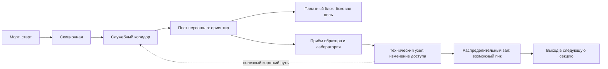

# Референсы рынка и построения уровней

Дата исследования: 2026-10-16. Область: одиночные игры с видом сверху/сверху сбоку, исследованием опасного комплекса, ограниченными ресурсами или массовым боем. Цель — сформулировать применимые приёмы для [начального концепта](../GAME_CONCEPT.md), не проектировать готовую кампанию.

После исследования владелец уточнил ближайшую цель: примерный план демо на 30 минут основного маршрута / около 50 со всем контентом, с началом в морге, необязательными наградами/секретами и финальной ареной с тремя видами монстров. Актуальная рамка находится в [концепте демо](../GAME_CONCEPT.md#примерная-структура-демо). Приведённые ниже маршруты остаются иллюстрациями; они не утверждают большой комплекс, полный набор отделений или структуру кампании.

## Метод и степень уверенности

Факты об играх ниже привязаны к страницам разработчиков/издателей, Steam, картам и отдельным обзорам/руководствам. Наблюдения по картам сделаны после визуального просмотра; интерпретации и предложения для нашей игры обозначены отдельно. Полных собственных прохождений в рамках этого исследования не было.

Просмотрены Alien Shooter 1, 5, 10 и Alien Shooter 2: Reloaded Level 02, Level 09. Автор подборок на vgmaps — LDK. Страницы иногда отвечали с задержкой/ошибкой, но эти пять карт удалось открыть и осмотреть в браузере. Survive 01 не удалось визуально проверить; выводы о геометрии этой арены не делаются. Изображение карты не доказывает порядок открытия дверей, состав волн, состояние выключателей, секретные проходы или момент появления врагов. Окрашенные объекты не интерпретируются без легенды как конкретные игровые триггеры.

Коммерческий раздел — небольшой сравнительный срез, а не оценка размера рынка. Выборка задана референсами владельца и дополнена двумя близкими примерами; она смещена в сторону заметных игр. Положительные отзывы не доказывают прибыльность, а удачные дизайнерские решения не доказывают причину продаж.

## 1. Рыночные направления и ожидания

| Игра | Обещание игроку и доступный сигнал | Значение для нашего позиционирования |
|---|---|---|
| [Alien Shooter](https://store.steampowered.com/app/33100/Alien_Shooter/) | Массовое уничтожение противников и усиление героя; витрина: 94% из 874 English Reviews | От оружия ждут ощутимого роста силы и читаемого массового боя |
| [Alien Shooter 2: Reloaded](https://store.steampowered.com/app/33120/Alien_Shooter_2_Reloaded/) | Аркадный бой с RPG-развитием, отдельными режимами; 89% из 582 English Reviews | Повышать масштаб можно через оружие и построение столкновения, а не только число тел |
| [Subterrain](https://store.steampowered.com/app/340490/Subterrain/) | Выживание и исследование комплекса; 79% из 1 005, блок All Reviews в полученной странице | Более системный опыт привлекает свою аудиторию, но не гарантирует доступности и удобства |
| [Teleglitch: Die More Edition](https://store.steampowered.com/app/234390/Teleglitch_Die_More_Edition/) | Опасные комнаты, нехватка ресурсов, цена ошибки; 88% из 1 011, блок All Reviews в полученной странице | Напряжение можно строить без постоянной огромной орды |
| [Darkwood](https://store.steampowered.com/app/274520/Darkwood/) | Атмосферный horror, исследование и подготовка к обороне; 94% из 10 253 English Reviews | Есть заметный пример интереса к медленному horror с видом сверху |
| [CONSCRIPT: Director’s Cut](https://store.steampowered.com/app/1286990/CONSCRIPT/) | Методичный survival horror с маршрутами, ограниченными запасами и головоломками; 90% из 1 342 English Reviews | Более свежий пример 2024 года: сама по себе классическая структура не исчезла из предложения |

Числа — снимок отображённых блоков витрин на дату исследования; ответы могли быть кэшированы. English Reviews и All Reviews не приводятся к одной базе и не сравниваются как размеры аудиторий. Это не число покупателей, не текущий онлайн и не прогноз спроса. Цена не используется для выбора нашей цены: в выдаче различались регионы и скидки. Darkwood и CONSCRIPT добавлены как рыночный контекст, а не как автоматически утверждённые главные референсы.

**Наш вывод:** наиболее понятная рабочая ниша — исследовательский horror в больнице с ощутимой стрельбой и фонарём, меняющим поведение угроз. Это гипотеза позиционирования. Не следует одновременно обещать симулятор содержания базы, roguelike с полной случайностью и непрерывный аркадный шутер: они предъявляют разные требования к темпу и ресурсам. Проверять нужно на будущих игровых пробах, какой опыт действительно получается.

## 2. Что видно на картах Alien Shooter

Источники подборок: [Alien Shooter](https://vgmaps.de/maps/pc/alien-shooter), [Alien Shooter 2: Reloaded](https://vgmaps.de/maps/pc/alien-shooter-2-reloaded). Планировки ниже не копируются в проект; изображения и оформление остаются у правообладателей. В библиотеку игровых ассетов они не добавлены.

| Просмотренная карта | Непосредственное наблюдение | Наша интерпретация и возможное применение |
|---|---|---|
| [AS 1](https://vgmaps.de/maps/view?m=24362) | Подход снаружи к ограждённой территории с двумя строениями; вокруг корпусов оставлено свободное пространство | Переход через границу и изменение типа пространства могут объяснять продвижение лучше, чем очередная одинаковая дверь. Для больницы аналог — вход в отделение через узнаваемый шлюз/пост, без буквального копирования двора |
| [AS 5](https://vgmaps.de/maps/view?m=24366) | Длинные участки основного коридора меняют направление; небольшие комнаты отходят в стороны и собраны в группы | Магистраль помогает держать направление, группы кабинетов дают локальный выбор. В больнице это может быть связка «коридор отделения + несколько помещений своей функции» |
| [AS 10](https://vgmaps.de/maps/view?m=24371) | Большой вытянутый центральный зал с двумя продолговатыми островами, боковыми помещениями и отдельной присоединённой группой комнат | Контраст ширины и обход препятствий дают материал для боевого пика. По изображению нельзя объявлять зал конкретной финальной волной |
| [AS2 Level 02](https://vgmaps.de/maps/view?m=24374) | В основном блоке — длинные проходы, множество прилегающих комнат и несколько крупных помещений. Ниже показаны отдельные фрагменты планировки | Полезно различать основной маршрут и локальные карманы исследования. Способ перехода между отдельными фрагментами по картинке не устанавливаем |
| [AS2 Level 09](https://vgmaps.de/maps/view?m=24377) | Более связная сеть комнат и проходов вокруг нескольких крупных пустот; ширина помещений меняется, присутствуют узкие соединения | Геометрия позволяет обсуждать петли и обходы. Доступны ли все связи одновременно, без прохождения неизвестно. Наш будущий короткий путь нужно проверять по состояниям дверей |

**Общий вывод из геометрии:** интерес создаёт иерархия пространства: крупный связующий участок → группа комнат → локальное препятствие/место действия. Одинаковая площадь всех комнат и случайная мебель этой иерархии не дают. Угол изометрии и размеры карт нельзя прямо переносить в наши Unity units: сначала учитываются камера, размеры акторов, коллизии, дальность фонаря и темп перемещения.

Массовый бой в серии подтверждается описаниями Sigma Team в Steam, но заявленные там количества монстров — характеристика референса, не наша цель производительности. Не следует выводить из этих чисел плотность каждой комнаты или считать, что большинство времени любой карты обязательно занимает орда.

## 3. Subterrain: главный референс исследования комплекса

Речь об оригинальной игре Pixellore 2016 года, не о Subterrain: Mines of Titan. Точнее описывать её место действия как подземную колонию на Марсе. В [официальном описании](https://store.steampowered.com/app/340490/Subterrain/) связаны исследование, потребности персонажа, исследование технологий/производство, ремонт систем среды и развивающаяся инфекция. Есть созданные вручную места и случайные подуровни; нелинейное раскрытие истории через записи. Это не просто коридорный шутер на космической базе.

В [описании Central Control](https://subterrain.fandom.com/wiki/Central_Control) и [руководстве по нему](https://www.trueachievements.com/game/Subterrain/walkthrough/4) база выступает узлом подготовки: хранение/пополнение, управление питанием и доступом к секторам, связи с другими функциями комплекса. Это сведения из руководств игроков, не собственный обмер карты. Точные цифры энергопотребления, инфекции и вместимости в наш концепт не переносятся.

**Интерпретация привлекательности:** вылазка имеет цель вне самой зачистки; добытое позволяет подготовить следующую, а развитие связано с пониманием комплекса. Возвращение приобретает смысл, если меняет возможности. Это правдоподобные объяснения интереса к игре, не доказанные причины её коммерческого успеха.

Есть и полезный отрицательный урок. В [обзоре PC](https://www.christcenteredgamer.com/reviews/pc-mac/subterrain-pc) отмечены сочетание систем и удобные детали, но также повторяемость и затянутость; в [консольном обзоре](https://www.trueachievements.com/n26515/subterrain-review) — трудности освоения, интерфейс и перегруженность. Это отдельные мнения, не подсчёт всех отзывов. Доступны публичные извлечения этих материалов; часть прямых страниц при проверке ограничивала доступ. Особенности консольного управления не объявляются дефектом нашей PC-игры.

**Предложение для больницы:** заимствовать функциональную связность. Лаборатория нуждается в месте приёма образцов; пост персонала связывает палаты и служебные помещения; морг имеет связь с секционной и хозяйственным маршрутом. Открытая дверь или новый проход должны давать заметную пользу. Не требуется одновременно вводить голод, туалет, кислород, крафтинг и менеджмент генератора. Постоянная безопасная база у нас пока не утверждена.

## 4. Teleglitch: неизвестность следующей комнаты

[Издатель](https://www.paradoxinteractive.com/games/teleglitch-die-more-edition/about) описывает процедурный top-down shooter с дефицитом боеприпасов, созданием предметов, опасными противниками и риском окончательной смерти. Пиксельность относится к его художественному решению, а не к обязательному условию такого напряжения.

Для геометрии важна ограниченная видимость за препятствиями: она описана в [справочном разборе геймплея](https://wiki-origin.giantbomb.com/wiki/Games/Teleglitch). Корректнее брать этот принцип как информационную неопределённость, а не утверждать, что в игре реализован наш направленный фонарь с отпугиванием. Само наличие тёмного изображения не доказывает одинаковую световую механику.

**Наша интерпретация:** дверной проём и поворот меняют объём доступной информации. Игроку приходится решить, заходить ли внутрь, сколько места остаётся для отхода и какую цену имеет выстрел. Это полезно и в комнате с одним противником. Боковой карман интересен, когда обещает конкретную пользу, а не просто скрывает ещё одного врага.

**Предложение для нас:** управлять обзором стенами и крупной мебелью, давать читаемые основания ожидать угрозу и оставлять возможность осмысленного действия после обнаружения. Не заимствуем автоматически процедурную перестройку карты, permadeath и пиксельную графику. Новую систему тумана войны также не вводим: у нас принят обычный свет и темнота.

## 5. Логика построения нашего уровня

Ниже — предложения для будущего проектирования. Они не утверждают существование новых целей, доступа по электропитанию, сюжетных записок или системы волн.

### Сначала задача и связи, затем стены

Для секции сначала записывать: зачем игрок туда идёт, что знает на входе, какое препятствие замечает, что изменится после исследования и куда ведёт выход. Затем строить граф функций. И только после этого выбирать точные формы комнат и мебель.

Например, «морг → секционная → служебный коридор» понятнее как связь работавшей больницы, чем случайная последовательность лабораторий. После этого можно намеренно нарушить бытовое ожидание и сделать нарушение сюжетным вопросом. Необъяснимое помещение должно выглядеть намеренной загадкой, а не ошибкой сборки.

| Тип пространства | Бытовая функция | Возможная игровая роль |
|---|---|---|
| Морг | Хранение и перемещение тел | Старт, освоение управления и наблюдения; причина присутствия игрока ещё не выбрана |
| Секционная | Работа рядом с моргом | Первая подробная история через расстановку и связь с лабораторией |
| Пост персонала | Контроль отделения и документы | Ориентир и развилка; не автоматически безопасная зона |
| Палатный блок | Пациенты, обслуживание, обходы | Повторяемая основа с осмысленными отличиями и боковыми решениями |
| Приём образцов / лаборатория | Передача, хранение и исследование материалов | Понятная причина связи помещений и будущей цели |
| Аптечный/хозяйственный склад | Запасы и выдача | Дополнительный риск ради ресурса; награда не обязана быть боеприпасом |
| Технический узел | Обслуживание здания | Другое устройство маршрута и возможность будущего изменения доступа |
| Крупный распределительный зал | Перемещение людей или грузов | Возможное пространство позднего боевого испытания, если оно будет утверждено |

### Ориентир, локальный выбор и полезное возвращение

Предлагаемая структура секции: понятная опорная точка, ограниченное число одновременно доступных направлений, ответвление с объяснимой ценностью и открываемое сокращение маршрута. Петля полезна, если игрок узнаёт место и получает удобство; сама по себе нарисованная окружность не делает карту хорошей. Повторный путь должен менять знание, доступ, состояние сцены или расход ресурсов.

Следующая схема — собственная иллюстрация принципа, не реконструкция чужой карты и не утверждённый план первого уровня:

### Темп через смену действий

Для обсуждения: освоение места → намёк на угрозу → локальное столкновение → спокойное исследование с результатом → новое решение по маршруту → возможный боевой пик → передышка/выход. Это не обязательная формула для каждого отделения. Если каждая боковая дверь всегда заканчивается засадой, игрок быстро перестаёт верить окружению; если все награды одинаковы, исследование превращается в обязанность.

Сначала чередовать действия и объём информации, затем оценивать длительность в Play. Проценты времени на horror/бой и фиксированные размеры комнат сейчас ничем не подтверждены. Пустое место тоже выполняет функцию — возможность услышать, оглядеться, перезарядиться, принять решение.

### Пространство под наши реальные механики

- Камера и фонарь ограничивают видимую часть комнаты. Проверять вход и отход реальной камерой, не только общим видом Scene; широкий зал целиком может не помещаться в кадр.
- Сталкер после обнаружения сохраняет агрессию. Привычная петля возвращения не становится безопасной сама собой; нельзя проектировать обязательный отход с расчётом, что противник «забудет» игрока за углом.
- Реакция на фонарь имеет задержку и вызывает отход. Проверять углы и карманы, где игрок может непреднамеренно загнать угрозу в непроходимую позицию или сам оказаться заперт.
- Обычные лампы не являются защитными. Красивый светлый пост персонала нельзя считать убежищем без отдельного решения о безопасности.
- Пистолет — 8 патронов и перезарядка 1.4 с; дробовик — 4 и отдельная зарядка. Проверять возможность принять решение и двигаться при обслуживании оружия. Бесконечный запас тестовой песочницы не является балансом будущего уровня.
- Второй тип врага, реагирующий агрессией на свет, пока концепт; не рассчитывать на него как на готовую часть столкновения.
- Коллизии предметов могут быть проще силуэта. Проверять фактический проход игрока, врага и пуль; узкие щели между красивыми PNG не гарантируют проходимость.
- Длинные плоские тени сохраняются. Проверять плотные группы мебели и силуэты важных проходов с нескольких направлений; решение по теням находится в [руководстве окружения](../Guides/ENVIRONMENT_LIBRARY.md).

Это ограничения из [SPEC](../SPEC.md) и [эталона Сталкера](../Enemies/STALKER.md), а не особенности заимствованных игр.

### Декор как след работы, а не заполнение площади

Собирать композицию вокруг действия: образец приняли и подписали; тележку оставили у секционной; часть документов перенесли; чистый лабораторный стол контрастирует с нарушенным порядком рядом. Следы крови и разрушения — отдельные состояния с причиной, а не обязательный фильтр на всё окружение.

Трубы должны вести между понятными узлами и иметь последовательные соединения. Койка, шкаф, урна и стол соотносятся по масштабу и доступны по назначению. Варьировать содержимое и небольшие следы использования, сохраняя читаемые пути и индивидуальность ассетов из project content skill.

## 6. Финальная арена демо и вопрос масштаба

Актуальная примерная рамка владельца — закончить демо насыщенным боссфайтом на арене с тремя видами монстров. Состав видов, роль босса, границы арены, фазы и условие победы ещё не выбраны. Орда и волновая структура — возможные способы постановки, не автоматически утверждённые механики. Сейчас это цель концепта, не реализованное столкновение.

Перед будущим прототипом нужно определить:

1. Как игрок заранее понимает опасность и что запускает событие. Без внезапной потери управления и немедленного появления противника в упор.
2. Какие направления подхода можно различить, где перемещаться и обслуживать оружие. Если вся орда собирается в одной узкой двери, испытывается в основном эксплуатация прохода, а не манёвр.
3. Какие ресурсы реально доступны к этому месту. Обязательное событие не должно требовать боеприпасов, которые игрок мог законно потратить раньше, без иной возможности пройти. Проверять также прохождение без улучшений из необязательных боевых комнат и пропущенных секретов.
4. Как событие заканчивается, что произойдёт при поражении и как работает перезапуск. Перенос кампании/состояния между уровнями ещё не готов.
5. Какой масштаб одновременно понятен игроку и выдерживает наша сборка со звуком, кровью и останками. Числа Alien Shooter не заменяют измерений. Отложенная OPT-01 не запускается этим исследованием.

Базовое техническое препятствие «обычная лампа не отпугивает» остаётся в силе и для такой сцены. Пока это список вопросов к отдельной задаче, без спавнера, волн, нового AI или автоматического усложнения.

## 7. Что проверять дальше, когда начнётся проектирование

Сначала разобрать несколько реальных прохождений референсов с отметками: вход, первая информация об опасности, расход ресурсов, обязательная цель, возврат, событие и выход. Отдельно подтвердить, какие связи на полных картах были открыты в этот момент. Нынешний визуальный разбор этого не подменяет.

Для собственной небольшой пробы оценивать: понял ли игрок ближайшую цель без объяснения; узнаёт ли место при возвращении; имеет ли боковой маршрут ценность; видит ли угрозу достаточно рано для действия; может ли двигаться и перезаряжаться; где застревает в коллизиях; какие теневые перекрытия мешают чтению; какой расход боезапаса и урона приходится на каждый участок. Проводить наблюдение на актуальных конфигурациях, не устанавливать норматив по одному прохождению автора.

Текущий результат исследования — начальный концепт, сравнение подходов, пять визуально разобранных карт и гипотезы. Геометрия игровых сцен, настройки Unity и существующие ассеты не изменяются.
